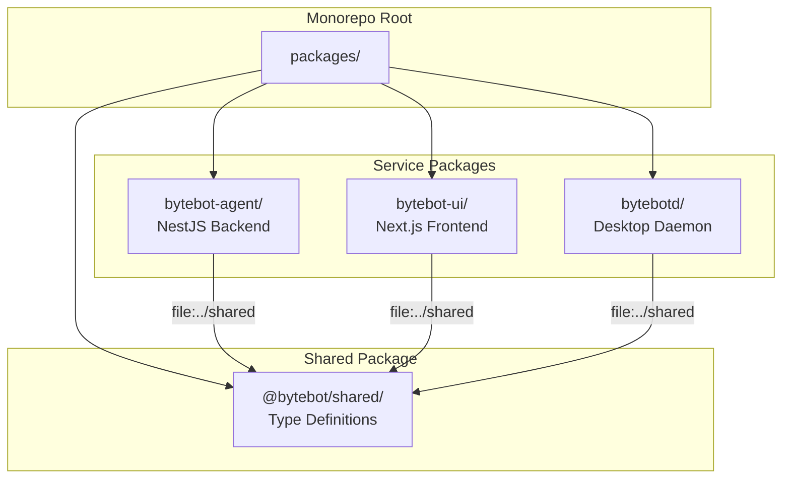
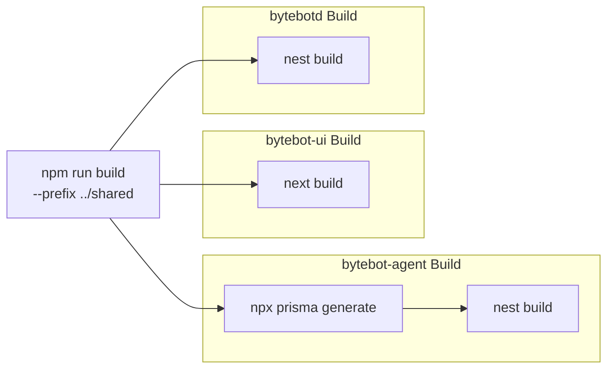
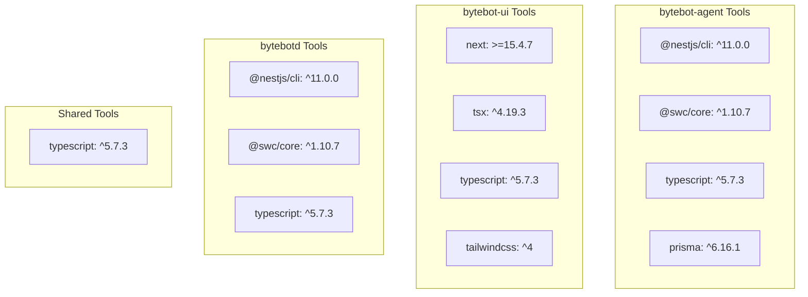
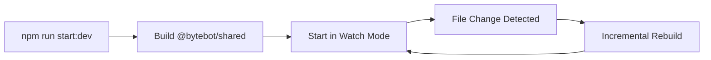
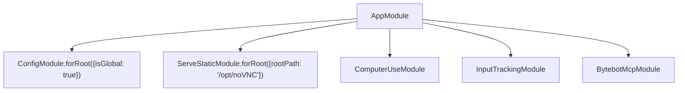
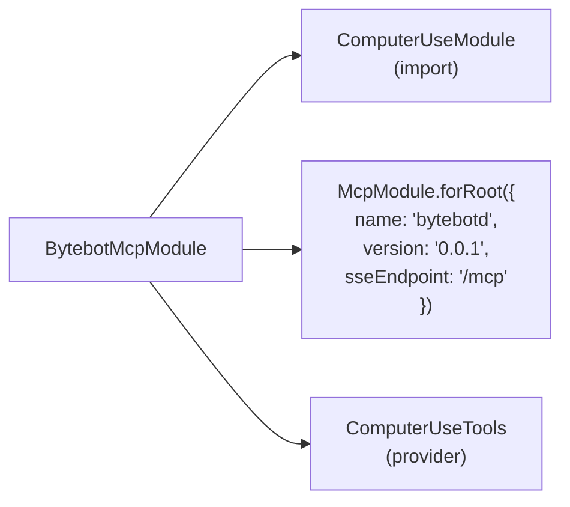
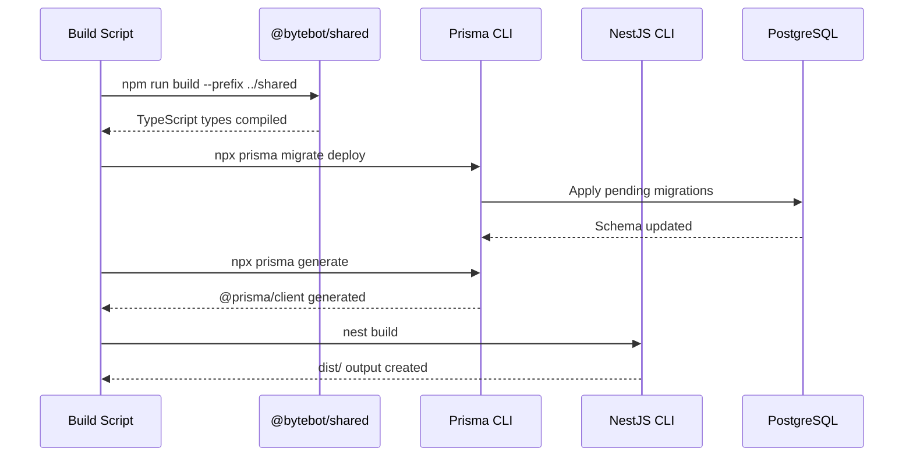
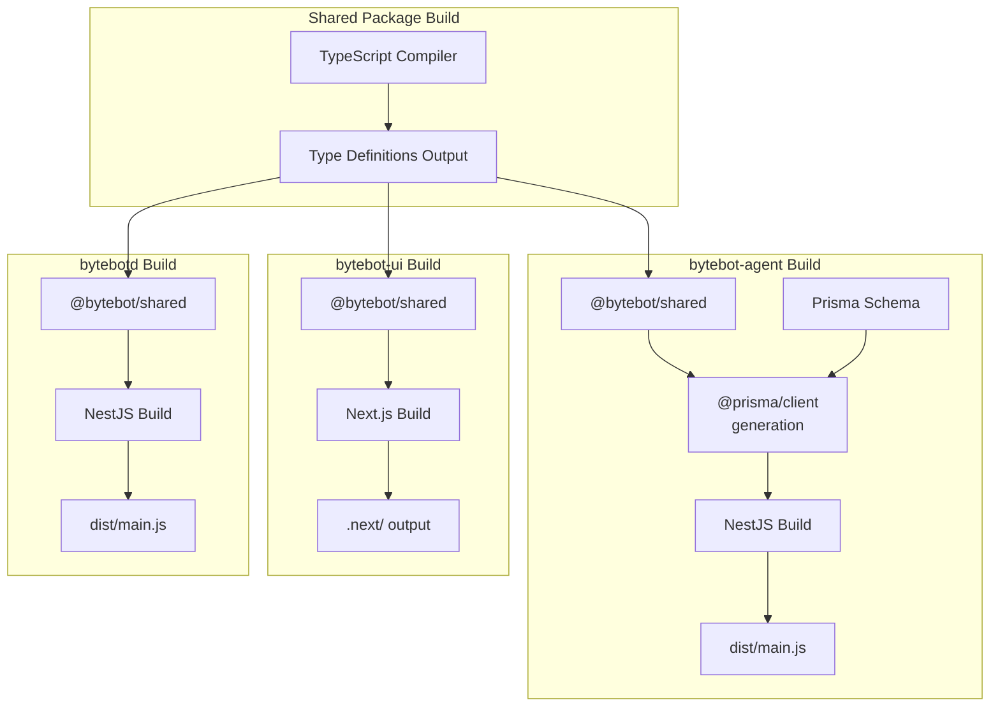

<!-- source: DeepWiki mcp.deepwiki.com · repo bytebot-ai/bytebot · page 11.1 Build System · fetched 2026-10-29 -->

# Build System

<details>
<summary>Relevant source files</summary>

The following files were used as context for generating this wiki page:

- [packages/bytebot-agent/package-lock.json](packages/bytebot-agent/package-lock.json)
- [packages/bytebot-agent/package.json](packages/bytebot-agent/package.json)
- [packages/bytebot-agent/src/agent/agent.module.ts](packages/bytebot-agent/src/agent/agent.module.ts)
- [packages/bytebot-agent/src/app.module.ts](packages/bytebot-agent/src/app.module.ts)
- [packages/bytebot-ui/package-lock.json](packages/bytebot-ui/package-lock.json)
- [packages/bytebot-ui/package.json](packages/bytebot-ui/package.json)
- [packages/bytebot-ui/src/app/layout.tsx](packages/bytebot-ui/src/app/layout.tsx)
- [packages/bytebot-ui/src/components/layout/Header.tsx](packages/bytebot-ui/src/components/layout/Header.tsx)
- [packages/bytebotd/package-lock.json](packages/bytebotd/package-lock.json)
- [packages/bytebotd/package.json](packages/bytebotd/package.json)
- [packages/bytebotd/src/app.controller.ts](packages/bytebotd/src/app.controller.ts)
- [packages/bytebotd/src/app.module.ts](packages/bytebotd/src/app.module.ts)
- [packages/bytebotd/src/mcp/bytebot-mcp.module.ts](packages/bytebotd/src/mcp/bytebot-mcp.module.ts)
- [packages/bytebotd/src/mcp/index.ts](packages/bytebotd/src/mcp/index.ts)

</details>


This document describes the build process, package dependencies, compilation workflow, and development scripts for the Bytebot codebase. For information about module organization within individual services, see [Module Architecture](#11.2).

## Overview

Bytebot uses a **monorepo structure** with three independently buildable services that share a common type library. The build system is based on npm workspaces, with each package managing its own compilation through specialized build tools (NestJS CLI, Next.js, TypeScript compiler). A critical aspect of the build workflow is the **build order dependency** on the shared package, which must be compiled before any service can build.

## Repository Structure



**Sources:** [packages/bytebot-agent/package.json:1-100](), [packages/bytebot-ui/package.json:1-64](), [packages/bytebotd/package.json:1-93]()

### Package Dependencies

Each service package declares `@bytebot/shared` as a dependency using local file references:

| Package | Dependency Declaration |
|---------|----------------------|
| bytebot-agent | `"@bytebot/shared": "../shared"` |
| bytebot-ui | `"@bytebot/shared": "../shared"` |
| bytebotd | `"@bytebot/shared": "file:../shared"` |

This creates a build-time dependency where changes to shared types require rebuilding all consuming packages.

**Sources:** [packages/bytebot-agent/package.json:26](), [packages/bytebot-ui/package.json:13](), [packages/bytebotd/package.json:12]()

## Build Scripts and Workflow

### Build Order Dependency Chain

All service build scripts follow a consistent pattern: **shared package must build first**. This is enforced through script prefixes:

```
npm run build --prefix ../shared && <service-specific-build>
```



**Sources:** [packages/bytebot-agent/package.json:11-16](), [packages/bytebot-ui/package.json:6-8](), [packages/bytebotd/package.json:15-20]()

### bytebot-agent Build Process

The backend service has the most complex build pipeline due to Prisma database schema generation:

| Script | Command | Purpose |
|--------|---------|---------|
| `build` | `npm run build --prefix ../shared && npx prisma generate && nest build` | Production build with Prisma client generation |
| `start` | `npm run build --prefix ../shared && nest start` | Start compiled server |
| `start:dev` | `npm run build --prefix ../shared && nest start --watch` | Development mode with hot reload |
| `start:prod` | `npm run build --prefix ../shared && npx prisma migrate deploy && npx prisma generate && node dist/main` | Production start with migrations |

The production start script includes **database migration execution** (`prisma migrate deploy`) before starting the server, ensuring the database schema is current.

**Sources:** [packages/bytebot-agent/package.json:8-23]()

### bytebot-ui Build Process

The frontend uses a custom Express server (instead of Next.js standalone mode) for API proxying:

| Script | Command | Purpose |
|--------|---------|---------|
| `dev` | `npm run build --prefix ../shared && tsx server.ts` | Development mode using tsx runtime |
| `build` | `npm run build --prefix ../shared && next build` | Production build |
| `start` | `npm run build --prefix ../shared && tsx server.ts` | Production start (runs custom Express server) |

The `tsx` runtime is used instead of `next start` because the service implements a **custom Express server** for request proxying to bytebot-agent and bytebotd services.

**Sources:** [packages/bytebot-ui/package.json:5-9]()

### bytebotd Build Process

The desktop daemon follows a simpler NestJS build pattern:

| Script | Command | Purpose |
|--------|---------|---------|
| `build` | `npm run build --prefix ../shared && nest build` | Production build |
| `start:dev` | `npm run build --prefix ../shared && nest start --watch` | Development with hot reload |
| `start:prod` | `npm run build --prefix ../shared && node dist/main` | Production start |
| `compile` | `tsc` | TypeScript compilation only (no NestJS CLI) |

**Sources:** [packages/bytebotd/package.json:13-26]()

## Build Tool Stack

### Compilation Tools by Package



**Sources:** [packages/bytebot-agent/package.json:47-73](), [packages/bytebot-ui/package.json:49-62](), [packages/bytebotd/package.json:48-73]()

### Key Build Dependencies

**NestJS Services (bytebot-agent, bytebotd):**
- `@nestjs/cli` - Framework CLI for building and scaffolding
- `@swc/core` - Fast TypeScript/JavaScript compiler (used by NestJS)
- `ts-loader` - TypeScript loader for Webpack
- `tsconfig-paths` - Path mapping support for TypeScript

**Frontend (bytebot-ui):**
- `next` - React framework with built-in build pipeline
- `tsx` - TypeScript execution engine for custom server
- `@tailwindcss/postcss` - CSS processing and optimization

**All Packages:**
- `typescript: ^5.7.3` - Unified TypeScript version across monorepo
- `prettier` - Code formatting
- `eslint` - Code linting

**Sources:** [packages/bytebot-agent/package-lock.json:47-73](), [packages/bytebot-ui/package.json:49-62](), [packages/bytebotd/package.json:48-73]()

## Development Workflow

### Local Development Scripts

Each package provides watch mode for development:



**Watch Mode Commands:**

| Service | Command | Mechanism |
|---------|---------|-----------|
| bytebot-agent | `nest start --watch` | NestJS CLI with incremental compilation |
| bytebot-ui | `tsx server.ts` (with Next.js dev mode) | Next.js Fast Refresh + tsx runtime |
| bytebotd | `nest start --watch` | NestJS CLI with incremental compilation |

**Sources:** [packages/bytebot-agent/package.json:14](), [packages/bytebot-ui/package.json:6](), [packages/bytebotd/package.json:18]()

### Debug Mode Support

Debug scripts attach Node.js inspector for debugging:

```bash
# bytebot-agent debug mode
npm run start:debug
# → nest start --debug --watch
```

This enables debugging in IDEs like VS Code by exposing the Node.js debug port (default 9229).

**Sources:** [packages/bytebot-agent/package.json:15](), [packages/bytebotd/package.json:19]()

## Module System and TypeScript Configuration

### Module Resolution

The codebase uses **path aliases** to simplify imports. For example, in bytebot-agent:

```typescript
import { AgentProcessor } from './agent/agent.processor';
import { TasksModule } from '../tasks/tasks.module';
import { SummariesModule } from 'src/summaries/summaries.modue';
```

The `src/` prefix is configured via `tsconfig-paths` and TypeScript's `baseUrl` setting, allowing absolute imports within each package.

**Sources:** [packages/bytebot-agent/src/agent/agent.module.ts:1-34](), [packages/bytebotd/src/app.module.ts:1-26]()

### NestJS Module Architecture

Both backend services (bytebot-agent, bytebotd) use NestJS's module system with decorators:

**bytebot-agent App Module Structure:**

```mermaid
graph TB
    AppModule["AppModule"]
    
    ScheduleModule["ScheduleModule.forRoot()"]
    EventEmitterModule["EventEmitterModule.forRoot()"]
    ConfigModule["ConfigModule.forRoot({isGlobal: true})"]
    
    AgentModule["AgentModule"]
    TasksModule["TasksModule"]
    MessagesModule["MessagesModule"]
    SummariesModule["SummariesModule"]
    AnthropicModule["AnthropicModule"]
    OpenAIModule["OpenAIModule"]
    GoogleModule["GoogleModule"]
    ProxyModule["ProxyModule"]
    PrismaModule["PrismaModule"]
    
    AppModule --> ScheduleModule
    AppModule --> EventEmitterModule
    AppModule --> ConfigModule
    AppModule --> AgentModule
    AppModule --> TasksModule
    AppModule --> MessagesModule
    AppModule --> SummariesModule
    AppModule --> AnthropicModule
    AppModule --> OpenAIModule
    AppModule --> GoogleModule
    AppModule --> ProxyModule
    AppModule --> PrismaModule
```



**Sources:** [packages/bytebot-agent/src/app.module.ts:1-38]()

**bytebotd App Module Structure:**



**Sources:** [packages/bytebotd/src/app.module.ts:1-27]()

### MCP Module Initialization

The bytebotd service includes MCP (Model Context Protocol) integration:



This configures the SSE endpoint at `/mcp` for MCP client connections.

**Sources:** [packages/bytebotd/src/mcp/bytebot-mcp.module.ts:1-18]()

## Database Schema Management

### Prisma Build Integration

The bytebot-agent service uses Prisma for database schema management, which adds extra build steps:

**Development Workflow:**
```bash
npm run prisma:dev
# → npx prisma migrate dev && npx prisma generate
```

**Production Workflow:**
```bash
npm run prisma:prod
# → npx prisma migrate deploy && npx prisma generate
```

The `prisma generate` command creates the Prisma Client TypeScript definitions based on the schema, which must be regenerated whenever the schema changes.

**Sources:** [packages/bytebot-agent/package.json:9-10]()

### Production Build Sequence



**Sources:** [packages/bytebot-agent/package.json:16]()

## Testing Infrastructure

### Test Scripts

All packages include Jest-based testing:

| Script | Purpose | Configuration |
|--------|---------|---------------|
| `test` | Run all tests once | `jest` |
| `test:watch` | Run tests in watch mode | `jest --watch` |
| `test:cov` | Generate coverage reports | `jest --coverage` |
| `test:debug` | Debug tests with inspector | `node --inspect-brk ... jest --runInBand` |
| `test:e2e` | End-to-end tests | `jest --config ./test/jest-e2e.json` |

**Jest Configuration** (embedded in package.json):

```javascript
{
  "moduleFileExtensions": ["js", "json", "ts"],
  "rootDir": "src",
  "testRegex": ".*\\.spec\\.ts$",
  "transform": {
    "^.+\\.(t|j)s$": "ts-jest"
  },
  "collectCoverageFrom": ["**/*.(t|j)s"],
  "coverageDirectory": "../coverage",
  "testEnvironment": "node"
}
```

**Sources:** [packages/bytebot-agent/package.json:18-22, 75-91](), [packages/bytebotd/package.json:22-26, 75-91]()

## Linting and Formatting

### Code Quality Tools

All packages use consistent linting and formatting:

**ESLint Configuration:**
- `@eslint/eslintrc` for configuration
- `eslint-config-prettier` to disable conflicting rules
- `eslint-plugin-prettier` to run Prettier as ESLint rule
- `typescript-eslint` for TypeScript-specific rules

**Format Script:**
```bash
npm run format
# → prettier --write "src/**/*.ts" "test/**/*.ts"
```

**Lint Script:**
```bash
npm run lint
# → eslint "{src,apps,libs,test}/**/*.ts" --fix
```

**Sources:** [packages/bytebot-agent/package.json:12, 17, 47-73](), [packages/bytebotd/package.json:14, 21, 48-73]()

## Deployment Build Artifacts

### Production Build Outputs

Each service produces different artifacts:

| Service | Output Directory | Entry Point | Type |
|---------|-----------------|-------------|------|
| bytebot-agent | `dist/` | `dist/main.js` | NestJS compiled output |
| bytebot-ui | `.next/` | `server.ts` (via tsx) | Next.js optimized build + custom server |
| bytebotd | `dist/` | `dist/main.js` | NestJS compiled output |

**Production Start Commands:**

```bash
# bytebot-agent
node dist/main

# bytebot-ui  
tsx server.ts

# bytebotd
node dist/main
```

**Sources:** [packages/bytebot-agent/package.json:16](), [packages/bytebot-ui/package.json:8](), [packages/bytebotd/package.json:20]()

### Docker Build Considerations

While Docker configuration files are not shown in the provided sources, the production scripts indicate the services are designed to run in containerized environments:

- Database migrations run automatically in `start:prod`
- Environment configuration via `ConfigModule.forRoot({isGlobal: true})`
- Static asset serving configured for noVNC in bytebotd

**Sources:** [packages/bytebot-agent/src/app.module.ts:21-23](), [packages/bytebotd/src/app.module.ts:12-18]()

## Build System Dependencies Graph



**Sources:** All package.json files across the repository

---

