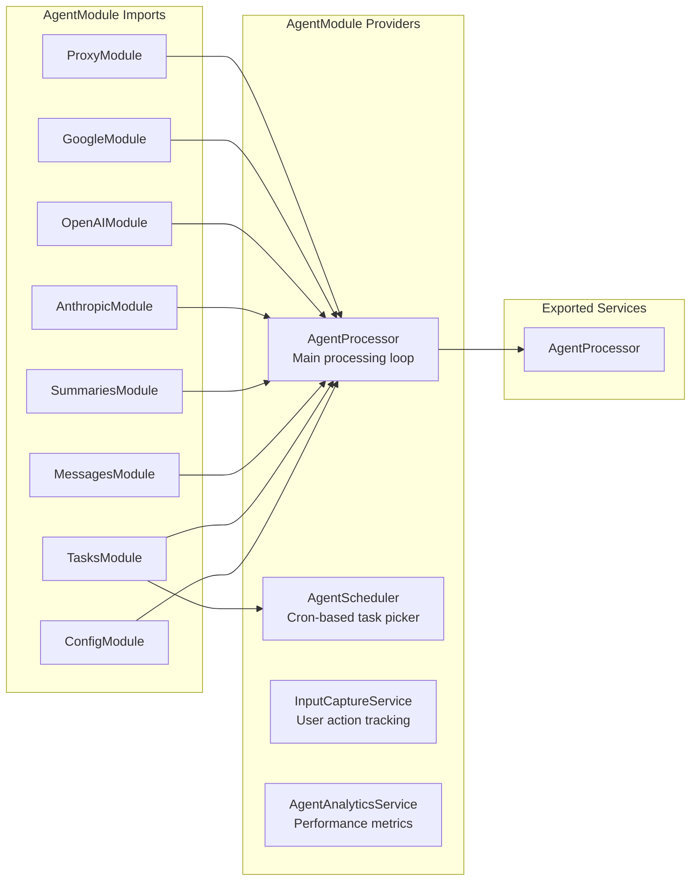
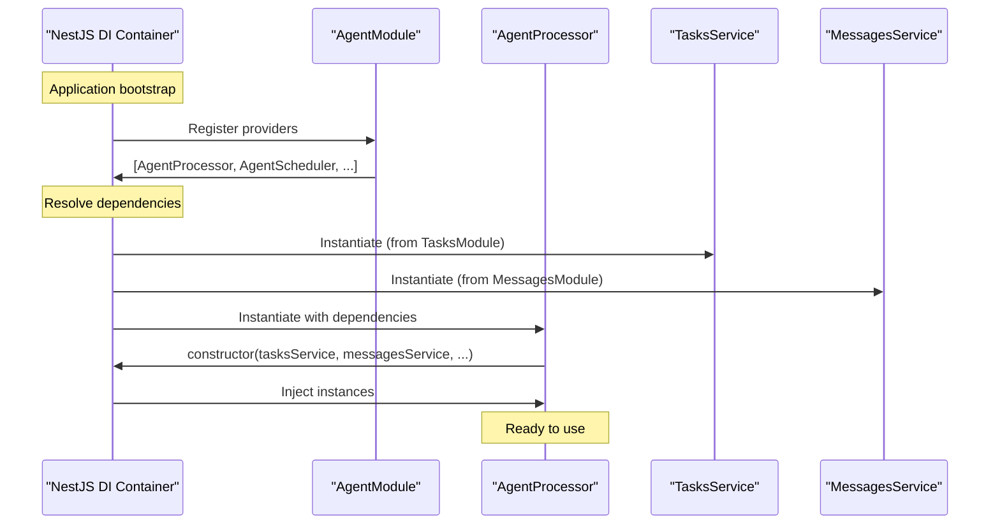
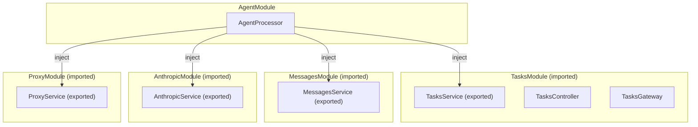
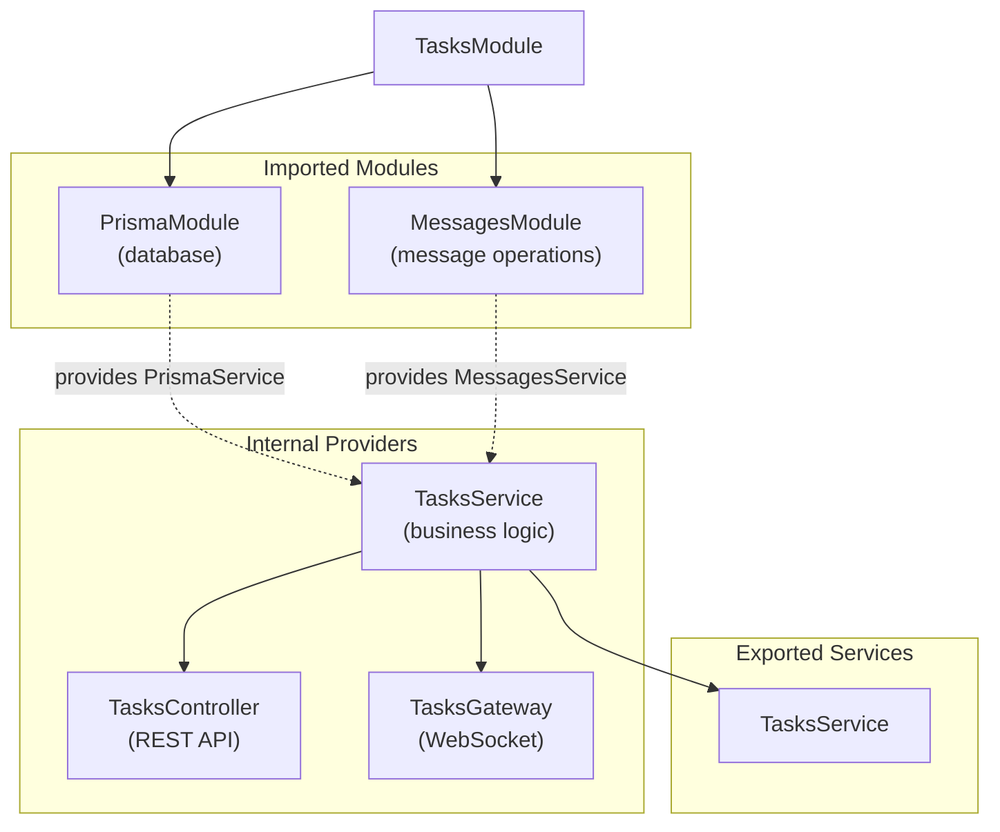
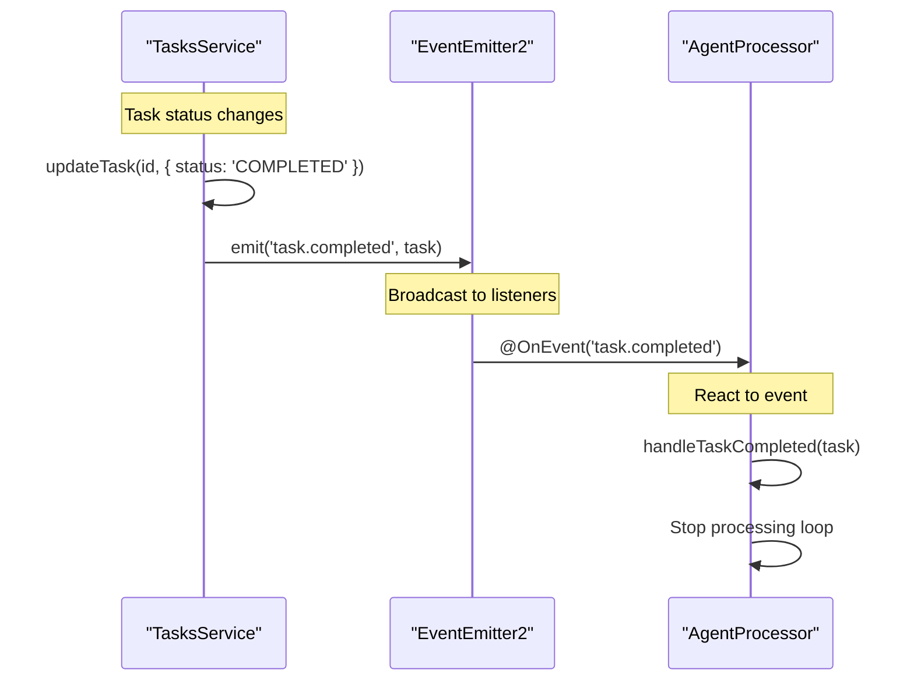
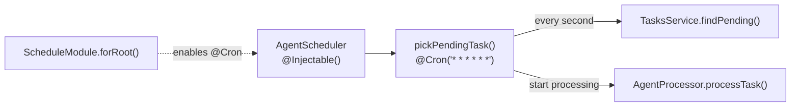

<!-- source: DeepWiki mcp.deepwiki.com · repo bytebot-ai/bytebot · page 11.2 Module Architecture · fetched 2026-10-29 -->

# Module Architecture

<details>
<summary>Relevant source files</summary>

The following files were used as context for generating this wiki page:

- [packages/bytebot-agent/package-lock.json](packages/bytebot-agent/package-lock.json)
- [packages/bytebot-agent/package.json](packages/bytebot-agent/package.json)
- [packages/bytebot-agent/src/agent/agent.module.ts](packages/bytebot-agent/src/agent/agent.module.ts)
- [packages/bytebot-agent/src/app.module.ts](packages/bytebot-agent/src/app.module.ts)

</details>


This document details the NestJS module structure used in both `bytebot-agent` and `bytebotd` services. It explains how modules organize services through dependency injection, how cross-module dependencies are managed, and the patterns used to maintain clean separation of concerns.

For information about the build system and package structure, see [Build System](#11.1). For details on validation systems used within modules, see [Testing and Validation](#11.3).

---

## Overview

Both `bytebot-agent` and `bytebotd` services use the NestJS framework, which organizes code into modules that encapsulate related functionality. Each module declares its providers (services), controllers (HTTP endpoints or gateways), imports (dependencies on other modules), and exports (services made available to other modules).

The module system provides:
- **Dependency Injection**: Automatic instantiation and injection of service dependencies
- **Encapsulation**: Clear boundaries between feature domains
- **Testability**: Easy mocking of dependencies for unit testing
- **Modularity**: Reusable, self-contained feature modules

---

## Root Module Structure

### AppModule: bytebot-agent

The root application module coordinates all feature modules and configures global infrastructure.

```mermaid
graph TB
    AppModule["AppModule<br/>(app.module.ts)"]
    
    subgraph "Global Infrastructure"
        ScheduleModule["ScheduleModule.forRoot()<br/>Cron scheduling"]
        EventEmitterModule["EventEmitterModule.forRoot()<br/>Internal events"]
        ConfigModule["ConfigModule.forRoot()<br/>Environment config"]
    end
    
    subgraph "Core Feature Modules"
        TasksModule["TasksModule<br/>Task CRUD + WebSocket"]
        MessagesModule["MessagesModule<br/>Message storage"]
        SummariesModule["SummariesModule<br/>Context compression"]
        AgentModule["AgentModule<br/>Agent processing"]
    end
    
    subgraph "LLM Provider Modules"
        AnthropicModule["AnthropicModule<br/>Claude integration"]
        OpenAIModule["OpenAIModule<br/>GPT integration"]
        GoogleModule["GoogleModule<br/>Gemini integration"]
    end
    
    subgraph "Infrastructure Modules"
        PrismaModule["PrismaModule<br/>Database client"]
        ProxyModule["ProxyModule<br/>bytebotd proxy"]
    end
    
    AppModule --> ScheduleModule
    AppModule --> EventEmitterModule
    AppModule --> ConfigModule
    AppModule --> TasksModule
    AppModule --> MessagesModule
    AppModule --> SummariesModule
    AppModule --> AgentModule
    AppModule --> AnthropicModule
    AppModule --> OpenAIModule
    AppModule --> GoogleModule
    AppModule --> PrismaModule
    AppModule --> ProxyModule
```



**Sources:** [packages/bytebot-agent/src/app.module.ts:1-38]()

---

## Module Organization Patterns

### Feature Module Structure

Each feature module follows a consistent directory structure:

```
<feature>/
├── <feature>.module.ts       # Module definition
├── <feature>.service.ts      # Business logic
├── <feature>.controller.ts   # HTTP endpoints (if applicable)
├── <feature>.gateway.ts      # WebSocket gateway (if applicable)
├── dto/                      # Data transfer objects
│   ├── create-<feature>.dto.ts
│   └── update-<feature>.dto.ts
└── entities/                 # Database entities (if applicable)
    └── <feature>.entity.ts
```

### Module Types

| Module Type | Purpose | Examples | Global? |
|-------------|---------|----------|---------|
| **Infrastructure** | Provides low-level services to all modules | `PrismaModule`, `ConfigModule` | Yes |
| **Feature** | Implements specific business domain | `TasksModule`, `MessagesModule`, `AgentModule` | No |
| **Provider** | Integrates external services | `AnthropicModule`, `OpenAIModule`, `GoogleModule` | No |
| **Utility** | Cross-cutting concerns | `ScheduleModule`, `EventEmitterModule` | Yes |
| **Proxy** | External API clients | `ProxyModule` | No |

**Sources:** [packages/bytebot-agent/src/app.module.ts:1-38]()

---

## AgentModule: Detailed Example

The `AgentModule` demonstrates typical NestJS module patterns including imports, providers, and exports.

### Module Definition



**Module Declaration:**

The module imports eight dependencies and declares four providers. Only `AgentProcessor` is exported for use by other modules.

**Sources:** [packages/bytebot-agent/src/agent/agent.module.ts:1-35]()

---

## Dependency Injection Flow

### Provider Registration and Injection

NestJS uses the `@Injectable()` decorator to mark classes as providers that can be injected. Dependencies are declared in the constructor.



### Service Scope

| Scope | Lifetime | Use Case | Example |
|-------|----------|----------|---------|
| **Singleton** (default) | Application lifetime | Stateless services, shared resources | `TasksService`, `PrismaService` |
| **Request** | Per HTTP request | Request-specific context | Authentication guards |
| **Transient** | New instance per injection | Independent state per consumer | Rare in this codebase |

All services in `bytebot-agent` use singleton scope for performance and simplicity.

**Sources:** [packages/bytebot-agent/src/agent/agent.module.ts:1-35]()

---

## Cross-Module Communication

### Import Chains

Modules access services from other modules by importing them. The imported module must export the required service.



**Pattern:**
1. `TasksModule` exports `TasksService` in its `exports` array
2. `AgentModule` imports `TasksModule` in its `imports` array
3. `AgentProcessor` declares `TasksService` as a constructor parameter
4. NestJS injects the `TasksService` instance from `TasksModule`

**Sources:** [packages/bytebot-agent/src/agent/agent.module.ts:15-34]()

---

## Global Modules

### Infrastructure Modules

Certain modules are configured as global to avoid repeated imports across every feature module.

| Module | Configuration | Purpose |
|--------|---------------|---------|
| `ConfigModule` | `ConfigModule.forRoot({ isGlobal: true })` | Environment variables accessible everywhere |
| `ScheduleModule` | `ScheduleModule.forRoot()` | Enables `@Cron()` decorators in any module |
| `EventEmitterModule` | `EventEmitterModule.forRoot()` | Event bus for inter-service communication |
| `PrismaModule` | Custom global module | Database client available to all modules |

**ConfigModule Example:**

```typescript
// In app.module.ts
ConfigModule.forRoot({
  isGlobal: true,  // Makes ConfigService available everywhere
})

// In any service
constructor(private configService: ConfigService) {
  const apiKey = this.configService.get<string>('ANTHROPIC_API_KEY');
}
```

**Sources:** [packages/bytebot-agent/src/app.module.ts:21-23]()

---

## Module Dependencies in Practice

### TasksModule Dependencies



**Key Points:**
- `TasksModule` imports `PrismaModule` to access `PrismaService` for database queries
- `TasksModule` imports `MessagesModule` to create messages when tasks are updated
- `TasksService` is both used internally (by `TasksController` and `TasksGateway`) and exported for external modules
- Controller and Gateway are providers but not exported (only for internal HTTP/WebSocket handling)

**Sources:** Referenced from module pattern visible in [packages/bytebot-agent/src/app.module.ts:1-38]()

---

## Provider Lifecycle and Events

### EventEmitter Integration

The `EventEmitterModule` enables services to emit and listen for events without direct coupling.



**Event Listener Declaration:**

Services use the `@OnEvent()` decorator to subscribe to events:

```typescript
@Injectable()
export class AgentProcessor {
  @OnEvent('task.completed')
  handleTaskCompleted(task: Task) {
    // React to task completion
  }
}
```

**Sources:** Pattern referenced from [packages/bytebot-agent/src/app.module.ts:13]() (EventEmitterModule import)

---

## Scheduled Tasks with Cron

### AgentScheduler Pattern

The `@nestjs/schedule` module enables cron-based task scheduling within any module.



**Cron Decorator Usage:**

```typescript
@Injectable()
export class AgentScheduler {
  @Cron('* * * * * *')  // Every second
  async pickPendingTask() {
    const task = await this.tasksService.findPending();
    if (task) await this.agentProcessor.processTask(task.id);
  }
}
```

**Sources:** [packages/bytebot-agent/src/app.module.ts:19](), [packages/bytebot-agent/src/agent/agent.module.ts:28]()

---

## Module Testing Strategy

### Dependency Mocking

NestJS testing utilities allow replacing real services with mocks:

```typescript
const module: TestingModule = await Test.createTestingModule({
  providers: [
    AgentProcessor,
    {
      provide: TasksService,
      useValue: mockTasksService,  // Mock implementation
    },
    {
      provide: MessagesService,
      useValue: mockMessagesService,
    },
  ],
}).compile();

const processor = module.get<AgentProcessor>(AgentProcessor);
```

**Benefits:**
- Test services in isolation
- Control dependency behavior
- Fast unit tests without database/network

**Sources:** Standard NestJS testing pattern used throughout the codebase

---

## Package Dependencies

### Core NestJS Packages

The following packages enable the module system:

| Package | Version | Purpose |
|---------|---------|---------|
| `@nestjs/common` | ^11.0.1 | Core decorators (`@Module`, `@Injectable`, `@Controller`) |
| `@nestjs/core` | ^11.0.1 | Dependency injection container |
| `@nestjs/platform-express` | ^11.1.5 | HTTP server (Express adapter) |
| `@nestjs/platform-socket.io` | ^11.1.1 | WebSocket server (Socket.IO adapter) |
| `@nestjs/websockets` | ^11.1.1 | WebSocket gateway decorators |
| `@nestjs/config` | ^4.0.2 | Environment configuration module |
| `@nestjs/schedule` | ^6.0.0 | Cron scheduling |
| `@nestjs/event-emitter` | ^3.0.1 | Event-driven communication |

**Sources:** [packages/bytebot-agent/package.json:24-36]()

---

## Module Best Practices

### Guidelines Followed in bytebot-agent

1. **Single Responsibility**: Each module encapsulates one domain (Tasks, Messages, Agent, etc.)
2. **Explicit Exports**: Only export services needed by other modules
3. **Import Order**: Global modules → Infrastructure → Feature → Provider modules
4. **Circular Dependencies**: Avoided through careful import design (e.g., TasksModule doesn't import AgentModule)
5. **Service Naming**: `<Domain>Service` for business logic, `<Domain>Controller` for HTTP, `<Domain>Gateway` for WebSocket
6. **Global Sparingly**: Only configuration and infrastructure are global

**Anti-Pattern Example (avoided):**
```typescript
// BAD: Circular dependency
// TasksModule imports AgentModule
// AgentModule imports TasksModule
// Solution: Use EventEmitter for decoupling
```

**Sources:** Pattern observed across [packages/bytebot-agent/src/app.module.ts:1-38]() and [packages/bytebot-agent/src/agent/agent.module.ts:1-35]()

---

## Summary

The NestJS module architecture in bytebot-agent provides:

- **Clear Boundaries**: Each module owns a specific domain
- **Dependency Injection**: Automatic instantiation and wiring
- **Event-Driven**: Decoupled communication via EventEmitter
- **Scheduled Tasks**: Cron-based background jobs
- **Global Configuration**: Environment variables accessible everywhere
- **Testability**: Easy mocking for unit tests

This architecture scales well as new features are added, maintaining clean separation of concerns and explicit dependencies between modules.

**Sources:** [packages/bytebot-agent/src/app.module.ts:1-38](), [packages/bytebot-agent/src/agent/agent.module.ts:1-35](), [packages/bytebot-agent/package.json:1-101]()

---

