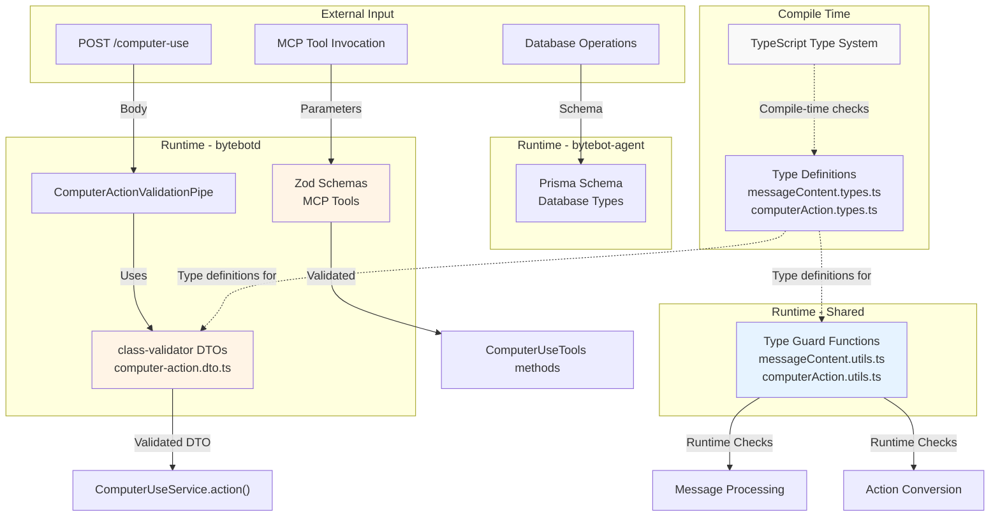
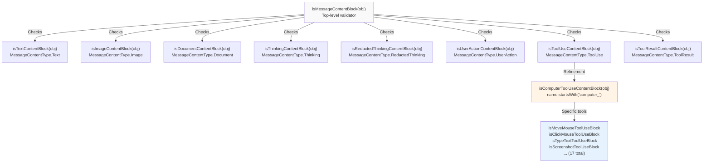
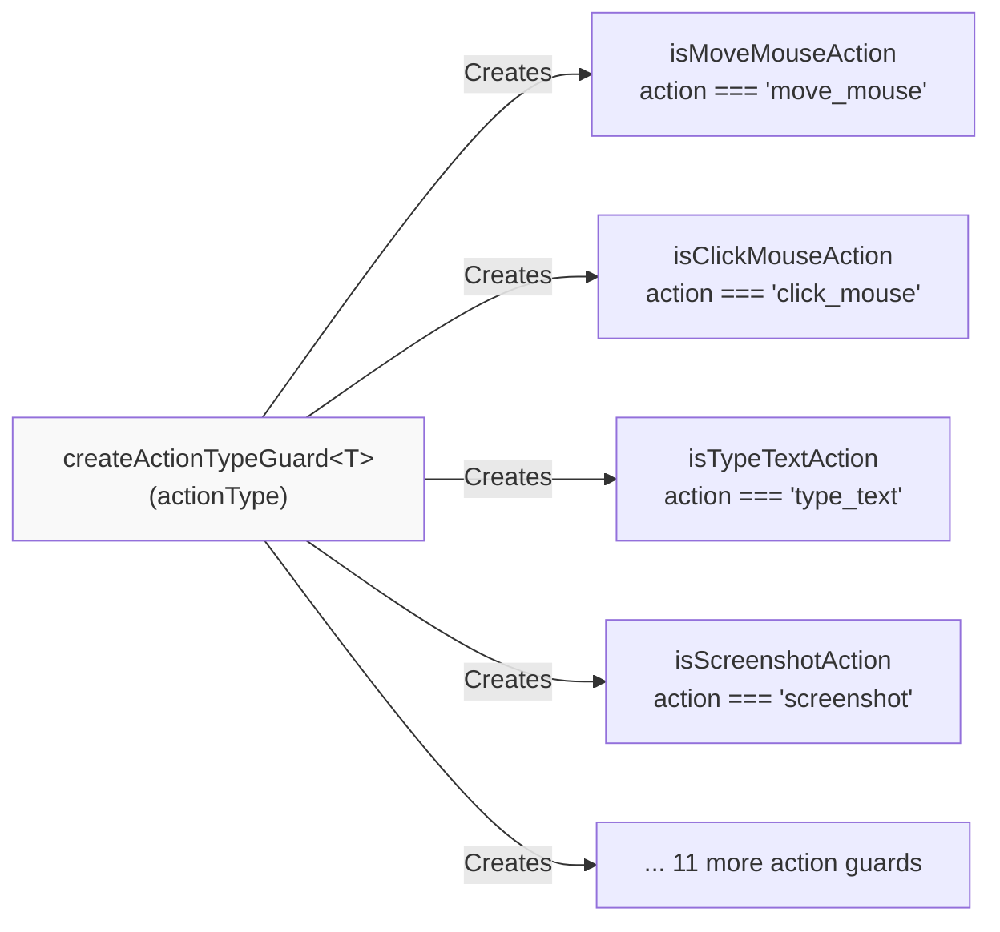
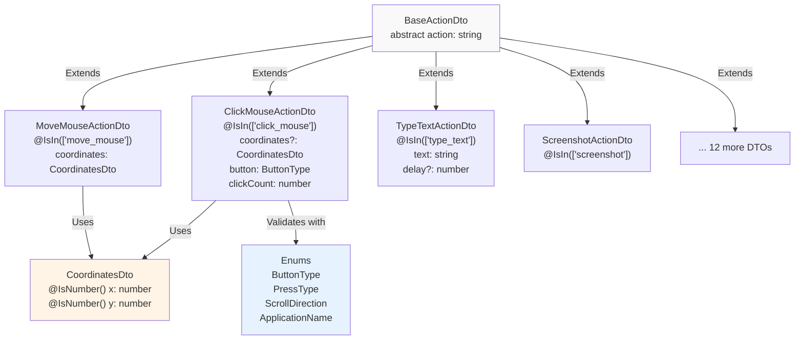
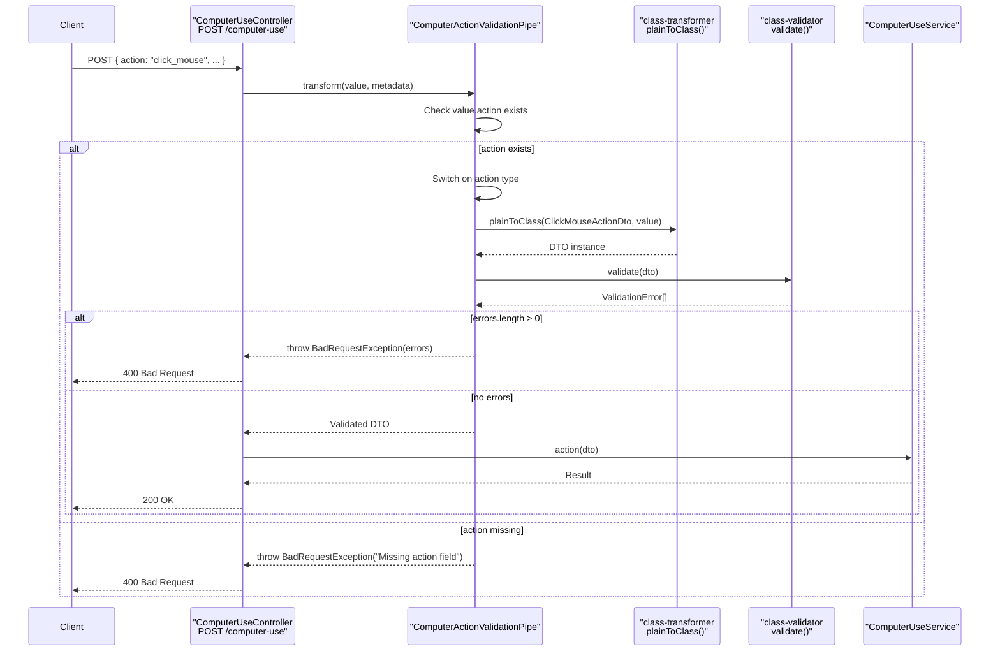
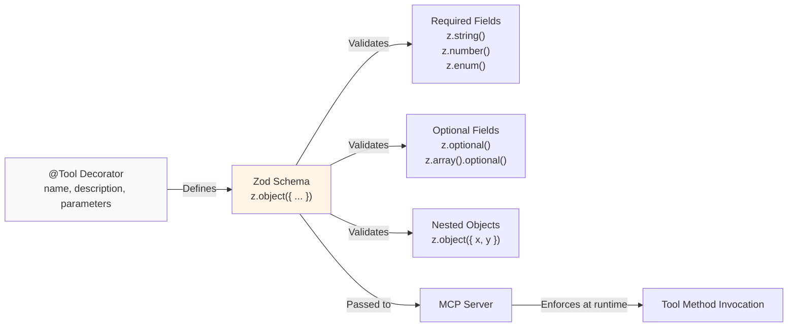
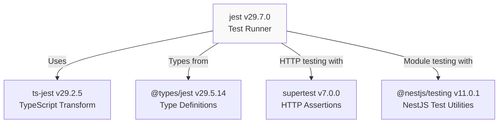
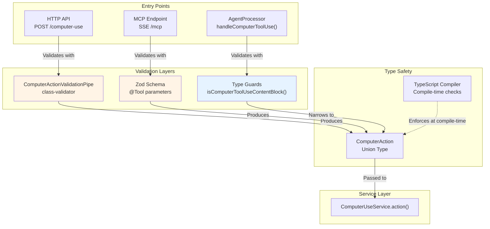
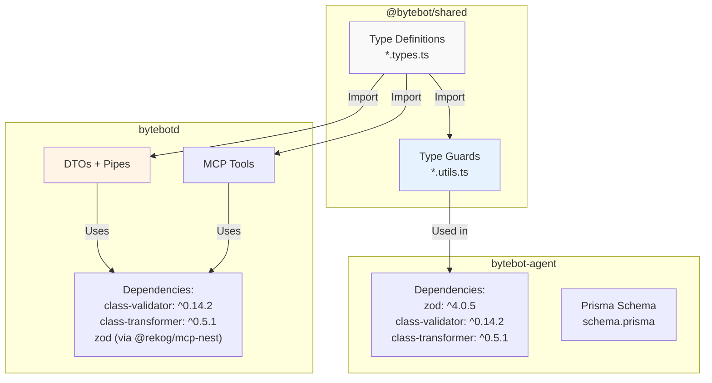

<!-- source: DeepWiki mcp.deepwiki.com · repo bytebot-ai/bytebot · page 11.3 Testing and Validation · fetched 2026-10-29 -->

# Testing and Validation

<details>
<summary>Relevant source files</summary>

The following files were used as context for generating this wiki page:

- [packages/bytebot-agent/package-lock.json](packages/bytebot-agent/package-lock.json)
- [packages/bytebot-agent/package.json](packages/bytebot-agent/package.json)
- [packages/bytebot-agent/src/agent/agent.module.ts](packages/bytebot-agent/src/agent/agent.module.ts)
- [packages/bytebot-agent/src/app.module.ts](packages/bytebot-agent/src/app.module.ts)
- [packages/bytebotd/src/computer-use/computer-use.service.ts](packages/bytebotd/src/computer-use/computer-use.service.ts)
- [packages/bytebotd/src/computer-use/dto/base.dto.ts](packages/bytebotd/src/computer-use/dto/base.dto.ts)
- [packages/bytebotd/src/computer-use/dto/computer-action-validation.pipe.ts](packages/bytebotd/src/computer-use/dto/computer-action-validation.pipe.ts)
- [packages/bytebotd/src/computer-use/dto/computer-action.dto.ts](packages/bytebotd/src/computer-use/dto/computer-action.dto.ts)
- [packages/bytebotd/src/mcp/computer-use.tools.ts](packages/bytebotd/src/mcp/computer-use.tools.ts)
- [packages/shared/src/types/computerAction.types.ts](packages/shared/src/types/computerAction.types.ts)
- [packages/shared/src/types/messageContent.types.ts](packages/shared/src/types/messageContent.types.ts)
- [packages/shared/src/utils/computerAction.utils.ts](packages/shared/src/utils/computerAction.utils.ts)
- [packages/shared/src/utils/messageContent.utils.ts](packages/shared/src/utils/messageContent.utils.ts)

</details>


This document describes the validation and testing systems used in Bytebot. The codebase employs a multi-layered validation strategy combining compile-time type checking (TypeScript), runtime validation (class-validator, Zod), and type guards for safe type narrowing. For information about the overall type system architecture, see [Type System Overview](#9.1).

## Validation Architecture Overview

Bytebot uses three complementary validation approaches to ensure data integrity across service boundaries and throughout the application lifecycle:



**Sources:** [packages/bytebotd/src/computer-use/dto/computer-action-validation.pipe.ts:1-97](), [packages/bytebotd/src/mcp/computer-use.tools.ts:1-699](), [packages/shared/src/utils/messageContent.utils.ts:1-516](), [packages/shared/src/utils/computerAction.utils.ts:1-343]()

## Type Guard System

The `@bytebot/shared` package provides comprehensive type guards for runtime type checking. These functions safely narrow TypeScript types and enable pattern matching across message content and computer actions.

### Message Content Type Guards

Type guards for message content blocks follow a consistent pattern and are organized into a hierarchy:



Each type guard validates the discriminator field (`type`) and required properties. For example:

**Text Content Block Validation:**
```typescript
// From messageContent.utils.ts:38-47
function isTextContentBlock(obj: unknown): obj is TextContentBlock {
  const block = obj as Partial<TextContentBlock>;
  return (
    block.type === MessageContentType.Text && 
    typeof block.text === "string"
  );
}
```

**Tool Use Content Block Validation:**
```typescript
// From messageContent.utils.ts:139-154
function isToolUseContentBlock(obj: unknown): obj is ToolUseContentBlock {
  const block = obj as Partial<ToolUseContentBlock>;
  return (
    block.type === MessageContentType.ToolUse &&
    typeof block.name === "string" &&
    typeof block.id === "string" &&
    block.input !== undefined &&
    typeof block.input === "object"
  );
}
```

**Sources:** [packages/shared/src/utils/messageContent.utils.ts:33-208]()

### Computer Action Type Guards

The `computerAction.utils.ts` module provides type guards using a factory pattern for consistency:



The factory function ensures consistent validation logic:

```typescript
// From computerAction.utils.ts:28-38
function createActionTypeGuard<T extends ComputerAction>(
  actionType: T["action"]
): (obj: unknown) => obj is T {
  return (obj: unknown): obj is T => {
    if (!obj || typeof obj !== "object") return false;
    const action = obj as Record<string, any>;
    return action.action === actionType;
  };
}
```

**Sources:** [packages/shared/src/utils/computerAction.utils.ts:26-67]()

### Type Guard Usage Patterns

| Pattern | Usage | Example Location |
|---------|-------|------------------|
| **Type Narrowing** | Safely narrow union types in conditional logic | Message processing in agent |
| **Validation** | Verify data structure before processing | Tool result handling |
| **Pattern Matching** | Switch-case discrimination | `convertComputerActionToToolUseBlock` |
| **Debug/Logging** | Identify specific types for logging | `getMessageContentBlockType` |

**Sources:** [packages/shared/src/utils/messageContent.utils.ts:211-261](), [packages/shared/src/utils/computerAction.utils.ts:299-342]()

## Class-Validator DTOs (bytebotd)

The `bytebotd` service uses class-validator for validating incoming computer action requests at the API boundary.

### DTO Structure

DTOs are organized by action type with a common base class:



### Validation Decorators

Each DTO uses class-validator decorators to enforce constraints:

| Decorator | Purpose | Example |
|-----------|---------|---------|
| `@IsIn([value])` | Validates literal action type | `@IsIn(['move_mouse'])` |
| `@IsNumber()` | Ensures numeric value | Coordinate validation |
| `@IsString()` | Ensures string value | Text content |
| `@IsEnum(Enum)` | Validates enum membership | Button types |
| `@IsOptional()` | Marks field as optional | Optional coordinates |
| `@ValidateNested()` | Validates nested objects | CoordinatesDto |
| `@IsArray()` | Ensures array type | Key arrays |
| `@Min(value)` | Minimum numeric value | `clickCount: @Min(1)` |

**Example DTO with Multiple Validators:**
```typescript
// From computer-action.dto.ts:51-71
export class ClickMouseActionDto extends BaseActionDto {
  @IsIn(['click_mouse'])
  action: 'click_mouse';

  @IsOptional()
  @ValidateNested()
  @Type(() => CoordinatesDto)
  coordinates?: CoordinatesDto;

  @IsEnum(ButtonType)
  button: ButtonType;

  @IsOptional()
  @IsArray()
  @IsString({ each: true })
  holdKeys?: string[];

  @IsNumber()
  @Min(1)
  clickCount: number;
}
```

**Sources:** [packages/bytebotd/src/computer-use/dto/computer-action.dto.ts:1-240](), [packages/bytebotd/src/computer-use/dto/base.dto.ts:1-38]()

## Validation Pipes

The `ComputerActionValidationPipe` transforms and validates incoming API requests before they reach the service layer.

### Validation Flow



### Pipe Implementation Pattern

The validation pipe uses a switch statement to map action types to their corresponding DTOs:

```typescript
// From computer-action-validation.pipe.ts:30-95
async transform(value: any, metadata: ArgumentMetadata) {
  if (!value || !value.action) {
    throw new BadRequestException('Missing action field');
  }

  let dto;
  switch (value.action) {
    case 'move_mouse':
      dto = plainToClass(MoveMouseActionDto, value);
      break;
    case 'click_mouse':
      dto = plainToClass(ClickMouseActionDto, value);
      break;
    // ... 13 more cases
    default:
      throw new BadRequestException(`Unknown action: ${value.action}`);
  }

  const errors = await validate(dto);
  if (errors.length > 0) {
    throw new BadRequestException(errors);
  }

  return dto;
}
```

**Sources:** [packages/bytebotd/src/computer-use/dto/computer-action-validation.pipe.ts:28-96]()

## Zod Schema Validation (MCP Tools)

The MCP integration in `bytebotd` uses Zod schemas to validate tool parameters. The `@Tool` decorator accepts a Zod schema that defines parameter structure.

### MCP Tool Schema Pattern



### Example Zod Schema Definitions

**Simple Action (Screenshot):**
```typescript
// From computer-use.tools.ts:549-577
@Tool({
  name: 'computer_screenshot',
  description: 'Captures a screenshot of the current screen.',
})
async screenshot() {
  // No parameters schema needed
}
```

**Complex Action (Click Mouse):**
```typescript
// From computer-use.tools.ts:80-138
@Tool({
  name: 'computer_click_mouse',
  description: 'Performs a mouse click at the specified coordinates or current position.',
  parameters: z.object({
    coordinates: z.object({
      x: z.number().describe('The x-coordinate to move the mouse to.'),
      y: z.number().describe('The y-coordinate to move the mouse to.'),
    }).optional().describe('Optional coordinates for the click.'),
    button: z.enum(['left', 'right', 'middle']).describe('The mouse button to click.'),
    holdKeys: z.array(z.string()).optional().describe('Optional array of keys to hold.'),
    clickCount: z.number().describe('Number of clicks to perform (e.g., 2 for double-click).'),
  }),
})
```

### Zod vs Class-Validator Comparison

| Aspect | Zod (MCP Tools) | class-validator (API DTOs) |
|--------|-----------------|---------------------------|
| **Location** | `bytebotd/mcp/computer-use.tools.ts` | `bytebotd/computer-use/dto/` |
| **Syntax** | Functional, chainable | Decorator-based |
| **Type Inference** | Automatic from schema | Manual TypeScript types |
| **Use Case** | MCP tool parameter validation | HTTP API request validation |
| **Error Format** | Zod error objects | ValidationError arrays |
| **Integration** | `@rekog/mcp-nest` framework | NestJS pipes |

**Sources:** [packages/bytebotd/src/mcp/computer-use.tools.ts:11-698]()

## Testing Infrastructure

### Jest Configuration

The `bytebot-agent` package is configured with Jest for testing:

```typescript
// From package.json:75-91
{
  "jest": {
    "moduleFileExtensions": ["js", "json", "ts"],
    "rootDir": "src",
    "testRegex": ".*\\.spec\\.ts$",
    "transform": {
      "^.+\\.(t|j)s$": "ts-jest"
    },
    "collectCoverageFrom": ["**/*.(t|j)s"],
    "coverageDirectory": "../coverage",
    "testEnvironment": "node"
  }
}
```

### Test Scripts

| Script | Command | Purpose |
|--------|---------|---------|
| `test` | `jest` | Run all tests once |
| `test:watch` | `jest --watch` | Run tests in watch mode |
| `test:cov` | `jest --coverage` | Generate coverage report |
| `test:debug` | `node --inspect-brk ... jest` | Debug tests |
| `test:e2e` | `jest --config ./test/jest-e2e.json` | Run end-to-end tests |

### Testing Dependencies



**Sources:** [packages/bytebot-agent/package.json:47-91]()

## Validation Integration Points

### Computer Action Validation Path



**Sources:** [packages/bytebotd/src/computer-use/computer-use.service.ts:31-105](), [packages/bytebotd/src/computer-use/dto/computer-action-validation.pipe.ts:1-97](), [packages/bytebotd/src/mcp/computer-use.tools.ts:1-699]()

## Best Practices

### When to Use Each Validation Approach

| Scenario | Recommended Approach | Rationale |
|----------|---------------------|-----------|
| **API Request Body** | class-validator DTOs + ValidationPipe | NestJS integration, detailed error messages |
| **MCP Tool Parameters** | Zod schemas with `@Tool` | MCP framework requirement, functional style |
| **Message Processing** | Type guards | Safe type narrowing for union types |
| **Internal Type Conversion** | Type guards + TypeScript | Compile-time and runtime safety |
| **Database Operations** | Prisma schema | ORM-level validation and type generation |

### Validation Error Handling

**class-validator Errors:**
```typescript
// ValidationPipe throws BadRequestException with detailed errors
// Each error contains:
// - property: string (field name)
// - constraints: Record<string, string> (validation failures)
// - children: ValidationError[] (nested errors)
```

**Zod Errors:**
```typescript
// Zod provides structured error information:
// - path: (string | number)[] (location of error)
// - message: string (error description)
// - code: ZodIssueCode (error type)
```

### Type Guard Patterns

**Exhaustive Switch with Type Guards:**
```typescript
// From computerAction.utils.ts:299-342
export function convertComputerActionToToolUseBlock(
  action: ComputerAction,
  toolUseId: string
): ComputerToolUseContentBlock {
  switch (action.action) {
    case "move_mouse":
      return convertMoveMouseActionToToolUseBlock(action, toolUseId);
    case "click_mouse":
      return convertClickMouseActionToToolUseBlock(action, toolUseId);
    // ... more cases
    default:
      const exhaustiveCheck: never = action;
      throw new Error(`Unknown action type: ${(exhaustiveCheck as any).action}`);
  }
}
```

The `never` type in the default case ensures compile-time completeness checking.

**Sources:** [packages/shared/src/utils/computerAction.utils.ts:299-342]()

### Nested Validation

For complex nested structures, use `@ValidateNested()` with `@Type()`:

```typescript
// From computer-action.dto.ts:51-58
export class ClickMouseActionDto extends BaseActionDto {
  @IsOptional()
  @ValidateNested()
  @Type(() => CoordinatesDto)
  coordinates?: CoordinatesDto;
  // ... other fields
}
```

This ensures that nested objects are validated according to their DTO class definitions.

**Sources:** [packages/bytebotd/src/computer-use/dto/computer-action.dto.ts:51-71]()

## Module Dependencies

The validation system spans multiple packages with specific dependency relationships:



**Sources:** [packages/bytebot-agent/package.json:24-45](), [packages/shared/src/types/messageContent.types.ts:1-258](), [packages/shared/src/types/computerAction.types.ts:1-126]()