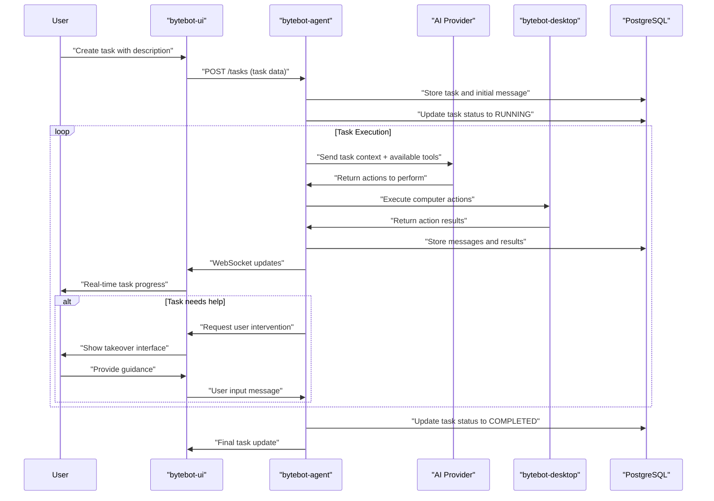
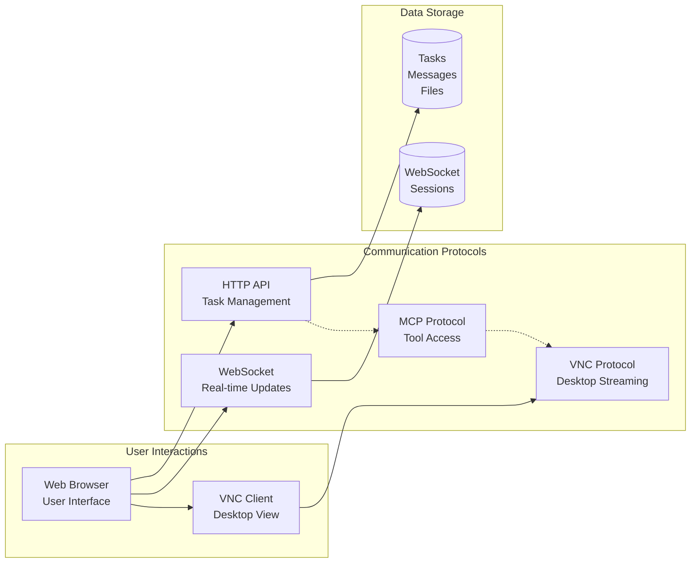
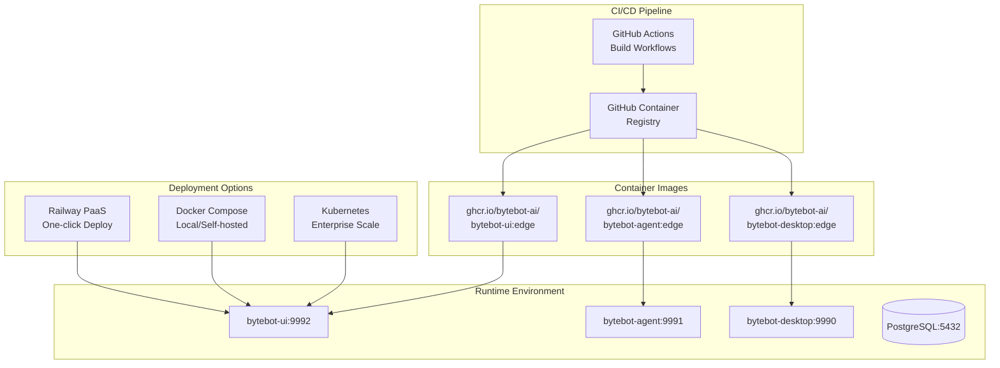

<!-- source: DeepWiki mcp.deepwiki.com · repo bytebot-ai/bytebot · page 2 System Architecture · fetched 2026-10-29 -->

# System Architecture

<details>
<summary>Relevant source files</summary>

The following files were used as context for generating this wiki page:

- [README.md](README.md)
- [docs/api-reference/agent/tasks.mdx](docs/api-reference/agent/tasks.mdx)
- [docs/core-concepts/desktop-environment.mdx](docs/core-concepts/desktop-environment.mdx)
- [docs/deployment/railway.mdx](docs/deployment/railway.mdx)
- [docs/guides/task-creation.mdx](docs/guides/task-creation.mdx)
- [docs/introduction.mdx](docs/introduction.mdx)
- [docs/quickstart.mdx](docs/quickstart.mdx)
- [packages/bytebot-agent/src/main.ts](packages/bytebot-agent/src/main.ts)
- [packages/bytebot-agent/src/tasks/tasks.gateway.ts](packages/bytebot-agent/src/tasks/tasks.gateway.ts)
- [packages/bytebot-ui/next.config.ts](packages/bytebot-ui/next.config.ts)
- [packages/bytebot-ui/server.ts](packages/bytebot-ui/server.ts)
- [packages/bytebot-ui/src/app/api/[[...path]]/route.ts](packages/bytebot-ui/src/app/api/[[...path]]/route.ts)
- [packages/bytebot-ui/src/hooks/useWebSocket.ts](packages/bytebot-ui/src/hooks/useWebSocket.ts)

</details>


This document provides a comprehensive overview of Bytebot's multi-service system architecture, covering service interactions, data flows, and deployment patterns. For detailed information about individual services, see [Service Architecture](#2.1), and for deployment-specific configurations, see [Deployment Architecture](#2.2).

## Overview

Bytebot is implemented as a distributed system consisting of four core services that work together to provide AI-powered desktop automation. The architecture follows a microservices pattern with clear separation of concerns: user interface, AI orchestration, desktop automation, and data persistence.

### High-Level System Architecture

```mermaid
graph TB
    subgraph "Frontend Layer"
        UI[bytebot-ui<br/>"Next.js Web App<br/>:9992"]
    end
    
    subgraph "Backend Services"
        Agent[bytebot-agent<br/>"NestJS Service<br/>:9991"]
        Desktop[bytebot-desktop<br/>"Ubuntu + XFCE<br/>:9990"]
        DB[("PostgreSQL<br/>Database")]
    end
    
    subgraph "External Services"
        LLM["AI Providers<br/>Anthropic, OpenAI, Google"]
        VNC["VNC Server<br/>Desktop Access"]
    end
    
    UI -->|"Task Management<br/>WebSocket/HTTP"| Agent
    UI -->|"VNC Streaming<br/>WebSocket"| Desktop
    Agent -->|"Task Orchestration<br/>Computer Actions"| Desktop
    Agent -->|"Data Persistence"| DB
    Agent -->|"AI Generation"| LLM
    Desktop -->|"Desktop Environment"| VNC
```

The system consists of four main components: `bytebot-ui` serves as the user interface, `bytebot-agent` handles AI orchestration and task management, `bytebot-desktop` provides the virtual desktop environment, and PostgreSQL stores persistent data. External AI providers power the intelligent decision-making, while VNC enables visual access to the desktop.

Sources: [README.md:99-106](), [packages/bytebot-agent/src/app.module.ts:17-36](), [docs/core-concepts/desktop-environment.mdx:72-87]()

## Core Service Architecture

### bytebot-ui Service

The `bytebot-ui` service is a Next.js 15 application that provides the web interface for task management and desktop interaction.

**Key Components:**
- **Task Management Interface**: Creates and monitors tasks
- **Desktop Viewer**: Embedded VNC client for real-time desktop access
- **API Proxy**: Routes requests to backend services
- **WebSocket Client**: Real-time updates from agent service

**Technology Stack:**
- Next.js 15 with React 19
- TypeScript for type safety
- TailwindCSS for styling
- Socket.IO client for WebSocket connections
- react-vnc for desktop viewing

Sources: [README.md:227-233](), [docs/quickstart.mdx:77-83]()

### bytebot-agent Service

The `bytebot-agent` service orchestrates AI-powered task execution through a modular NestJS architecture.

### Agent Service Module Architecture

```mermaid
graph TB
    subgraph "bytebot-agent (NestJS)"
        TasksService[TasksService<br/>"Task CRUD & Lifecycle"]
        AgentProcessor[AgentProcessor<br/>"AI Orchestration"]
        MessagesService[MessagesService<br/>"Message Storage"]
        TasksGateway[TasksGateway<br/>"WebSocket Server"]
        
        subgraph "AI Providers"
            AnthropicService[AnthropicService]
            OpenAIService[OpenAIService] 
            GoogleService[GoogleService]
            ProxyService[ProxyService]
        end
    end
    
    TasksService --> AgentProcessor
    AgentProcessor --> AnthropicService
    AgentProcessor --> OpenAIService
    AgentProcessor --> GoogleService
    AgentProcessor --> ProxyService
    AgentProcessor --> MessagesService
    TasksGateway --> TasksService
```

**Core Module Structure:**
- `AppModule`: Root module importing all service modules
- `AgentModule`: Contains `AgentProcessor`, `AgentScheduler`, and `InputCaptureService`
- `TasksModule`: Task management with `TasksService` and `TasksGateway` for WebSocket
- `MessagesModule`: Message persistence and retrieval
- Provider modules: `AnthropicModule`, `OpenAIModule`, `GoogleModule`, `ProxyModule`

**Key Services:**
- `AgentProcessor`: Coordinates AI model interactions and computer actions
- `AgentScheduler`: Manages task queuing and execution scheduling  
- `InputCaptureService`: Captures user input for training and monitoring
- `TasksService`: CRUD operations for task management
- `MessagesService`: Conversation history and message processing

Sources: [packages/bytebot-agent/src/app.module.ts:17-36](), [packages/bytebot-agent/src/agent/agent.module.ts:15-33]()

### bytebot-desktop Service

The `bytebot-desktop` service provides a containerized Ubuntu 22.04 environment with automation capabilities.

**Core Components:**
- **bytebotd Daemon**: Automation service built on nutjs framework
- **XFCE4 Desktop**: Lightweight desktop environment
- **noVNC Server**: Browser-based desktop access
- **Pre-installed Applications**: Firefox, VS Code, Thunderbird, development tools

**APIs Exposed:**
- Computer Use API on port 9990
- MCP (Model Context Protocol) endpoint at `/mcp`
- VNC WebSocket proxy for remote access

Sources: [docs/core-concepts/desktop-environment.mdx:36-88](), [README.md:227-233]()

### PostgreSQL Database

The database stores all persistent data using Prisma ORM for type-safe database access.

**Schema Structure:**
- **Tasks Table**: Task metadata, status, and execution details
- **Messages Table**: Conversation history and AI interactions
- **Summaries Table**: Task summaries and parent relationships
- **Users Table**: Authentication data (when auth enabled)

Sources: [packages/bytebot-agent/src/app.module.ts:10](), [docs/core-concepts/agent-system.mdx:149-154]()

## Communication and Data Flow

### Task Execution Flow



This sequence shows the complete task execution flow with tasks created through the UI, processed by the agent using AI providers, executed on the virtual desktop, and continuously updated in the database with real-time feedback to users.

**WebSocket Events:**
- `task_updated`: Real-time task status changes
- `new_message`: AI conversation updates  
- `task_completed`: Final task completion

Sources: [docs/api-reference/agent/tasks.mdx:25-67](), [docs/guides/task-creation.mdx:114-121]()

### Data and Communication Flow



This diagram shows the various communication protocols and data flows within Bytebot. HTTP APIs handle task management, WebSockets provide real-time updates, VNC enables desktop visualization, and MCP (Model Context Protocol) allows AI models to access tools.

### API Communication Patterns

| Protocol | Usage | Endpoints | Port |
|----------|-------|-----------|------|
| HTTP REST | Task CRUD operations | `/tasks`, `/messages` | 9991 |
| WebSocket | Real-time updates | Socket.IO connections | 9991 |
| HTTP Proxy | UI → Backend routing | `/api/**` in Next.js | 9992 |
| VNC WebSocket | Desktop streaming | `/vnc` via websockify | 9990 |
| MCP SSE | Tool integration | `/mcp` Server-Sent Events | 9990 |

Sources: [docs/quickstart.mdx:170-177](), [docs/core-concepts/desktop-environment.mdx:122-141](), [docs/api-reference/agent/tasks.mdx:8]()

## Technology Stack Integration

### Multi-Provider AI Integration Architecture

```mermaid
graph TB
    subgraph "Agent Core"
        AP[AgentProcessor<br/>"Task Orchestration"]
        AT[AgentTools<br/>"Tool Definitions"]
    end
    
    subgraph "AI Provider Adapters"
        AS[AnthropicService]
        OS[OpenAIService]
        GS[GoogleService]
        PS[ProxyService]
    end
    
    subgraph "External AI APIs"
        Claude[Anthropic Claude]
        GPT[OpenAI GPT]
        Gemini[Google Gemini]
        LLMProxy[LiteLLM Proxy]
    end
    
    subgraph "Tool Execution"
        CTU[Computer Tool Use<br/>"Handler"]
        CUS[ComputerUseService]
        Desktop["Virtual Desktop"]
    end
    
    AT --> AS
    AT --> OS
    AT --> GS
    AT --> PS
    
    AP --> AS
    AP --> OS
    AP --> GS
    AP --> PS
    
    AS <--> Claude
    OS <--> GPT
    GS <--> Gemini
    PS <--> LLMProxy
    
    AP --> CTU
    CTU --> CUS
    CUS --> Desktop
```

The system supports multiple AI providers through a common interface, with each provider having its own service adapter. Tool definitions are consistently formatted across providers, enabling the same computer automation capabilities regardless of which AI model is used.

**Environment Configuration:**
- `ANTHROPIC_API_KEY`: Claude model access
- `OPENAI_API_KEY`: GPT model access  
- `GEMINI_API_KEY`: Gemini model access
- `LLM_PROXY_URL`: LiteLLM proxy endpoint

Sources: [packages/bytebot-agent/src/app.module.ts:27-31](), [packages/bytebot-agent/package.json:25-27,40]()

### Deployment and Infrastructure Overview



The system supports multiple deployment methods from simple PaaS solutions to enterprise Kubernetes clusters. Automated CI/CD builds multi-architecture container images that are deployed consistently across different environments.

**Container Images:**
- `ghcr.io/bytebot-ai/bytebot-ui:edge`
- `ghcr.io/bytebot-ai/bytebot-agent:edge`
- `ghcr.io/bytebot-ai/bytebot-desktop:edge`
- `postgres:14-alpine`

**Network Architecture:**
- Internal container networking
- Port mapping for external access
- WebSocket proxy for VNC connections
- Health checks and service discovery

Sources: [docs/quickstart.mdx:68-74,190-201](), [README.md:76-78,251-261]()

## Security and Isolation

### Container Security Model

Each service runs in isolated Docker containers with specific security configurations:

- **Process Isolation**: Services run as non-root users where possible
- **Network Isolation**: Private networking between containers
- **Resource Limits**: CPU and memory constraints enforced
- **Data Persistence**: Volumes for database and user data

### Authentication Integration

Optional authentication through `@thallesp/nestjs-better-auth`:

```typescript
// Conditional auth module loading
const authEnabled = process.env.AUTH_ENABLED === 'true';
```

Sources: [packages/bytebot-agent/src/app.module.ts:19-29](), [docs/core-concepts/architecture.mdx:119-149]()

## Deployment Patterns

The architecture supports multiple deployment scenarios:

| Pattern | Use Case | Resource Requirements |
|---------|----------|----------------------|
| Docker Compose | Development/Self-hosting | 4GB RAM, 2 CPU cores |
| Railway PaaS | Managed deployment | Auto-scaling |
| Kubernetes/Helm | Enterprise production | Dedicated nodes |

**Configuration Management:**
- Environment variables for secrets
- Docker Compose overrides
- Helm value customization
- Health check endpoints

Sources: [docs/quickstart.mdx:36-96](), [docs/deployment/railway.mdx:1-89](), [docs/core-concepts/architecture.mdx:151-176]()

---

