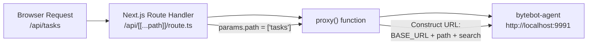
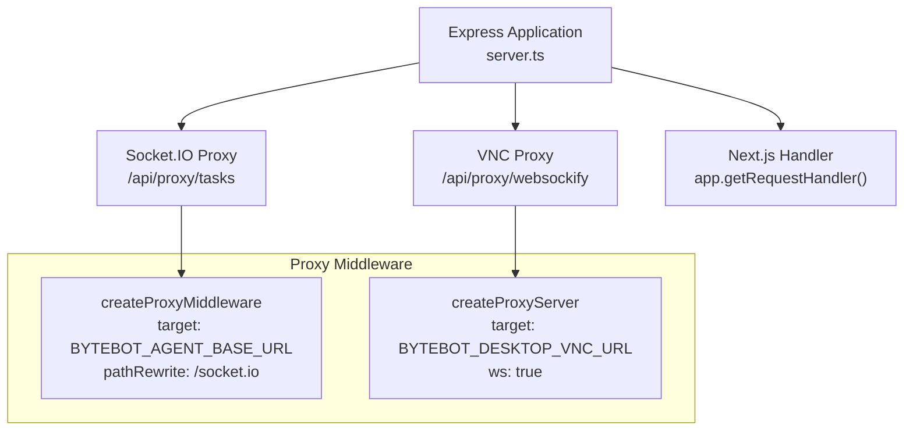
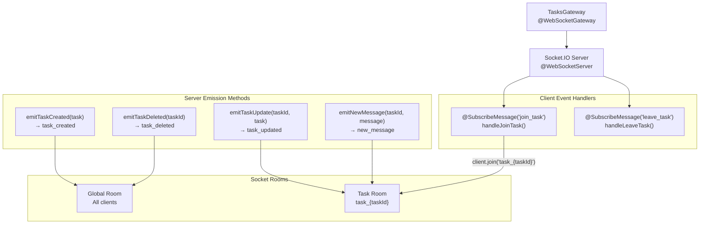
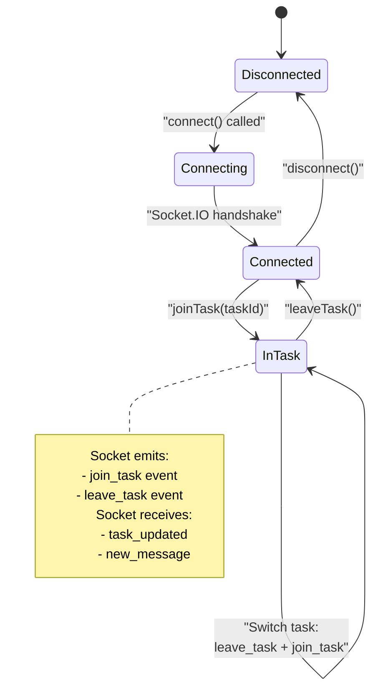
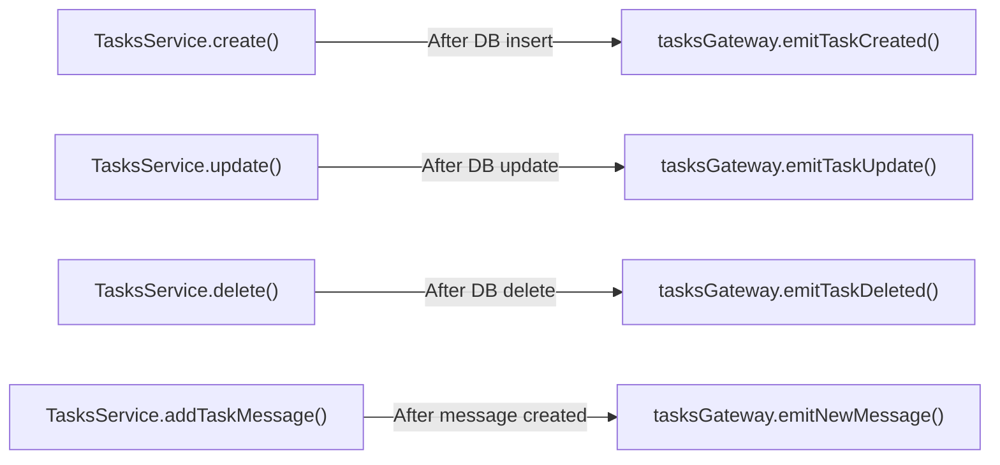
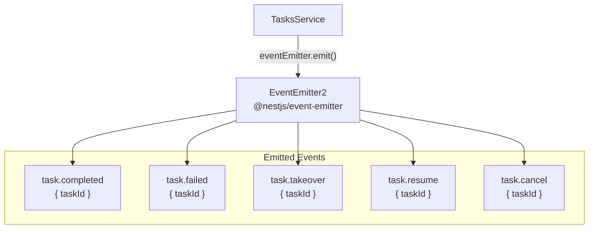
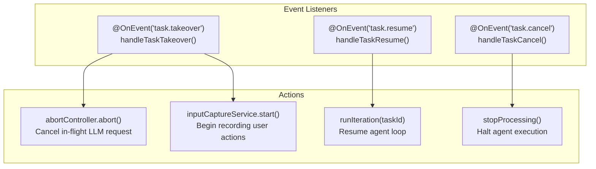
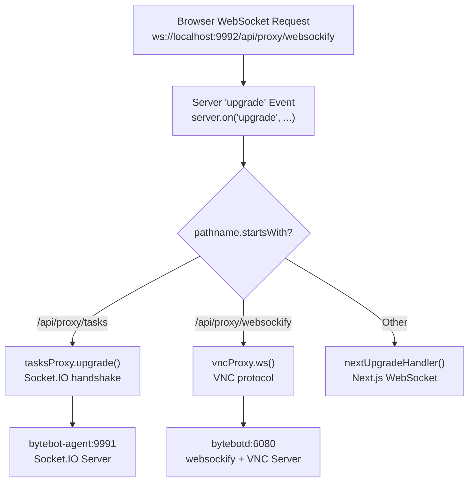
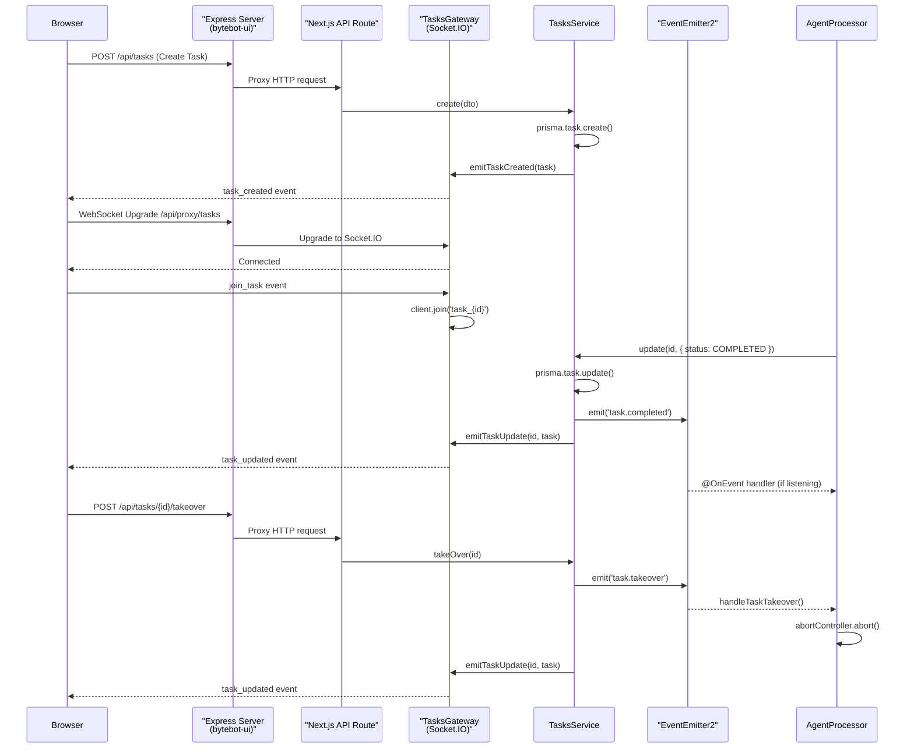

<!-- source: DeepWiki mcp.deepwiki.com · repo bytebot-ai/bytebot · page 2.2 Communication Patterns · fetched 2026-10-29 -->

# Communication Patterns

<details>
<summary>Relevant source files</summary>

The following files were used as context for generating this wiki page:

- [packages/bytebot-agent/src/agent/agent.processor.ts](packages/bytebot-agent/src/agent/agent.processor.ts)
- [packages/bytebot-agent/src/main.ts](packages/bytebot-agent/src/main.ts)
- [packages/bytebot-agent/src/tasks/tasks.controller.ts](packages/bytebot-agent/src/tasks/tasks.controller.ts)
- [packages/bytebot-agent/src/tasks/tasks.gateway.ts](packages/bytebot-agent/src/tasks/tasks.gateway.ts)
- [packages/bytebot-agent/src/tasks/tasks.service.ts](packages/bytebot-agent/src/tasks/tasks.service.ts)
- [packages/bytebot-ui/next.config.ts](packages/bytebot-ui/next.config.ts)
- [packages/bytebot-ui/server.ts](packages/bytebot-ui/server.ts)
- [packages/bytebot-ui/src/app/api/[[...path]]/route.ts](packages/bytebot-ui/src/app/api/[[...path]]/route.ts)
- [packages/bytebot-ui/src/hooks/useChatSession.ts](packages/bytebot-ui/src/hooks/useChatSession.ts)
- [packages/bytebot-ui/src/hooks/useWebSocket.ts](packages/bytebot-ui/src/hooks/useWebSocket.ts)

</details>


This document describes the three primary communication mechanisms in Bytebot: REST API proxying through the frontend layer, WebSocket-based real-time event distribution, and VNC streaming for desktop access. It also covers the internal event-driven coordination between backend services.

For detailed API specifications, see [Tasks REST API](#10.1) and [WebSocket API](#10.3). For service-level architecture, see [Service Architecture](#2.1).

---

## REST API Proxying

Bytebot-ui acts as a unified proxy layer, forwarding all HTTP requests from the browser to bytebot-agent. This architecture provides a single origin for the frontend and simplifies CORS management.

### Next.js Catch-All Route

The Next.js API routes proxy HTTP requests to the backend using a catch-all route handler.

**Path Resolution Flow Diagram**



**Sources:** [packages/bytebot-ui/src/app/api/[[...path]]/route.ts:1-65]()

The route handler at [packages/bytebot-ui/src/app/api/[[...path]]/route.ts:6-46]() implements request proxying:

1. Extracts path segments from the catch-all `[[...path]]` parameter
2. Reconstructs the full URL using `BYTEBOT_AGENT_BASE_URL` environment variable
3. Forwards HTTP method, headers (including cookies), and body
4. Returns the backend response with preserved `Set-Cookie` headers

**HTTP Method Support**

| Method | Handler Export | Use Case |
|--------|---------------|----------|
| GET | `export const GET = handler` | Fetch tasks, messages, models |
| POST | `export const POST = handler` | Create tasks, add messages |
| PATCH | `export const PATCH = handler` | Update task status |
| DELETE | `export const DELETE = handler` | Delete tasks |

**Sources:** [packages/bytebot-ui/src/app/api/[[...path]]/route.ts:58-64]()

### Express Server Proxying

For WebSocket upgrades and VNC streaming, bytebot-ui runs a custom Express server that handles HTTP proxying and WebSocket protocol upgrades.

**Express Proxy Configuration Diagram**



**Sources:** [packages/bytebot-ui/server.ts:1-89]()

The Express server at [packages/bytebot-ui/server.ts:29-51]() configures two proxy paths:

1. **`/api/proxy/tasks`** - Proxies Socket.IO connections to bytebot-agent, rewriting the path to `/socket.io` [packages/bytebot-ui/server.ts:33-37]()
2. **`/api/proxy/websockify`** - Proxies VNC WebSocket connections to bytebotd [packages/bytebot-ui/server.ts:41-51]()

All other requests fall through to Next.js via `handle(req, res)` [packages/bytebot-ui/server.ts:54]().

**Sources:** [packages/bytebot-ui/server.ts:29-54]()

---

## WebSocket Communication

Bytebot uses Socket.IO for bidirectional, real-time communication between the frontend and backend. This enables instant task status updates, message notifications, and reactive UI updates.

### Server-Side Gateway

The `TasksGateway` class implements the Socket.IO server in bytebot-agent.

**TasksGateway Architecture Diagram**



**Sources:** [packages/bytebot-agent/src/tasks/tasks.gateway.ts:1-58]()

**Room-Based Event Distribution**

The gateway uses Socket.IO rooms to implement targeted event delivery:

- **Task-specific events** (`task_updated`, `new_message`) emit to `task_{taskId}` room [packages/bytebot-agent/src/tasks/tasks.gateway.ts:42-47]()
- **Global events** (`task_created`, `task_deleted`) broadcast to all connected clients [packages/bytebot-agent/src/tasks/tasks.gateway.ts:50-56]()

Clients join rooms by emitting `join_task` with a task ID [packages/bytebot-agent/src/tasks/tasks.gateway.ts:30-34]().

**Sources:** [packages/bytebot-agent/src/tasks/tasks.gateway.ts:30-56]()

### Client-Side Hook

The `useWebSocket` hook manages the Socket.IO client connection in the React frontend.

**WebSocket Client Lifecycle**



**Sources:** [packages/bytebot-ui/src/hooks/useWebSocket.ts:1-114]()

**Connection Configuration**

The hook creates a Socket.IO client with the following parameters [packages/bytebot-ui/src/hooks/useWebSocket.ts:27-34]():

```
io({
  path: "/api/proxy/tasks",
  transports: ["websocket"],
  autoConnect: true,
  reconnection: true,
  reconnectionAttempts: 5,
  reconnectionDelay: 1000
})
```

**Event Handlers Table**

| Socket Event | Handler | Callback Prop | Usage |
|--------------|---------|---------------|-------|
| `task_updated` | [Line 44-46]() | `onTaskUpdate` | Update task status in UI |
| `new_message` | [Line 49-51]() | `onNewMessage` | Append message to chat |
| `task_created` | [Line 54-56]() | `onTaskCreated` | Refresh task list |
| `task_deleted` | [Line 59-61]() | `onTaskDeleted` | Remove task from list |

**Sources:** [packages/bytebot-ui/src/hooks/useWebSocket.ts:36-62]()

### Service Integration

`TasksService` calls `TasksGateway` emission methods after database operations to trigger real-time updates.

**Service-to-Gateway Call Pattern**



**Sources:** [packages/bytebot-agent/src/tasks/tasks.service.ts:114-116](), [packages/bytebot-agent/src/tasks/tasks.service.ts:244-246](), [packages/bytebot-agent/src/tasks/tasks.service.ts:258-260](), [packages/bytebot-agent/src/tasks/tasks.service.ts:278-279]()

The `TasksService` constructor injects `TasksGateway` using `@Inject(forwardRef(() => TasksGateway))` to resolve circular dependencies [packages/bytebot-agent/src/tasks/tasks.service.ts:32-33]().

**Sources:** [packages/bytebot-agent/src/tasks/tasks.service.ts:30-38]()

---

## Internal Event System

Bytebot-agent uses `EventEmitter2` for asynchronous, decoupled communication between services. This pattern allows `TasksService` to broadcast state changes without directly coupling to `AgentProcessor`.

### Event Emitters

The `TasksService` emits lifecycle events after task state transitions.

**Internal Event Emission Diagram**



**Sources:** [packages/bytebot-agent/src/tasks/tasks.service.ts:234-239](), [packages/bytebot-agent/src/tasks/tasks.service.ts:312](), [packages/bytebot-agent/src/tasks/tasks.service.ts:351](), [packages/bytebot-agent/src/tasks/tasks.service.ts:385]()

**Event Emission Triggers**

| Method | Condition | Event Emitted | Payload |
|--------|-----------|---------------|---------|
| `update()` | `status === COMPLETED` | `task.completed` | `{ taskId }` |
| `update()` | `status === FAILED` | `task.failed` | `{ taskId }` |
| `takeOver()` | User takes control | `task.takeover` | `{ taskId }` |
| `resume()` | User returns control | `task.resume` | `{ taskId }` |
| `cancel()` | Task cancelled | `task.cancel` | `{ taskId }` |

**Sources:** [packages/bytebot-agent/src/tasks/tasks.service.ts:217-391]()

### Event Listeners

The `AgentProcessor` uses the `@OnEvent` decorator to handle internal events.

**AgentProcessor Event Handling Flow**



**Sources:** [packages/bytebot-agent/src/agent/agent.processor.ts:84-112]()

**Event Handler Details**

1. **`task.takeover`** [packages/bytebot-agent/src/agent/agent.processor.ts:84-95]()
   - Aborts any in-flight LLM API call if processing the same task
   - Starts input capture to record user actions

2. **`task.resume`** [packages/bytebot-agent/src/agent/agent.processor.ts:97-105]()
   - Creates new `AbortController` for next iteration
   - Resumes the agent's `runIteration()` loop

3. **`task.cancel`** [packages/bytebot-agent/src/agent/agent.processor.ts:107-112]()
   - Calls `stopProcessing()` to halt execution
   - Stops input capture

**Sources:** [packages/bytebot-agent/src/agent/agent.processor.ts:84-112]()

---

## VNC Streaming

The VNC streaming architecture provides browser-based access to the virtual desktop environment. This involves WebSocket protocol upgrades and proxy routing.

### WebSocket Upgrade Handling

The Express server listens for WebSocket upgrade requests and routes them appropriately.

**WebSocket Upgrade Flow Diagram**



**Sources:** [packages/bytebot-ui/server.ts:57-79]()

The upgrade handler at [packages/bytebot-ui/server.ts:57-79]() performs path-based routing:

1. **Socket.IO**: Paths starting with `/api/proxy/tasks` upgrade to bytebot-agent's Socket.IO server
2. **VNC**: Paths starting with `/api/proxy/websockify` upgrade to bytebotd's VNC server
3. **Next.js**: All other paths handled by Next.js WebSocket handler

**VNC Proxy Configuration**

The VNC proxy server is created with [packages/bytebot-ui/server.ts:27]():

```
createProxyServer({ 
  changeOrigin: true, 
  ws: true 
})
```

The path rewrite logic extracts the target path from the URL [packages/bytebot-ui/server.ts:68-71]():

```
targetUrl.pathname + request.url.replace(/^\/api\/proxy\/websockify/, "")
```

**Sources:** [packages/bytebot-ui/server.ts:27](), [packages/bytebot-ui/server.ts:67-75]()

### Environment Configuration

Both proxy targets are configured via environment variables:

| Variable | Purpose | Example |
|----------|---------|---------|
| `BYTEBOT_AGENT_BASE_URL` | Backend REST/WS endpoint | `http://localhost:9991` |
| `BYTEBOT_DESKTOP_VNC_URL` | VNC WebSocket endpoint | `http://localhost:6080` |

**Sources:** [packages/bytebot-ui/server.ts:16-17]()

---

## Complete Communication Flow

This diagram shows how all three communication patterns work together during a typical task execution.

**End-to-End Communication Sequence**



**Sources:** [packages/bytebot-ui/server.ts:33-79](), [packages/bytebot-ui/src/app/api/[[...path]]/route.ts:6-46](), [packages/bytebot-agent/src/tasks/tasks.gateway.ts:30-56](), [packages/bytebot-agent/src/tasks/tasks.service.ts:40-391](), [packages/bytebot-agent/src/agent/agent.processor.ts:84-112]()

---

