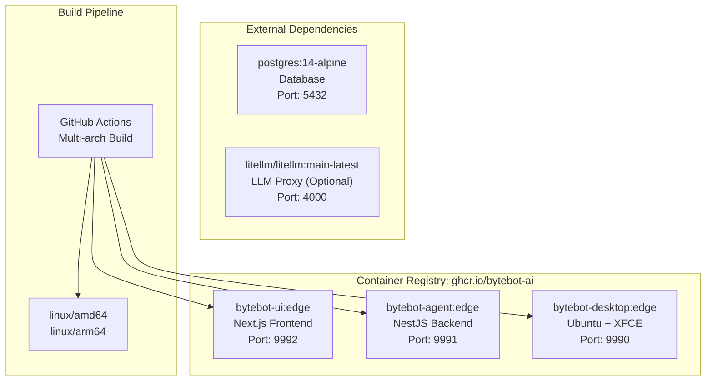
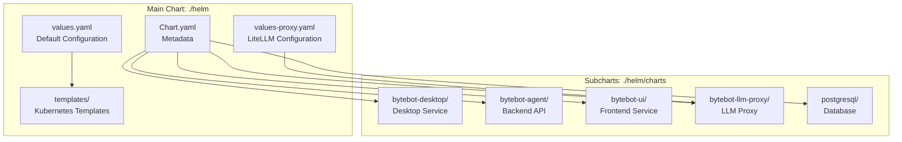
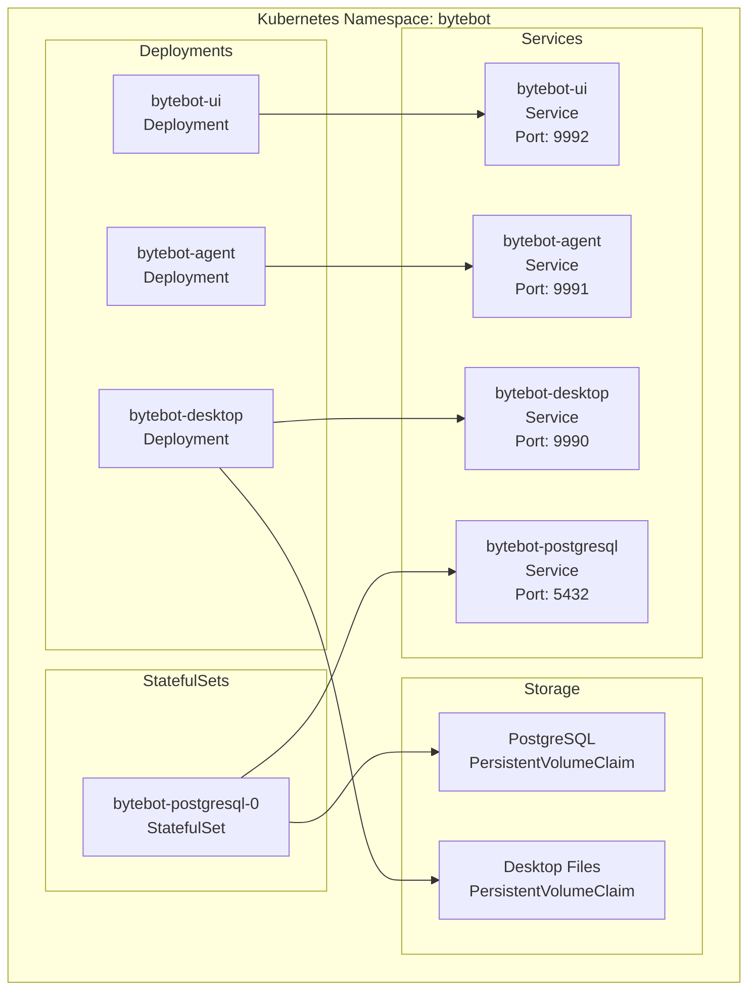
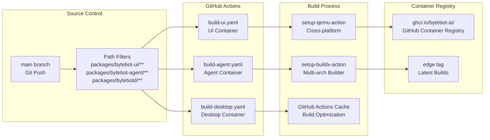
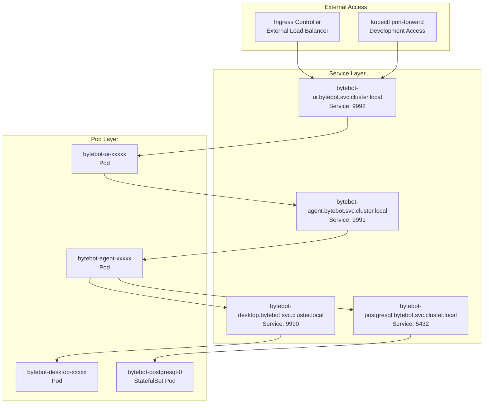
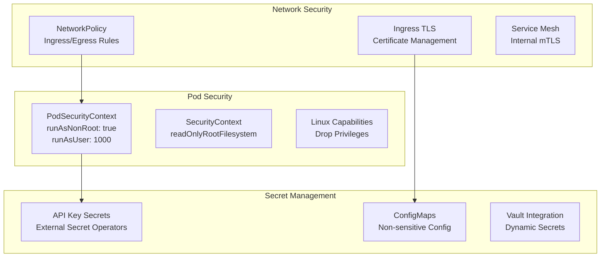

<!-- source: DeepWiki mcp.deepwiki.com · repo bytebot-ai/bytebot · page 2.3 Deployment Architecture · fetched 2026-10-29 -->

# Deployment Architecture

<details>
<summary>Relevant source files</summary>

The following files were used as context for generating this wiki page:

- [README.md](README.md)
- [docs/api-reference/agent/tasks.mdx](docs/api-reference/agent/tasks.mdx)
- [docs/core-concepts/desktop-environment.mdx](docs/core-concepts/desktop-environment.mdx)
- [docs/deployment/railway.mdx](docs/deployment/railway.mdx)
- [docs/guides/task-creation.mdx](docs/guides/task-creation.mdx)
- [docs/introduction.mdx](docs/introduction.mdx)
- [docs/quickstart.mdx](docs/quickstart.mdx)

</details>


This document explains the Docker containerization strategy, Kubernetes deployment architecture with Helm charts, and infrastructure patterns used by the Bytebot system. It covers container orchestration, service networking, and deployment automation.

For detailed information about the internal service architecture and component interactions, see [Service Architecture](#2.1). For step-by-step installation instructions, see [Installation and Setup](#3).

## Overview

Bytebot's deployment architecture is built on containerized microservices designed for Kubernetes orchestration:

| Component | Purpose | Container Image | Architecture |
|-----------|---------|-----------------|--------------|
| **Helm Charts** | Kubernetes deployment | `/helm` directory | Declarative configuration |
| **Multi-arch Images** | Container distribution | GitHub Container Registry | `linux/amd64`, `linux/arm64` |
| **Service Mesh** | Internal networking | Kubernetes Services | Private cluster communication |
| **Persistent Storage** | Data persistence | PersistentVolumeClaims | Database and file storage |

## Container Architecture

Bytebot deploys as a multi-container system with standardized Docker images:

### Core Container Images



Sources: [.github/workflows/build-ui.yaml:27-28](), [.github/workflows/build-agent.yaml:27-28](), [.github/workflows/build-desktop.yaml:34-35]()

### Container Build Configuration

Each service uses optimized Docker builds with multi-architecture support:

| Service | Context | Dockerfile | Platforms |
|---------|---------|------------|-----------|
| `bytebot-ui` | `./packages` | `bytebot-ui/Dockerfile` | `linux/amd64,linux/arm64` |
| `bytebot-agent` | `./packages` | `bytebot-agent/Dockerfile` | `linux/amd64,linux/arm64` |
| `bytebot-desktop` | `./packages` | `bytebotd/Dockerfile` | `linux/amd64,linux/arm64` |

Sources: [.github/workflows/build-ui.yaml:42-44](), [.github/workflows/build-agent.yaml:42-44](), [.github/workflows/build-desktop.yaml:53-55]()

## Kubernetes Deployment with Helm

Bytebot uses Helm charts for Kubernetes deployment, providing declarative configuration and lifecycle management.

### Helm Chart Structure



Sources: [helm/README.md:34-48]()

### Service Configuration in Kubernetes

The Helm deployment creates Kubernetes resources with proper networking:



Sources: [docs/deployment/helm.mdx:132-144]()

### Configuration Management

Helm values provide centralized configuration for all services:

```yaml
# Example configuration from values.yaml
bytebot-agent:
  apiKeys:
    anthropic:
      value: "sk-ant-your-key-here"
    openai:
      value: "sk-your-key-here"
      
desktop:
  resources:
    requests:
      memory: "2Gi"
      cpu: "1"
    limits:
      memory: "4Gi" 
      cpu: "2"
      
ui:
  ingress:
    enabled: true
    hostname: "bytebot.your-domain.com"
```

Sources: [docs/deployment/helm.mdx:68-77](), [docs/deployment/helm.mdx:84-100](), [docs/deployment/helm.mdx:107-112]()

## Container Image Management

### CI/CD Pipeline Architecture

Automated Docker builds use GitHub Actions with multi-architecture support:



Sources: [.github/workflows/build-ui.yaml:4-10](), [.github/workflows/build-agent.yaml:4-10](), [.github/workflows/build-desktop.yaml:4-10]()

### Image Build Configuration

Each workflow uses consistent build patterns with platform-specific optimizations:

| Build Feature | Configuration | Purpose |
|---------------|---------------|---------|
| **Platforms** | `linux/amd64,linux/arm64` | Multi-architecture support |
| **Cache** | `type=gha,mode=max` | GitHub Actions cache optimization |
| **Registry** | `ghcr.io` | GitHub Container Registry |
| **Buildx** | `BUILDX_NO_DEFAULT_ATTESTATIONS: 1` | Clean registry metadata |

Sources: [.github/workflows/build-ui.yaml:38-50](), [.github/workflows/build-agent.yaml:38-49](), [.github/workflows/build-desktop.yaml:48-60]()

### Container Security and Optimization

Build configuration includes security and performance optimizations:

```bash
# Environment variables for build optimization
BUILDX_NO_DEFAULT_ATTESTATIONS=1  # Hide "unknown/unknown" in GHCR
DOCKER_BUILD_SUMMARY=false        # Keep logs concise
DOCKER_BUILD_RECORD_UPLOAD=false  # Reduce build artifacts
```

Sources: [.github/workflows/build-ui.yaml:38-40](), [.github/workflows/build-agent.yaml:37-40](), [.github/workflows/build-desktop.yaml:49-51]()

## Infrastructure Patterns

### Kubernetes Service Networking

Internal service communication uses Kubernetes DNS and service discovery:



Sources: [docs/deployment/helm.mdx:118-122](), [helm/templates/NOTES.txt:5-6]()

### Storage Architecture

Persistent storage patterns for stateful components:

| Component | Storage Type | Purpose | Configuration |
|-----------|-------------|---------|---------------|
| **PostgreSQL** | `StatefulSet` + `PVC` | Database persistence | `postgresql.persistence.size` |
| **Desktop Files** | `PersistentVolume` | User data retention | `desktop.persistence.enabled` |
| **Agent Logs** | `emptyDir` | Temporary log storage | Container filesystem |
| **Shared Config** | `ConfigMap` + `Secret` | Configuration management | Helm values |

Sources: [docs/deployment/helm.mdx:236-247]()

### Resource Management

Kubernetes resource allocation follows container-specific patterns:

```yaml
# Resource configuration patterns
desktop:
  resources:
    requests:
      memory: "2Gi"    # Ubuntu + XFCE baseline
      cpu: "1"         # Desktop automation workload
    limits:
      memory: "4Gi"    # Prevent memory exhaustion
      cpu: "2"         # GUI rendering peak usage

agent:
  resources:
    requests:
      memory: "1Gi"    # NestJS + AI model requests
      cpu: "500m"      # API server baseline
```

Sources: [docs/deployment/helm.mdx:84-100]()

## Security and Access Patterns

### Kubernetes Security Model

Production deployments include security hardening through Helm configuration:



Sources: [docs/deployment/helm.mdx:252-269]()

### Access Control Configuration

```yaml
# Production security configuration
networkPolicy:
  enabled: true                    # Restrict pod-to-pod communication

podSecurityContext:
  runAsNonRoot: true              # Security hardening
  runAsUser: 1000                 # Non-privileged user
  fsGroup: 1000                   # File system group

auth:
  enabled: true                   # Enable authentication
  type: "basic"                   # Basic auth type
  username: "admin"               # Username
  password: "changeme"            # Use secrets in production
```

Sources: [docs/deployment/helm.mdx:252-268]()

## Configuration Management

### Environment Variable Hierarchy

```typescript
// Priority order (highest to lowest)
1. Railway service variables    // Platform-specific config
2. Docker Compose .env file    // Local development config  
3. Container default values    // Fallback configuration
4. Application defaults        // Code-level defaults
```

### Required vs Optional Configuration

| Variable | Required | Default | Purpose |
|----------|----------|---------|---------|
| `ANTHROPIC_API_KEY` | One of AI keys | - | Claude model access |
| `OPENAI_API_KEY` | One of AI keys | - | GPT model access |
| `GOOGLE_API_KEY` | One of AI keys | - | Gemini model access |
| `DATABASE_URL` | Yes | Auto-generated | PostgreSQL connection |
| `DESKTOP_SERVICE_URL` | No | `http://bytebot-desktop:9990` | Desktop API endpoint |

Sources: [docs/deployment/railway.mdx:38-43]()

## Troubleshooting Deployment Issues

### Common Railway Issues

| Symptom | Cause | Solution |
|---------|-------|----------|
| UI shows "connecting..." | Desktop container not ready | Wait for `bytebot-desktop` startup |
| Agent API errors `401`/`403` | Invalid AI API key | Verify API key in Railway variables |
| Slow desktop performance | Resource limits | Upgrade Railway plan |

Sources: [docs/deployment/railway.mdx:78-82]()

### Local Deployment Issues

- **Port conflicts**: Ensure ports 5432, 9990-9992 are available
- **Docker resources**: Allocate sufficient CPU/RAM for desktop container
- **Network connectivity**: Verify container-to-container communication
- **Image availability**: Ensure access to GitHub Container Registry

Sources: [docs/api-reference/agent/ui.mdx:128-134]()

---

