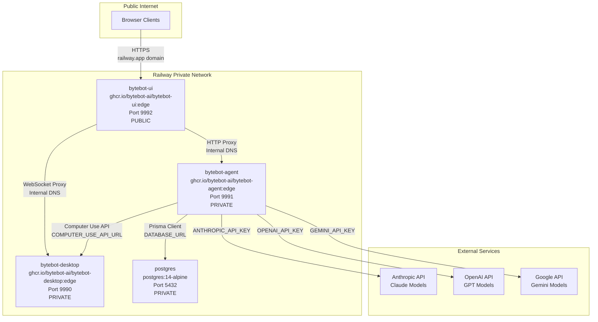
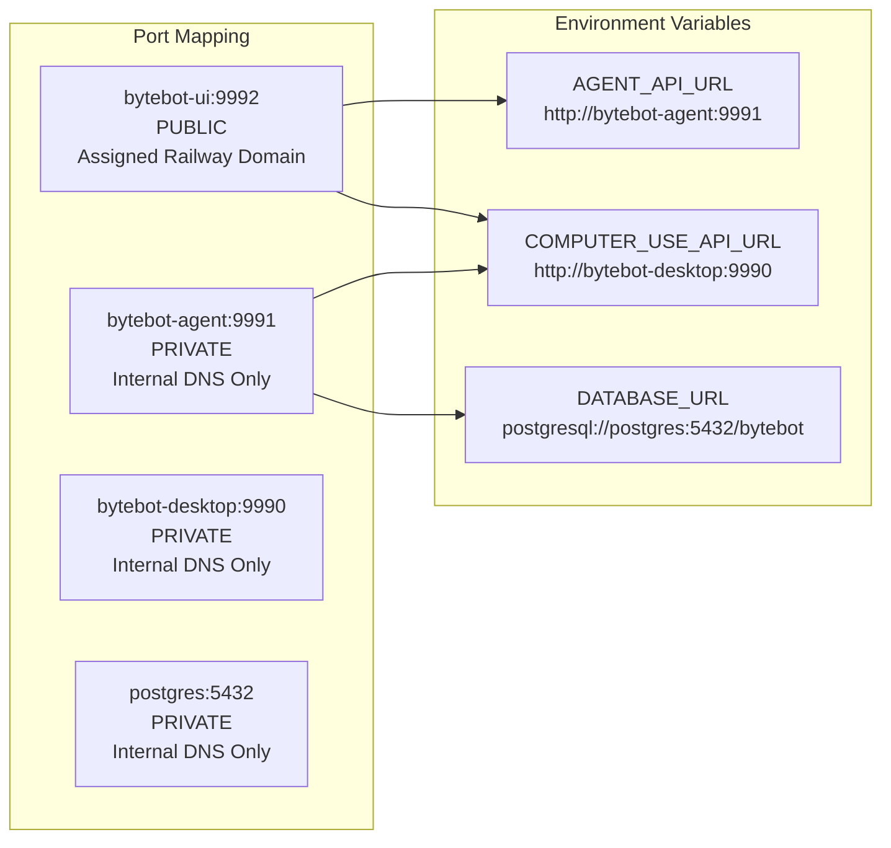
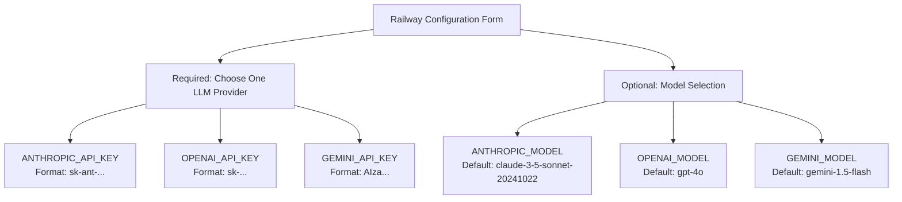
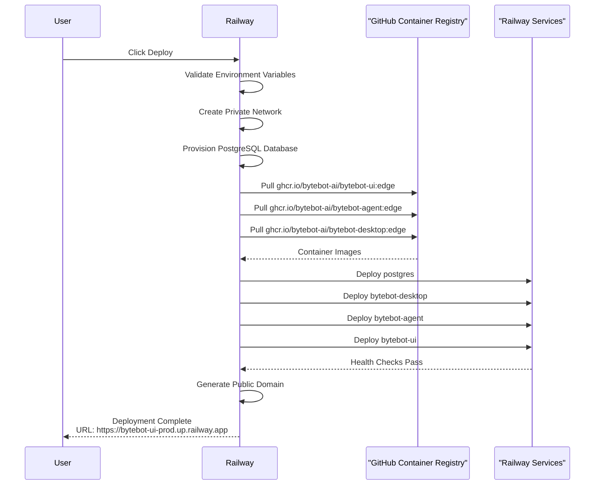
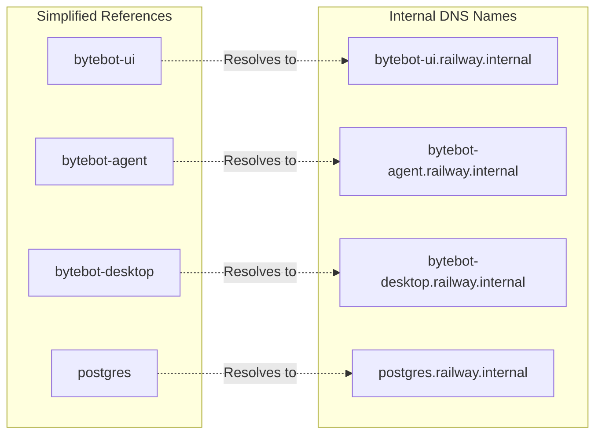
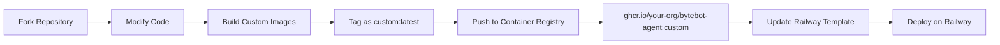
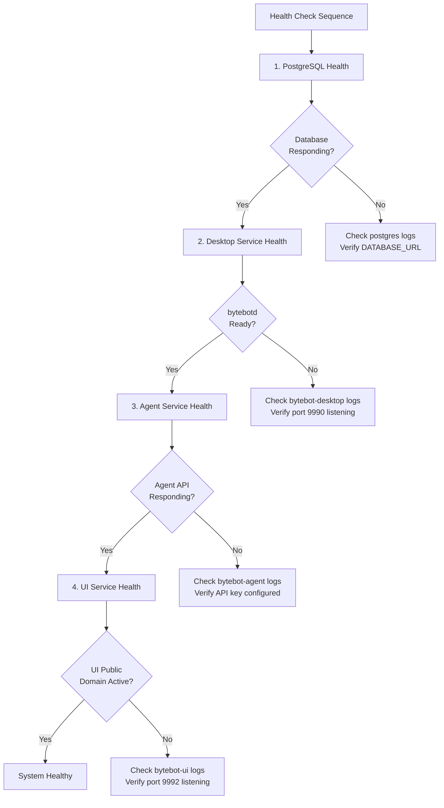

<!-- source: DeepWiki mcp.deepwiki.com · repo bytebot-ai/bytebot · page 3.2 Railway Deployment · fetched 2026-10-29 -->

# Railway Deployment

<details>
<summary>Relevant source files</summary>

The following files were used as context for generating this wiki page:

- [README.md](README.md)
- [docs/api-reference/agent/tasks.mdx](docs/api-reference/agent/tasks.mdx)
- [docs/core-concepts/desktop-environment.mdx](docs/core-concepts/desktop-environment.mdx)
- [docs/deployment/railway.mdx](docs/deployment/railway.mdx)
- [docs/guides/task-creation.mdx](docs/guides/task-creation.mdx)
- [docs/introduction.mdx](docs/introduction.mdx)
- [docs/quickstart.mdx](docs/quickstart.mdx)

</details>


## Purpose and Scope

This document provides comprehensive guidance for deploying Bytebot on the Railway platform. Railway offers a zero-configuration Platform-as-a-Service (PaaS) deployment method that automatically provisions all required services with private networking. This deployment option is ideal for users who want a production-ready Bytebot instance without managing infrastructure.

For local development deployment, see [Docker Deployment](#3.1). For overall deployment architecture concepts, see [Deployment Architecture](#2.3). For general configuration options that apply to all deployment methods, see [Configuration](#3.3).

## Railway Deployment Overview

Railway provides a template-based deployment system that instantiates the complete Bytebot stack from pre-built container images. The deployment uses Railway's private networking to connect services securely while exposing only the web UI to the public internet.

**Deployment URL**: The official template is accessible at:
```
https://railway.com/deploy/bytebot?referralCode=L9lKXQ
```

**Deployment Time**: Approximately 2 minutes for initial deployment, with faster subsequent redeploys.

**Sources**: [README.md:11](), [docs/deployment/railway.mdx:1-14](), [docs/quickstart.mdx:14]()

## Railway Service Architecture

### Service Topology

The Railway template deploys four interconnected services that communicate via Railway's internal private network:



**Sources**: [docs/deployment/railway.mdx:18-28](), [docs/quickstart.mdx:68-74]()

### Container Image Sources

All services use pre-built images from GitHub Container Registry, automatically built from the `edge` branch:

| Service | Container Image | Purpose |
|---------|----------------|---------|
| **bytebot-ui** | `ghcr.io/bytebot-ai/bytebot-ui:edge` | Next.js frontend with Express server for API proxying |
| **bytebot-agent** | `ghcr.io/bytebot-ai/bytebot-agent:edge` | NestJS backend for task orchestration and LLM integration |
| **bytebot-desktop** | `ghcr.io/bytebot-ai/bytebot-desktop:edge` | Ubuntu 22.04 desktop environment with bytebotd daemon |
| **postgres** | `postgres:14-alpine` | Relational database for tasks, messages, summaries, and files |

**Sources**: [docs/deployment/railway.mdx:18-26]()

### Service Port Configuration



**Sources**: [docs/deployment/railway.mdx:18-28](), [docs/quickstart.mdx:170-177]()

## Step-by-Step Deployment Process

### 1. Template Initialization

Access the Railway template by clicking the deployment button or visiting the template URL directly. Railway will prompt for authentication if not already logged in.

**Template URL**: `https://railway.com/deploy/bytebot?referralCode=L9lKXQ`

**Sources**: [docs/deployment/railway.mdx:34-36](), [README.md:11](), [docs/quickstart.mdx:17-19]()

### 2. Environment Configuration

The deployment requires at least one LLM provider API key. Railway presents a configuration form for the `bytebot-agent` service:



**Required Configuration**:
- **API Key**: At least one of `ANTHROPIC_API_KEY`, `OPENAI_API_KEY`, or `GEMINI_API_KEY` must be provided
- **Format Validation**: Keys must match the expected format for each provider

**Optional Configuration**:
- **Model Selection**: Override default models by setting provider-specific model environment variables
- **Database Credentials**: Auto-generated by Railway; no manual configuration needed

**Sources**: [docs/deployment/railway.mdx:38-44](), [docs/quickstart.mdx:20-22](), [docs/quickstart.mdx:326-337]()

### 3. Service Provisioning

Railway executes the following provisioning sequence:



**Provisioning Steps**:
1. Environment variable validation
2. Private network creation for inter-service communication
3. PostgreSQL database initialization with auto-generated credentials
4. Container image pulls from GitHub Container Registry
5. Service deployment in dependency order (database → desktop → agent → UI)
6. Health check verification for each service
7. Public domain assignment to `bytebot-ui` service

**Deployment Duration**: Approximately 2 minutes for initial deployment. Subsequent redeploys are faster due to cached container layers.

**Sources**: [docs/deployment/railway.mdx:45-52](), [docs/deployment/railway.mdx:54-56]()

### 4. Service Readiness

The deployment is complete when the UI service reports ready status. Access the application at the generated Railway domain:

**URL Format**: `https://bytebot-ui-prod-{random}.up.railway.app`

**Verification Steps**:
1. Navigate to the generated URL
2. Verify the task creation interface loads
3. Create a test task to confirm agent connectivity
4. Check desktop viewer for virtual desktop access

**Sources**: [docs/deployment/railway.mdx:48-52]()

## Environment Variables and Configuration

### Core Service Variables

#### bytebot-agent Environment

The agent service requires LLM provider credentials and internal service URLs:

| Variable | Required | Default | Description |
|----------|----------|---------|-------------|
| `ANTHROPIC_API_KEY` | Conditional* | - | Anthropic API key for Claude models |
| `OPENAI_API_KEY` | Conditional* | - | OpenAI API key for GPT models |
| `GEMINI_API_KEY` | Conditional* | - | Google API key for Gemini models |
| `ANTHROPIC_MODEL` | No | `claude-3-5-sonnet-20241022` | Specific Claude model identifier |
| `OPENAI_MODEL` | No | `gpt-4o` | Specific GPT model identifier |
| `GEMINI_MODEL` | No | `gemini-1.5-flash` | Specific Gemini model identifier |
| `DATABASE_URL` | Yes (auto) | Auto-generated | PostgreSQL connection string |
| `COMPUTER_USE_API_URL` | Yes (auto) | `http://bytebot-desktop:9990` | Desktop service API endpoint |

\* At least one LLM provider API key is required

**Sources**: [docs/deployment/railway.mdx:38-44](), [docs/quickstart.mdx:326-337]()

#### bytebot-ui Environment

The UI service requires agent API endpoint configuration:

| Variable | Required | Default | Description |
|----------|----------|---------|-------------|
| `AGENT_API_URL` | Yes (auto) | `http://bytebot-agent:9991` | Agent service REST API endpoint |
| `PORT` | No | `9992` | HTTP server port |

**Sources**: [docs/quickstart.mdx:170-177]()

#### bytebot-desktop Environment

The desktop service runs with minimal configuration:

| Variable | Required | Default | Description |
|----------|----------|---------|-------------|
| `PORT` | No | `9990` | Computer use API and VNC server port |
| `DISPLAY` | Yes (auto) | `:0` | X11 display server identifier |

**Sources**: [docs/core-concepts/desktop-environment.mdx:73-77]()

### Database Configuration

Railway automatically provisions a PostgreSQL database and injects the connection string into the `bytebot-agent` service:

```
DATABASE_URL=postgresql://<user>:<password>@<host>:5432/<database>
```

**Auto-generated Components**:
- Database name
- Username
- Password
- Internal hostname
- SSL configuration

The `bytebot-agent` service uses Prisma as the database client, which reads `DATABASE_URL` from the environment.

**Sources**: [docs/deployment/railway.mdx:18-26]()

## Railway Private Networking

### Internal DNS Resolution

Railway's private network provides DNS-based service discovery. Services communicate using internal hostnames that match the service names:



**Service Communication Patterns**:
- `bytebot-ui` → `http://bytebot-agent:9991` (REST API proxy)
- `bytebot-ui` → `ws://bytebot-desktop:9990` (VNC WebSocket proxy)
- `bytebot-agent` → `http://bytebot-desktop:9990/computer-use` (Computer actions)
- `bytebot-agent` → `postgresql://postgres:5432/bytebot` (Database queries)

**Sources**: [docs/deployment/railway.mdx:27-28](), [docs/deployment/railway.mdx:60-66]()

### Network Isolation

Railway enforces network isolation at multiple layers:

| Layer | Configuration | Purpose |
|-------|---------------|---------|
| **Public Exposure** | Only `bytebot-ui` receives a public domain | Limits attack surface to UI service only |
| **Internal Network** | All services share a private network segment | Enables service-to-service communication |
| **Port Binding** | Services bind to `0.0.0.0` internally | Accessible within private network only |
| **DNS Scope** | Internal DNS names not resolvable publicly | Prevents external resolution of private services |

**Security Implications**:
- Agent API (`port 9991`) not accessible from public internet
- Desktop API (`port 9990`) not accessible from public internet
- PostgreSQL (`port 5432`) not accessible from public internet
- Only UI serves HTTP/WebSocket traffic to external clients

**Sources**: [docs/deployment/railway.mdx:60-66]()

## Public Access and Domain Configuration

### Default Railway Domain

Railway automatically generates a public domain for the `bytebot-ui` service:

**URL Pattern**: `https://{service-name}-{environment}-{random}.up.railway.app`

**Example**: `https://bytebot-ui-prod-a4k2j.up.railway.app`

**Sources**: [docs/deployment/railway.mdx:48-52]()

### Custom Domain Configuration

Railway supports custom domain mapping through the dashboard:

```mermaid
graph LR
    CustomDomain["Custom Domain<br/>app.yourcompany.com"]
    
    CustomDomain -->|"1. Add Domain in Railway"| Railway["Railway Dashboard"]
    Railway -->|"2. Provides DNS Records"| DNS["DNS Provider"]
    DNS -->|"3. Configure CNAME/A Records"| Records["DNS Records"]
    Records -->|"4. SSL Certificate"| SSL["Auto-provisioned<br/>Let's Encrypt"]
    SSL -->|"5. HTTPS Traffic"| UI["bytebot-ui Service"]
```



**Configuration Steps**:
1. Navigate to `bytebot-ui` service settings in Railway dashboard
2. Click "Add Domain"
3. Enter custom domain (e.g., `app.yourcompany.com`)
4. Configure DNS provider with provided records
5. Railway automatically provisions SSL certificate

**Sources**: [docs/deployment/railway.mdx:65]()

### Adding Authentication Layer

Railway deployments can be secured with authentication proxies:

**Options**:
- **Railway Built-in**: Password protection via Railway dashboard settings
- **Cloudflare Access**: Zero Trust authentication with Cloudflare
- **OAuth Proxy**: OAuth2 Proxy for identity provider integration
- **Auth0**: Reverse proxy with Auth0 authentication

**Implementation**: Place authentication proxy in front of `bytebot-ui` service using Railway's service chaining.

**Sources**: [docs/deployment/railway.mdx:63-65]()

## Customization and Scaling

### Using Custom Container Images

Fork the repository and build custom images to modify service behavior:



**Steps**:
1. Fork `https://github.com/bytebot-ai/bytebot`
2. Modify service code as needed
3. Build and tag custom container images
4. Push to your container registry (GitHub Container Registry, Docker Hub, etc.)
5. Edit Railway template to reference custom images
6. Deploy modified template

**Sources**: [docs/deployment/railway.mdx:70-72]()

### Resource Allocation

Railway provides per-service resource controls:

| Resource | Minimum | Recommended | Maximum |
|----------|---------|-------------|---------|
| **CPU** | 0.5 vCPU | 2 vCPU | 8 vCPU |
| **Memory** | 512 MB | 2 GB | 32 GB |
| **Storage** | 1 GB | 10 GB | 100 GB |

**Service-Specific Recommendations**:
- **bytebot-ui**: 512 MB RAM, 0.5 vCPU (low resource usage)
- **bytebot-agent**: 2 GB RAM, 1 vCPU (LLM context processing)
- **bytebot-desktop**: 4 GB RAM, 2 vCPU (desktop environment and automation)
- **postgres**: 1 GB RAM, 1 vCPU (database operations)

**Scaling Configuration**: Access resource sliders in Railway dashboard under each service's Settings → Resources tab.

**Sources**: [docs/deployment/railway.mdx:71-72]()

### Database Management

Railway provides PostgreSQL management tools:

**Available Operations**:
- **Backups**: Automatic daily backups with point-in-time recovery
- **Scaling**: Vertical scaling via RAM/CPU sliders
- **Monitoring**: Built-in metrics for connections, queries, storage
- **Access**: Direct database access via Railway's built-in PostgreSQL client

**Connection Details**: Access credentials and connection string from Railway dashboard under postgres service → Connect tab.

**Sources**: [docs/deployment/railway.mdx:18-26]()

## Monitoring and Troubleshooting

### Service Logs

Railway provides real-time log streaming for all services:

**Access Pattern**:
1. Navigate to project in Railway dashboard
2. Select service (e.g., `bytebot-agent`)
3. Click "Logs" tab for real-time stream

**Log Types**:
- **Build Logs**: Container image pull and initialization
- **Deploy Logs**: Service startup and health checks
- **Runtime Logs**: Application output (stdout/stderr)

**Sources**: [docs/deployment/railway.mdx:50]()

### Common Issues and Resolutions

| Symptom | Likely Cause | Resolution |
|---------|--------------|------------|
| UI shows "connecting..." | `bytebot-desktop` not ready | Wait for desktop container startup (~30s); verify logs show "bytebotd ready" |
| Agent returns `401 Unauthorized` | Missing or invalid API key | Re-enter LLM provider API key in Railway variables; redeploy |
| Agent returns `403 Forbidden` | API key lacks required permissions | Verify API key has access to requested model |
| Slow desktop video stream | Free tier bandwidth throttling | Upgrade Railway plan or reduce screen resolution in desktop settings |
| Database connection errors | `DATABASE_URL` misconfigured | Verify postgres service is healthy; check `DATABASE_URL` format |
| Tasks fail to start | `COMPUTER_USE_API_URL` unreachable | Verify `bytebot-desktop` service is running; check private network configuration |

**Sources**: [docs/deployment/railway.mdx:77-83]()

### Health Check Verification



**Manual Health Checks**:
1. **Database**: Verify postgres service shows "Active" status in Railway dashboard
2. **Desktop**: Check logs for "VNC server started" and "bytebotd listening on port 9990"
3. **Agent**: Check logs for "NestJS application successfully started" and "Listening on port 9991"
4. **UI**: Access public URL and verify task creation interface loads

**Sources**: [docs/deployment/railway.mdx:77-83]()

## Cost Considerations

### Railway Pricing Model

Railway uses a resource-based pricing model:

**Pricing Components**:
- **Base Resources**: CPU, RAM, and storage per service
- **Network Egress**: Outbound bandwidth from public services
- **Build Minutes**: Time spent building custom images (if applicable)

**Free Trial**: Railway offers trial credits for new accounts, sufficient for testing Bytebot deployment.

**Production Costs**: Typical monthly cost for Bytebot stack ranges from $20-50 USD depending on usage patterns and resource allocation.

**Sources**: [docs/deployment/railway.mdx:82]()

### Optimization Strategies

**Cost Reduction Techniques**:
1. **Use Pre-built Images**: Avoid rebuild costs by using official `edge` images
2. **Right-size Resources**: Start with minimum recommended resources; scale as needed
3. **Optimize Desktop Usage**: Reduce screen resolution and color depth for lower bandwidth
4. **Schedule Deployments**: Use Railway's cron jobs to stop/start services during off-hours

**Monitoring Costs**: Track resource usage in Railway dashboard under project → Usage tab.

**Sources**: [docs/deployment/railway.mdx:70-72]()

## Next Steps

After successful Railway deployment, consider the following actions:

- **Configure Desktop**: Use the Desktop tab to install additional applications and set up password managers (see [Core Concepts: Desktop Environment](#1.2))
- **Create Tasks**: Start with simple tasks to verify functionality (see [Task Creation & Management](#8.1))
- **API Integration**: Integrate Bytebot with your applications using the Tasks API (see [Tasks REST API](#10.1))
- **Custom Domains**: Set up a custom domain for professional deployment (see this page, Custom Domain Configuration section above)
- **Security Hardening**: Add authentication layer for production use (see this page, Adding Authentication Layer section above)

**Sources**: [docs/deployment/railway.mdx:86-90]()

---

