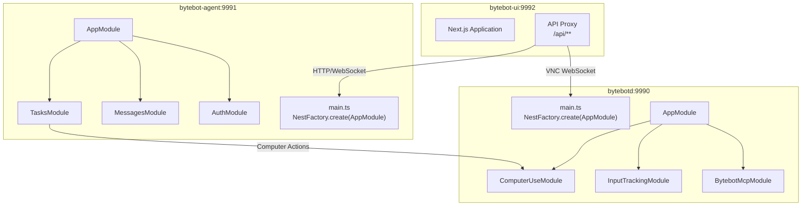
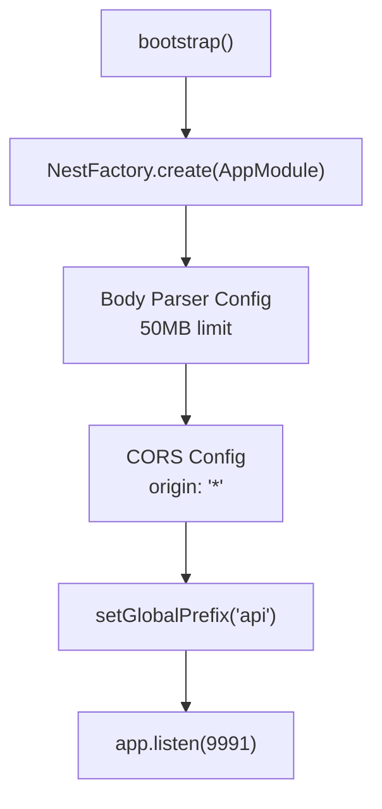
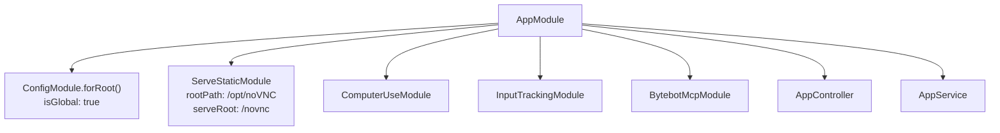
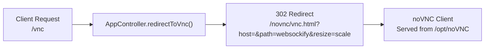
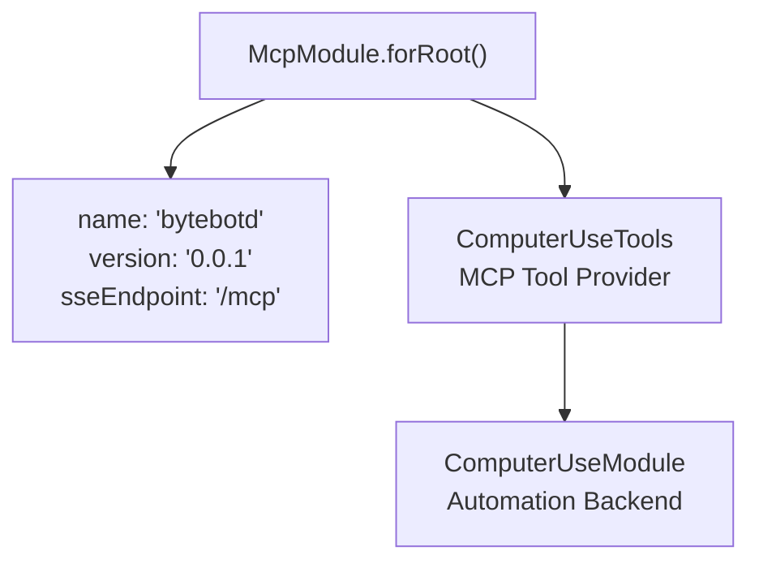
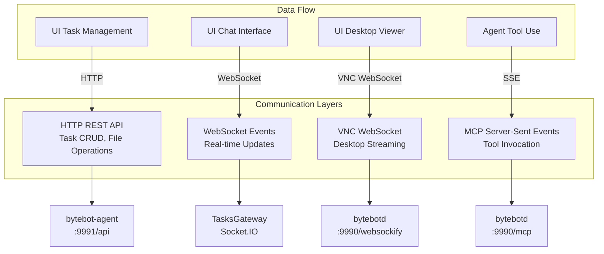

<!-- source: DeepWiki mcp.deepwiki.com · repo bytebot-ai/bytebot · page 4 Core Services · fetched 2026-10-29 -->

# Core Services

Relevant source files

The following files were used as context for generating this wiki page:

- [packages/bytebot-agent/package-lock.json](packages/bytebot-agent/package-lock.json)
- [packages/bytebot-agent/package.json](packages/bytebot-agent/package.json)
- [packages/bytebot-agent/src/agent/agent.module.ts](packages/bytebot-agent/src/agent/agent.module.ts)
- [packages/bytebot-agent/src/app.module.ts](packages/bytebot-agent/src/app.module.ts)
- [packages/bytebot-ui/package-lock.json](packages/bytebot-ui/package-lock.json)
- [packages/bytebot-ui/package.json](packages/bytebot-ui/package.json)
- [packages/bytebot-ui/src/app/layout.tsx](packages/bytebot-ui/src/app/layout.tsx)
- [packages/bytebot-ui/src/components/layout/Header.tsx](packages/bytebot-ui/src/components/layout/Header.tsx)
- [packages/bytebotd/package-lock.json](packages/bytebotd/package-lock.json)
- [packages/bytebotd/package.json](packages/bytebotd/package.json)
- [packages/bytebotd/src/app.controller.ts](packages/bytebotd/src/app.controller.ts)
- [packages/bytebotd/src/app.module.ts](packages/bytebotd/src/app.module.ts)
- [packages/bytebotd/src/mcp/bytebot-mcp.module.ts](packages/bytebotd/src/mcp/bytebot-mcp.module.ts)
- [packages/bytebotd/src/mcp/index.ts](packages/bytebotd/src/mcp/index.ts)

This page provides a detailed examination of Bytebot's three core services and their internal architecture. It covers the implementation details, module structures, and communication patterns within each service.

For deployment and infrastructure information, see [Deployment Architecture](#2.2). For user-facing functionality, see [User Interface](#7) and [Desktop Environment](#5).

## Service Overview

Bytebot consists of three primary services that work together to provide AI-powered desktop automation:

| Service | Package Name | Technology | Port | Primary Role |
|---------|--------------|------------|------|--------------|
| Agent Service | `bytebot-agent` | NestJS | 9991 | AI orchestration, API backend |
| Desktop Service | `bytebotd` | NestJS | 9990 | Desktop automation, VNC server |
| UI Service | `bytebot-ui` | Next.js | 9992 | Web frontend, user interface |

**Sources:** [packages/bytebot-agent/src/main.ts:1-36](), [packages/bytebotd/src/app.module.ts:1-27](), [packages/bytebotd/package.json:1-93]()

## Agent Service Architecture

The `bytebot-agent` service serves as the central orchestrator, handling AI model integration, task management, and API endpoints.

### Main Application Setup

The agent service initializes through `main.ts` with specific configurations for handling large payloads and CORS:

The application configures JSON and URL-encoded body parsers with a 50MB limit to handle large file uploads and screenshots [packages/bytebot-agent/src/main.ts:18-19](), sets a global API prefix [packages/bytebot-agent/src/main.ts:22](), and enables permissive CORS for cross-origin requests [packages/bytebot-agent/src/main.ts:25-28]().

### Module Structure

The agent service follows NestJS modular architecture patterns:

| Module | Responsibility | Key Components |
|--------|----------------|----------------|
| `AppModule` | Root module, dependency injection | Core configuration |
| `TasksModule` | Task lifecycle management | `TasksService`, `TasksController` |
| `MessagesModule` | Chat message handling | `MessagesService`, message persistence |
| `AuthModule` | Authentication and authorization | Better Auth integration |
| `AgentModule` | AI model orchestration | `AgentProcessor`, LLM integrations |

**Sources:** [packages/bytebot-agent/src/main.ts:1-36]()

## Desktop Service Architecture

The `bytebotd` service provides the virtual desktop environment and computer automation capabilities.

### Application Module Configuration

The desktop service configures global environment variables [packages/bytebotd/src/app.module.ts:12-14](), serves noVNC static files for web-based VNC access [packages/bytebotd/src/app.module.ts:15-18](), and integrates multiple specialized modules for different automation concerns.

### Core Modules

| Module | Technology Stack | Purpose |
|--------|------------------|---------|
| `ComputerUseModule` | `@nut-tree-fork/nut-js` | Mouse, keyboard, screen automation |
| `InputTrackingModule` | `uiohook-napi` | User input monitoring and capture |
| `BytebotMcpModule` | `@rekog/mcp-nest` | Model Context Protocol server |

### VNC Integration

The `AppController` provides seamless VNC access through automatic redirection:

The controller extracts the host header and constructs a noVNC URL with appropriate parameters for websocket connection and display scaling [packages/bytebotd/src/app.controller.ts:13-16]().

**Sources:** [packages/bytebotd/src/app.module.ts:1-27](), [packages/bytebotd/src/app.controller.ts:1-19](), [packages/bytebotd/package.json:28-47]()

## Model Context Protocol Integration

The desktop service implements MCP (Model Context Protocol) for standardized AI tool integration:

The MCP integration exposes computer automation capabilities as standardized tools that can be consumed by AI models through the `/mcp` SSE endpoint [packages/bytebotd/src/mcp/bytebot-mcp.module.ts:9-13]().

**Sources:** [packages/bytebotd/src/mcp/bytebot-mcp.module.ts:1-18](), [packages/bytebotd/src/mcp/index.ts:1-2]()

## Inter-Service Communication Patterns

The services communicate through multiple channels optimized for different data types and latency requirements:

### Service Dependencies

Each service has specific technology dependencies that define its capabilities:

| Service | Key Dependencies | Purpose |
|---------|------------------|---------|
| `bytebot-agent` | `@nestjs/platform-socket.io`, `prisma` | WebSocket gateway, database ORM |
| `bytebotd` | `@nut-tree-fork/nut-js`, `uiohook-napi`, `sharp` | OS automation, input capture, image processing |
| `bytebot-ui` | `socket.io-client`, `react-vnc` | Real-time communication, VNC display |

**Sources:** [packages/bytebotd/package.json:28-47](), [packages/bytebot-agent/src/main.ts:22-28]()

## Service Lifecycle and Process Management

Each service follows standardized patterns for initialization, configuration, and shutdown:

```mermaid
graph TB
    subgraph "Agent Service Lifecycle"
        Agent_Bootstrap["bootstrap()"]
        Agent_Crypto["Crypto Polyfill<br/>globalThis.crypto"]
        Agent_Factory["NestFactory.create(AppModule)"]
        Agent_Config["Middleware & CORS Setup"]
        Agent_Listen["Listen on Port 9991"]
    end
    
    subgraph "Desktop Service Lifecycle"
        Desktop_Module["AppModule Bootstrap"]
        Desktop_Static["Static File Serving<br/>/opt/noVNC"]
        Desktop_Modules["Load Feature Modules"]
        Desktop_Listen["Listen on Port 9990"]
    end
    
    Agent_Bootstrap --> Agent_Crypto
    Agent_Crypto --> Agent_Factory
    Agent_Factory --> Agent_Config
    Agent_Config --> Agent_Listen
    
    Desktop_Module --> Desktop_Static
    Desktop_Static --> Desktop_Modules
    Desktop_Modules --> Desktop_Listen
```

The agent service includes a crypto polyfill for compatibility with NestJS schedule module [packages/bytebot-agent/src/main.ts:7-9](), while the desktop service prioritizes static file serving for noVNC integration.

**Sources:** [packages/bytebot-agent/src/main.ts:1-36](), [packages/bytebotd/src/app.module.ts:10-26]()

---

