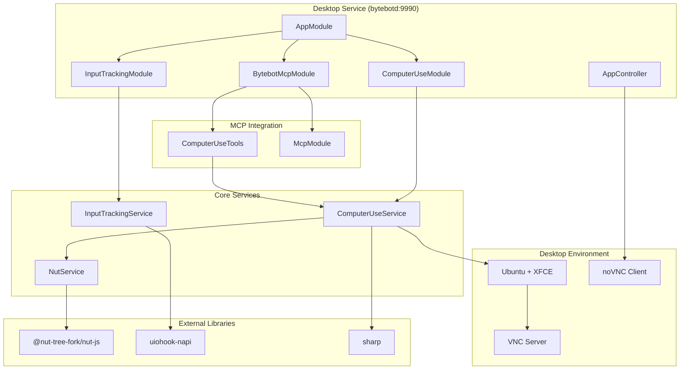
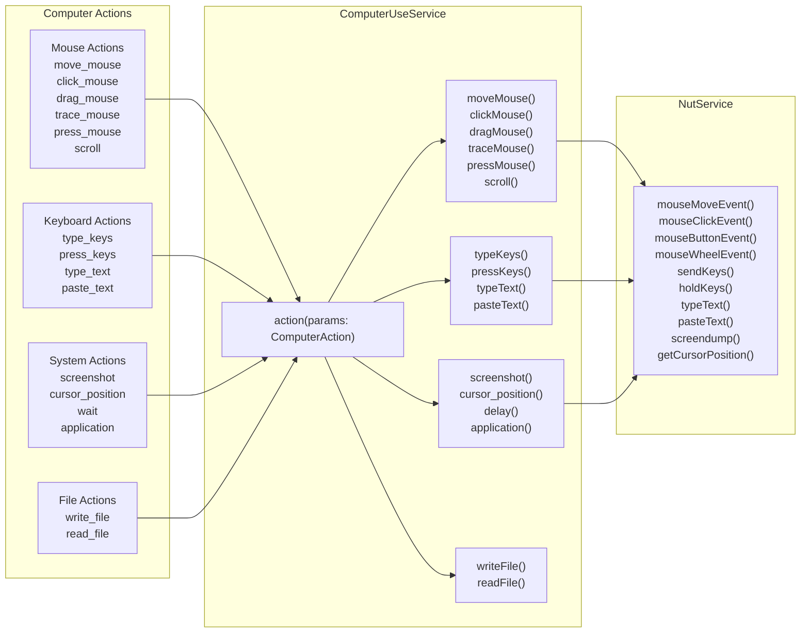
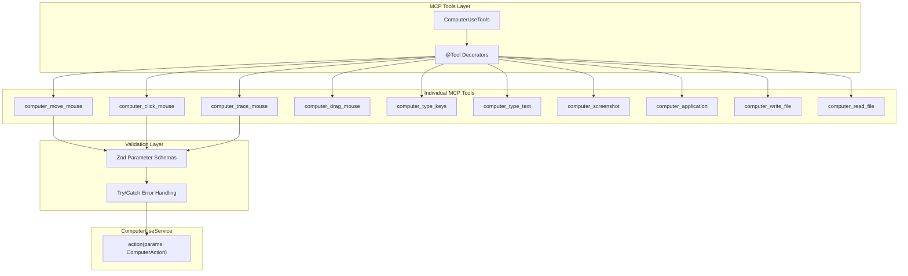
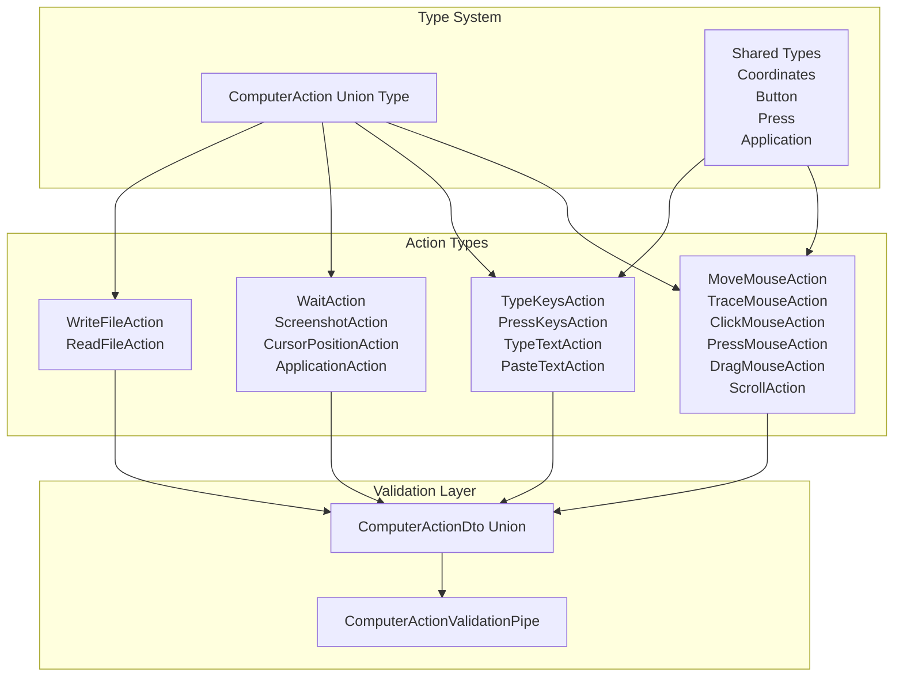
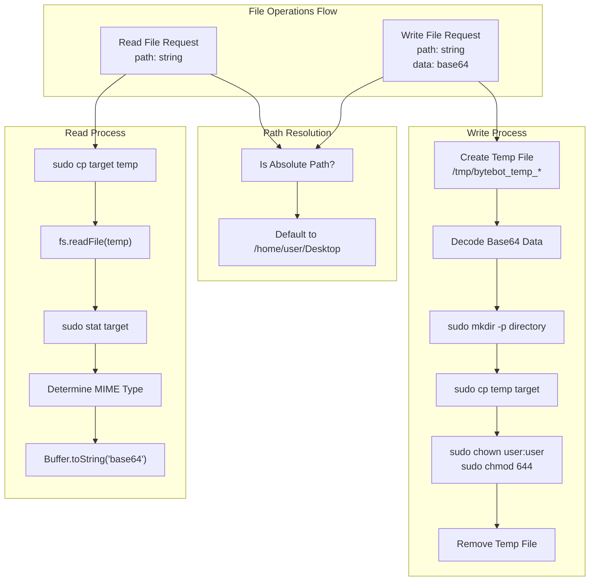
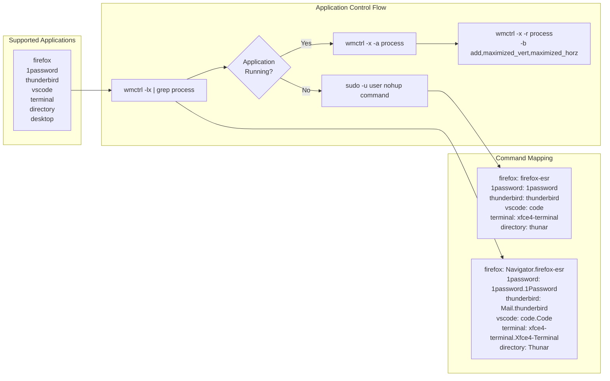
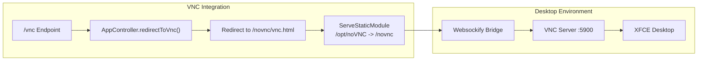
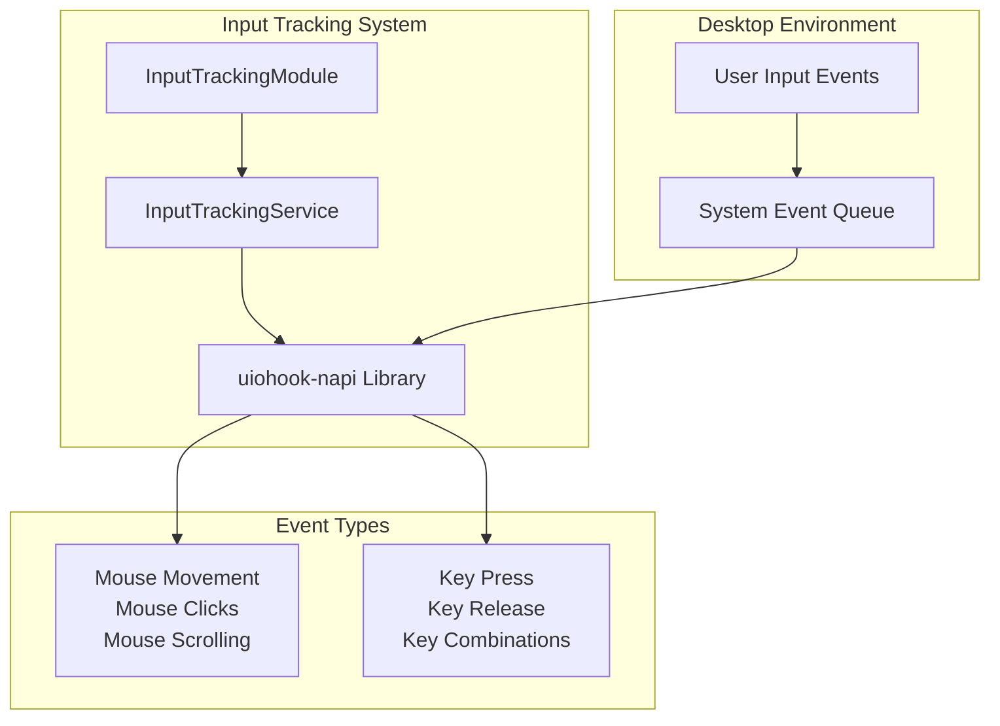

<!-- source: DeepWiki mcp.deepwiki.com · repo bytebot-ai/bytebot · page 4.2 bytebotd Desktop Service · fetched 2026-10-29 -->

# Desktop Service

Relevant source files

The following files were used as context for generating this wiki page:

- [README.md](README.md)
- [docs/api-reference/agent/tasks.mdx](docs/api-reference/agent/tasks.mdx)
- [docs/core-concepts/desktop-environment.mdx](docs/core-concepts/desktop-environment.mdx)
- [docs/deployment/railway.mdx](docs/deployment/railway.mdx)
- [docs/guides/task-creation.mdx](docs/guides/task-creation.mdx)
- [docs/introduction.mdx](docs/introduction.mdx)
- [docs/quickstart.mdx](docs/quickstart.mdx)
- [packages/bytebotd/package-lock.json](packages/bytebotd/package-lock.json)
- [packages/bytebotd/package.json](packages/bytebotd/package.json)
- [packages/bytebotd/src/app.controller.ts](packages/bytebotd/src/app.controller.ts)
- [packages/bytebotd/src/app.module.ts](packages/bytebotd/src/app.module.ts)
- [packages/bytebotd/src/mcp/bytebot-mcp.module.ts](packages/bytebotd/src/mcp/bytebot-mcp.module.ts)
- [packages/bytebotd/src/mcp/index.ts](packages/bytebotd/src/mcp/index.ts)

The Desktop Service (`bytebotd`) is a NestJS-based daemon that provides programmatic control over a virtual desktop environment. It serves as the bridge between AI agents and the underlying Ubuntu desktop system, enabling automated computer interactions through a comprehensive API. This service handles mouse movements, keyboard input, application launching, file operations, and screen capture within the containerized desktop environment.

For information about how the agent orchestrates tasks using this service, see [Agent Service](#4.1). For details about the web interface that displays the desktop, see [UI Service](#4.3).

## Architecture Overview

The Desktop Service is built as a NestJS application running on port 9990, providing both REST APIs and Model Context Protocol (MCP) integration for computer automation.

Sources: [packages/bytebotd/src/app.module.ts:1-26](), [packages/bytebotd/package.json:28-46](), [packages/bytebotd/src/mcp/bytebot-mcp.module.ts:1-17]()

## Core Components

### ComputerUseService

The `ComputerUseService` is the central component that executes all computer actions. It implements a comprehensive action dispatcher that handles mouse, keyboard, application, and file operations.

Sources: [packages/bytebotd/src/computer-use/computer-use.service.ts:31-105]()

### MCP Integration

The service exposes its functionality through the Model Context Protocol (MCP), allowing AI models to directly invoke computer actions as tools.

Sources: [packages/bytebotd/src/mcp/computer-use.tools.ts:8-698](), [packages/bytebotd/src/mcp/bytebot-mcp.module.ts:9-13]()

## Computer Action Types

The system supports a comprehensive set of computer actions defined by TypeScript types and validated through DTOs.

| Action Category | Actions | Purpose |
|----------------|---------|---------|
| Mouse Movement | `move_mouse`, `trace_mouse` | Position cursor and create movement paths |
| Mouse Interaction | `click_mouse`, `press_mouse`, `drag_mouse` | Perform clicks, hold/release buttons, drag operations |
| Scrolling | `scroll` | Scroll in any direction with customizable count |
| Keyboard Input | `type_keys`, `press_keys`, `type_text`, `paste_text` | Send key combinations, hold keys, type text |
| System Control | `screenshot`, `cursor_position`, `wait` | Capture screen, get cursor position, add delays |
| Application Control | `application` | Launch and switch between applications |
| File Operations | `write_file`, `read_file` | Create and read files with base64 encoding |

Sources: [packages/shared/src/types/computerAction.types.ts:1-126](), [packages/bytebotd/src/computer-use/dto/computer-action.dto.ts:223-240]()

## File Operations

The service provides secure file operations with automatic path resolution and permission handling.

Sources: [packages/bytebotd/src/computer-use/computer-use.service.ts:364-506]()

## Application Management

The service can launch and manage desktop applications with automatic window management.

Sources: [packages/bytebotd/src/computer-use/computer-use.service.ts:264-362]()

## Integration Points

### VNC Access

The service provides VNC access through a redirect endpoint that integrates with the noVNC web client.

Sources: [packages/bytebotd/src/app.controller.ts:8-17](), [packages/bytebotd/src/app.module.ts:15-18]()

### Input Tracking

The service includes input tracking capabilities for monitoring user interactions with the desktop environment.

Sources: [packages/bytebotd/src/app.module.ts:20](), [packages/bytebotd/package.json:46]()

---

