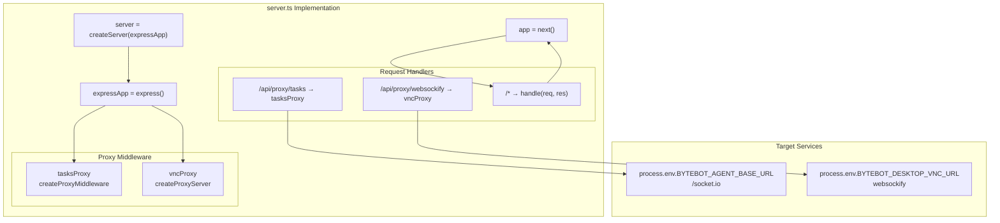
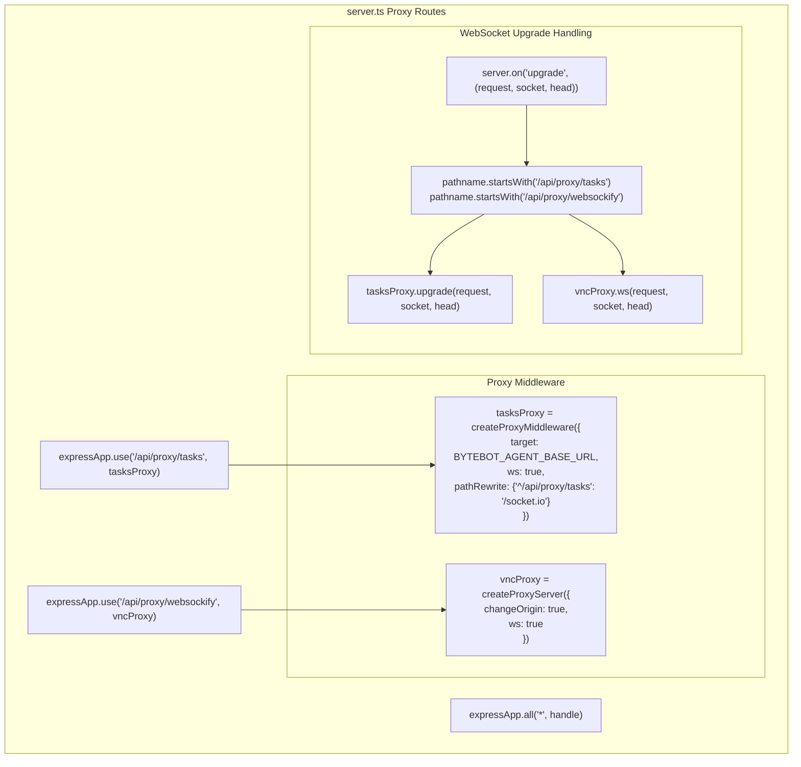
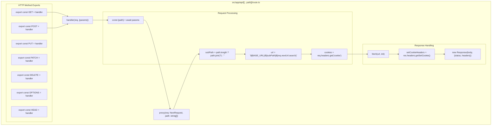
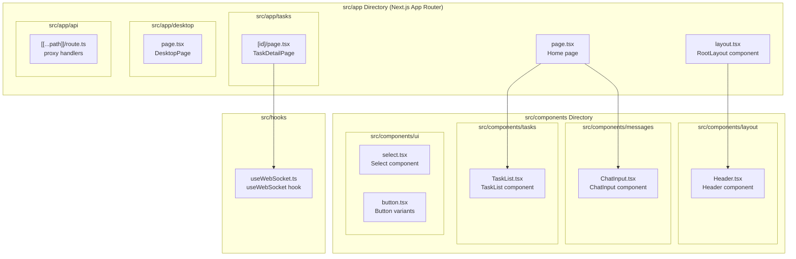
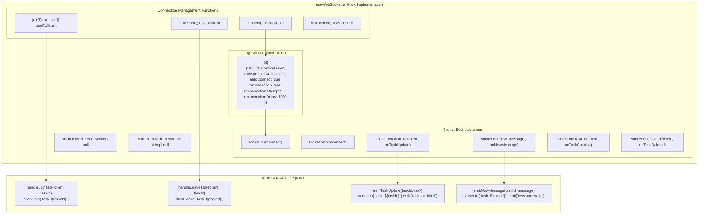
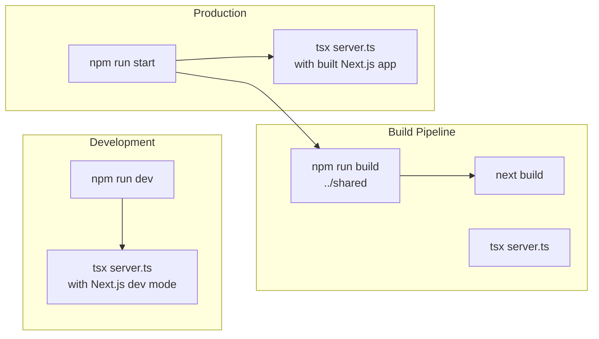

<!-- source: DeepWiki mcp.deepwiki.com · repo bytebot-ai/bytebot · page 4.3 bytebot-ui Frontend Service · fetched 2026-10-29 -->

# UI Service

Relevant source files

The following files were used as context for generating this wiki page:

- [packages/bytebot-agent/src/main.ts](packages/bytebot-agent/src/main.ts)
- [packages/bytebot-agent/src/tasks/tasks.gateway.ts](packages/bytebot-agent/src/tasks/tasks.gateway.ts)
- [packages/bytebot-ui/next.config.ts](packages/bytebot-ui/next.config.ts)
- [packages/bytebot-ui/package-lock.json](packages/bytebot-ui/package-lock.json)
- [packages/bytebot-ui/package.json](packages/bytebot-ui/package.json)
- [packages/bytebot-ui/server.ts](packages/bytebot-ui/server.ts)
- [packages/bytebot-ui/src/app/api/[[...path]]/route.ts](packages/bytebot-ui/src/app/api/[[...path]]/route.ts)
- [packages/bytebot-ui/src/app/layout.tsx](packages/bytebot-ui/src/app/layout.tsx)
- [packages/bytebot-ui/src/components/layout/Header.tsx](packages/bytebot-ui/src/components/layout/Header.tsx)
- [packages/bytebot-ui/src/hooks/useWebSocket.ts](packages/bytebot-ui/src/hooks/useWebSocket.ts)

The UI Service (`bytebot-ui`) is a Next.js 15 React application that provides the web frontend for Bytebot system interaction. It operates as a hybrid Express/Next.js server running on port 9992, implementing dual-proxy architecture to route requests to `bytebot-agent` and `bytebot-desktop` services. The service handles task management UI, real-time WebSocket communication via Socket.IO, and VNC desktop viewing through `react-vnc`.

The service integrates with [Agent Service](#4.1) for task orchestration and [Desktop Service](#4.2) for computer automation capabilities.

## Architecture Overview

The `bytebot-ui` service implements a dual-server architecture combining Express.js with Next.js. The `server.ts` file creates an Express application that wraps the Next.js app, enabling custom proxy middleware while preserving Next.js functionality.

**Dual-Server Architecture**

The `server.listen()` function starts the hybrid server on `process.env.PORT ?? 9992` with WebSocket upgrade handling for both Socket.IO and VNC connections.

Sources: [packages/bytebot-ui/server.ts:29-31](), [packages/bytebot-ui/server.ts:19-24](), [packages/bytebot-ui/server.ts:81-83]()

## Proxy Implementation

The service implements dual-proxy routing through Express middleware (`server.ts`) and Next.js API routes (`[[...path]]/route.ts`). This handles both WebSocket upgrades and HTTP API forwarding to backend services.

### Express Server Proxy Configuration

**WebSocket and HTTP Proxy Setup**

**Proxy Route Mapping**
| Route Pattern | Proxy Target | Rewrite Rule | WebSocket Support |
|---------------|--------------|--------------|-------------------|
| `/api/proxy/tasks` | `BYTEBOT_AGENT_BASE_URL/socket.io` | `^/api/proxy/tasks` → `/socket.io` | ✓ |
| `/api/proxy/websockify` | `BYTEBOT_DESKTOP_VNC_URL` | Path preserved with prefix removal | ✓ |
| `*` | `handle(req, res)` | Next.js handler | Next.js WebSocket |

Sources: [packages/bytebot-ui/server.ts:33-37](), [packages/bytebot-ui/server.ts:41-51](), [packages/bytebot-ui/server.ts:57-79]()

### Next.js API Proxy Routes

**Catch-All Route Implementation**

The `proxy()` function forwards requests to `process.env.BYTEBOT_AGENT_BASE_URL` with cookie preservation and supports all HTTP methods through dynamic exports.

Sources: [packages/bytebot-ui/src/app/api/[[...path]]/route.ts:6-25](), [packages/bytebot-ui/src/app/api/[[...path]]/route.ts:53-64]()

## React Component Structure

The `bytebot-ui` implements a Next.js App Router architecture with TypeScript React components using `@radix-ui` primitives and Tailwind CSS styling.

**Component File Structure**

**Key Component Implementation Details**

**Header Component** (`src/components/layout/Header.tsx`):
- `usePathname()` for active route detection via `isActive(path)` function
- Theme-aware logo switching with `useTheme()` from `next-themes`
- Navigation links using `Link` components with dynamic CSS classes via `getLinkClasses(path)`
- HugeIcons integration: `Home01Icon`, `TaskDaily01Icon`, `ComputerIcon`, `DocumentCodeIcon`

**WebSocket Integration** (`src/hooks/useWebSocket.ts`):
- `socketRef.current` maintains Socket.IO client instance
- Connection config: `path: "/api/proxy/tasks"`, `transports: ["websocket"]`
- Event handlers: `onTaskUpdate`, `onNewMessage`, `onTaskCreated`, `onTaskDeleted`
- Room management: `joinTask(taskId)` emits `join_task`, `leaveTask()` emits `leave_task`

Sources: [packages/bytebot-ui/src/components/layout/Header.tsx:15-43](), [packages/bytebot-ui/src/hooks/useWebSocket.ts:12-17](), [packages/bytebot-ui/src/hooks/useWebSocket.ts:68-88]()

## Socket.IO WebSocket Implementation

The `useWebSocket` hook manages Socket.IO client connections to the `bytebot-agent` service through the Express proxy layer, implementing task-based room subscriptions and real-time event handling.

**Socket.IO Client Architecture**

**WebSocket Event Protocol**

| Client Event | Server Handler | Server Response | Room Targeting |
|--------------|----------------|-----------------|----------------|
| `emit('join_task', taskId)` | `handleJoinTask()` | - | `client.join(\`task_${taskId}\`)` |
| `emit('leave_task', taskId)` | `handleLeaveTask()` | - | `client.leave(\`task_${taskId}\`)` |
| - | `emitTaskUpdate()` | `task_updated` | `server.to(\`task_${taskId}\`)` |
| - | `emitNewMessage()` | `new_message` | `server.to(\`task_${taskId}\`)` |
| - | `emitTaskCreated()` | `task_created` | `server.emit()` (broadcast) |
| - | `emitTaskDeleted()` | `task_deleted` | `server.emit()` (broadcast) |

The hook maintains `currentTaskIdRef` to track active subscriptions and automatically handles room transitions when switching between tasks.

Sources: [packages/bytebot-ui/src/hooks/useWebSocket.ts:21-34](), [packages/bytebot-ui/src/hooks/useWebSocket.ts:68-88](), [packages/bytebot-agent/src/tasks/tasks.gateway.ts:30-56]()

## Dependencies and Technology Stack

The `bytebot-ui` package implements a modern React stack with specific dependencies for proxy servers, real-time communication, and desktop integration.

### Core Runtime Dependencies

| Package | Version | Implementation Purpose |
|---------|---------|----------------------|
| `next` | ≥15.3.3 | Next.js App Router with React Server Components |
| `react` | ^19.0.0 | UI framework with concurrent features |
| `express` | ^4.21.2 | Custom server wrapper for `server.ts` |
| `http-proxy-middleware` | ^3.0.5 | Express middleware for `/api/proxy/tasks` routing |
| `http-proxy` | ^1.18.1 | Low-level proxy for VNC WebSocket handling |
| `socket.io-client` | ^4.8.1 | WebSocket client for `useWebSocket` hook |
| `react-vnc` | ^3.1.0 | VNC client component for desktop viewing |
| `tsx` | ^4.19.3 | TypeScript runtime for `server.ts` execution |

### UI Component Dependencies

| Package | Version | Usage |
|---------|---------|-------|
| `@radix-ui/react-*` | ^2.x | Headless UI primitives (`Select`, `DropdownMenu`, `Popover`) |
| `@hugeicons/react` | ^1.0.5 | Icon components (`Home01Icon`, `TaskDaily01Icon`) |
| `lucide-react` | ^0.517.0 | Additional icon library |
| `tailwindcss` | ^4 | Utility-first CSS framework |
| `class-variance-authority` | ^0.7.1 | Component variant management |
| `clsx` | ^2.1.1 | Conditional className utility |

### Shared Package Integration

| Package | Source | Purpose |
|---------|--------|---------|
| `@bytebot/shared` | `../shared` | TypeScript interfaces (`Task`, `Message`) |
| `@prisma/client` | ^6.5.0 | Database client types and runtime |

The `next.config.ts` includes `transpilePackages: ["@bytebot/shared"]` to enable monorepo package importing.

Sources: [packages/bytebot-ui/package.json:11-47](), [packages/bytebot-ui/package.json:49-62](), [packages/bytebot-ui/next.config.ts:6-8]()

## Build and Deployment Configuration

The UI Service uses custom build scripts and supports both development and production deployments.

### Build Scripts

### Environment Configuration

| Variable | Purpose | Default |
|----------|---------|---------|
| `BYTEBOT_AGENT_BASE_URL` | Agent Service endpoint | Required |
| `BYTEBOT_DESKTOP_VNC_URL` | Desktop VNC endpoint | Required |
| `PORT` | Server port | 9992 |
| `HOSTNAME` | Server hostname | localhost |
| `NODE_ENV` | Environment mode | development |

The Next.js configuration [packages/bytebot-ui/next.config.ts]() transpiles the shared package for proper module resolution across the monorepo structure.

Sources: [packages/bytebot-ui/package.json:5-9](), [packages/bytebot-ui/server.ts:11-17](), [packages/bytebot-ui/next.config.ts:6-8]()

---

