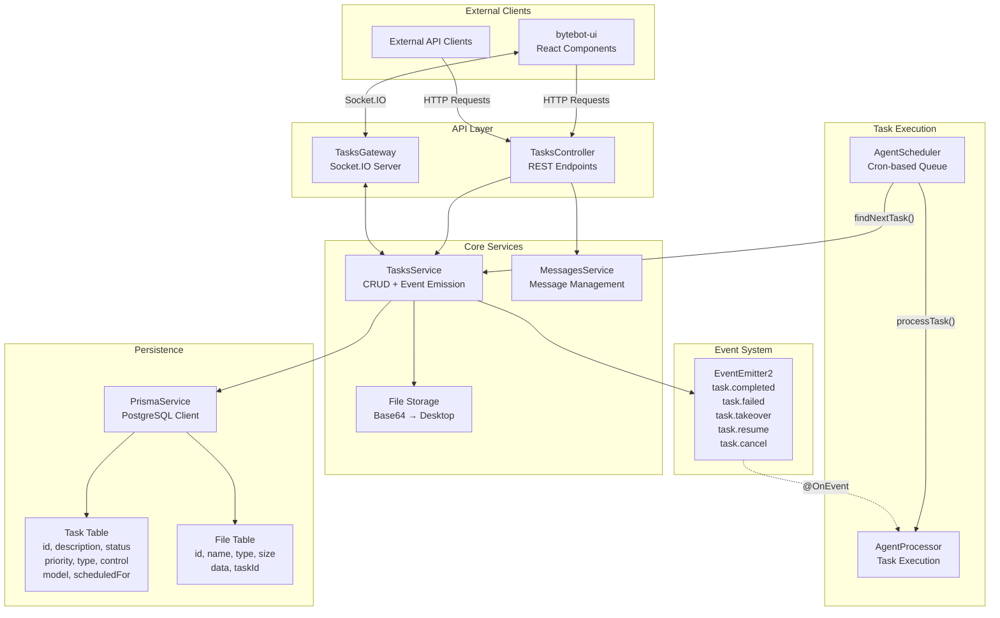
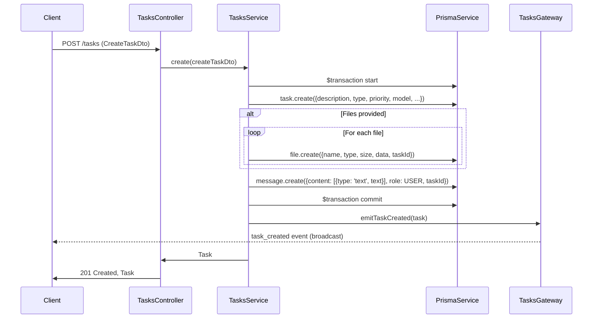
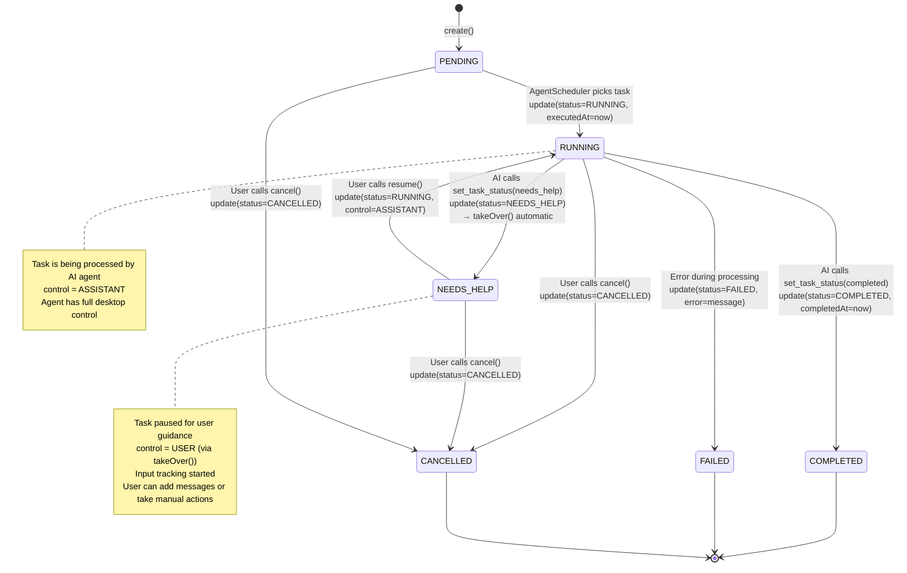
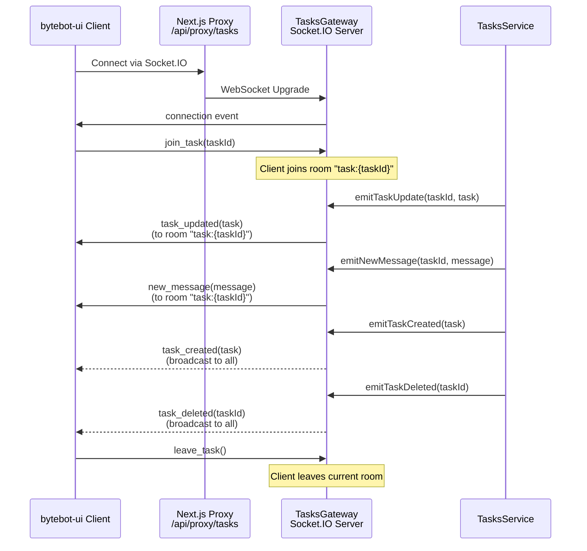
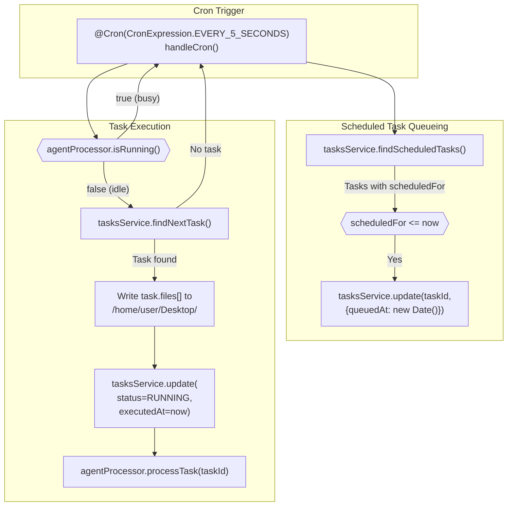
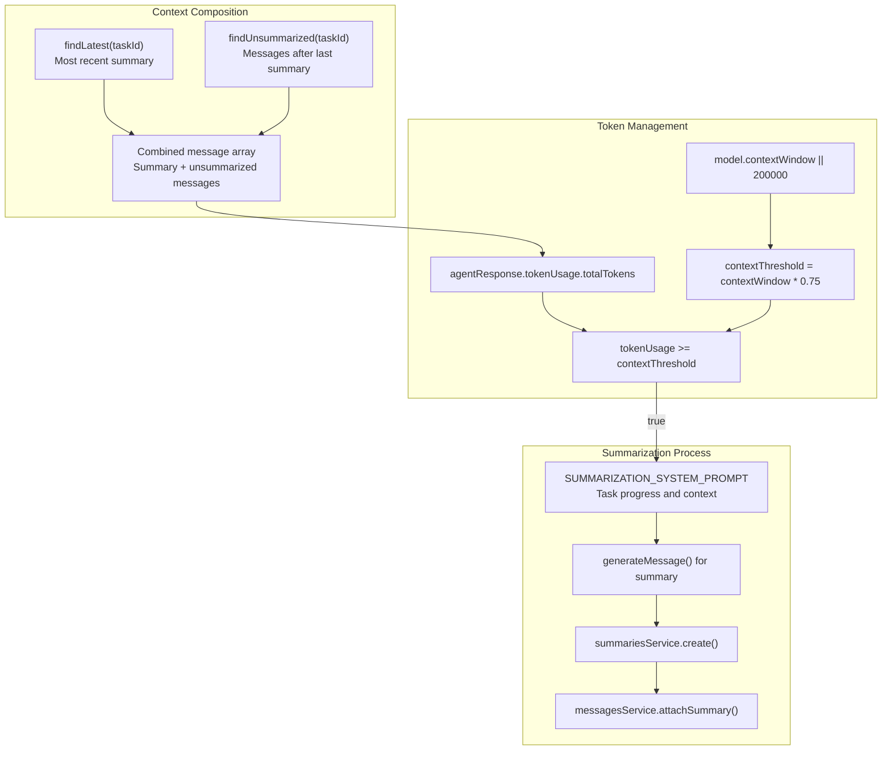
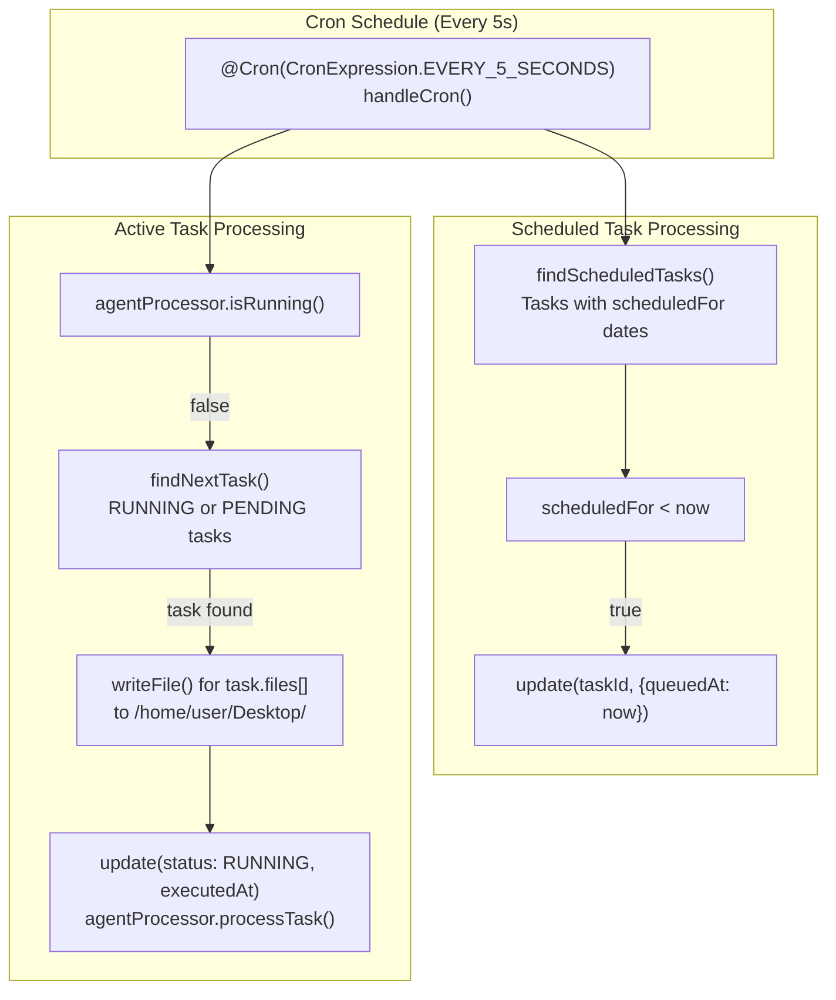

<!-- source: DeepWiki mcp.deepwiki.com · repo bytebot-ai/bytebot · page 5 Task Management System · fetched 2026-10-29 -->

# Task Management System

<details>
<summary>Relevant source files</summary>

The following files were used as context for generating this wiki page:

- [packages/bytebot-agent/src/agent/agent.processor.ts](packages/bytebot-agent/src/agent/agent.processor.ts)
- [packages/bytebot-agent/src/tasks/tasks.controller.ts](packages/bytebot-agent/src/tasks/tasks.controller.ts)
- [packages/bytebot-agent/src/tasks/tasks.service.ts](packages/bytebot-agent/src/tasks/tasks.service.ts)
- [packages/bytebot-ui/src/hooks/useChatSession.ts](packages/bytebot-ui/src/hooks/useChatSession.ts)

</details>


The Task Management System provides comprehensive task creation, lifecycle management, and real-time communication capabilities for Bytebot. This system handles task CRUD operations, state transitions, scheduling, file attachments, and WebSocket-based event broadcasting to keep all clients synchronized.

For details on how tasks are executed by the AI agent, see page 6 (Agent System). For real-time event communication patterns, see page 2.2 (Communication Patterns). For database schema details, see page 9.2 (Database Schema).

## Architecture Overview

The Task Management System centers around `TasksService`, which provides CRUD operations, state management, and event emission. It integrates with `TasksGateway` for WebSocket broadcasting, `AgentScheduler` for queue management, and `EventEmitter2` for internal event coordination.

**Task Management System Architecture**



Sources: [packages/bytebot-agent/src/tasks/tasks.service.ts:1-392](), [packages/bytebot-agent/src/tasks/tasks.controller.ts:1-194](), [packages/bytebot-agent/src/tasks/tasks.gateway.ts]()

## Task Data Model

Tasks are represented by the Prisma `Task` model with comprehensive metadata for scheduling, execution tracking, and control management.

**Task Entity Schema**

| Field | Type | Description |
|-------|------|-------------|
| `id` | `string` | UUID primary key |
| `description` | `string` | User-provided task description |
| `status` | `TaskStatus` | Current state: PENDING, RUNNING, NEEDS_HELP, COMPLETED, FAILED, CANCELLED |
| `priority` | `TaskPriority` | Execution priority: LOW, MEDIUM, HIGH |
| `type` | `TaskType` | Task type: IMMEDIATE, SCHEDULED |
| `control` | `Role` | Control authority: ASSISTANT (AI), USER |
| `createdBy` | `Role` | Creator: USER or ASSISTANT |
| `model` | `Json` | AI model configuration (provider, name, contextWindow) |
| `scheduledFor` | `DateTime?` | Optional scheduled execution time |
| `queuedAt` | `DateTime?` | When task was queued for execution |
| `executedAt` | `DateTime?` | When task execution started |
| `completedAt` | `DateTime?` | When task finished |
| `error` | `string?` | Error message if failed |
| `createdAt` | `DateTime` | Creation timestamp |
| `updatedAt` | `DateTime` | Last modification timestamp |

**Task Status Enumeration**

```typescript
enum TaskStatus {
  PENDING      // Created but not started
  RUNNING      // Currently executing
  NEEDS_HELP   // Paused, awaiting user guidance
  COMPLETED    // Successfully finished
  FAILED       // Terminated with error
  CANCELLED    // User-cancelled
}
```

**Task Priority and Type**

```typescript
enum TaskPriority {
  LOW
  MEDIUM
  HIGH
}

enum TaskType {
  IMMEDIATE    // Execute as soon as possible
  SCHEDULED    // Execute at scheduledFor time
}
```

Sources: [packages/bytebot-agent/prisma/schema.prisma](), [packages/bytebot-agent/src/tasks/tasks.service.ts:12-20]()

## TasksService Core Operations

The `TasksService` class provides comprehensive task lifecycle management through CRUD operations, state transitions, and event emission.

**Task Creation Flow**



Sources: [packages/bytebot-agent/src/tasks/tasks.service.ts:40-117](), [packages/bytebot-agent/src/tasks/tasks.controller.ts:42-46]()

### Primary TasksService Methods

**CRUD Operations**

| Method | Parameters | Return | Description |
|--------|-----------|--------|-------------|
| `create()` | `CreateTaskDto` | `Promise<Task>` | Creates task with initial message, saves files, emits `task_created` |
| `findAll()` | `page, limit, statuses?` | `Promise<{tasks, total, totalPages}>` | Paginated task list with optional status filter |
| `findById()` | `id: string` | `Promise<Task>` | Retrieves single task with files included |
| `update()` | `id: string, UpdateTaskDto` | `Promise<Task>` | Updates task, handles status transitions, emits `task_updated` |
| `delete()` | `id: string` | `Promise<Task>` | Deletes task, emits `task_deleted` |

**Task Queue Management**

| Method | Parameters | Return | Description |
|--------|-----------|--------|-------------|
| `findScheduledTasks()` | - | `Promise<Task[]>` | Returns tasks with `scheduledFor` set but not yet queued |
| `findNextTask()` | - | `Promise<Task & {files}>` | Returns highest priority RUNNING or PENDING task with files |

**Control Transfer Operations**

| Method | Parameters | Return | Description |
|--------|-----------|--------|-------------|
| `takeOver()` | `taskId: string` | `Promise<Task>` | Transfers control to USER, starts input tracking, emits `task.takeover` |
| `resume()` | `taskId: string` | `Promise<Task>` | Returns control to ASSISTANT, stops input tracking, emits `task.resume` |
| `cancel()` | `taskId: string` | `Promise<Task>` | Sets status to CANCELLED, emits `task.cancel` |
| `addTaskMessage()` | `taskId, AddTaskMessageDto` | `Promise<Task>` | Adds user message, emits `new_message` |

Sources: [packages/bytebot-agent/src/tasks/tasks.service.ts:40-391]()

### Status Update Logic

When `update()` is called with a status change, `TasksService` handles special status transitions:

```typescript
// In update() method
if (updateTaskDto.status === TaskStatus.COMPLETED) {
  this.eventEmitter.emit('task.completed', { taskId: id });
} else if (updateTaskDto.status === TaskStatus.NEEDS_HELP) {
  updatedTask = await this.takeOver(id);
} else if (updateTaskDto.status === TaskStatus.FAILED) {
  this.eventEmitter.emit('task.failed', { taskId: id });
}
```

The `NEEDS_HELP` status automatically triggers `takeOver()`, which transfers control to the user and starts input tracking.

Sources: [packages/bytebot-agent/src/tasks/tasks.service.ts:217-247]()

## Task Lifecycle State Machine

Tasks transition through well-defined states from creation to completion. The state machine handles user intervention, error conditions, and successful completion.

**Task State Transitions**



**Control Authority Transitions**

Tasks have a `control` field that determines who currently manages the desktop:

| Control Value | Authority | Input Tracking | Actions Available |
|---------------|-----------|----------------|-------------------|
| `Role.ASSISTANT` | AI Agent | Stopped | AI can execute desktop actions via computer tools |
| `Role.USER` | Human User | Started | User can manually interact with desktop, VNC streaming active |

Control transfers occur via:
- `takeOver(taskId)`: ASSISTANT → USER (sets `control=USER`, starts input tracking)
- `resume(taskId)`: USER → ASSISTANT (sets `control=ASSISTANT`, stops input tracking)

Sources: [packages/bytebot-agent/src/tasks/tasks.service.ts:217-391](), [packages/bytebot-agent/src/agent/agent.processor.ts:134-149]()

### State Transition Events

`TasksService` emits internal events via `EventEmitter2` for key state transitions:

| Event Name | Triggered By | Payload | Listeners |
|------------|--------------|---------|-----------|
| `task.completed` | `update(status=COMPLETED)` | `{taskId}` | AgentProcessor |
| `task.failed` | `update(status=FAILED)` | `{taskId}` | AgentProcessor |
| `task.takeover` | `takeOver(taskId)` | `{taskId}` | AgentProcessor |
| `task.resume` | `resume(taskId)` | `{taskId}` | AgentProcessor |
| `task.cancel` | `cancel(taskId)` | `{taskId}` | AgentProcessor |

These events allow `AgentProcessor` to react to task lifecycle changes (e.g., aborting processing on takeover, resuming iteration on resume).

Sources: [packages/bytebot-agent/src/tasks/tasks.service.ts:234-238](), [packages/bytebot-agent/src/tasks/tasks.service.ts:312](), [packages/bytebot-agent/src/tasks/tasks.service.ts:351](), [packages/bytebot-agent/src/tasks/tasks.service.ts:385]()

## WebSocket Real-Time Events

`TasksGateway` provides WebSocket-based real-time communication using Socket.IO, enabling clients to subscribe to task updates and receive instant notifications.

**WebSocket Event Flow**



Sources: [packages/bytebot-agent/src/tasks/tasks.gateway.ts](), [packages/bytebot-ui/src/hooks/useWebSocket.ts]()

### WebSocket Events

**Client-to-Server Events**

| Event | Payload | Description |
|-------|---------|-------------|
| `join_task` | `{taskId: string}` | Subscribe to updates for specific task (joins room `task:{taskId}`) |
| `leave_task` | - | Unsubscribe from current task room |

**Server-to-Client Events**

| Event | Payload | Scope | Description |
|-------|---------|-------|-------------|
| `task_updated` | `Task` | Room (`task:{taskId}`) | Emitted when task status, control, or other fields change |
| `new_message` | `Message` | Room (`task:{taskId}`) | Emitted when new message added to task |
| `task_created` | `Task` | Broadcast (all clients) | Emitted when new task created |
| `task_deleted` | `string` (taskId) | Broadcast (all clients) | Emitted when task deleted |

### TasksGateway Implementation

`TasksGateway` uses Socket.IO rooms for targeted event delivery:

```typescript
// Join task room
@SubscribeMessage('join_task')
handleJoinTask(client: Socket, payload: { taskId: string }) {
  client.join(`task:${payload.taskId}`);
}

// Room-scoped emission (only clients in that room receive)
emitTaskUpdate(taskId: string, task: Task) {
  this.server.to(`task:${taskId}`).emit('task_updated', task);
}

// Broadcast to all connected clients
emitTaskCreated(task: Task) {
  this.server.emit('task_created', task);
}
```

Sources: [packages/bytebot-agent/src/tasks/tasks.gateway.ts]()

### Frontend WebSocket Integration

The `useWebSocket` hook in bytebot-ui manages Socket.IO connections and event handling:

```typescript
const { joinTask, leaveTask } = useWebSocket({
  onTaskUpdate: (task) => setTaskStatus(task.status),
  onNewMessage: (message) => setMessages(prev => [...prev, message]),
  onTaskCreated: (task) => console.log('New task:', task),
  onTaskDeleted: (taskId) => console.log('Deleted:', taskId),
});

// Subscribe to specific task
useEffect(() => {
  if (currentTaskId) {
    joinTask(currentTaskId);
  }
  return () => leaveTask();
}, [currentTaskId]);
```

Sources: [packages/bytebot-ui/src/hooks/useWebSocket.ts](), [packages/bytebot-ui/src/hooks/useChatSession.ts:99-104]()

## Task Scheduling System

`AgentScheduler` manages the task execution queue via a cron job that runs every 5 seconds, handling scheduled task queueing and picking the next task for execution.

**AgentScheduler Operation Flow**



Sources: [packages/bytebot-agent/src/agent/agent.scheduler.ts:1-64]()

### Task Selection Priority

The `findNextTask()` method returns the highest priority task using this sort order:

1. **executedAt** (ascending): Tasks already RUNNING are prioritized over PENDING tasks
2. **priority** (descending): HIGH > MEDIUM > LOW
3. **queuedAt** (ascending): Earlier queued tasks first
4. **createdAt** (ascending): Older tasks first

```typescript
await this.prisma.task.findFirst({
  where: {
    status: {
      in: [TaskStatus.RUNNING, TaskStatus.PENDING],
    },
  },
  orderBy: [
    { executedAt: 'asc' },
    { priority: 'desc' },
    { queuedAt: 'asc' },
    { createdAt: 'asc' },
  ],
  include: {
    files: true,
  },
});
```

This ensures:
- A task already RUNNING (with `executedAt` set) continues before starting new tasks
- Higher priority tasks execute first within PENDING tasks
- Tasks are processed in FIFO order when priority is equal

Sources: [packages/bytebot-agent/src/tasks/tasks.service.ts:131-156]()

### Scheduled Task Processing

Tasks with `type=SCHEDULED` and a `scheduledFor` date are handled specially:

1. `findScheduledTasks()` retrieves tasks where `scheduledFor` is set but `queuedAt` is null
2. For each task where `scheduledFor <= now`, update `queuedAt` to current time
3. Task becomes eligible for `findNextTask()` selection

```typescript
async findScheduledTasks(): Promise<Task[]> {
  return this.prisma.task.findMany({
    where: {
      scheduledFor: {
        not: null,
      },
      queuedAt: null,
    },
    orderBy: [{ scheduledFor: 'asc' }],
  });
}
```

Sources: [packages/bytebot-agent/src/tasks/tasks.service.ts:119-129](), [packages/bytebot-agent/src/agent/agent.scheduler.ts:22-63]()

## Context Management and Summarization

The agent system automatically manages conversation context through intelligent summarization when approaching token limits, ensuring long-running tasks can continue without losing important information.

**Context Window Management**



Sources: [packages/bytebot-agent/src/agent/agent.processor.ts:157-181](), [packages/bytebot-agent/src/agent/agent.processor.ts:233-298](), [packages/bytebot-agent/src/agent/agent.constants.ts:6-15]()

## Task Scheduling and Queue Management

The `AgentScheduler` manages task execution through a cron-based system that handles scheduled tasks, file preparation, and ensures only one task processes at a time.

**Task Queue Processing Logic**



Sources: [packages/bytebot-agent/src/agent/agent.scheduler.ts:22-63](), [packages/bytebot-agent/src/tasks/tasks.service.ts:131-156]()

## System Prompts and Tool Definitions

The agent system uses carefully crafted system prompts and comprehensive tool definitions to guide AI behavior and ensure reliable computer automation.

The `AGENT_SYSTEM_PROMPT` provides detailed instructions for computer interaction, including valid keyboard keys, application handling, and task lifecycle management. The prompt emphasizes observation-first behavior, human-like interaction patterns, and thorough verification of actions.

Key prompt sections include:
- **Available Applications**: Firefox, Thunderbird, 1Password, VSCode, Terminal, File Manager
- **Core Working Principles**: Screenshot before action, navigate via `computer_application`, human-like interaction
- **Repetitive Task Handling**: Progress tracking, batch processing, error recovery
- **Task Lifecycle Template**: Prepare → Execute Loop → Batch Loop → Cleanup → Terminate

The `agentTools` array defines 15+ computer interaction tools covering:
- **Mouse Actions**: `computer_move_mouse`, `computer_click_mouse`, `computer_drag_mouse`, `computer_scroll`
- **Keyboard Actions**: `computer_type_keys`, `computer_press_keys`, `computer_type_text`, `computer_paste_text`
- **Utility Actions**: `computer_screenshot`, `computer_cursor_position`, `computer_wait`, `computer_application`
- **Task Management**: `set_task_status`, `create_task`
- **File Operations**: `computer_read_file`

Sources: [packages/bytebot-agent/src/agent/agent.constants.ts:17-176](), [packages/bytebot-agent/src/agent/agent.tools.ts:387-405]()

---

