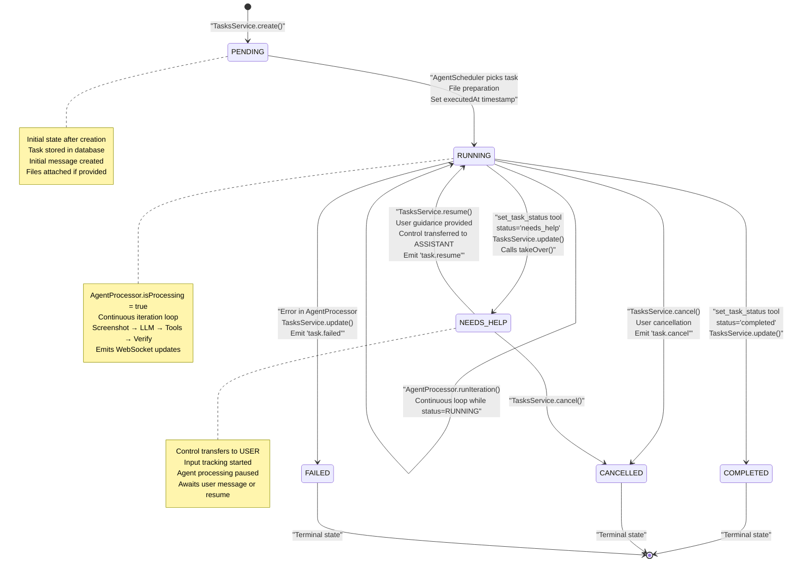
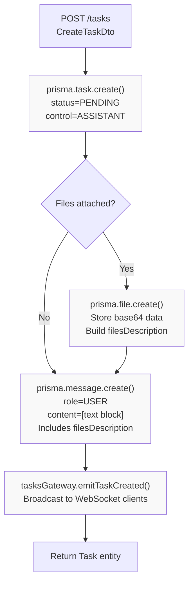
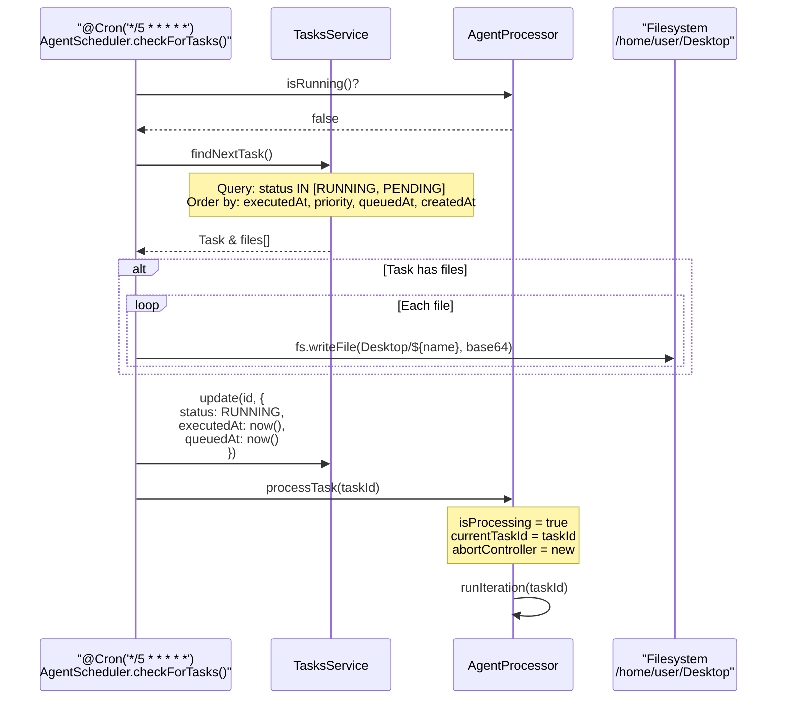
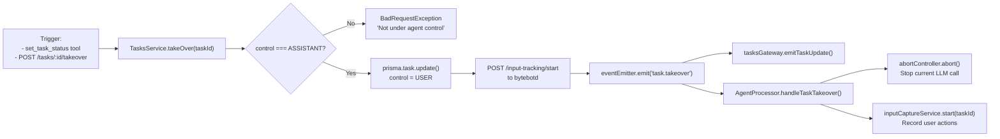
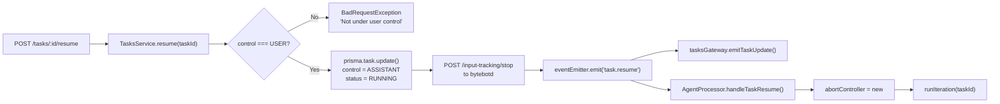
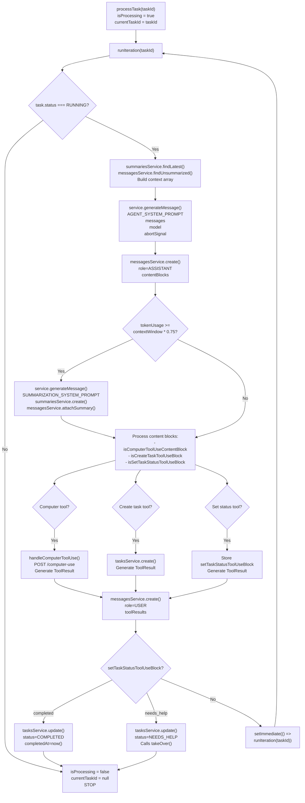

<!-- source: DeepWiki mcp.deepwiki.com · repo bytebot-ai/bytebot · page 5.1 Task Lifecycle · fetched 2026-10-29 -->

# Task Lifecycle

Relevant source files

The following files were used as context for generating this wiki page:

- [packages/bytebot-agent/prisma/schema.prisma](packages/bytebot-agent/prisma/schema.prisma)
- [packages/bytebot-agent/src/agent/agent.processor.ts](packages/bytebot-agent/src/agent/agent.processor.ts)
- [packages/bytebot-agent/src/anthropic/anthropic.tools.ts](packages/bytebot-agent/src/anthropic/anthropic.tools.ts)
- [packages/bytebot-agent/src/tasks/dto/create-task.dto.ts](packages/bytebot-agent/src/tasks/dto/create-task.dto.ts)
- [packages/bytebot-agent/src/tasks/tasks.controller.ts](packages/bytebot-agent/src/tasks/tasks.controller.ts)
- [packages/bytebot-agent/src/tasks/tasks.service.ts](packages/bytebot-agent/src/tasks/tasks.service.ts)
- [packages/bytebot-ui/src/hooks/useChatSession.ts](packages/bytebot-ui/src/hooks/useChatSession.ts)
- [packages/bytebot-ui/src/types/index.ts](packages/bytebot-ui/src/types/index.ts)

This document describes the lifecycle of a Task entity from creation through completion, including all possible states, state transitions, control handoff mechanisms, and the agent processing loop. Tasks are the fundamental unit of work in Bytebot, representing user requests that the AI agent executes on the virtual desktop.

For details on creating and managing tasks via API, see [TasksService API](#5.2). For information on the agent's processing logic, see [Agent Processor](#6.1). For real-time task updates, see [WebSocket Events](#5.3).

---

## Task States

Tasks progress through a defined set of states stored in the `status` field. The complete set of states is defined in the Prisma schema as the `TaskStatus` enum.

| Status | Description | Control | Terminal |
|--------|-------------|---------|----------|
| `PENDING` | Task created but not yet started by the scheduler | `ASSISTANT` | No |
| `RUNNING` | Agent actively processing the task in iterations | `ASSISTANT` | No |
| `NEEDS_HELP` | Agent has requested user guidance or intervention | `USER` | No |
| `NEEDS_REVIEW` | Task completed but requires user verification | `USER` | No |
| `COMPLETED` | Task successfully finished | `ASSISTANT` | Yes |
| `CANCELLED` | Task manually cancelled by user | `ASSISTANT` | Yes |
| `FAILED` | Task terminated due to error | `ASSISTANT` | Yes |

**Sources:**
- [packages/bytebot-agent/prisma/schema.prisma:16-24]()
- [packages/bytebot-ui/src/types/index.ts:32-40]()

---

## Task State Diagram

The following diagram shows all possible state transitions and the operations that trigger them:

**Sources:**
- [packages/bytebot-agent/src/tasks/tasks.service.ts:217-247]()
- [packages/bytebot-agent/src/agent/agent.processor.ts:134-403]()
- [packages/bytebot-agent/src/tasks/tasks.controller.ts:176-192]()

---

## Task Creation Flow

When a task is created via `TasksService.create()`, the system performs several initialization steps within a database transaction:

**Key Implementation Details:**

- **Transaction boundary**: [packages/bytebot-agent/src/tasks/tasks.service.ts:45-112]()
- **File processing**: Base64 data prefix removed, stored in `File.data` field [packages/bytebot-agent/src/tasks/tasks.service.ts:66-93]()
- **Initial message**: Contains task description plus file confirmation text [packages/bytebot-agent/src/tasks/tasks.service.ts:96-109]()
- **Default values**: `type=IMMEDIATE`, `priority=MEDIUM`, `status=PENDING`, `createdBy=USER`, `control=ASSISTANT` [packages/bytebot-agent/src/tasks/tasks.service.ts:48-59]()

**Sources:**
- [packages/bytebot-agent/src/tasks/tasks.service.ts:40-117]()
- [packages/bytebot-agent/src/tasks/dto/create-task.dto.ts:31-60]()

---

## Task Scheduling and File Preparation

The `AgentScheduler` cron job monitors for tasks ready to execute:

**Scheduling Logic:**
- **Cron interval**: Every 5 seconds [packages/bytebot-agent/src/agent/agent.scheduler.ts:31]()
- **Task selection**: Returns first task matching status filter, ordered by priority and timestamps [packages/bytebot-agent/src/tasks/tasks.service.ts:131-156]()
- **File materialization**: Files decoded from base64 and written to `/home/user/Desktop/` [packages/bytebot-agent/src/agent/agent.scheduler.ts:58-70]()
- **State update**: Sets `status=RUNNING`, `executedAt`, and `queuedAt` before processing [packages/bytebot-agent/src/agent/agent.scheduler.ts:75-79]()

**Sources:**
- [packages/bytebot-agent/src/agent/agent.scheduler.ts:27-95]()
- [packages/bytebot-agent/src/tasks/tasks.service.ts:131-156]()

---

## Control Handoff System

Tasks have a `control` field that determines whether the agent or user has control of the desktop:

| Control Value | Desktop Control | Input Tracking | Agent Processing | Use Case |
|---------------|----------------|----------------|------------------|----------|
| `ASSISTANT` | Agent | Stopped | Active | Normal agent operation |
| `USER` | User | Active | Paused | Manual intervention, guidance |

### Taking Over Control

When the agent calls `set_task_status` with `status='needs_help'`, or when a user manually calls `POST /tasks/:id/takeover`:

**Implementation Details:**
- **Validation**: Ensures task is under agent control before allowing takeover [packages/bytebot-agent/src/tasks/tasks.service.ts:328-332]()
- **Database update**: Sets `control=USER` [packages/bytebot-agent/src/tasks/tasks.service.ts:334-339]()
- **Input tracking**: Starts recording mouse/keyboard events [packages/bytebot-agent/src/tasks/tasks.service.ts:341-348]()
- **Event emission**: Broadcasts `task.takeover` to abort processing [packages/bytebot-agent/src/tasks/tasks.service.ts:351]()
- **Agent response**: Aborts in-flight LLM calls if processing this task [packages/bytebot-agent/src/agent/agent.processor.ts:84-95]()

### Resuming Agent Control

When a user provides guidance and clicks resume, or calls `POST /tasks/:id/resume`:

**Implementation Details:**
- **Validation**: Ensures task is under user control [packages/bytebot-agent/src/tasks/tasks.service.ts:290-292]()
- **Database update**: Sets `control=ASSISTANT`, `status=RUNNING` [packages/bytebot-agent/src/tasks/tasks.service.ts:294-300]()
- **Input tracking**: Stops recording user actions [packages/bytebot-agent/src/tasks/tasks.service.ts:302-309]()
- **Event emission**: Broadcasts `task.resume` to restart processing [packages/bytebot-agent/src/tasks/tasks.service.ts:312]()
- **Agent response**: Creates new abort controller and continues iteration [packages/bytebot-agent/src/agent/agent.processor.ts:97-105]()

**Sources:**
- [packages/bytebot-agent/src/tasks/tasks.service.ts:282-357]()
- [packages/bytebot-agent/src/agent/agent.processor.ts:84-105]()
- [packages/bytebot-agent/src/tasks/tasks.controller.ts:176-186]()

---

## Agent Processing Loop

Once a task enters `RUNNING` state, `AgentProcessor` executes a continuous iteration loop:

**Key Components:**

- **Context building**: Combines latest summary with unsummarized messages [packages/bytebot-agent/src/agent/agent.processor.ts:157-180]()
- **LLM call**: Uses provider-specific service (Anthropic, OpenAI, Google, or Proxy) [packages/bytebot-agent/src/agent/agent.processor.ts:185-207]()
- **Summarization**: Triggered when token usage exceeds 75% of context window [packages/bytebot-agent/src/agent/agent.processor.ts:233-299]()
- **Tool execution**: Processes computer, create_task, and set_task_status tools [packages/bytebot-agent/src/agent/agent.processor.ts:305-357]()
- **Status updates**: Handles task completion or needs_help transitions [packages/bytebot-agent/src/agent/agent.processor.ts:368-382]()
- **Non-blocking loop**: Uses `setImmediate()` to schedule next iteration [packages/bytebot-agent/src/agent/agent.processor.ts:385-387]()

**Sources:**
- [packages/bytebot-agent/src/agent/agent.processor.ts:114-403]()
- [packages/bytebot-agent/src/agent/agent.computer-use.ts:1-100]()

---

## Terminal States

Tasks can reach three terminal states:

### COMPLETED

- **Trigger**: Agent calls `set_task_status` tool with `status='completed'`
- **Update**: Sets `status=COMPLETED`, `completedAt=now()` [packages/bytebot-agent/src/agent/agent.processor.ts:370-374]()
- **Event**: Emits `task.completed` via EventEmitter2 [packages/bytebot-agent/src/tasks/tasks.service.ts:234]()
- **Processing**: Agent stops iteration loop [packages/bytebot-agent/src/agent/agent.processor.ts:142-148]()

### FAILED

- **Trigger**: Unhandled error in `AgentProcessor.runIteration()`
- **Update**: Sets `status=FAILED` [packages/bytebot-agent/src/agent/agent.processor.ts:396-398]()
- **Event**: Emits `task.failed` via EventEmitter2 [packages/bytebot-agent/src/tasks/tasks.service.ts:238]()
- **Processing**: Sets `isProcessing=false`, clears `currentTaskId` [packages/bytebot-agent/src/agent/agent.processor.ts:399-400]()
- **Common causes**: No service found for model provider, LLM returned empty content blocks

### CANCELLED

- **Trigger**: User calls `POST /tasks/:id/cancel`
- **Validation**: Cannot cancel if already `COMPLETED`, `FAILED`, or `CANCELLED` [packages/bytebot-agent/src/tasks/tasks.service.ts:367-375]()
- **Update**: Sets `status=CANCELLED` [packages/bytebot-agent/src/tasks/tasks.service.ts:377-382]()
- **Event**: Emits `task.cancel` to abort processing [packages/bytebot-agent/src/tasks/tasks.service.ts:385]()
- **Processing**: `AgentProcessor.handleTaskCancel()` calls `stopProcessing()` [packages/bytebot-agent/src/agent/agent.processor.ts:107-112]()

**Sources:**
- [packages/bytebot-agent/src/agent/agent.processor.ts:368-402]()
- [packages/bytebot-agent/src/tasks/tasks.service.ts:233-239]()
- [packages/bytebot-agent/src/tasks/tasks.service.ts:359-391]()

---

## Event System Integration

The task lifecycle emits internal events via EventEmitter2 for reactive coordination:

| Event Name | Emitted By | Payload | Listeners |
|------------|-----------|---------|-----------|
| `task.completed` | `TasksService.update()` | `{ taskId }` | None currently |
| `task.failed` | `TasksService.update()` | `{ taskId }` | None currently |
| `task.takeover` | `TasksService.takeOver()` | `{ taskId }` | `AgentProcessor.handleTaskTakeover()` |
| `task.resume` | `TasksService.resume()` | `{ taskId }` | `AgentProcessor.handleTaskResume()` |
| `task.cancel` | `TasksService.cancel()` | `{ taskId }` | `AgentProcessor.handleTaskCancel()` |

**Event Handler Decorators:**

- `@OnEvent('task.takeover')`: Aborts current processing, starts input capture [packages/bytebot-agent/src/agent/agent.processor.ts:84-95]()
- `@OnEvent('task.resume')`: Creates new abort controller, continues iteration [packages/bytebot-agent/src/agent/agent.processor.ts:97-105]()
- `@OnEvent('task.cancel')`: Stops processing immediately [packages/bytebot-agent/src/agent/agent.processor.ts:107-112]()

**WebSocket Broadcasting:**

In addition to internal events, `TasksGateway` broadcasts task updates to connected clients:

- `emitTaskCreated(task)`: Sent to all connected clients [packages/bytebot-agent/src/tasks/tasks.service.ts:114]()
- `emitTaskUpdate(taskId, task)`: Sent to clients in task's room [packages/bytebot-agent/src/tasks/tasks.service.ts:244]()
- `emitTaskDeleted(taskId)`: Sent to all connected clients [packages/bytebot-agent/src/tasks/tasks.service.ts:258]()
- `emitNewMessage(taskId, message)`: Sent to clients in task's room [packages/bytebot-agent/src/tasks/tasks.service.ts:278]()

**Sources:**
- [packages/bytebot-agent/src/tasks/tasks.service.ts:233-391]()
- [packages/bytebot-agent/src/agent/agent.processor.ts:84-112]()
- [packages/bytebot-agent/src/tasks/tasks.gateway.ts:1-100]()

---

