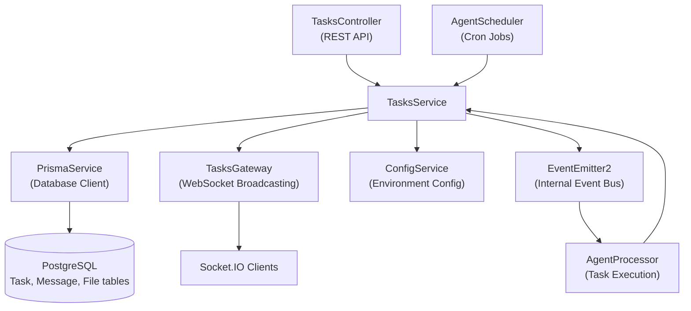
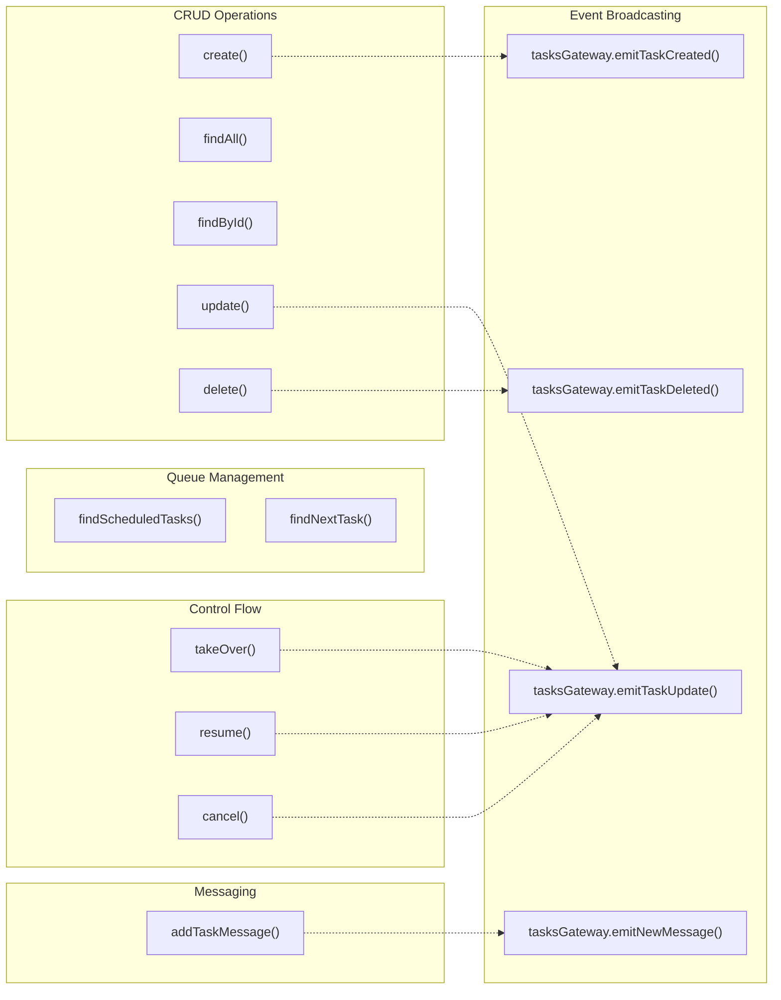
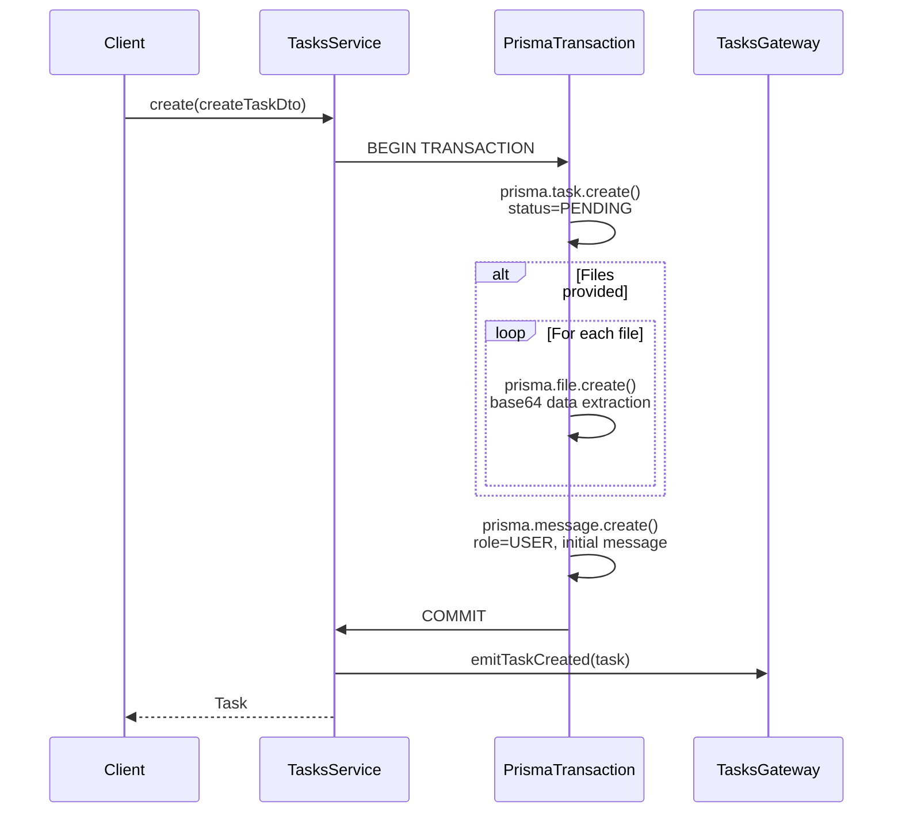
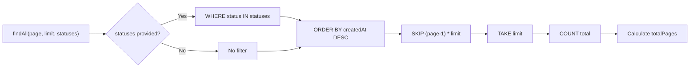
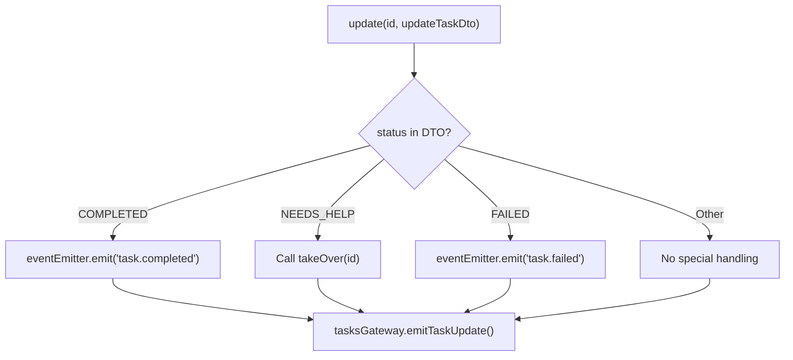
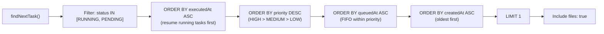
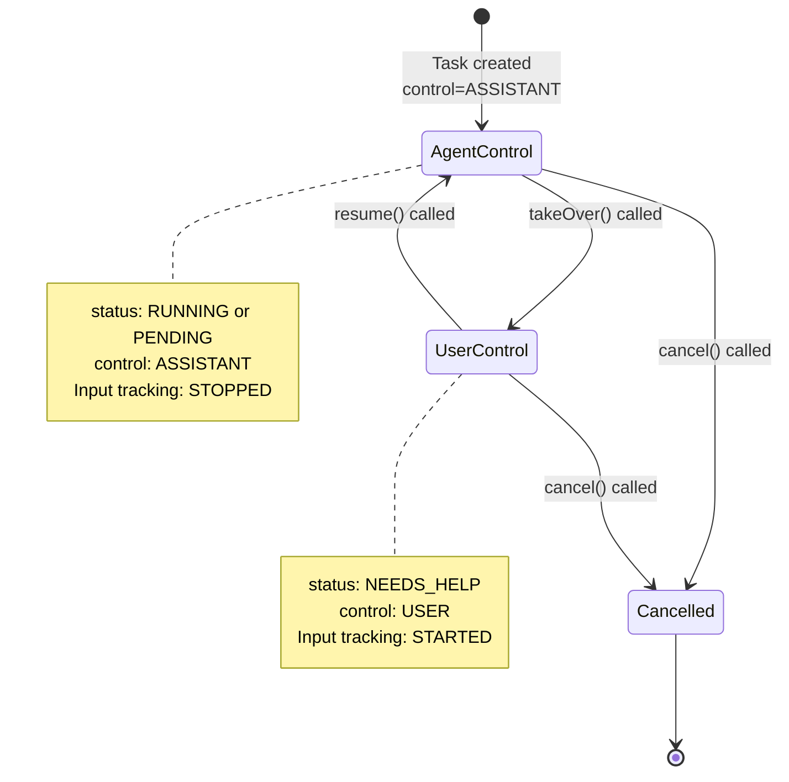
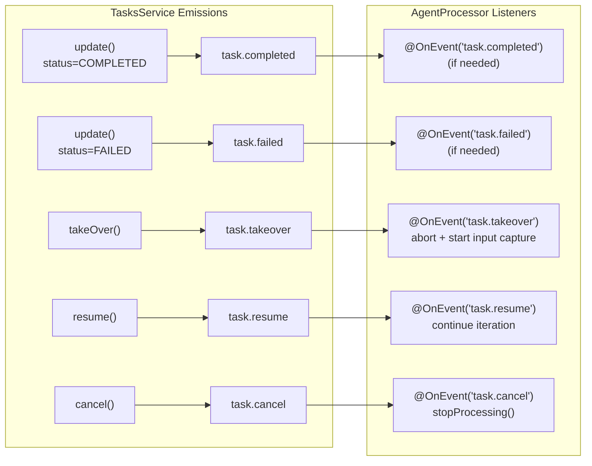

<!-- source: DeepWiki mcp.deepwiki.com · repo bytebot-ai/bytebot · page 5.2 TasksService API · fetched 2026-10-29 -->

# TasksService API

<details>
<summary>Relevant source files</summary>

The following files were used as context for generating this wiki page:

- [packages/bytebot-agent/src/agent/agent.processor.ts](packages/bytebot-agent/src/agent/agent.processor.ts)
- [packages/bytebot-agent/src/tasks/tasks.controller.ts](packages/bytebot-agent/src/tasks/tasks.controller.ts)
- [packages/bytebot-agent/src/tasks/tasks.service.ts](packages/bytebot-agent/src/tasks/tasks.service.ts)
- [packages/bytebot-ui/src/hooks/useChatSession.ts](packages/bytebot-ui/src/hooks/useChatSession.ts)

</details>


## Purpose and Scope

This document details the `TasksService` class and its API methods for managing task lifecycle, state, and control flow. The service provides CRUD operations, task querying, and control handoff mechanisms between user and AI agent.

For information about task states and transitions, see [Task Lifecycle](#5.1). For real-time event broadcasting, see [WebSocket Events](#5.3). For automated task scheduling, see [Task Scheduling](#5.4).

**Sources:** [packages/bytebot-agent/src/tasks/tasks.service.ts:1-392]()

---

## Service Architecture

The `TasksService` is a NestJS injectable service that coordinates task management across multiple subsystems. It serves as the central authority for task state mutations and broadcasts changes to connected clients.

### Dependency Graph



**Sources:** [packages/bytebot-agent/src/tasks/tasks.service.ts:26-38]()

The service uses constructor-based dependency injection with a circular dependency on `TasksGateway` (resolved via `forwardRef`) to enable bidirectional communication for real-time updates.

---

## Method Categorization

TasksService methods are organized into five functional categories:



**Sources:** [packages/bytebot-agent/src/tasks/tasks.service.ts:40-391]()

---

## CRUD Operations

### create(createTaskDto: CreateTaskDto)

Creates a new task with associated files and initial message in a database transaction.

**Transaction Sequence:**



**Key Behaviors:**

| Behavior | Implementation |
|----------|----------------|
| **Base64 Processing** | Strips `data:*/*;base64,` prefix from file data before storage ([tasks.service.ts:74-76]()) |
| **File Description** | Appends file names to task description message ([tasks.service.ts:78]()) |
| **Default Values** | Sets `type=IMMEDIATE`, `priority=MEDIUM`, `status=PENDING`, `createdBy=USER` if not provided ([tasks.service.ts:51-54]()) |
| **Initial Message** | Creates USER message combining description and file information ([tasks.service.ts:96-109]()) |

**Sources:** [packages/bytebot-agent/src/tasks/tasks.service.ts:40-117]()

---

### findAll(page, limit, statuses?)

Retrieves paginated task list with optional status filtering.

**Parameters:**
- `page` (number, default=1): Page number for pagination
- `limit` (number, default=10): Items per page
- `statuses` (string[], optional): Filter by task statuses (e.g., `['RUNNING', 'PENDING']`)

**Return Type:**
```typescript
{
  tasks: Task[];
  total: number;
  totalPages: number;
}
```

**Query Strategy:**



The method executes parallel queries for tasks and count using `Promise.all` for performance ([tasks.service.ts:174-184]()).

**Sources:** [packages/bytebot-agent/src/tasks/tasks.service.ts:158-190]()

---

### findById(id: string)

Retrieves a single task by ID with associated files included.

**Includes:** `files: true` - Eager loads file records associated with the task.

**Error Handling:** Throws `NotFoundException` if task does not exist ([tasks.service.ts:203-205]()).

**Sources:** [packages/bytebot-agent/src/tasks/tasks.service.ts:192-215]()

---

### update(id: string, updateTaskDto: UpdateTaskDto)

Updates task fields and triggers state-specific side effects.

**State Transition Side Effects:**



**Event Emissions:**

| Status Change | Event Emitted | Listener |
|---------------|---------------|----------|
| `COMPLETED` | `task.completed` | `AgentProcessor` ([agent.processor.ts:234]()) |
| `FAILED` | `task.failed` | `AgentProcessor` |
| `NEEDS_HELP` | `task.takeover` | Delegated to `takeOver()` method |

**Sources:** [packages/bytebot-agent/src/tasks/tasks.service.ts:217-247]()

---

### delete(id: string)

Deletes task and cascades to associated records (messages, files, summaries via Prisma schema).

**Broadcast:** Emits `task_deleted` WebSocket event to all connected clients ([tasks.service.ts:258]()).

**Sources:** [packages/bytebot-agent/src/tasks/tasks.service.ts:249-261]()

---

## Queue Management Methods

### findScheduledTasks()

Queries tasks with scheduled execution times that haven't been queued yet.

**Query Conditions:**
- `scheduledFor` is NOT NULL
- `queuedAt` is NULL

**Ordering:** Ascending by `scheduledFor` to process earliest scheduled tasks first.

**Usage:** Called by `AgentScheduler` cron job to identify tasks ready for execution ([agent.scheduler.ts]()).

**Sources:** [packages/bytebot-agent/src/tasks/tasks.service.ts:119-129]()

---

### findNextTask()

Retrieves the highest-priority task from the queue for agent processing.

**Priority Algorithm:**



**Key Insight:** The `executedAt ASC` ordering ensures that `RUNNING` tasks (which have `executedAt` set) are resumed before `PENDING` tasks are started, preventing task interruption.

**Sources:** [packages/bytebot-agent/src/tasks/tasks.service.ts:131-156]()

---

## Task Control Methods

These methods manage the handoff of control between the AI agent and human user.

### Control State Machine



**Sources:** [packages/bytebot-agent/src/tasks/tasks.service.ts:282-391]()

---

### takeOver(taskId: string)

Transfers control from agent to user, enabling manual intervention.

**Preconditions:**
- Task must exist
- Task `control` must be `ASSISTANT` (throws `BadRequestException` otherwise)

**State Changes:**

| Field | New Value |
|-------|-----------|
| `control` | `USER` |
| Status | Unchanged (typically `NEEDS_HELP` set separately via `update()`) |

**Side Effects:**
1. **Input Tracking Activation:** Sends `POST /input-tracking/start` to bytebotd service ([tasks.service.ts:342-348]())
2. **Event Emission:** Emits `task.takeover` event to notify `AgentProcessor` to abort processing ([tasks.service.ts:351]())
3. **WebSocket Broadcast:** Emits `task_updated` to connected clients

**AgentProcessor Integration:**

When `AgentProcessor` receives the `task.takeover` event, it:
- Aborts any in-flight LLM requests via `AbortController` ([agent.processor.ts:90]())
- Starts `InputCaptureService` to record user actions ([agent.processor.ts:94]())

**Sources:** [packages/bytebot-agent/src/tasks/tasks.service.ts:320-357]()

---

### resume(taskId: string)

Returns control from user back to agent, resuming automated execution.

**Preconditions:**
- Task must exist
- Task `control` must be `USER` (throws `BadRequestException` otherwise)

**State Changes:**

| Field | New Value |
|-------|-----------|
| `control` | `ASSISTANT` |
| `status` | `RUNNING` |

**Side Effects:**
1. **Input Tracking Deactivation:** Sends `POST /input-tracking/stop` to bytebotd service ([tasks.service.ts:303-309]())
2. **Event Emission:** Emits `task.resume` event ([tasks.service.ts:312]())
3. **WebSocket Broadcast:** Emits `task_updated` to connected clients

**AgentProcessor Integration:**

When `AgentProcessor` receives the `task.resume` event while processing the task, it:
- Creates new `AbortController` instance ([agent.processor.ts:101]())
- Immediately calls `runIteration()` to continue agent loop ([agent.processor.ts:103]())

**Sources:** [packages/bytebot-agent/src/tasks/tasks.service.ts:282-318]()

---

### cancel(taskId: string)

Cancels an in-progress task, preventing further execution.

**Preconditions:**
- Task must exist
- Task status must NOT be `COMPLETED`, `FAILED`, or `CANCELLED` (throws `BadRequestException` otherwise)

**State Changes:**

| Field | New Value |
|-------|-----------|
| `status` | `CANCELLED` |

**Side Effects:**
1. **Event Emission:** Emits `task.cancel` event ([tasks.service.ts:385]())
2. **WebSocket Broadcast:** Emits `task_updated` to connected clients

**AgentProcessor Integration:**

The `task.cancel` event listener calls `stopProcessing()`, which:
- Aborts in-flight operations via `AbortController` ([agent.processor.ts:413]())
- Stops input tracking ([agent.processor.ts:415]())
- Clears processing state ([agent.processor.ts:417-418]())

**Sources:** [packages/bytebot-agent/src/tasks/tasks.service.ts:359-391]()

---

## Messaging Integration

### addTaskMessage(taskId: string, addTaskMessageDto: AddTaskMessageDto)

Adds a user-provided message to a task's conversation history.

**Message Creation:**
- **Role:** `USER`
- **Content:** Single text block containing the message
- **Linked to Task:** via `taskId` foreign key

**WebSocket Broadcast:** Emits `new_message` event to clients subscribed to the task room ([tasks.service.ts:278]()).

**Usage Context:** Called when user provides guidance or additional instructions while task is in `NEEDS_HELP` state.

**Sources:** [packages/bytebot-agent/src/tasks/tasks.service.ts:263-280]()

---

## Event Integration Patterns

TasksService integrates with two event systems for decoupled communication.

### EventEmitter2 (Internal Events)

Internal events enable reactive behavior across services without tight coupling.



**Event Payload Format:**
```typescript
{ taskId: string }
```

**Sources:** [packages/bytebot-agent/src/tasks/tasks.service.ts:234-386](), [packages/bytebot-agent/src/agent/agent.processor.ts:84-112]()

---

### TasksGateway (WebSocket Events)

WebSocket events broadcast state changes to connected UI clients in real-time.

**Emitted Events:**

| Method | Gateway Method | Event Name | Payload |
|--------|----------------|------------|---------|
| `create()` | `emitTaskCreated()` | `task_created` | `Task` object |
| `update()` | `emitTaskUpdate()` | `task_updated` | `Task` object |
| `delete()` | `emitTaskDeleted()` | `task_deleted` | Task ID string |
| `addTaskMessage()` | `emitNewMessage()` | `new_message` | `Message` object |

**Room-Based Broadcasting:**

- `task_created` and `task_deleted` are broadcast globally to all connected clients
- `task_updated` and `new_message` are broadcast only to clients in the task-specific room (joined via `join_task` event)

**Sources:** [packages/bytebot-agent/src/tasks/tasks.service.ts:114-388](), [packages/bytebot-agent/src/tasks/tasks.gateway.ts]()

---

## REST API Endpoints

The `TasksController` exposes TasksService methods via HTTP endpoints:

| Endpoint | Method | TasksService Method | Description |
|----------|--------|---------------------|-------------|
| `POST /tasks` | `create()` | `create()` | Create new task |
| `GET /tasks` | `findAll()` | `findAll()` | List tasks with pagination |
| `GET /tasks/:id` | `findById()` | `findById()` | Get single task |
| `DELETE /tasks/:id` | `delete()` | `delete()` | Delete task |
| `POST /tasks/:id/messages` | `addTaskMessage()` | `addTaskMessage()` | Add user message |
| `POST /tasks/:id/takeover` | `takeOver()` | `takeOver()` | Take manual control |
| `POST /tasks/:id/resume` | `resume()` | `resume()` | Return control to agent |
| `POST /tasks/:id/cancel` | `cancel()` | `cancel()` | Cancel task |

**Additional Controller Methods:**

- `GET /tasks/models` - Returns available LLM models (not a TasksService method)
- `GET /tasks/:id/messages` - Delegates to `MessagesService.findAll()`
- `GET /tasks/:id/messages/raw` - Delegates to `MessagesService.findRawMessages()`
- `GET /tasks/:id/messages/processed` - Delegates to `MessagesService.findProcessedMessages()`

**Sources:** [packages/bytebot-agent/src/tasks/tasks.controller.ts:1-193]()

---

## Usage Examples

### Creating a Task with Files

```typescript
// Client request to POST /tasks
const createTaskDto = {
  description: "Analyze the spreadsheet and create a summary report",
  type: TaskType.IMMEDIATE,
  priority: TaskPriority.HIGH,
  model: {
    provider: "anthropic",
    name: "claude-3-5-sonnet-20241022"
  },
  files: [
    {
      name: "data.xlsx",
      type: "application/vnd.openxmlformats-officedocument.spreadsheetml.sheet",
      size: 45678,
      base64: "data:application/vnd.openxmlformats-officedocument.spreadsheetml.sheet;base64,UEsDBBQABg..."
    }
  ]
};

// TasksService processes:
// 1. Creates task record (status=PENDING)
// 2. Strips base64 prefix and creates file record
// 3. Creates initial USER message: "Analyze the spreadsheet... File data.xlsx written to desktop."
// 4. Broadcasts task_created event
```

**Sources:** [packages/bytebot-agent/src/tasks/tasks.service.ts:40-117](), [packages/bytebot-agent/src/tasks/dto/create-task.dto.ts]()

---

### Control Handoff Workflow

```typescript
// 1. Agent encounters ambiguity, sets status=NEEDS_HELP
await tasksService.update(taskId, { status: TaskStatus.NEEDS_HELP });
// → Calls takeOver() → Sets control=USER, starts input tracking

// 2. User provides guidance
await tasksService.addTaskMessage(taskId, { message: "Use the export function in the menu" });
// → Creates USER message, broadcasts new_message event

// 3. User clicks "Resume" in UI
await tasksService.resume(taskId);
// → Sets control=ASSISTANT, status=RUNNING
// → Emits task.resume event
// → AgentProcessor continues processing loop
```

**Sources:** [packages/bytebot-agent/src/tasks/tasks.service.ts:217-318]()

---

## Error Handling

### Common Exceptions

| Exception | Thrown By | Condition |
|-----------|-----------|-----------|
| `NotFoundException` | `findById()` | Task ID does not exist |
| `BadRequestException` | `resume()` | Task not under user control (`control !== USER`) |
| `BadRequestException` | `takeOver()` | Task not under agent control (`control !== ASSISTANT`) |
| `BadRequestException` | `cancel()` | Task already in terminal state (`COMPLETED`, `FAILED`, `CANCELLED`) |

**Logging Strategy:**

- **Info Level:** Method entry/exit, successful operations ([tasks.service.ts:41-42, 61, 114]())
- **Debug Level:** Detailed operation progress ([tasks.service.ts:47, 69, 96]())
- **Warn Level:** Task not found scenarios ([tasks.service.ts:204]())
- **Error Level:** Exception details with stack traces ([tasks.service.ts:211-212, 308, 347]())

**Sources:** [packages/bytebot-agent/src/tasks/tasks.service.ts:1-392]()

---

## Database Transaction Patterns

### Atomic Task Creation

The `create()` method uses `prisma.$transaction()` to ensure atomicity across three operations:

1. Task record creation
2. File records creation (if files provided)
3. Initial message creation

**Rollback Guarantee:** If any step fails, all changes are rolled back, preventing orphaned records.

**Sources:** [packages/bytebot-agent/src/tasks/tasks.service.ts:45-112]()

---

## Performance Considerations

### Parallel Query Execution

The `findAll()` method executes task retrieval and count queries in parallel using `Promise.all()`, reducing response time by ~50% compared to sequential queries.

```typescript
const [tasks, total] = await Promise.all([
  this.prisma.task.findMany({ /* query */ }),
  this.prisma.task.count({ /* query */ })
]);
```

**Sources:** [packages/bytebot-agent/src/tasks/tasks.service.ts:174-184]()

### Eager Loading

`findNextTask()` and `findById()` include `files: true` to prevent N+1 query problems when accessing task files.

**Sources:** [packages/bytebot-agent/src/tasks/tasks.service.ts:144-146, 198-200]()

---

## Integration with Other Services

### AgentScheduler Integration

`AgentScheduler` calls `findScheduledTasks()` every minute to check for tasks with `scheduledFor` times that have passed. When found, it queues them by setting `queuedAt` timestamp and updating status to `PENDING`.

**Sources:** [packages/bytebot-agent/src/tasks/tasks.service.ts:119-129](), [packages/bytebot-agent/src/agent/agent.scheduler.ts]()

### AgentProcessor Integration

`AgentProcessor` calls `findNextTask()` to retrieve the highest-priority task from the queue. It listens for `task.*` events to react to state changes:

- `task.takeover` → Abort processing, start input capture
- `task.resume` → Resume processing loop
- `task.cancel` → Stop processing
- `task.completed` → Natural completion (no action needed)
- `task.failed` → Natural failure (no action needed)

**Sources:** [packages/bytebot-agent/src/agent/agent.processor.ts:84-112](), [packages/bytebot-agent/src/tasks/tasks.service.ts:131-156]()

### Bytebotd Integration

Control methods (`takeOver()` and `resume()`) communicate with the bytebotd service to start/stop input tracking via HTTP requests to `/input-tracking/start` and `/input-tracking/stop`.

**Error Handling:** Failed input tracking requests are logged but do not throw exceptions, allowing control transfers to complete even if bytebotd is unavailable.

**Sources:** [packages/bytebot-agent/src/tasks/tasks.service.ts:303-309, 342-348]()

---

