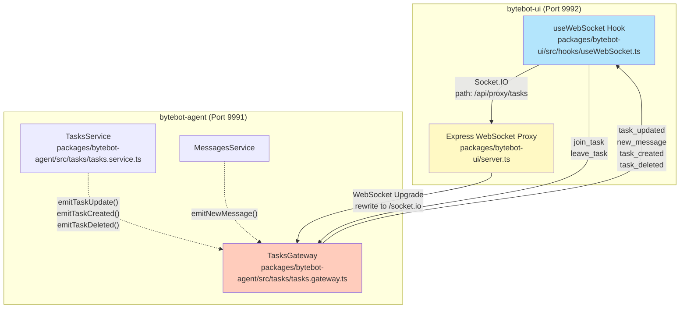
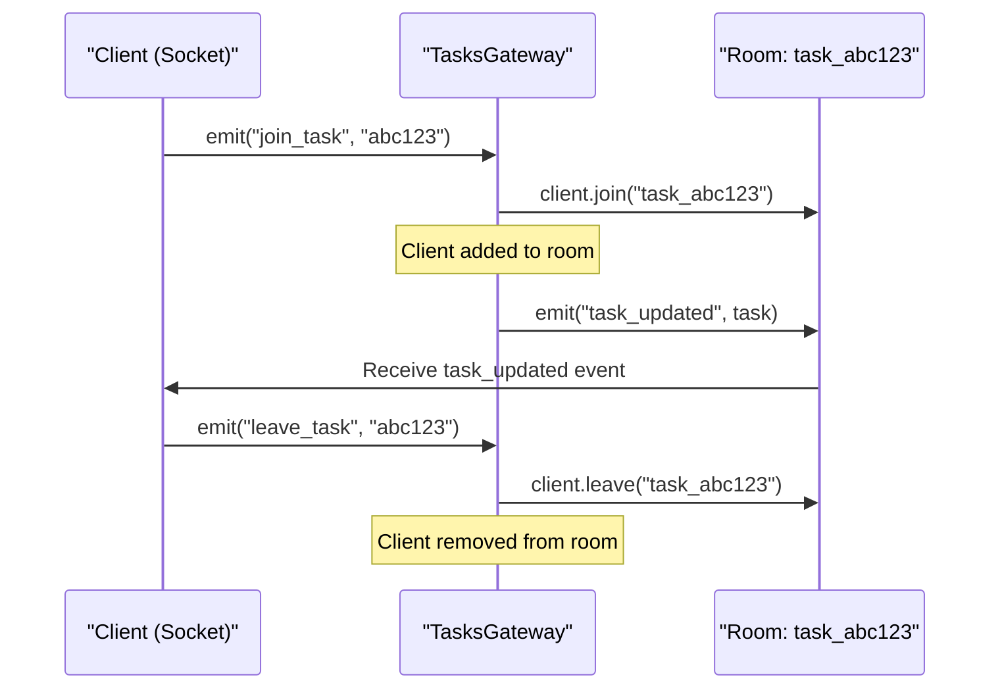
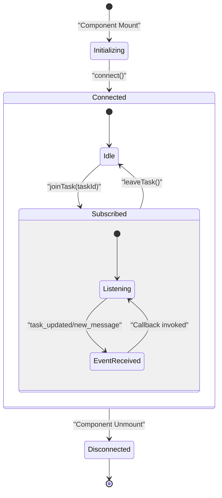
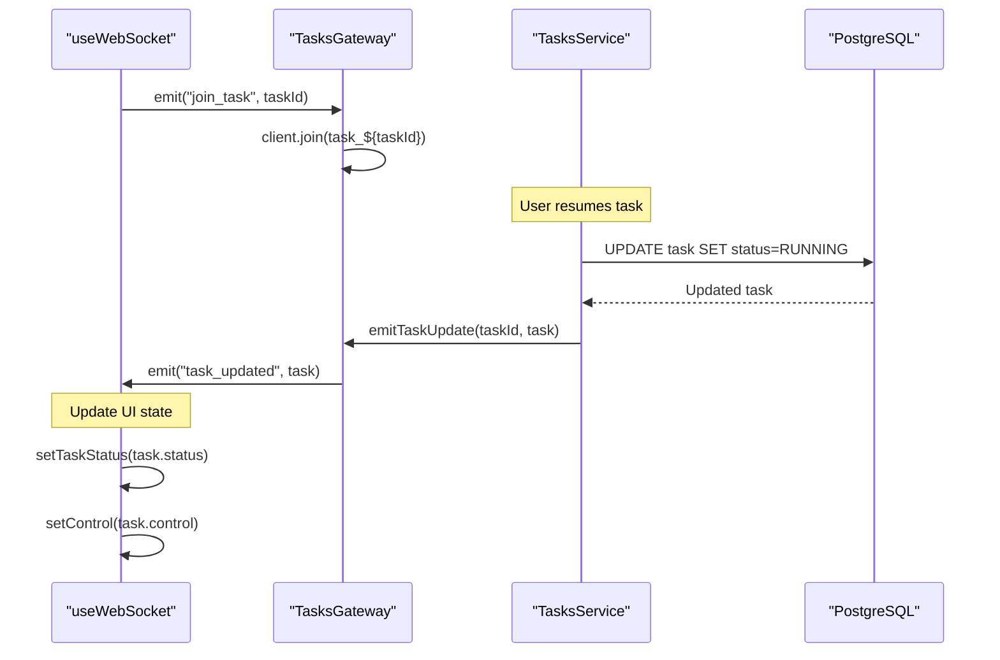
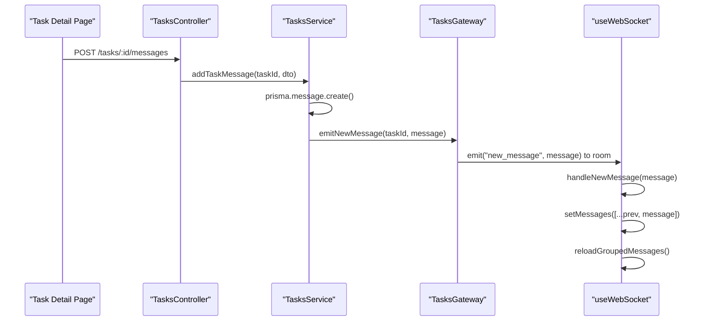
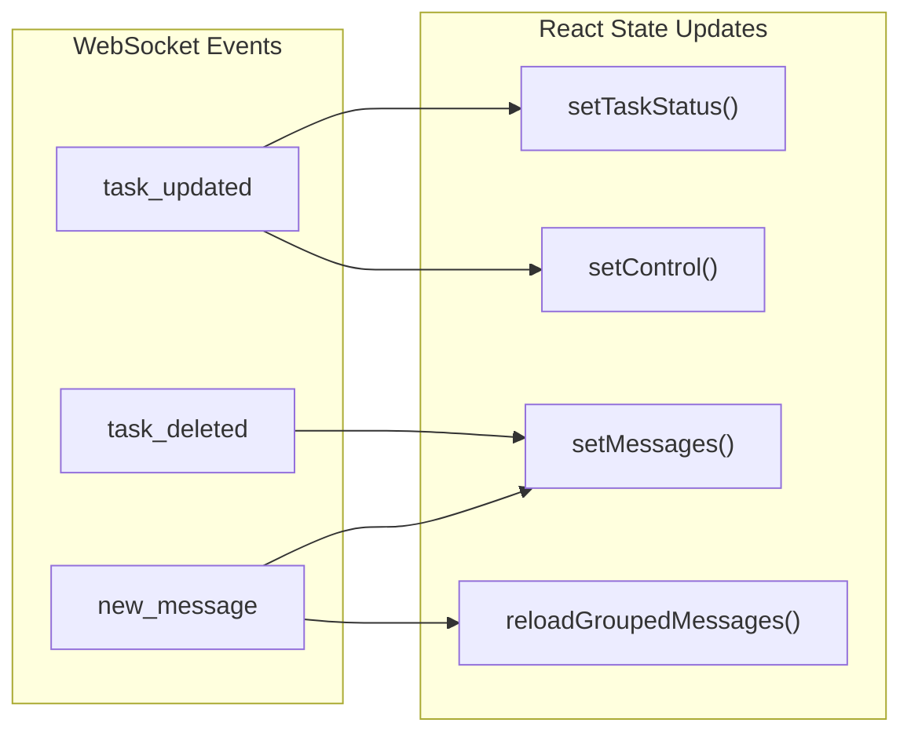

<!-- source: DeepWiki mcp.deepwiki.com · repo bytebot-ai/bytebot · page 5.3 WebSocket Events · fetched 2026-10-29 -->

# WebSocket Events

<details>
<summary>Relevant source files</summary>

The following files were used as context for generating this wiki page:

- [packages/bytebot-agent/src/agent/agent.processor.ts](packages/bytebot-agent/src/agent/agent.processor.ts)
- [packages/bytebot-agent/src/main.ts](packages/bytebot-agent/src/main.ts)
- [packages/bytebot-agent/src/tasks/tasks.controller.ts](packages/bytebot-agent/src/tasks/tasks.controller.ts)
- [packages/bytebot-agent/src/tasks/tasks.gateway.ts](packages/bytebot-agent/src/tasks/tasks.gateway.ts)
- [packages/bytebot-agent/src/tasks/tasks.service.ts](packages/bytebot-agent/src/tasks/tasks.service.ts)
- [packages/bytebot-ui/next.config.ts](packages/bytebot-ui/next.config.ts)
- [packages/bytebot-ui/server.ts](packages/bytebot-ui/server.ts)
- [packages/bytebot-ui/src/app/api/[[...path]]/route.ts](packages/bytebot-ui/src/app/api/[[...path]]/route.ts)
- [packages/bytebot-ui/src/hooks/useChatSession.ts](packages/bytebot-ui/src/hooks/useChatSession.ts)
- [packages/bytebot-ui/src/hooks/useWebSocket.ts](packages/bytebot-ui/src/hooks/useWebSocket.ts)

</details>


This document describes the real-time WebSocket communication system in Bytebot, covering the Socket.IO-based event architecture that enables live task updates, message notifications, and client-server coordination. The WebSocket layer provides bidirectional communication between the **bytebot-ui** frontend and **bytebot-agent** backend.

For information about the REST API endpoints, see [Tasks REST API](#10.1). For internal event-driven coordination within bytebot-agent (using EventEmitter2), see [Agent Processor](#6.1).

---

## Architecture Overview

The WebSocket system uses Socket.IO to provide real-time, event-driven communication. The architecture consists of three layers:

1. **Client Layer** (`useWebSocket` hook in bytebot-ui)
2. **Proxy Layer** (Express server proxying WebSocket connections)
3. **Server Layer** (`TasksGateway` in bytebot-agent)

**WebSocket Communication Architecture**



**Sources:** [packages/bytebot-ui/src/hooks/useWebSocket.ts:1-114](), [packages/bytebot-agent/src/tasks/tasks.gateway.ts:1-58](), [packages/bytebot-ui/server.ts:1-89]()

---

## Event Types

Bytebot's WebSocket system defines two categories of events:

### Client-to-Server Events

| Event Name | Payload | Purpose |
|------------|---------|---------|
| `join_task` | `taskId: string` | Subscribe to updates for a specific task |
| `leave_task` | `taskId: string` | Unsubscribe from task updates |

### Server-to-Client Events

| Event Name | Scope | Payload | Purpose |
|------------|-------|---------|---------|
| `task_updated` | Task-specific | `Task` object | Notify when task state changes |
| `new_message` | Task-specific | `Message` object | Notify when a new message is created |
| `task_created` | Global | `Task` object | Notify all clients of new task creation |
| `task_deleted` | Global | `taskId: string` | Notify all clients of task deletion |

**Sources:** [packages/bytebot-agent/src/tasks/tasks.gateway.ts:30-56](), [packages/bytebot-ui/src/hooks/useWebSocket.ts:44-62]()

---

## Room-Based Event Routing

TasksGateway uses Socket.IO rooms to implement targeted event delivery. Each task has a dedicated room identified by `task_${taskId}`.

**Room Subscription Pattern**



**Sources:** [packages/bytebot-agent/src/tasks/tasks.gateway.ts:30-40]()

### Room Scoping Implementation

The `TasksGateway` implements room-based routing through Socket.IO's `join` and `leave` methods:

```typescript
// Client joins a task room
@SubscribeMessage('join_task')
handleJoinTask(client: Socket, taskId: string) {
  client.join(`task_${taskId}`);
}

// Emit to specific room only
emitTaskUpdate(taskId: string, task: any) {
  this.server.to(`task_${taskId}`).emit('task_updated', task);
}

// Emit globally (no room restriction)
emitTaskCreated(task: any) {
  this.server.emit('task_created', task);
}
```

| Event Method | Routing | Scope |
|--------------|---------|-------|
| `emitTaskUpdate()` | `server.to(task_${taskId})` | Task-specific room |
| `emitNewMessage()` | `server.to(task_${taskId})` | Task-specific room |
| `emitTaskCreated()` | `server.emit()` | All connected clients |
| `emitTaskDeleted()` | `server.emit()` | All connected clients |

**Sources:** [packages/bytebot-agent/src/tasks/tasks.gateway.ts:42-56]()

---

## Server-to-Client Events

### task_updated

Emitted when task properties change (status, control, etc.). Sent only to clients subscribed to the specific task room.

**Trigger Locations:**
- [packages/bytebot-agent/src/tasks/tasks.service.ts:244]() - After task update
- [packages/bytebot-agent/src/tasks/tasks.service.ts:315]() - After resume
- [packages/bytebot-agent/src/tasks/tasks.service.ts:354]() - After takeover
- [packages/bytebot-agent/src/tasks/tasks.service.ts:388]() - After cancel

**Payload Structure:**
```typescript
interface Task {
  id: string;
  description: string;
  status: TaskStatus;
  control: Role;
  priority: TaskPriority;
  type: TaskType;
  model: BytebotAgentModel;
  createdAt: Date;
  updatedAt: Date;
  executedAt?: Date;
  completedAt?: Date;
  error?: string;
  // ... additional fields
}
```

**Client Handling:**
```typescript
socket.on("task_updated", (task: Task) => {
  if (task.id === currentTaskId) {
    setTaskStatus(task.status);
    setControl(task.control);
  }
});
```

**Sources:** [packages/bytebot-agent/src/tasks/tasks.service.ts:217-246](), [packages/bytebot-ui/src/hooks/useChatSession.ts:37-45]()

---

### new_message

Emitted when a message is created for a task. Sent only to clients subscribed to the task room.

**Trigger Location:**
- [packages/bytebot-agent/src/tasks/tasks.service.ts:278]() - After message creation

**Payload Structure:**
```typescript
interface Message {
  id: string;
  content: MessageContentBlock[];
  role: Role;
  taskId: string;
  summaryId?: string;
  createdAt: Date;
  updatedAt: Date;
}
```

**Client Handling:**
```typescript
socket.on("new_message", (message: Message) => {
  if (!processedMessageIds.current.has(message.id) 
      && message.taskId === currentTaskId) {
    processedMessageIds.current.add(message.id);
    setMessages((prev) => [...prev, message]);
    reloadGroupedMessages();
  }
});
```

**Sources:** [packages/bytebot-agent/src/tasks/tasks.service.ts:263-280](), [packages/bytebot-ui/src/hooks/useChatSession.ts:65-80]()

---

### task_created

Global event emitted when any task is created. All connected clients receive this notification.

**Trigger Location:**
- [packages/bytebot-agent/src/tasks/tasks.service.ts:114]() - After task creation in database

**Payload:** Complete `Task` object

**Client Handling:**
```typescript
socket.on("task_created", (task: Task) => {
  console.log("New task created:", task);
  // Typically used to refresh task lists
});
```

**Sources:** [packages/bytebot-agent/src/tasks/tasks.service.ts:40-117](), [packages/bytebot-ui/src/hooks/useChatSession.ts:82-84]()

---

### task_deleted

Global event emitted when a task is deleted. All connected clients receive this notification.

**Trigger Location:**
- [packages/bytebot-agent/src/tasks/tasks.service.ts:258]() - After task deletion

**Payload:** `taskId: string`

**Client Handling:**
```typescript
socket.on("task_deleted", (taskId: string) => {
  if (taskId === currentTaskId) {
    setCurrentTaskId(null);
    setMessages([]);
    processedMessageIds.current = new Set();
  }
});
```

**Sources:** [packages/bytebot-agent/src/tasks/tasks.service.ts:249-261](), [packages/bytebot-ui/src/hooks/useChatSession.ts:86-96]()

---

## Client-to-Server Events

### join_task

Subscribes the client to updates for a specific task by joining the task's Socket.IO room.

**Client Emission:**
```typescript
const joinTask = (taskId: string) => {
  const socket = socketRef.current || connect();
  if (currentTaskIdRef.current) {
    socket.emit("leave_task", currentTaskIdRef.current);
  }
  socket.emit("join_task", taskId);
  currentTaskIdRef.current = taskId;
};
```

**Server Handler:**
```typescript
@SubscribeMessage('join_task')
handleJoinTask(client: Socket, taskId: string) {
  client.join(`task_${taskId}`);
  console.log(`Client ${client.id} joined task ${taskId}`);
}
```

**Sources:** [packages/bytebot-ui/src/hooks/useWebSocket.ts:68-79](), [packages/bytebot-agent/src/tasks/tasks.gateway.ts:30-34]()

---

### leave_task

Unsubscribes the client from task updates by leaving the task's Socket.IO room.

**Client Emission:**
```typescript
const leaveTask = () => {
  const socket = socketRef.current;
  if (socket && currentTaskIdRef.current) {
    socket.emit("leave_task", currentTaskIdRef.current);
    currentTaskIdRef.current = null;
  }
};
```

**Server Handler:**
```typescript
@SubscribeMessage('leave_task')
handleLeaveTask(client: Socket, taskId: string) {
  client.leave(`task_${taskId}`);
  console.log(`Client ${client.id} left task ${taskId}`);
}
```

**Sources:** [packages/bytebot-ui/src/hooks/useWebSocket.ts:81-88](), [packages/bytebot-agent/src/tasks/tasks.gateway.ts:36-40]()

---

## Client Implementation

### useWebSocket Hook

The `useWebSocket` hook provides a React-friendly interface for WebSocket communication.

**Hook Lifecycle**



**Sources:** [packages/bytebot-ui/src/hooks/useWebSocket.ts:1-114]()

### Connection Management

The hook manages a single Socket.IO connection with automatic reconnection:

```typescript
const connect = useCallback(() => {
  const socket = io({
    path: "/api/proxy/tasks",
    transports: ["websocket"],
    autoConnect: true,
    reconnection: true,
    reconnectionAttempts: 5,
    reconnectionDelay: 1000,
  });
  
  socket.on("connect", () => {
    console.log("Connected to WebSocket server");
  });
  
  // Event handlers
  socket.on("task_updated", (task: Task) => onTaskUpdate?.(task));
  socket.on("new_message", (message: Message) => onNewMessage?.(message));
  socket.on("task_created", (task: Task) => onTaskCreated?.(task));
  socket.on("task_deleted", (taskId: string) => onTaskDeleted?.(taskId));
  
  return socket;
}, [onTaskUpdate, onNewMessage, onTaskCreated, onTaskDeleted]);
```

**Configuration Options:**

| Option | Value | Purpose |
|--------|-------|---------|
| `path` | `/api/proxy/tasks` | Proxy path to backend Socket.IO |
| `transports` | `["websocket"]` | Force WebSocket transport (no polling fallback) |
| `reconnection` | `true` | Enable automatic reconnection |
| `reconnectionAttempts` | `5` | Maximum reconnection attempts |
| `reconnectionDelay` | `1000` | Delay between attempts (ms) |

**Sources:** [packages/bytebot-ui/src/hooks/useWebSocket.ts:21-66]()

---

## Server Implementation

### TasksGateway

The `TasksGateway` class implements the Socket.IO server using NestJS decorators.

**Gateway Configuration:**
```typescript
@Injectable()
@WebSocketGateway({
  cors: {
    origin: '*',
    methods: ['GET', 'POST'],
  },
})
export class TasksGateway implements OnGatewayConnection, OnGatewayDisconnect {
  @WebSocketServer()
  server: Server;
  
  handleConnection(client: Socket) {
    console.log(`Client connected: ${client.id}`);
  }
  
  handleDisconnect(client: Socket) {
    console.log(`Client disconnected: ${client.id}`);
  }
}
```

**Event Emission Methods:**

| Method | Room Scope | Called From |
|--------|-----------|-------------|
| `emitTaskUpdate(taskId, task)` | `task_${taskId}` | TasksService.update() |
| `emitNewMessage(taskId, message)` | `task_${taskId}` | TasksService.addTaskMessage() |
| `emitTaskCreated(task)` | Global | TasksService.create() |
| `emitTaskDeleted(taskId)` | Global | TasksService.delete() |

**Sources:** [packages/bytebot-agent/src/tasks/tasks.gateway.ts:1-58]()

---

## Event Flow Examples

### Task Update Flow



**Sources:** [packages/bytebot-agent/src/tasks/tasks.service.ts:282-318](), [packages/bytebot-ui/src/hooks/useChatSession.ts:37-45]()

---

### Message Creation Flow



**Sources:** [packages/bytebot-agent/src/tasks/tasks.service.ts:263-280](), [packages/bytebot-agent/src/tasks/tasks.controller.ts:133-140](), [packages/bytebot-ui/src/hooks/useChatSession.ts:65-80]()

---

## Proxy Configuration

The bytebot-ui Express server proxies WebSocket connections to the backend using `http-proxy-middleware`.

**Proxy Setup:**

```typescript
// HTTP proxy for Socket.IO handshake
const tasksProxy = createProxyMiddleware({
  target: BYTEBOT_AGENT_BASE_URL,
  ws: true,
  pathRewrite: { "^/api/proxy/tasks": "/socket.io" },
});

expressApp.use("/api/proxy/tasks", tasksProxy);
```

**WebSocket Upgrade Handler:**

```typescript
server.on("upgrade", (request, socket, head) => {
  const { pathname } = new URL(request.url!, `http://${request.headers.host}`);
  
  if (pathname.startsWith("/api/proxy/tasks")) {
    return tasksProxy.upgrade(request, socket as any, head);
  }
  
  // Fallback to Next.js
  nextUpgradeHandler(request, socket, head);
});
```

**Path Rewriting:**

| Client Path | Rewritten To | Backend Path |
|-------------|--------------|--------------|
| `/api/proxy/tasks` | → | `/socket.io` |

This allows the client to use a consistent `/api/proxy/tasks` path while the backend serves Socket.IO on the standard `/socket.io` path.

**Sources:** [packages/bytebot-ui/server.ts:32-79]()

---

## Integration with useChatSession

The `useChatSession` hook consumes WebSocket events to maintain real-time task state:

**Event Handler Setup:**

```typescript
const { joinTask, leaveTask } = useWebSocket({
  onTaskUpdate: handleTaskUpdate,
  onNewMessage: handleNewMessage,
  onTaskCreated: handleTaskCreated,
  onTaskDeleted: handleTaskDeleted,
});

// Join task room when taskId changes
useEffect(() => {
  if (currentTaskId) {
    joinTask(currentTaskId);
  } else {
    leaveTask();
  }
}, [currentTaskId, joinTask, leaveTask]);
```

**State Synchronization:**



**Sources:** [packages/bytebot-ui/src/hooks/useChatSession.ts:36-104](), [packages/bytebot-ui/src/hooks/useChatSession.ts:232-241]()

---

## Distinction from Internal Events

Note that WebSocket events are distinct from the internal EventEmitter2 events used within bytebot-agent:

| WebSocket Events | Internal Events (EventEmitter2) |
|------------------|--------------------------------|
| Cross-process (UI ↔ Agent) | Within bytebot-agent process |
| Socket.IO protocol | Node.js EventEmitter |
| `task_updated`, `new_message` | `task.takeover`, `task.resume`, `task.cancel` |
| Client-server communication | Service coordination |

Internal events are documented in [Agent Processor](#6.1).

**Sources:** [packages/bytebot-agent/src/agent/agent.processor.ts:84-112](), [packages/bytebot-agent/src/tasks/tasks.service.ts:234-240]()

---

