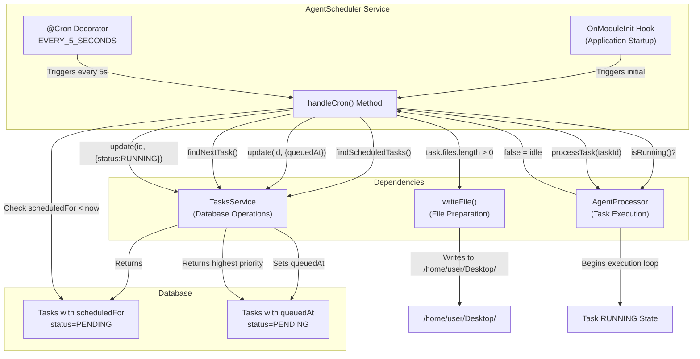
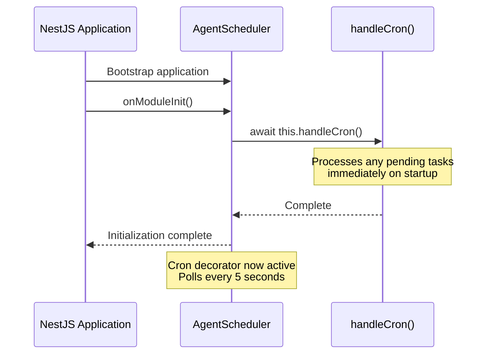
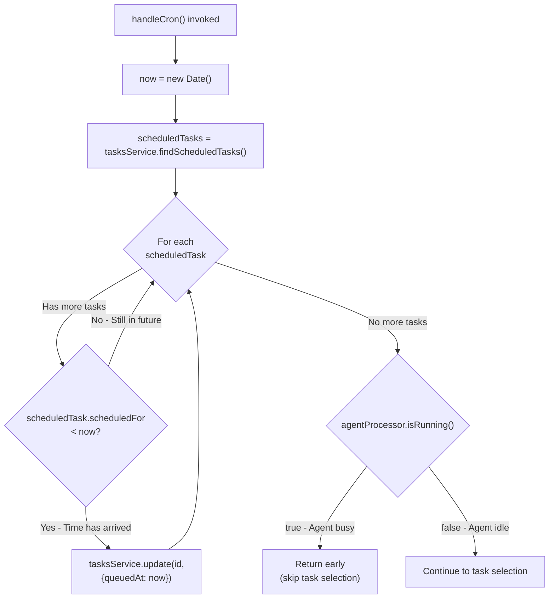
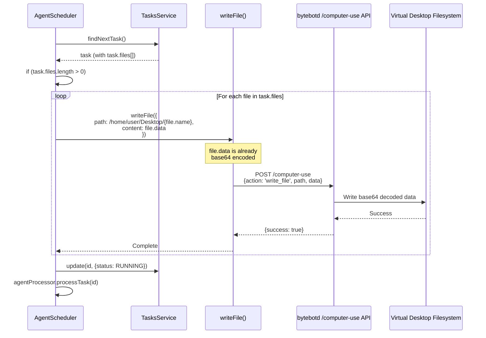
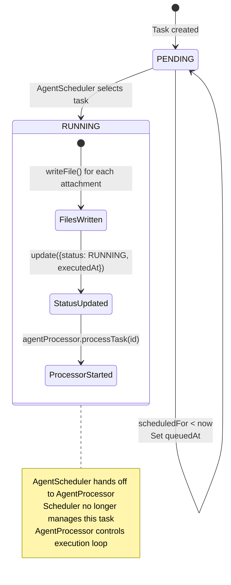

<!-- source: DeepWiki mcp.deepwiki.com · repo bytebot-ai/bytebot · page 5.4 Task Scheduling · fetched 2026-10-29 -->

# Task Scheduling

<details>
<summary>Relevant source files</summary>

The following files were used as context for generating this wiki page:

- [packages/bytebot-agent/prisma/migrations/20250722041608_files/migration.sql](packages/bytebot-agent/prisma/migrations/20250722041608_files/migration.sql)
- [packages/bytebot-agent/src/agent/agent.computer-use.ts](packages/bytebot-agent/src/agent/agent.computer-use.ts)
- [packages/bytebot-agent/src/agent/agent.constants.ts](packages/bytebot-agent/src/agent/agent.constants.ts)
- [packages/bytebot-agent/src/agent/agent.scheduler.ts](packages/bytebot-agent/src/agent/agent.scheduler.ts)
- [packages/bytebot-agent/src/agent/agent.tools.ts](packages/bytebot-agent/src/agent/agent.tools.ts)
- [packages/bytebotd/src/computer-use/computer-use.controller.ts](packages/bytebotd/src/computer-use/computer-use.controller.ts)
- [packages/bytebotd/src/main.ts](packages/bytebotd/src/main.ts)

</details>


## Purpose and Scope

This document describes the **AgentScheduler** system responsible for automated task execution in Bytebot. The scheduler implements cron-based polling to:

1. Queue scheduled tasks when their execution time arrives
2. Select the next pending task based on priority
3. Prepare task files by writing them to the desktop filesystem
4. Initiate task processing via the AgentProcessor

For information about task lifecycle states and transitions, see [Task Lifecycle](#5.1). For details on the AgentProcessor's execution loop, see [Agent Processor](#6.1). For task creation and management APIs, see [TasksService API](#5.2).

**Sources:** [packages/bytebot-agent/src/agent/agent.scheduler.ts:1-63]()

---

## Scheduling Architecture

The `AgentScheduler` runs as a NestJS service with cron-based polling. It acts as the orchestrator between task storage (database) and task execution (agent processor).

### Component Relationships



**Sources:** [packages/bytebot-agent/src/agent/agent.scheduler.ts:1-63]()

---

## Scheduler Initialization

The scheduler implements the `OnModuleInit` lifecycle hook to begin polling immediately when the application starts, ensuring no delay in processing existing queued tasks.

| Component | Type | Purpose |
|-----------|------|---------|
| `AgentScheduler` | `@Injectable()` class | NestJS service providing scheduling functionality |
| `OnModuleInit` | Interface | Lifecycle hook for initialization |
| `onModuleInit()` | Method | Executes `handleCron()` once at startup |

The initialization sequence:



**Implementation:**

```typescript
async onModuleInit() {
  this.logger.log('AgentScheduler initialized');
  await this.handleCron();
}
```

**Sources:** [packages/bytebot-agent/src/agent/agent.scheduler.ts:17-20]()

---

## Cron-Based Polling Mechanism

The scheduler uses the `@nestjs/schedule` package to execute `handleCron()` every 5 seconds via the `@Cron` decorator.

### Polling Configuration

| Parameter | Value | Rationale |
|-----------|-------|-----------|
| Interval | `CronExpression.EVERY_5_SECONDS` | Balance between responsiveness and system load |
| Execution | Single-threaded | Only one `handleCron()` runs at a time |
| Concurrency Control | `isRunning()` check | Prevents parallel task execution |

### Cron Method Implementation

```typescript
@Cron(CronExpression.EVERY_5_SECONDS)
async handleCron() {
  // 1. Queue scheduled tasks
  // 2. Check if agent is busy
  // 3. Select next task
  // 4. Prepare files
  // 5. Start execution
}
```

**Sources:** [packages/bytebot-agent/src/agent/agent.scheduler.ts:22-62]()

---

## Scheduled Task Queueing

The first phase of each cron cycle identifies tasks with future execution times and queues them when their scheduled time arrives.

### Queueing Logic Flow



### Database Query

The scheduler relies on `TasksService.findScheduledTasks()` to retrieve tasks where:
- `status = PENDING`
- `type = SCHEDULED`
- `scheduledFor IS NOT NULL`
- `queuedAt IS NULL`

When a task's `scheduledFor` time is reached, the scheduler sets `queuedAt` to the current timestamp, making it eligible for execution selection.

**Sources:** [packages/bytebot-agent/src/agent/agent.scheduler.ts:24-35]()

---

## Task Selection and Priority

When the `AgentProcessor` is idle, the scheduler selects the highest-priority pending task for execution.

### Selection Criteria

The `TasksService.findNextTask()` method returns tasks ordered by:

1. **Priority** (descending): `URGENT > HIGH > MEDIUM > LOW`
2. **Queue time** (ascending): Older queued tasks execute first

| Task State | Eligibility |
|------------|-------------|
| `status = PENDING` | ✓ Eligible |
| `queuedAt IS NOT NULL` | ✓ Eligible |
| `status = RUNNING` | ✗ Currently executing |
| `status = NEEDS_HELP` | ✗ Awaiting user input |
| `status = COMPLETED` | ✗ Finished |
| `queuedAt IS NULL` | ✗ Not yet queued |

### Concurrency Control

```typescript
if (this.agentProcessor.isRunning()) {
  return;
}
```

The scheduler prevents concurrent task execution by checking `AgentProcessor.isRunning()`. Only when the processor is idle does it proceed to select and start a new task.

**Sources:** [packages/bytebot-agent/src/agent/agent.scheduler.ts:37-41]()

---

## File Preparation Workflow

Before task execution begins, the scheduler writes any attached files to the virtual desktop's filesystem, making them accessible to the AI agent.

### File Writing Process



### File Structure

Files attached to tasks are stored in the database with the following schema:

| Column | Type | Description |
|--------|------|-------------|
| `id` | String (UUID) | Unique file identifier |
| `name` | String | Filename (e.g., `document.pdf`) |
| `type` | String | MIME type (e.g., `application/pdf`) |
| `size` | Integer | File size in bytes |
| `data` | Text | Base64-encoded file content |
| `taskId` | String (FK) | Reference to parent task |

### Desktop Path Convention

All task files are written to `/home/user/Desktop/{filename}`, ensuring they are:
- Immediately visible to the AI agent
- Easily accessible via desktop icons
- Ready for interaction in the XFCE environment

**Implementation:**

```typescript
if (task.files.length > 0) {
  this.logger.debug(
    `Task ID: ${task.id} has files, writing them to the desktop`,
  );
  for (const file of task.files) {
    await writeFile({
      path: `/home/user/Desktop/${file.name}`,
      content: file.data, // Already base64 encoded in database
    });
  }
}
```

**Sources:** [packages/bytebot-agent/src/agent/agent.scheduler.ts:43-53](), [packages/bytebot-agent/prisma/migrations/20250722041608_files/migration.sql:1-17](), [packages/bytebot-agent/src/agent/agent.computer-use.ts:612-646]()

---

## Task Execution Handoff

After file preparation, the scheduler transitions the task to `RUNNING` status and delegates execution to the `AgentProcessor`.

### State Transition Sequence



### Handoff Implementation

```typescript
await this.tasksService.update(task.id, {
  status: TaskStatus.RUNNING,
  executedAt: new Date(),
});
this.logger.debug(`Processing task ID: ${task.id}`);
this.agentProcessor.processTask(task.id);
```

| Field Updated | Value | Purpose |
|---------------|-------|---------|
| `status` | `TaskStatus.RUNNING` | Marks task as actively executing |
| `executedAt` | `new Date()` | Records execution start timestamp |

The `processTask()` call is **non-blocking**—the scheduler immediately returns, allowing the next cron cycle to run while the agent processes the task asynchronously.

**Sources:** [packages/bytebot-agent/src/agent/agent.scheduler.ts:55-60]()

---

## Integration with bytebotd

The file writing process delegates to the bytebotd service's `/computer-use` endpoint, which executes the actual filesystem operation in the virtual desktop environment.

### Computer Use API Integration

```mermaid
graph LR
    subgraph "bytebot-agent Service"
        Scheduler["AgentScheduler"]
        WriteFileFn["writeFile() function<br/>(agent.computer-use.ts)"]
    end
    
    subgraph "bytebotd Service (Port 9990)"
        Controller["ComputerUseController<br/>POST /computer-use"]
        Service["ComputerUseService<br/>action() method"]
        FileHandler["File Action Handler"]
    end
    
    subgraph "Virtual Desktop"
        Filesystem["/home/user/Desktop/"]
    end
    
    Scheduler -->|"await writeFile({path, content})"| WriteFileFn
    WriteFileFn -->|"fetch POST<br/>action='write_file'"| Controller
    Controller -->|"Validates DTO"| Service
    Service -->|"Dispatches action"| FileHandler
    FileHandler -->|"Decodes base64<br/>Writes file"| Filesystem
```



### API Request Format

```typescript
await fetch(`${BYTEBOT_DESKTOP_BASE_URL}/computer-use`, {
  method: 'POST',
  headers: { 'Content-Type': 'application/json' },
  body: JSON.stringify({
    action: 'write_file',
    path: '/home/user/Desktop/filename.ext',
    data: '<base64-encoded-content>',
  }),
});
```

The base64 encoding is preserved from database storage through to bytebotd, which decodes it before writing to the filesystem.

**Sources:** [packages/bytebot-agent/src/agent/agent.computer-use.ts:612-646](), [packages/bytebotd/src/computer-use/computer-use.controller.ts:1-42]()

---

## Scheduling Loop Summary

The complete scheduling cycle executes every 5 seconds:

| Phase | Duration | Action |
|-------|----------|--------|
| **1. Schedule Check** | ~10-50ms | Query scheduled tasks, update `queuedAt` for due tasks |
| **2. Concurrency Check** | <1ms | Check `AgentProcessor.isRunning()` |
| **3. Task Selection** | ~10-30ms | Query highest priority pending task |
| **4. File Preparation** | Variable | Write N files to desktop (depends on file count/size) |
| **5. Execution Start** | ~5-10ms | Update task status, call `processTask()` |
| **Total** | <100ms | Typical execution time (excluding file I/O) |

### Execution Guarantees

The scheduler provides the following guarantees:

1. **Single-threaded execution**: Only one task runs at a time via `isRunning()` check
2. **FIFO within priority**: Tasks of equal priority execute in queue order
3. **Scheduled task accuracy**: ±5 seconds from `scheduledFor` timestamp
4. **File availability**: All task files present on desktop before agent starts
5. **State consistency**: Task status always updated before processing begins

**Sources:** [packages/bytebot-agent/src/agent/agent.scheduler.ts:1-63]()

---

