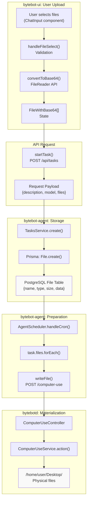
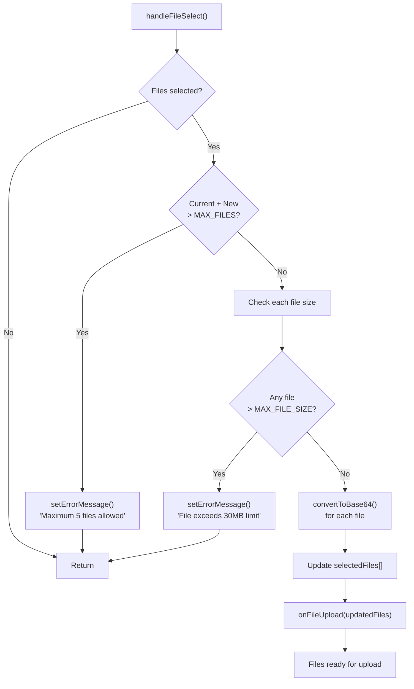
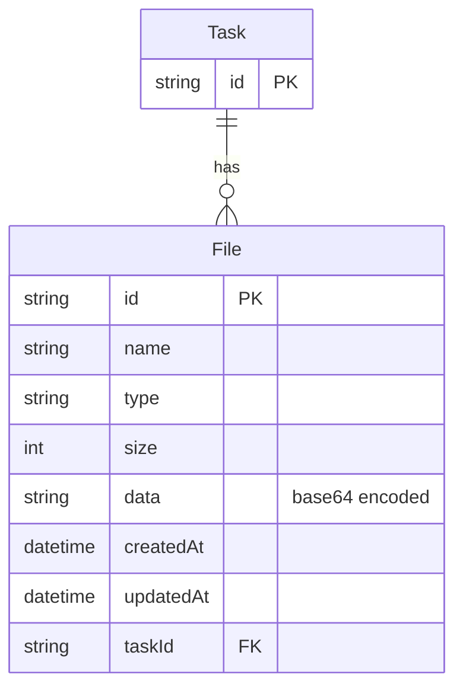
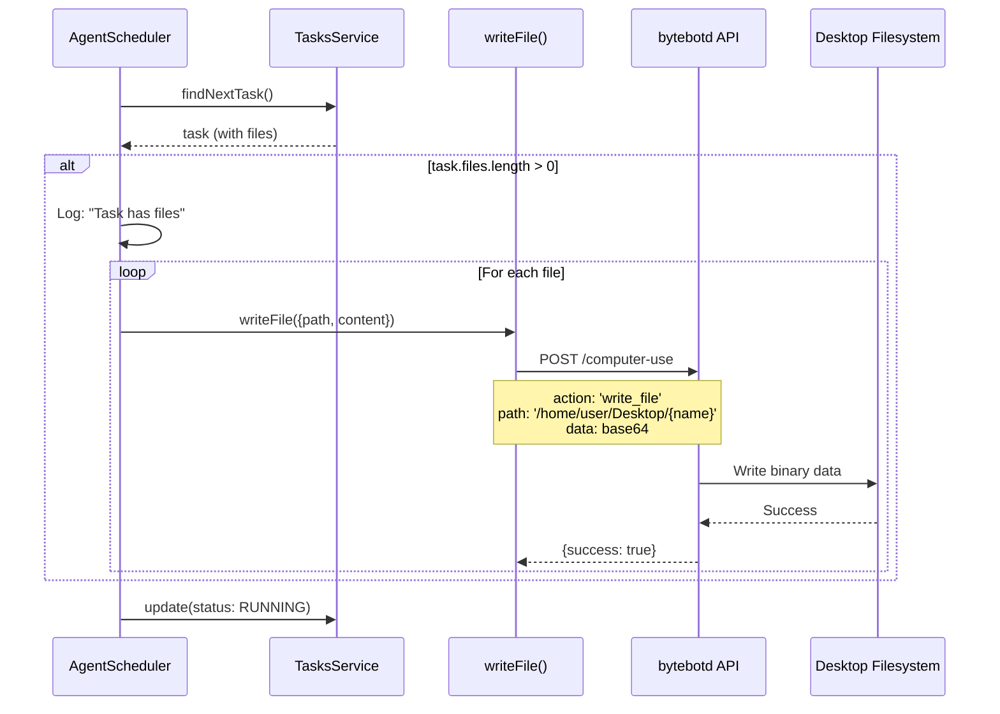
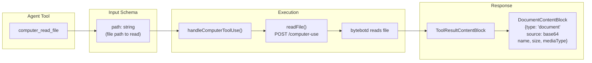
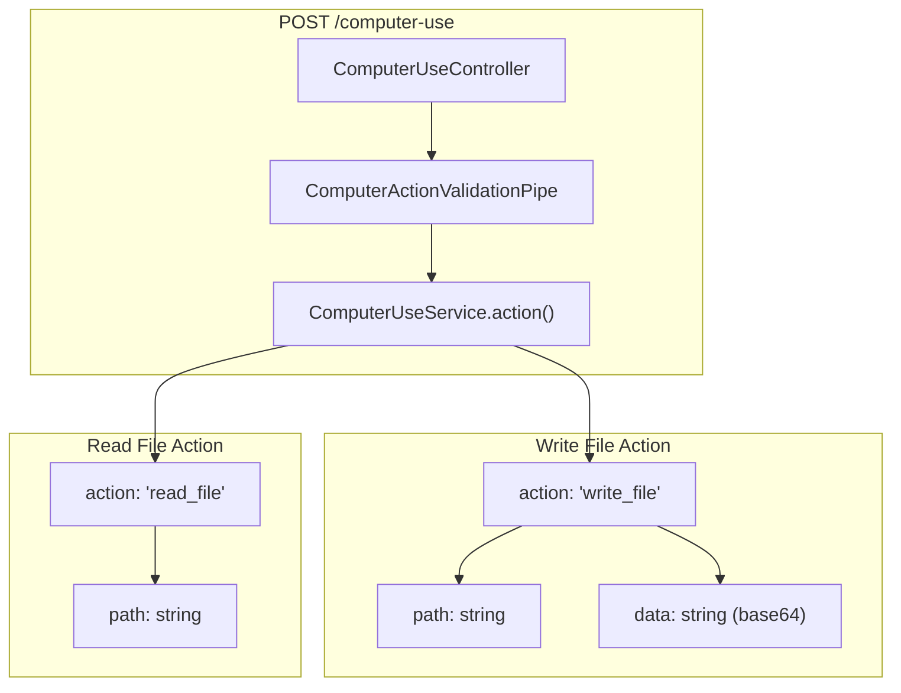
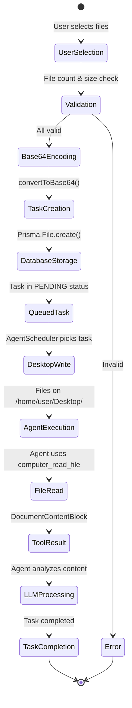

<!-- source: DeepWiki mcp.deepwiki.com · repo bytebot-ai/bytebot · page 5.5 File Handling · fetched 2026-10-29 -->

# File Handling

<details>
<summary>Relevant source files</summary>

The following files were used as context for generating this wiki page:

- [packages/bytebot-agent/prisma/migrations/20250722041608_files/migration.sql](packages/bytebot-agent/prisma/migrations/20250722041608_files/migration.sql)
- [packages/bytebot-agent/src/agent/agent.computer-use.ts](packages/bytebot-agent/src/agent/agent.computer-use.ts)
- [packages/bytebot-agent/src/agent/agent.constants.ts](packages/bytebot-agent/src/agent/agent.constants.ts)
- [packages/bytebot-agent/src/agent/agent.scheduler.ts](packages/bytebot-agent/src/agent/agent.scheduler.ts)
- [packages/bytebot-agent/src/agent/agent.tools.ts](packages/bytebot-agent/src/agent/agent.tools.ts)
- [packages/bytebot-ui/src/app/page.tsx](packages/bytebot-ui/src/app/page.tsx)
- [packages/bytebot-ui/src/components/messages/ChatInput.tsx](packages/bytebot-ui/src/components/messages/ChatInput.tsx)
- [packages/bytebot-ui/src/components/ui/select.tsx](packages/bytebot-ui/src/components/ui/select.tsx)
- [packages/bytebotd/src/computer-use/computer-use.controller.ts](packages/bytebotd/src/computer-use/computer-use.controller.ts)
- [packages/bytebotd/src/main.ts](packages/bytebotd/src/main.ts)

</details>


## Purpose and Scope

This document describes how Bytebot handles file uploads, storage, and access throughout the system. It covers:

- User file uploads via the web interface
- Base64 encoding and database storage
- Automatic file materialization to the virtual desktop
- Agent file reading capabilities
- File size limits and validation

For information about task creation and scheduling, see [Task Scheduling](#5.4). For details about the agent's file reading tool, see [Desktop Tools](#7.2).

---

## File Upload Flow

Files move through a multi-stage pipeline from user upload to desktop availability. The following diagram illustrates the complete flow:



**Sources:** [packages/bytebot-ui/src/components/messages/ChatInput.tsx:46-107](), [packages/bytebot-ui/src/app/page.tsx:97-133](), [packages/bytebot-agent/src/agent/agent.scheduler.ts:43-53](), [packages/bytebot-agent/src/agent/agent.computer-use.ts:612-646]()

---

## File Upload Interface

The `ChatInput` component provides the file upload interface with the following constraints:

| Parameter | Value | Location |
|-----------|-------|----------|
| Maximum Files | 5 files per task | [ChatInput.tsx:38]() |
| Maximum File Size | 30 MB per file | [ChatInput.tsx:39]() |
| Accepted Types | All file types (`*/*`) | [ChatInput.tsx:160]() |
| Encoding | Base64 data URL | [ChatInput.tsx:100-107]() |

### FileWithBase64 Interface

The `FileWithBase64` interface defines the structure used for file uploads:

```typescript
interface FileWithBase64 {
  name: string;      // Original filename
  base64: string;    // Data URL (data:type;base64,...)
  type: string;      // MIME type
  size: number;      // File size in bytes
}
```

**Sources:** [packages/bytebot-ui/src/components/messages/ChatInput.tsx:7-12](), [packages/bytebot-ui/src/app/page.tsx:37-42]()

### Validation Logic

The file upload process includes comprehensive validation:



**Sources:** [packages/bytebot-ui/src/components/messages/ChatInput.tsx:46-98]()

---

## Database Storage

Files are persisted in the PostgreSQL database through the Prisma ORM.

### File Table Schema



The `File` model stores base64-encoded file content directly in the `data` column. This approach simplifies deployment (no separate file storage service) but requires larger database storage.

**Sources:** [packages/bytebot-agent/prisma/migrations/20250722041608_files/migration.sql:1-17]()

---

## Desktop Materialization

When a task begins execution, the `AgentScheduler` automatically writes attached files to the virtual desktop.

### Materialization Process



**Sources:** [packages/bytebot-agent/src/agent/agent.scheduler.ts:43-53](), [packages/bytebot-agent/src/agent/agent.computer-use.ts:612-646]()

### File Writing Implementation

The `writeFile` function in `agent.computer-use.ts` handles the actual file transfer:

- **Path:** Files are always written to `/home/user/Desktop/{filename}`
- **Content:** Expects base64-encoded data (without data URL prefix)
- **Transport:** HTTP POST to `BYTEBOT_DESKTOP_BASE_URL/computer-use`
- **Action Type:** `write_file`

```typescript
// Simplified implementation
async function writeFile(input: {path: string; content: string}) {
  const response = await fetch(`${BYTEBOT_DESKTOP_BASE_URL}/computer-use`, {
    method: 'POST',
    headers: {'Content-Type': 'application/json'},
    body: JSON.stringify({
      action: 'write_file',
      path: input.path,
      data: input.content  // base64 data
    })
  });
}
```

**Sources:** [packages/bytebot-agent/src/agent/agent.computer-use.ts:612-646]()

---

## File Reading

The agent can read files from the desktop using the `computer_read_file` tool.

### Read File Tool Definition



**Sources:** [packages/bytebot-agent/src/agent/agent.tools.ts:368-382](), [packages/bytebot-agent/src/agent/agent.computer-use.ts:146-181]()

### Reading Process

When the agent invokes `computer_read_file`:

1. **Tool Call:** Agent provides `{path: "/path/to/file"}`
2. **API Request:** `handleComputerToolUse` sends POST to bytebotd
3. **File Read:** bytebotd reads the file and encodes it as base64
4. **Response Structure:**
   ```typescript
   {
     success: boolean,
     data?: string,        // base64 encoded content
     name?: string,        // filename
     size?: number,        // file size in bytes
     mediaType?: string,   // MIME type
     message?: string      // error message if failed
   }
   ```
5. **Content Block:** If successful, returns `DocumentContentBlock` to LLM

**Sources:** [packages/bytebot-agent/src/agent/agent.computer-use.ts:146-181](), [packages/bytebot-agent/src/agent/agent.computer-use.ts:576-610]()

---

## Technical Details

### Payload Size Limits

The system enforces size limits at multiple layers:

| Service | Limit | Configuration |
|---------|-------|---------------|
| bytebotd | 50 MB | [main.ts:11-12]() |
| UI Client | 30 MB per file | [ChatInput.tsx:39]() |
| UI Client | 5 files max | [ChatInput.tsx:38]() |

The bytebotd service configures Express middleware to accept large payloads:

```typescript
app.use(json({ limit: '50mb' }));
app.use(urlencoded({ limit: '50mb', extended: true }));
```

**Sources:** [packages/bytebotd/src/main.ts:10-12]()

### Base64 Encoding Details

Files undergo base64 encoding at the browser layer using the FileReader API:

```typescript
const convertToBase64 = (file: File): Promise<string> => {
  return new Promise((resolve, reject) => {
    const reader = new FileReader();
    reader.readAsDataURL(file);  // Produces data URL
    reader.onload = () => resolve(reader.result as string);
    reader.onerror = (error) => reject(error);
  });
};
```

The resulting string has the format: `data:{mimeType};base64,{encodedData}`

**Sources:** [packages/bytebot-ui/src/components/messages/ChatInput.tsx:100-107]()

### Desktop Path Convention

All uploaded files are materialized to a consistent location:

- **Directory:** `/home/user/Desktop/`
- **Filename:** Original filename from upload
- **User:** `user` (the desktop environment's default user)
- **Visibility:** Files appear as desktop icons in the XFCE environment

This convention allows the agent to easily locate user-provided files by name.

**Sources:** [packages/bytebot-agent/src/agent/agent.scheduler.ts:49]()

### Computer Use API Integration

The bytebotd service exposes file operations through the `/computer-use` endpoint:



The controller sanitizes logs to avoid outputting base64 data:

```typescript
const paramsCopy = { ...params };
if (paramsCopy.action === 'write_file') {
  paramsCopy.data = 'base64 data';  // Redacted for logs
}
this.logger.log(`Computer action request: ${JSON.stringify(paramsCopy)}`);
```

**Sources:** [packages/bytebotd/src/computer-use/computer-use.controller.ts:19-41]()

### Agent System Prompt Guidance

The agent receives explicit instructions about file reading in its system prompt:

> **Read Files** - If you need to read file contents, invoke
> ```json
> { "name": "computer_read_file", "input": { "path": "/path/to/file" } }
> ```
> This tool reads files and returns them as document content blocks with base64 data, supporting various file types including documents (PDF, DOCX, TXT, etc.) and images (PNG, JPG, etc.).

This guidance ensures the agent knows how to access uploaded files and other desktop files.

**Sources:** [packages/bytebot-agent/src/agent/agent.constants.ts:122-126]()

---

## File Lifecycle Summary



**Sources:** [packages/bytebot-ui/src/components/messages/ChatInput.tsx:46-107](), [packages/bytebot-agent/src/agent/agent.scheduler.ts:43-53](), [packages/bytebot-agent/src/agent/agent.computer-use.ts:146-181]()

---

