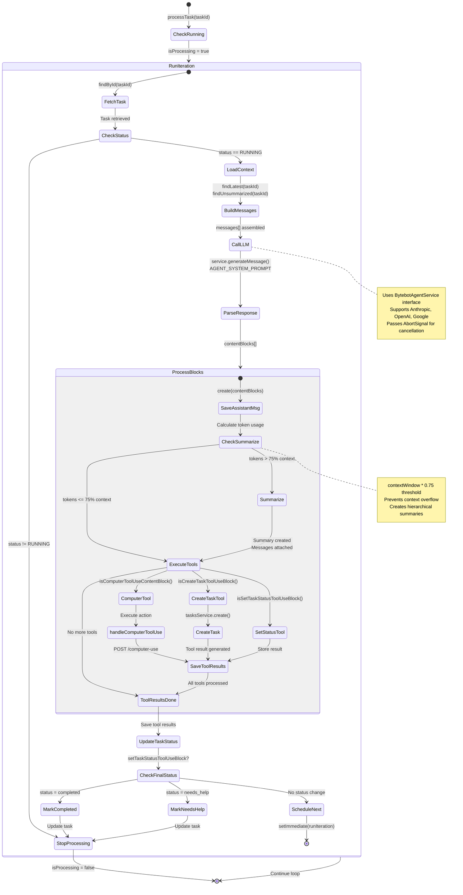
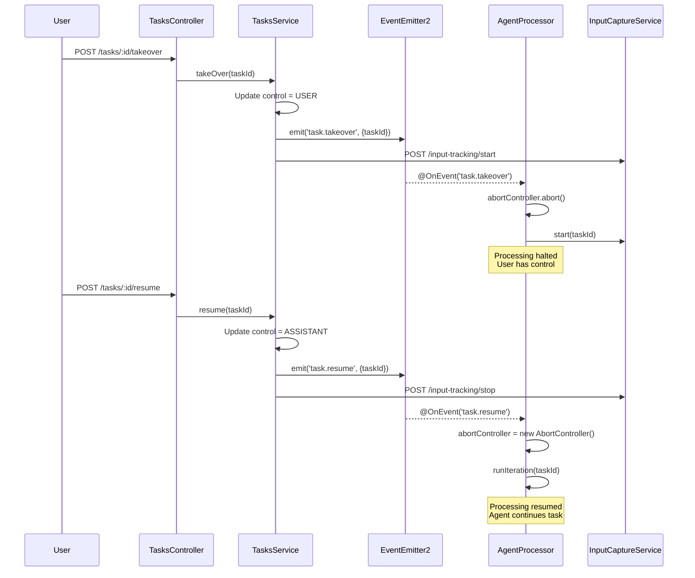

<!-- source: DeepWiki mcp.deepwiki.com · repo bytebot-ai/bytebot · page 6 Agent System · fetched 2026-10-29 -->

# Agent System

<details>
<summary>Relevant source files</summary>

The following files were used as context for generating this wiki page:

- [packages/bytebot-agent/prisma/migrations/20250722041608_files/migration.sql](packages/bytebot-agent/prisma/migrations/20250722041608_files/migration.sql)
- [packages/bytebot-agent/src/agent/agent.computer-use.ts](packages/bytebot-agent/src/agent/agent.computer-use.ts)
- [packages/bytebot-agent/src/agent/agent.constants.ts](packages/bytebot-agent/src/agent/agent.constants.ts)
- [packages/bytebot-agent/src/agent/agent.processor.ts](packages/bytebot-agent/src/agent/agent.processor.ts)
- [packages/bytebot-agent/src/agent/agent.scheduler.ts](packages/bytebot-agent/src/agent/agent.scheduler.ts)
- [packages/bytebot-agent/src/agent/agent.tools.ts](packages/bytebot-agent/src/agent/agent.tools.ts)
- [packages/bytebot-agent/src/tasks/tasks.controller.ts](packages/bytebot-agent/src/tasks/tasks.controller.ts)
- [packages/bytebot-agent/src/tasks/tasks.service.ts](packages/bytebot-agent/src/tasks/tasks.service.ts)
- [packages/bytebot-ui/src/hooks/useChatSession.ts](packages/bytebot-ui/src/hooks/useChatSession.ts)
- [packages/bytebotd/src/computer-use/computer-use.controller.ts](packages/bytebotd/src/computer-use/computer-use.controller.ts)
- [packages/bytebotd/src/main.ts](packages/bytebotd/src/main.ts)

</details>


The Agent System is the AI-driven core of Bytebot that orchestrates autonomous task execution on the virtual desktop. It implements a continuous observe-act-verify loop, using Large Language Models (LLMs) to make decisions and desktop automation tools to execute actions. This system transforms user task descriptions into sequences of computer interactions, managing context through summarization and handling multi-step workflows.

For information about task lifecycle management and status transitions, see [Task Management System](#5). For details about the desktop environment where actions are executed, see [Desktop Environment](#7). For LLM provider configuration, see [Configuration](#3.3).

## Architecture Overview

The Agent System consists of four primary components working in coordination:

**AgentProcessor** - The central orchestrator ([packages/bytebot-agent/src/agent/agent.processor.ts:44-420]()) that manages the processing loop, maintains state, and coordinates between LLM services and tool execution.

**BytebotAgentService Implementations** - Provider-specific adapters for Anthropic Claude, OpenAI GPT, and Google Gemini that abstract LLM communication behind a common interface.

**Tool System** - A collection of 17 desktop automation tools ([packages/bytebot-agent/src/agent/agent.tools.ts:387-405]()) and their execution handlers that translate LLM decisions into computer actions.

**Context Management** - Message storage and summarization services that maintain conversation history while respecting LLM context windows.

```mermaid
graph TB
    subgraph "AgentProcessor Core"
        AP[AgentProcessor<br/>agent.processor.ts:44]
        ProcessLoop[processTask()<br/>:114]
        RunIter[runIteration()<br/>:134]
        AbortCtrl[AbortController<br/>:48]
    end
    
    subgraph "LLM Integration Layer"
        BAIS[BytebotAgentService<br/>Interface]
        Anthropic[AnthropicService<br/>anthropic.service.ts]
        OpenAI[OpenAIService<br/>openai.service.ts]
        Google[GoogleService<br/>google.service.ts]
        Proxy[ProxyService<br/>proxy.service.ts]
    end
    
    subgraph "Tool Execution"
        ToolDefs[agentTools[]<br/>agent.tools.ts:387]
        CompUse[handleComputerToolUse()<br/>agent.computer-use.ts:28]
        DesktopAPI[POST /computer-use<br/>bytebotd:9990]
    end
    
    subgraph "Context Management"
        MsgSvc[MessagesService<br/>messages.service.ts]
        SumSvc[SummariesService<br/>summaries.service.ts]
        MsgDB[(Message Table)]
        SumDB[(Summary Table)]
    end
    
    subgraph "Task State"
        TaskSvc[TasksService<br/>tasks.service.ts]
        EventBus[EventEmitter2<br/>Internal Events]
    end
    
    ProcessLoop --> RunIter
    RunIter --> TaskSvc
    RunIter --> SumSvc
    RunIter --> MsgSvc
    RunIter --> BAIS
    
    BAIS --> Anthropic
    BAIS --> OpenAI
    BAIS --> Google
    BAIS --> Proxy
    
    RunIter --> CompUse
    CompUse --> DesktopAPI
    
    MsgSvc --> MsgDB
    SumSvc --> SumDB
    
    TaskSvc --> EventBus
    EventBus -.->|task.takeover| AP
    EventBus -.->|task.resume| AP
    EventBus -.->|task.cancel| AP
    
    AbortCtrl -.->|Cancels| BAIS
```

**Diagram: Agent System Component Architecture**

The diagram shows how AgentProcessor orchestrates the system, delegating to specialized services while maintaining control through event subscriptions and abort signals.

Sources: [packages/bytebot-agent/src/agent/agent.processor.ts:44-420](), [packages/bytebot-agent/src/agent/agent.computer-use.ts:1-647](), [packages/bytebot-agent/src/agent/agent.tools.ts:1-406]()

## Processing Loop

The agent operates in a continuous iteration loop implemented in `runIteration()`. Each iteration follows the observe-plan-act-verify pattern:



**Diagram: AgentProcessor Iteration Lifecycle**

Each iteration is scheduled via `setImmediate()`, creating a non-blocking asynchronous loop that continues until the task reaches a terminal status.

Sources: [packages/bytebot-agent/src/agent/agent.processor.ts:134-403](), [packages/bytebot-agent/src/tasks/tasks.service.ts:217-391]()

## Tool Use Execution Flow

When the LLM responds with tool use blocks, the agent processes each tool sequentially:

```mermaid
graph TB
    LLMResp[LLM Response<br/>contentBlocks[]]
    
    SaveMsg[messagesService.create()<br/>role: ASSISTANT<br/>:227-231]
    
    LoopBlocks{For each block}
    
    CheckType1{isComputerToolUseContentBlock?}
    CheckType2{isCreateTaskToolUseBlock?}
    CheckType3{isSetTaskStatusToolUseBlock?}
    
    HandleComp[handleComputerToolUse()<br/>agent.computer-use.ts:28]
    
    ToolDispatch{Tool Name}
    
    Screenshot[screenshot()<br/>:526-555]
    CursorPos[cursorPosition()<br/>:506-524]
    MouseAction[moveMouse/clickMouse/etc.<br/>:241-485]
    KeyAction[typeKeys/pressKeys/typeText<br/>:399-466]
    AppAction[application()<br/>:557-574]
    ReadFile[readFile()<br/>:576-610]
    
    Wait750[Wait 750ms<br/>:187-189]
    TakeScreenshot[screenshot()<br/>:192]
    
    BuildResult[Build ToolResultContentBlock<br/>:199-221]
    
    CreateTask[tasksService.create()<br/>:319-328]
    SetStatus[Store status change<br/>:343-356]
    
    CollectResults[generatedToolResults[]<br/>:305]
    
    SaveResults[messagesService.create()<br/>role: USER<br/>:360-364]
    
    UpdateTask[tasksService.update()<br/>Apply status change<br/>:368-382]
    
    LLMResp --> SaveMsg
    SaveMsg --> LoopBlocks
    
    LoopBlocks --> CheckType1
    CheckType1 -->|Yes| HandleComp
    CheckType1 -->|No| CheckType2
    
    HandleComp --> ToolDispatch
    
    ToolDispatch -->|screenshot| Screenshot
    ToolDispatch -->|cursor_position| CursorPos
    ToolDispatch -->|move_mouse,etc| MouseAction
    ToolDispatch -->|type_keys,etc| KeyAction
    ToolDispatch -->|application| AppAction
    ToolDispatch -->|read_file| ReadFile
    
    Screenshot --> BuildResult
    CursorPos --> BuildResult
    
    MouseAction --> Wait750
    KeyAction --> Wait750
    AppAction --> Wait750
    
    Wait750 --> TakeScreenshot
    TakeScreenshot --> BuildResult
    
    ReadFile --> BuildResult
    
    BuildResult --> CollectResults
    
    CheckType2 -->|Yes| CreateTask
    CheckType2 -->|No| CheckType3
    
    CreateTask --> CollectResults
    
    CheckType3 -->|Yes| SetStatus
    CheckType3 -->|No| LoopBlocks
    
    SetStatus --> CollectResults
    
    CollectResults --> SaveResults
    SaveResults --> UpdateTask
```

**Diagram: Tool Execution Dispatch and Result Collection**

The 750ms delay before post-action screenshots allows UI animations to settle, ensuring the agent observes the actual result state.

Sources: [packages/bytebot-agent/src/agent/agent.processor.ts:309-382](), [packages/bytebot-agent/src/agent/agent.computer-use.ts:28-239]()

## System Prompt and Operating Principles

The agent's behavior is governed by the `AGENT_SYSTEM_PROMPT` constant ([packages/bytebot-agent/src/agent/agent.constants.ts:17-175]()), which defines:

| Principle | Description | Implementation |
|-----------|-------------|----------------|
| **Observe First** | Always take screenshot before actions | `computer_screenshot` before each operation |
| **Human-Like Interaction** | Natural mouse movements, realistic typing | Smooth paths, context-appropriate text |
| **Verify Every Step** | Confirm expected state after actions | Screenshot after each tool use |
| **Batch Processing** | Process repetitive tasks in groups of 10-20 | Continue until all items processed |
| **Error Recovery** | Don't let single failures stop operations | Note errors, continue with next item |
| **Cleanup** | Return desktop to idle state | Close windows before completion |
| **Security** | Protect sensitive information | `isSensitive` flag on passwords |

The prompt includes a comprehensive task lifecycle template, valid key mappings from `nut-tree`'s `Key` enum, and specific guidance for bulk operations to prevent premature completion.

For detailed operating principles, see [Agent Operating Principles](#6.5).

Sources: [packages/bytebot-agent/src/agent/agent.constants.ts:17-175]()

## Event-Driven Control

The agent responds to external events through the `EventEmitter2` pattern:



**Diagram: Event-Driven Task Control Flow**

The abort controller mechanism ([packages/bytebot-agent/src/agent/agent.processor.ts:48,155]()) allows graceful cancellation of in-flight LLM requests without leaving operations in inconsistent states.

Sources: [packages/bytebot-agent/src/agent/agent.processor.ts:84-112](), [packages/bytebot-agent/src/tasks/tasks.service.ts:282-391]()

## LLM Provider Abstraction

The agent uses a common interface to support multiple LLM providers:

```typescript
interface BytebotAgentService {
  generateMessage(
    systemPrompt: string,
    messages: Message[],
    model: string,
    tools: boolean,
    signal: AbortSignal
  ): Promise<BytebotAgentResponse>;
}
```

Implementations map provider-specific APIs to this interface:

| Provider | Service Class | Model Selection | Context Window |
|----------|---------------|-----------------|----------------|
| Anthropic | `AnthropicService` | Claude 3.5 Sonnet, Opus | 200,000 tokens |
| OpenAI | `OpenAIService` | GPT-4o, o1-preview, o1-mini | 128,000 tokens |
| Google | `GoogleService` | Gemini 2.0 Flash, Pro | 1,000,000 tokens |
| Proxy | `ProxyService` | LiteLLM proxy endpoint | Configurable |

Provider selection occurs at runtime based on the task's `model` field ([packages/bytebot-agent/src/agent/agent.processor.ts:185-199]()), with automatic fallback if the specified provider is unavailable.

For provider implementation details, see [AI Model Integration](#6.3).

Sources: [packages/bytebot-agent/src/agent/agent.processor.ts:61-66,185-207](), [packages/bytebot-agent/src/tasks/tasks.controller.ts:23-33]()

## Summarization Strategy

To manage LLM context limits, the agent implements automatic summarization:

**Trigger Condition**: When `totalTokens >= (contextWindow * 0.75)` ([packages/bytebot-agent/src/agent/agent.processor.ts:234-237]())

**Summarization Process**:
1. Use `SUMMARIZATION_SYSTEM_PROMPT` to request concise summary
2. Send all unsummarized messages plus summary request to LLM
3. Extract text from response content blocks
4. Create summary record in database
5. Attach processed messages to summary via `summaryId`

**Context Building** ([packages/bytebot-agent/src/agent/agent.processor.ts:157-180]()):
```
[
  {role: USER, content: <latest summary text>},  // If exists
  ...unsummarizedMessages                         // Recent messages
]
```

This creates a hierarchical structure where summaries can reference parent summaries, enabling indefinite conversation length while staying within token limits.

For message processing and summarization details, see [Message and Summarization](#6.4).

Sources: [packages/bytebot-agent/src/agent/agent.processor.ts:157-299](), [packages/bytebot-agent/src/agent/agent.constants.ts:6-15]()

## Task Scheduling and Initialization

The `AgentScheduler` ([packages/bytebot-agent/src/agent/agent.scheduler.ts:9-63]()) runs every 5 seconds to:

1. **Check scheduled tasks**: Queue any tasks where `scheduledFor < now`
2. **Find next task**: If processor idle, find highest priority task (RUNNING or PENDING)
3. **Prepare files**: Write task attachments to `/home/user/Desktop/`
4. **Start processing**: Update status to RUNNING, call `agentProcessor.processTask()`

File preparation ([packages/bytebot-agent/src/agent/agent.scheduler.ts:43-53]()) materializes base64-encoded database blobs onto the virtual desktop filesystem, making them accessible to applications.

Task prioritization follows:
```
ORDER BY executedAt ASC, priority DESC, queuedAt ASC, createdAt ASC
```

This ensures RUNNING tasks resume before new PENDING tasks, with priority as the secondary sort.

Sources: [packages/bytebot-agent/src/agent/agent.scheduler.ts:1-64](), [packages/bytebot-agent/src/tasks/tasks.service.ts:131-156]()

## Desktop Tool Catalog

The agent has access to 17 computer automation tools grouped by category:

**Mouse Tools** ([packages/bytebot-agent/src/agent/agent.tools.ts:35-155]()):
- `computer_move_mouse`, `computer_trace_mouse`, `computer_click_mouse`
- `computer_press_mouse`, `computer_drag_mouse`, `computer_scroll`

**Keyboard Tools** ([packages/bytebot-agent/src/agent/agent.tools.ts:160-248]()):
- `computer_type_keys`, `computer_press_keys`, `computer_type_text`
- `computer_paste_text`

**Utility Tools** ([packages/bytebot-agent/src/agent/agent.tools.ts:253-382]()):
- `computer_screenshot`, `computer_cursor_position`, `computer_wait`
- `computer_application`, `computer_read_file`

**Task Management Tools** ([packages/bytebot-agent/src/agent/agent.tools.ts:314-363]()):
- `set_task_status`, `create_task`

Each tool definition includes JSON schema for input validation. The `computer_application` tool limits applications to: `firefox`, `1password`, `thunderbird`, `vscode`, `terminal`, `desktop`, `directory`.

For complete tool documentation, see [Computer Use Integration](#6.2) and [Desktop Tools](#7.2).

Sources: [packages/bytebot-agent/src/agent/agent.tools.ts:1-406]()

## Error Handling and Recovery

The agent implements multi-layer error handling:

**LLM Request Errors**: Caught at the service level, propagated as `BytebotAgentInterrupt` errors when abort signals trigger ([packages/bytebot-agent/src/agent/agent.processor.ts:389-401]())

**Tool Execution Errors**: Return `ToolResultContentBlock` with `is_error: true` flag ([packages/bytebot-agent/src/agent/agent.computer-use.ts:222-238]()), allowing the LLM to see failures and retry

**Task Failures**: Set `status: FAILED` and stop processing ([packages/bytebot-agent/src/agent/agent.processor.ts:193-198]())

**Abort on Takeover**: When user takes control, abort any in-flight requests immediately ([packages/bytebot-agent/src/agent/agent.processor.ts:89-91]())

Error messages include stack traces in logs but sanitize sensitive information before storage.

Sources: [packages/bytebot-agent/src/agent/agent.processor.ts:388-402](), [packages/bytebot-agent/src/agent/agent.computer-use.ts:222-238]()

## Integration Points

The Agent System integrates with:

| Component | Integration Method | Purpose |
|-----------|-------------------|---------|
| TasksService | Direct injection | CRUD operations, status updates |
| MessagesService | Direct injection | Store LLM responses, tool results |
| SummariesService | Direct injection | Context compression |
| bytebotd | HTTP POST /computer-use | Execute desktop actions |
| TasksGateway | Via TasksService | Real-time UI notifications |
| EventEmitter2 | Event subscriptions | React to control changes |
| InputCaptureService | Direct calls | Track user actions during takeover |

The processor maintains minimal state (current task ID, processing flag, abort controller), relying on database queries for task state to ensure consistency across restarts.

Sources: [packages/bytebot-agent/src/agent/agent.processor.ts:51-67](), [packages/bytebot-agent/src/agent/agent.computer-use.ts:26,248-555]()

---

