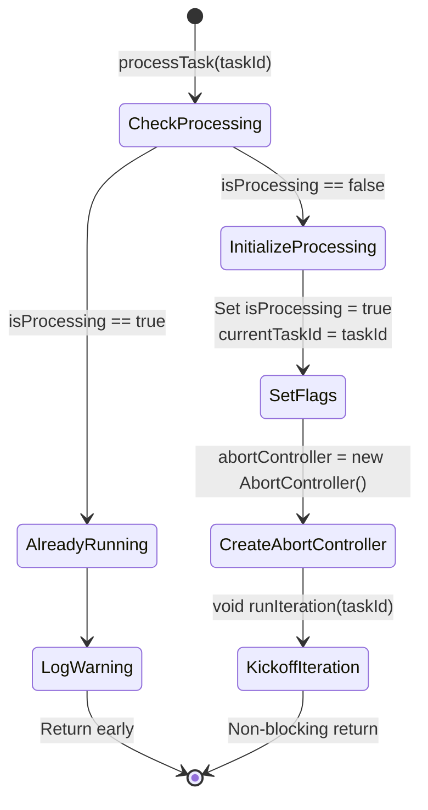
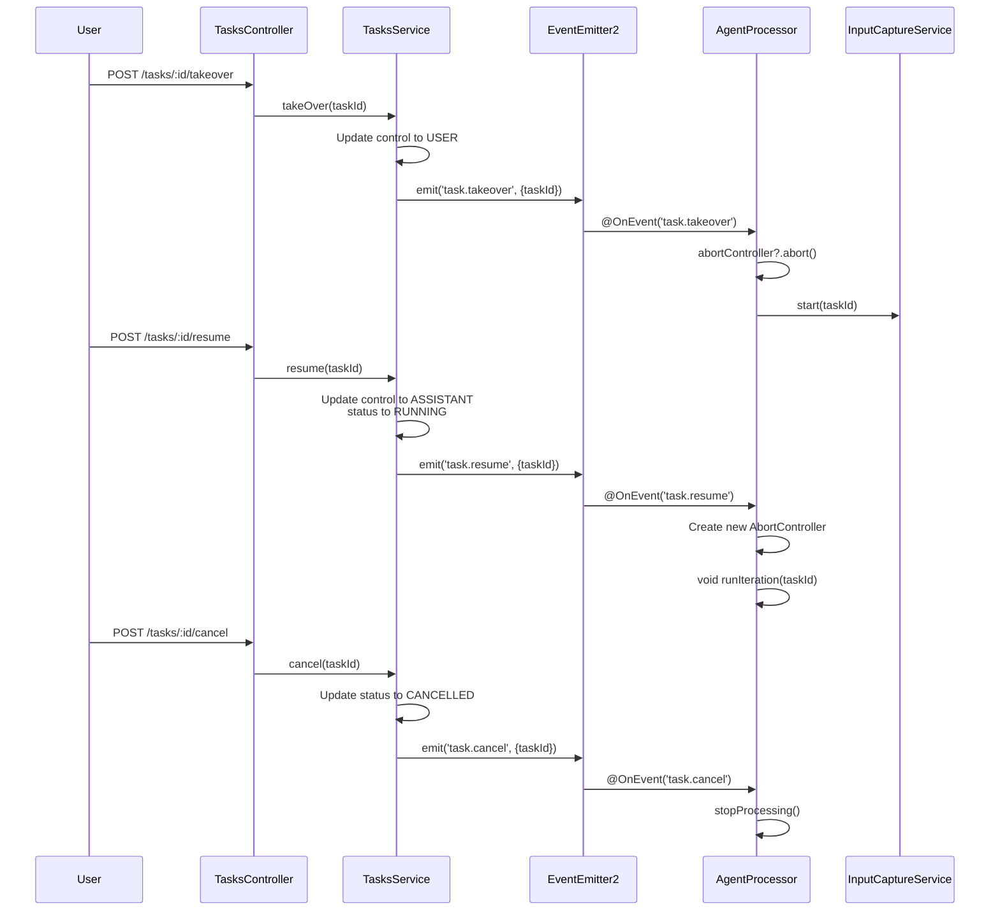
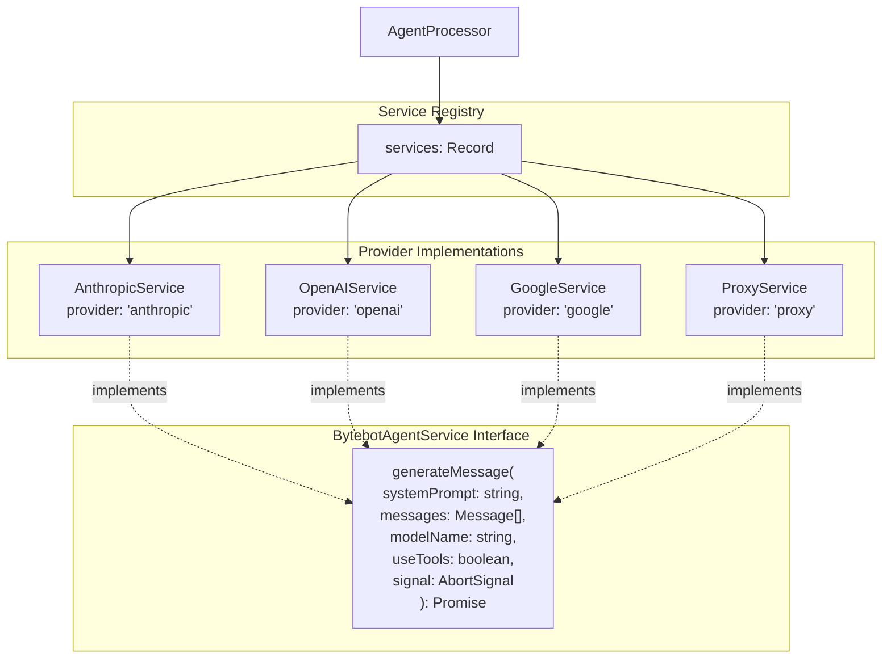
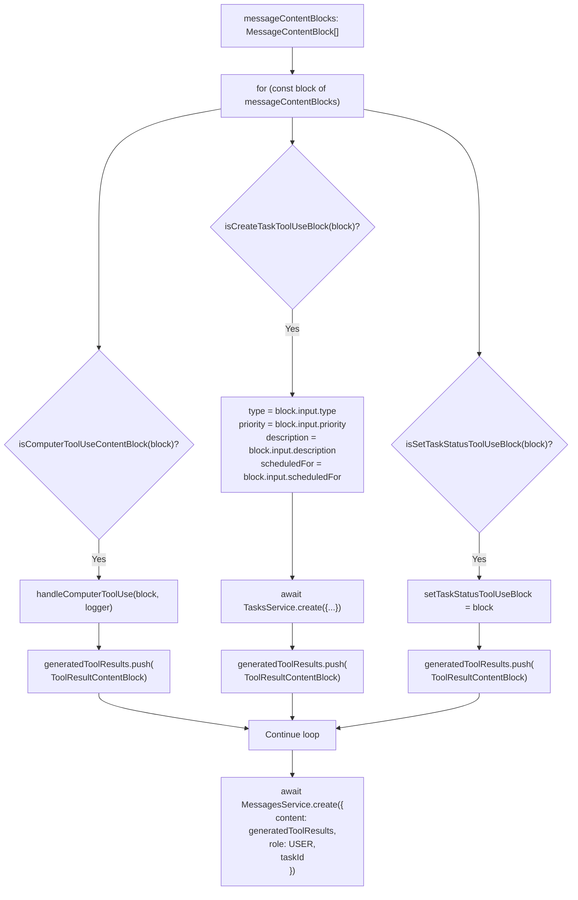
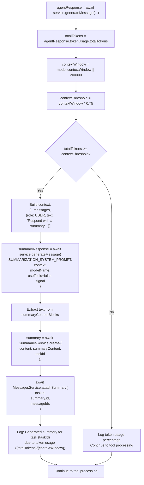
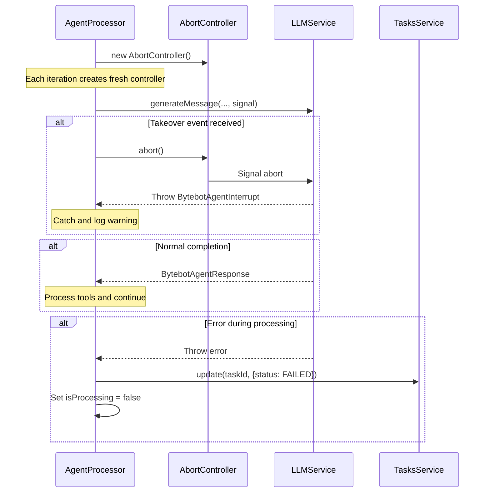

<!-- source: DeepWiki mcp.deepwiki.com · repo bytebot-ai/bytebot · page 6.1 Agent Processor · fetched 2026-10-29 -->

# Agent Processor

<details>
<summary>Relevant source files</summary>

The following files were used as context for generating this wiki page:

- [packages/bytebot-agent/src/agent/agent.processor.ts](packages/bytebot-agent/src/agent/agent.processor.ts)
- [packages/bytebot-agent/src/tasks/tasks.controller.ts](packages/bytebot-agent/src/tasks/tasks.controller.ts)
- [packages/bytebot-agent/src/tasks/tasks.service.ts](packages/bytebot-agent/src/tasks/tasks.service.ts)
- [packages/bytebot-ui/src/hooks/useChatSession.ts](packages/bytebot-ui/src/hooks/useChatSession.ts)

</details>


## Purpose and Scope

The **AgentProcessor** is the core orchestration component that executes AI-driven tasks in a continuous observation-action loop. It coordinates between LLM providers, desktop automation, message management, and summarization to autonomously complete user-defined tasks. This document covers the processing lifecycle, event-driven coordination, tool execution, and context management strategies.

For information about the specific desktop actions the agent can execute, see [Computer Use Integration](#6.2). For details on LLM provider implementations, see [AI Model Integration](#6.3). For the message storage and summarization strategy, see [Message and Summarization](#6.4).

---

## Overview

The AgentProcessor implements a single-threaded, non-blocking task execution engine that:

1. **Observes** the current desktop state via screenshots
2. **Reasons** by sending message context to LLM providers
3. **Acts** by executing tool use instructions (computer actions, subtask creation, status updates)
4. **Verifies** results and continues the loop until task completion

The processor runs one task at a time, maintaining state through the `isProcessing` flag and `currentTaskId` reference. It responds to external events (takeover, resume, cancel) via the EventEmitter2 system and supports graceful interruption using AbortController.

Sources: [packages/bytebot-agent/src/agent/agent.processor.ts:1-420]()

---

## Class Structure and Dependencies

### AgentProcessor Service

```mermaid
graph TB
    AgentProcessor["AgentProcessor<br/>@Injectable()"]
    
    subgraph "Service Dependencies"
        TasksService["TasksService<br/>CRUD + Events"]
        MessagesService["MessagesService<br/>Create + Query"]
        SummariesService["SummariesService<br/>Hierarchical summaries"]
        AnthropicService["AnthropicService<br/>Claude integration"]
        OpenAIService["OpenAIService<br/>GPT integration"]
        GoogleService["GoogleService<br/>Gemini integration"]
        ProxyService["ProxyService<br/>LLM proxy integration"]
        InputCaptureService["InputCaptureService<br/>User action tracking"]
    end
    
    subgraph "Internal State"
        currentTaskId["currentTaskId: string | null"]
        isProcessing["isProcessing: boolean"]
        abortController["abortController: AbortController"]
        services["services: Record<string, BytebotAgentService>"]
    end
    
    AgentProcessor --> TasksService
    AgentProcessor --> MessagesService
    AgentProcessor --> SummariesService
    AgentProcessor --> AnthropicService
    AgentProcessor --> OpenAIService
    AgentProcessor --> GoogleService
    AgentProcessor --> ProxyService
    AgentProcessor --> InputCaptureService
    
    AgentProcessor --> currentTaskId
    AgentProcessor --> isProcessing
    AgentProcessor --> abortController
    AgentProcessor --> services
```



The AgentProcessor maintains a services registry mapping provider names (`anthropic`, `openai`, `google`, `proxy`) to their respective service implementations. This allows runtime model selection based on the task's configured model.

| Internal State | Type | Purpose |
|---|---|---|
| `currentTaskId` | `string \| null` | ID of the task currently being processed |
| `isProcessing` | `boolean` | Flag indicating whether processor is active |
| `abortController` | `AbortController \| null` | Controls abortion of in-flight LLM requests |
| `services` | `Record<string, BytebotAgentService>` | Map of provider names to service implementations |

Sources: [packages/bytebot-agent/src/agent/agent.processor.ts:44-68]()

---

## Processing Lifecycle

### Entry Point: processTask()



The `processTask()` method [packages/bytebot-agent/src/agent/agent.processor.ts:114-128]() serves as the entry point for task execution. It:

1. Validates that no other task is currently processing
2. Sets the `isProcessing` flag and `currentTaskId`
3. Creates a fresh `AbortController` for request cancellation
4. Initiates the first iteration without blocking the caller

The method returns immediately after scheduling the first iteration, allowing the NestJS event loop to continue serving other requests.

Sources: [packages/bytebot-agent/src/agent/agent.processor.ts:114-128]()

---

### Main Loop: runIteration()

```mermaid
flowchart TD
    Start["runIteration(taskId)"] --> CheckProcessing{"isProcessing?"}
    CheckProcessing -->|No| Return["Return early"]
    CheckProcessing -->|Yes| FetchTask["Fetch task from DB"]
    
    FetchTask --> CheckStatus{"task.status == RUNNING?"}
    CheckStatus -->|No| CleanupState["Set isProcessing = false<br/>currentTaskId = null"]
    CleanupState --> Return
    
    CheckStatus -->|Yes| RefreshAbort["Create new AbortController"]
    RefreshAbort --> BuildContext["Build message context:<br/>latestSummary +<br/>unsummarizedMessages"]
    
    BuildContext --> SelectService["Select service by model.provider"]
    SelectService --> InvalidService{"Service exists?"}
    InvalidService -->|No| FailTask["Update status to FAILED"]
    FailTask --> CleanupState
    
    InvalidService -->|Yes| CallLLM["service.generateMessage()<br/>with AGENT_SYSTEM_PROMPT"]
    
    CallLLM --> ValidateResponse{"contentBlocks.length > 0?"}
    ValidateResponse -->|No| FailTask
    
    ValidateResponse -->|Yes| SaveAssistantMsg["Save ASSISTANT message<br/>with contentBlocks"]
    
    SaveAssistantMsg --> CheckTokens{"tokenUsage >= 75% of contextWindow?"}
    CheckTokens -->|Yes| Summarize["Generate summary via LLM<br/>Create Summary entity<br/>Attach messages to summary"]
    CheckTokens -->|No| ProcessTools["Process tool use blocks"]
    Summarize --> ProcessTools
    
    ProcessTools --> ComputerTool{"isComputerToolUseContentBlock?"}
    ProcessTools --> CreateTaskTool{"isCreateTaskToolUseBlock?"}
    ProcessTools --> SetStatusTool{"isSetTaskStatusToolUseBlock?"}
    
    ComputerTool --> HandleComputer["handleComputerToolUse()<br/>Execute via bytebotd"]
    CreateTaskTool --> CreateSubTask["TasksService.create()"]
    SetStatusTool --> SaveSetStatus["Save tool result"]
    
    HandleComputer --> AddResults["Collect tool results"]
    CreateSubTask --> AddResults
    SaveSetStatus --> AddResults
    
    AddResults --> SaveResults{"generatedToolResults.length > 0?"}
    SaveResults -->|Yes| SaveUserMsg["Save USER message<br/>with tool results"]
    SaveResults -->|No| CheckSetStatus
    SaveUserMsg --> CheckSetStatus
    
    CheckSetStatus{"setTaskStatusToolUseBlock?"}
    CheckSetStatus -->|completed| UpdateCompleted["Update status to COMPLETED<br/>Set completedAt"]
    CheckSetStatus -->|needs_help| UpdateNeedsHelp["Update status to NEEDS_HELP"]
    CheckSetStatus -->|No| ScheduleNext
    
    UpdateCompleted --> ScheduleNext
    UpdateNeedsHelp --> ScheduleNext
    
    ScheduleNext{"isProcessing?"}
    ScheduleNext -->|Yes| SetImmediate["setImmediate(() => runIteration(taskId))"]
    ScheduleNext -->|No| Return
    SetImmediate --> Return
```



The `runIteration()` method [packages/bytebot-agent/src/agent/agent.processor.ts:134-403]() implements the core processing loop. Each iteration:

1. **Validates task status** - Returns early if task is no longer RUNNING
2. **Builds context** - Combines latest summary with unsummarized messages
3. **Calls LLM** - Uses provider-specific service with AGENT_SYSTEM_PROMPT
4. **Saves response** - Stores ASSISTANT message with content blocks
5. **Conditionally summarizes** - If token usage ≥ 75% of context window
6. **Executes tools** - Processes computer actions, subtask creation, status updates
7. **Saves results** - Stores USER message with tool execution results
8. **Updates status** - If `set_task_status` tool was used
9. **Schedules next iteration** - Uses `setImmediate()` for non-blocking continuation

The loop continues until the task status changes from RUNNING to COMPLETED, NEEDS_HELP, FAILED, or CANCELLED.

Sources: [packages/bytebot-agent/src/agent/agent.processor.ts:134-403]()

---

## Event-Driven Coordination

The AgentProcessor responds to three key events emitted by TasksService via EventEmitter2:

### Event Handlers



### task.takeover Event

When a user takes control of a task [packages/bytebot-agent/src/agent/agent.processor.ts:84-95]():

1. **Aborts in-flight operations** - If the processor is currently processing this task, calls `abortController?.abort()` to cancel pending LLM requests
2. **Starts input capture** - Calls `InputCaptureService.start(taskId)` to track user actions on the desktop

The processor does not modify `isProcessing` or `currentTaskId` because the next iteration will naturally detect the status change and exit the loop.

### task.resume Event

When a user returns control to the agent [packages/bytebot-agent/src/agent/agent.processor.ts:97-105]():

1. **Validates ownership** - Only resumes if `currentTaskId === taskId && isProcessing`
2. **Creates fresh AbortController** - Replaces the aborted controller
3. **Resumes processing** - Calls `void runIteration(taskId)` to continue the loop

### task.cancel Event

When a user cancels a task [packages/bytebot-agent/src/agent/agent.processor.ts:107-112]():

1. **Calls stopProcessing()** - Aborts all operations and cleans up state
2. **Sets flags to null** - `isProcessing = false`, `currentTaskId = null`

Sources: [packages/bytebot-agent/src/agent/agent.processor.ts:84-112](), [packages/bytebot-agent/src/tasks/tasks.service.ts:282-391]()

---

## LLM Integration and Service Selection

### Multi-Provider Architecture



The AgentProcessor abstracts LLM providers behind a common `BytebotAgentService` interface. During initialization [packages/bytebot-agent/src/agent/agent.processor.ts:61-66](), it builds a services registry:

```typescript
this.services = {
  anthropic: this.anthropicService,
  openai: this.openaiService,
  google: this.googleService,
  proxy: this.proxyService,
};
```

### Runtime Service Selection

At the start of each iteration [packages/bytebot-agent/src/agent/agent.processor.ts:185-199]():

1. **Extract model metadata** - `const model = task.model as BytebotAgentModel`
2. **Lookup service** - `const service = this.services[model.provider]`
3. **Validate existence** - If no service found, mark task as FAILED
4. **Generate response** - `await service.generateMessage(...)`

This design allows users to select different models per task without code changes.

### System Prompts

The processor uses two system prompts:

| Prompt | Purpose | Location |
|---|---|---|
| `AGENT_SYSTEM_PROMPT` | Guides agent behavior during task execution | [packages/bytebot-agent/src/agent/agent.constants.ts]() |
| `SUMMARIZATION_SYSTEM_PROMPT` | Instructs LLM to compress conversation history | [packages/bytebot-agent/src/agent/agent.constants.ts]() |

Sources: [packages/bytebot-agent/src/agent/agent.processor.ts:185-207](), [packages/bytebot-agent/src/agent/agent.types.ts]()

---

## Tool Execution

The processor recognizes three tool types returned by LLMs:

### Tool Dispatch Logic



### Computer Tool Use

For computer actions [packages/bytebot-agent/src/agent/agent.processor.ts:310-313]():

```typescript
if (isComputerToolUseContentBlock(block)) {
  const result = await handleComputerToolUse(block, this.logger);
  generatedToolResults.push(result);
}
```

The `handleComputerToolUse()` function [packages/bytebot-agent/src/agent/agent.computer-use.ts]() executes the action via bytebotd's `/computer-use` endpoint and returns a `ToolResultContentBlock` containing the result or error.

### Create Task Tool

For subtask creation [packages/bytebot-agent/src/agent/agent.processor.ts:315-340]():

```typescript
if (isCreateTaskToolUseBlock(block)) {
  const type = block.input.type?.toUpperCase() as TaskType;
  const priority = block.input.priority?.toUpperCase() as TaskPriority;

  await this.tasksService.create({
    description: block.input.description,
    type,
    createdBy: Role.ASSISTANT,
    ...(block.input.scheduledFor && {
      scheduledFor: new Date(block.input.scheduledFor),
    }),
    model: task.model,
    priority,
  });

  generatedToolResults.push({
    type: MessageContentType.ToolResult,
    tool_use_id: block.id,
    content: [{
      type: MessageContentType.Text,
      text: 'The task has been created',
    }],
  });
}
```

This allows the agent to spawn subtasks with optional scheduling.

### Set Task Status Tool

For status updates [packages/bytebot-agent/src/agent/agent.processor.ts:342-356]():

```typescript
if (isSetTaskStatusToolUseBlock(block)) {
  setTaskStatusToolUseBlock = block;

  generatedToolResults.push({
    type: MessageContentType.ToolResult,
    tool_use_id: block.id,
    is_error: block.input.status === 'failed',
    content: [{
      type: MessageContentType.Text,
      text: block.input.description,
    }],
  });
}
```

After all tools are processed, if a `setTaskStatusToolUseBlock` was found [packages/bytebot-agent/src/agent/agent.processor.ts:368-382]():

```typescript
if (setTaskStatusToolUseBlock) {
  switch (setTaskStatusToolUseBlock.input.status) {
    case 'completed':
      await this.tasksService.update(taskId, {
        status: TaskStatus.COMPLETED,
        completedAt: new Date(),
      });
      break;
    case 'needs_help':
      await this.tasksService.update(taskId, {
        status: TaskStatus.NEEDS_HELP,
      });
      break;
  }
}
```

Sources: [packages/bytebot-agent/src/agent/agent.processor.ts:309-382]()

---

## Summarization System

### Token Usage Monitoring



After receiving a response from the LLM [packages/bytebot-agent/src/agent/agent.processor.ts:233-299]():

1. **Calculate threshold** - `contextThreshold = contextWindow * 0.75`
2. **Check usage** - `shouldSummarize = tokenUsage.totalTokens >= contextThreshold`
3. **Generate summary** - If threshold exceeded, send messages to LLM with `SUMMARIZATION_SYSTEM_PROMPT`
4. **Create Summary entity** - Store compressed content via `SummariesService.create()`
5. **Attach messages** - Link processed messages to summary via `MessagesService.attachSummary()`

### Context Building Strategy

At the start of each iteration [packages/bytebot-agent/src/agent/agent.processor.ts:157-180]():

```typescript
const latestSummary = await this.summariesService.findLatest(taskId);
const unsummarizedMessages = await this.messagesService.findUnsummarized(taskId);
const messages = [
  ...(latestSummary
    ? [{
        role: Role.USER,
        content: [{
          type: MessageContentType.Text,
          text: latestSummary.content,
        }],
      }]
    : []),
  ...unsummarizedMessages,
];
```

This creates a hybrid context where:
- **Summary** represents all older messages in compressed form
- **Unsummarized messages** provide full detail for recent interactions

This allows the agent to maintain indefinitely long task histories while staying within token limits.

Sources: [packages/bytebot-agent/src/agent/agent.processor.ts:157-299]()

---

## Error Handling and Abort Control

### AbortController Pattern



### Interruption Handling

The processor creates a fresh `AbortController` for each iteration [packages/bytebot-agent/src/agent/agent.processor.ts:155]():

```typescript
this.abortController = new AbortController();
```

This prevents accumulation of abort listeners on a single signal across iterations.

### Error Classification

The catch block [packages/bytebot-agent/src/agent/agent.processor.ts:388-402]() distinguishes between:

| Error Type | Handling |
|---|---|
| `BytebotAgentInterrupt` | Log warning, don't update task status (expected during takeover) |
| Other errors | Log error with stack trace, update task status to FAILED, cleanup state |

Sources: [packages/bytebot-agent/src/agent/agent.processor.ts:155, 388-402]()

---

## Status Check and Cleanup

### Public Status Methods

```typescript
isRunning(): boolean {
  return this.isProcessing;
}

getCurrentTaskId(): string | null {
  return this.currentTaskId;
}
```

These methods [packages/bytebot-agent/src/agent/agent.processor.ts:73-82]() allow external components (like the AgentScheduler) to check processor state before attempting to start a new task.

### stopProcessing Method

```typescript
async stopProcessing(): Promise<void> {
  if (!this.isProcessing) {
    return;
  }

  this.logger.log(`Stopping execution of task ${this.currentTaskId}`);

  // Signal any in-flight async operations to abort
  this.abortController?.abort();

  await this.inputCaptureService.stop();

  this.isProcessing = false;
  this.currentTaskId = null;
}
```

This method [packages/bytebot-agent/src/agent/agent.processor.ts:405-419]():
1. Aborts pending LLM requests
2. Stops input capture service
3. Resets processing state

Sources: [packages/bytebot-agent/src/agent/agent.processor.ts:73-82, 405-419]()

---

