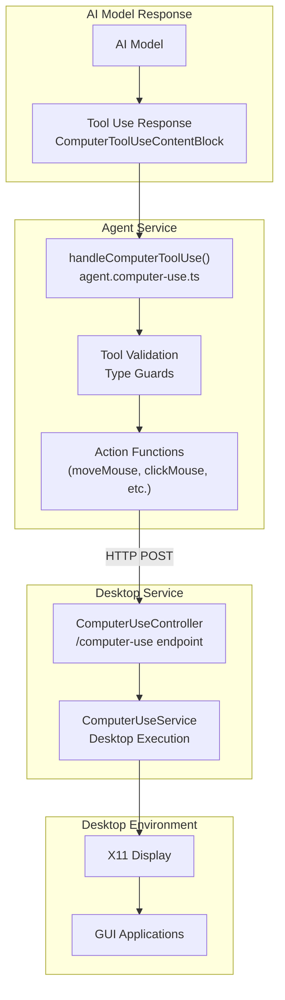
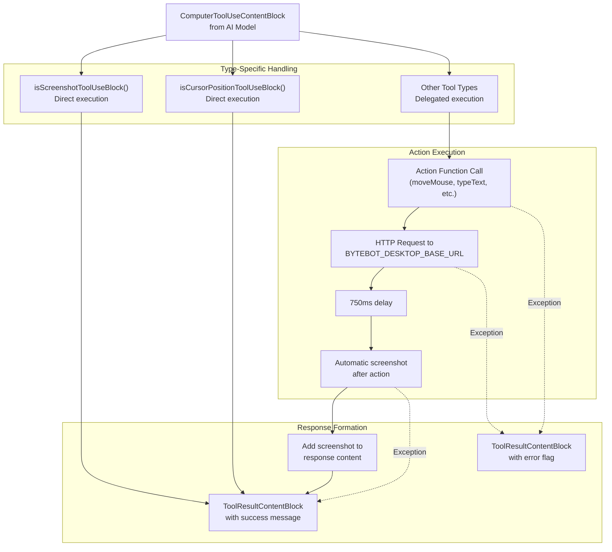

<!-- source: DeepWiki mcp.deepwiki.com · repo bytebot-ai/bytebot · page 6.2 Computer Use Integration · fetched 2026-10-29 -->

# Computer Use Integration

<details>
<summary>Relevant source files</summary>

The following files were used as context for generating this wiki page:

- [packages/bytebot-agent/prisma/migrations/20250722041608_files/migration.sql](packages/bytebot-agent/prisma/migrations/20250722041608_files/migration.sql)
- [packages/bytebot-agent/src/agent/agent.computer-use.ts](packages/bytebot-agent/src/agent/agent.computer-use.ts)
- [packages/bytebot-agent/src/agent/agent.constants.ts](packages/bytebot-agent/src/agent/agent.constants.ts)
- [packages/bytebot-agent/src/agent/agent.scheduler.ts](packages/bytebot-agent/src/agent/agent.scheduler.ts)
- [packages/bytebot-agent/src/agent/agent.tools.ts](packages/bytebot-agent/src/agent/agent.tools.ts)
- [packages/bytebotd/src/computer-use/computer-use.controller.ts](packages/bytebotd/src/computer-use/computer-use.controller.ts)
- [packages/bytebotd/src/main.ts](packages/bytebotd/src/main.ts)

</details>


This document explains how Bytebot's agent service translates AI model decisions into executable computer actions on the virtual desktop. It covers the tool definition system, the execution pipeline from AI responses to desktop commands, and the integration between the agent and desktop services.

For information about the desktop service API that receives these commands, see [Computer Use API](#5.1). For details about AI model integration and tool handling, see [AI Model Integration](#6.3).

## Overview

The Computer Use Integration system enables AI models to control the virtual desktop through a standardized tool interface. When an AI model decides to perform a computer action, it responds with tool use requests that are processed by the agent service and translated into HTTP requests to the desktop service.



Sources: [packages/bytebot-agent/src/agent/agent.computer-use.ts:28-239](), [packages/bytebotd/src/computer-use/computer-use.controller.ts:13-42]()

## Tool Definition System

The system provides AI models with a comprehensive set of computer interaction tools defined in `agentTools`. Each tool has a structured schema that specifies valid inputs and expected behavior.

### Mouse Tools

| Tool Name | Purpose | Key Parameters |
|-----------|---------|----------------|
| `computer_move_mouse` | Move cursor to coordinates | `coordinates` (x, y) |
| `computer_click_mouse` | Click at position or current location | `button`, `clickCount`, optional `coordinates` |
| `computer_drag_mouse` | Drag along a path | `path[]`, `button`, optional `holdKeys` |
| `computer_scroll` | Scroll in direction | `coordinates`, `direction`, `scrollCount` |

### Keyboard Tools

| Tool Name | Purpose | Key Parameters |
|-----------|---------|----------------|
| `computer_type_keys` | Type key sequences/shortcuts | `keys[]`, optional `delay` |
| `computer_type_text` | Type text character by character | `text`, optional `delay`, `isSensitive` |
| `computer_paste_text` | Paste text via clipboard | `text`, `isSensitive` |
| `computer_press_keys` | Hold/release keys | `keys[]`, `press` (up/down) |

### System Tools

| Tool Name | Purpose | Key Parameters |
|-----------|---------|----------------|
| `computer_screenshot` | Capture screen image | None |
| `computer_cursor_position` | Get cursor coordinates | None |
| `computer_application` | Open/focus application | `application` (enum) |
| `computer_wait` | Pause execution | `duration` (500ms) |
| `computer_read_file` | Read file contents | `path` |

Sources: [packages/bytebot-agent/src/agent/agent.tools.ts:35-405]()

## Tool Execution Pipeline

The `handleComputerToolUse` function processes AI model tool requests through a multi-stage pipeline:



Sources: [packages/bytebot-agent/src/agent/agent.computer-use.ts:28-239]()

## Computer Action Implementation

Each computer action is implemented as an async function that makes HTTP requests to the desktop service. The functions follow a consistent pattern:

### Mouse Actions

The `moveMouse` function demonstrates the standard pattern:
- Accepts typed input parameters
- Logs the action being performed  
- Makes POST request to `/computer-use` endpoint
- Includes proper error handling

```typescript
// Example from moveMouse function
await fetch(`${BYTEBOT_DESKTOP_BASE_URL}/computer-use`, {
  method: 'POST',
  headers: { 'Content-Type': 'application/json' },
  body: JSON.stringify({
    action: 'move_mouse',
    coordinates,
  }),
});
```

### Advanced Mouse Operations

More complex operations like `dragMouse` and `traceMouse` handle coordinate arrays and optional modifier keys:
- `traceMouse`: Moves along a path without button press
- `dragMouse`: Moves along path while holding button down
- Both support `holdKeys` for modifier combinations

### Keyboard Input Handling

The system provides multiple keyboard input methods:
- `typeKeys`: For key sequences and shortcuts using the valid key identifiers
- `typeText`: Character-by-character typing with optional delays
- `pasteText`: Clipboard-based text insertion for longer strings
- `pressKeys`: Hold or release specific keys

### File Operations

The `readFile` function returns structured responses with base64 data:
- Success: Returns `data`, `name`, `size`, `mediaType`
- Error: Returns `success: false` with error message
- Special handling in `handleComputerToolUse` to create document content blocks

Sources: [packages/bytebot-agent/src/agent/agent.computer-use.ts:241-646]()

## Response Processing and Screenshots

The system automatically captures screenshots after most actions to provide visual feedback to AI models:

### Automatic Screenshot Logic

1. **750ms Delay**: Allows UI to settle after action
2. **Screenshot Capture**: Uses the same `screenshot()` function  
3. **Response Enhancement**: Adds image to `ToolResultContentBlock`
4. **Error Resilience**: Screenshot failures don't fail the action

### Screenshot Function

The `screenshot` function communicates with the desktop service:
- Makes POST request with `action: 'screenshot'`  
- Returns base64-encoded PNG image data
- Includes comprehensive error handling
- Used both for explicit screenshot tools and automatic captures

### Special Case Handling

Some tools have special response handling:
- **Screenshot Tool**: Returns image directly in response
- **Cursor Position**: Returns text with coordinates  
- **Read File**: Returns document content block with file data
- **Standard Actions**: Return success message plus automatic screenshot

Sources: [packages/bytebot-agent/src/agent/agent.computer-use.ts:184-221](), [packages/bytebot-agent/src/agent/agent.computer-use.ts:526-555]()

## Error Handling and Logging

The system implements comprehensive error handling at multiple levels:

### Tool-Level Error Handling

Each action function catches exceptions and re-throws them:
- Network errors from desktop service communication
- Invalid parameters or malformed requests
- Desktop service internal errors

### Handler-Level Error Processing

The `handleComputerToolUse` function provides consistent error response formatting:
- Creates `ToolResultContentBlock` with `is_error: true`
- Includes descriptive error messages
- Logs full error details with stack traces
- Maintains tool_use_id for proper response correlation

### Logging Strategy

The system uses structured logging throughout:
- **Debug Level**: Action parameters and execution flow
- **Error Level**: Exceptions with full context and stack traces  
- **Sensitive Data**: Screenshots and file content not logged in full

Sources: [packages/bytebot-agent/src/agent/agent.computer-use.ts:57-70](), [packages/bytebot-agent/src/agent/agent.computer-use.ts:222-238]()

## Desktop Service Integration

The agent communicates with the desktop service through a REST API defined by the `BYTEBOT_DESKTOP_BASE_URL` environment variable.

### Request Format

All requests follow a consistent JSON structure:
```json
{
  "action": "action_name",
  "parameter1": "value1",
  "parameter2": "value2"
}
```

### Supported Actions

The desktop service handles these action types:
- **Mouse**: `move_mouse`, `click_mouse`, `press_mouse`, `drag_mouse`, `trace_mouse`
- **Keyboard**: `type_keys`, `press_keys`, `type_text`, `paste_text`  
- **System**: `scroll`, `wait`, `screenshot`, `cursor_position`, `application`
- **File**: `read_file`, `write_file`

### Response Handling

Different actions return different response formats:
- **Screenshot**: `{ image: "base64_data" }`
- **Cursor Position**: `{ x: number, y: number }`
- **File Read**: `{ success: boolean, data?: string, name?: string, size?: number, mediaType?: string }`
- **Standard Actions**: HTTP status indicates success/failure

Sources: [packages/bytebot-agent/src/agent/agent.computer-use.ts:26](), [packages/bytebotd/src/computer-use/computer-use.controller.ts:19-41]()

---

