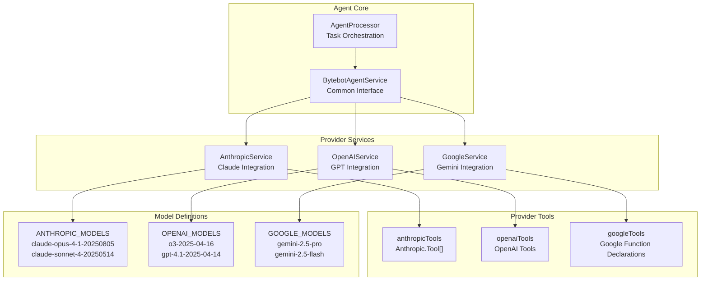
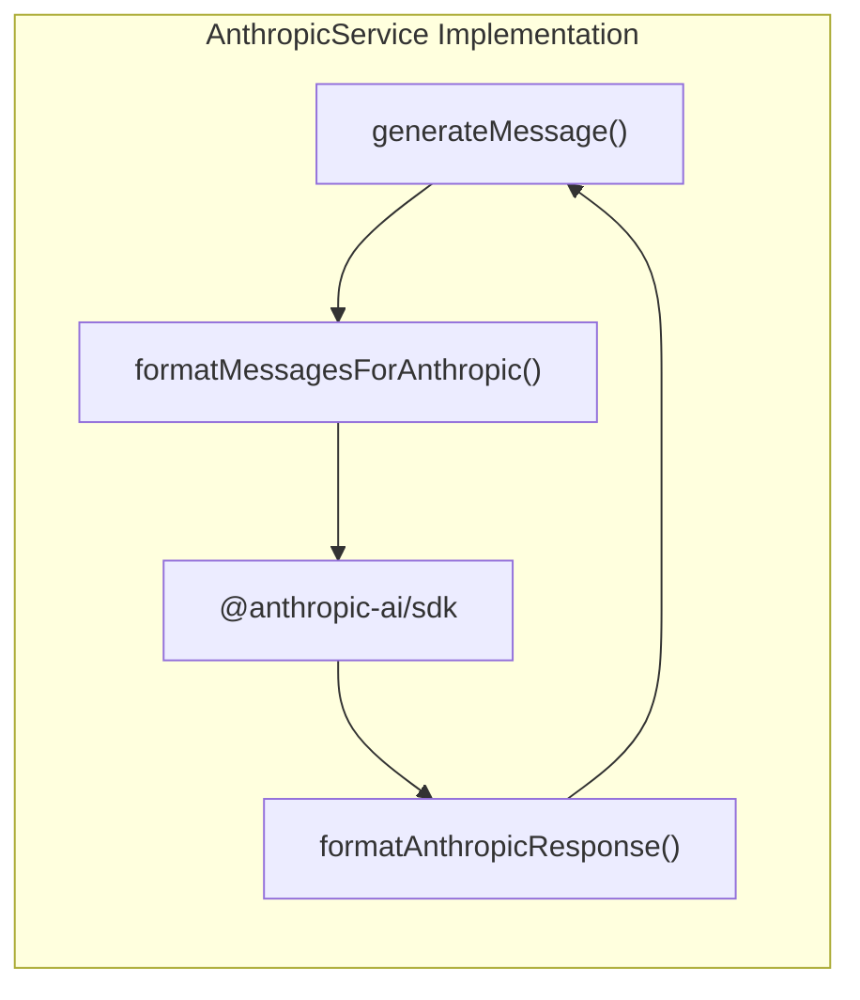
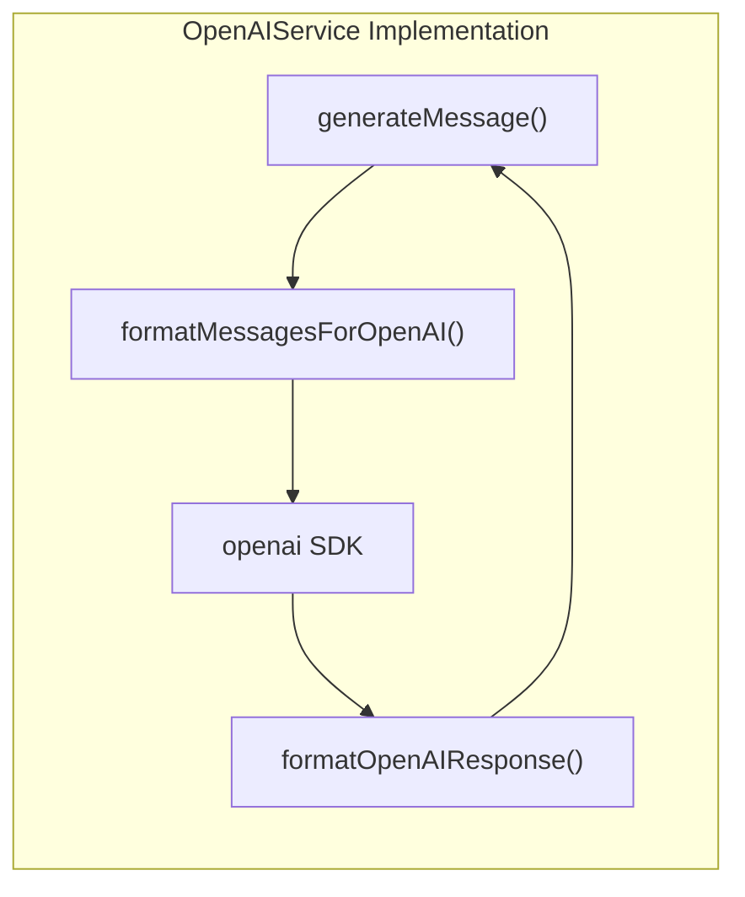
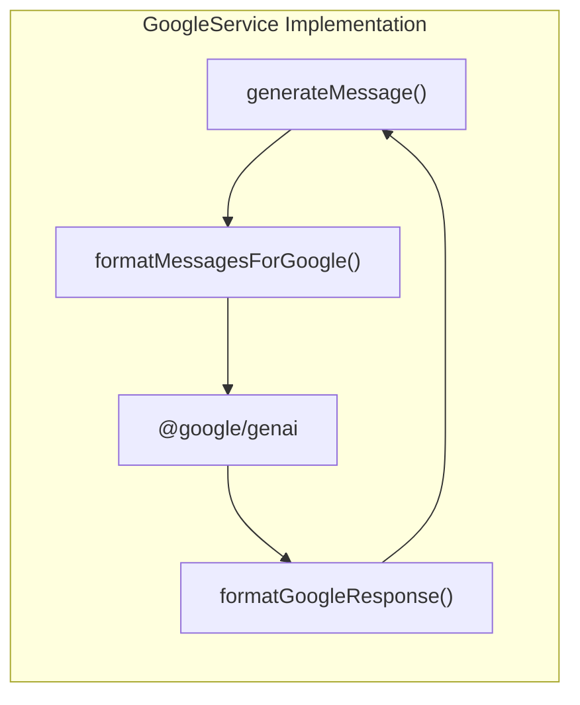
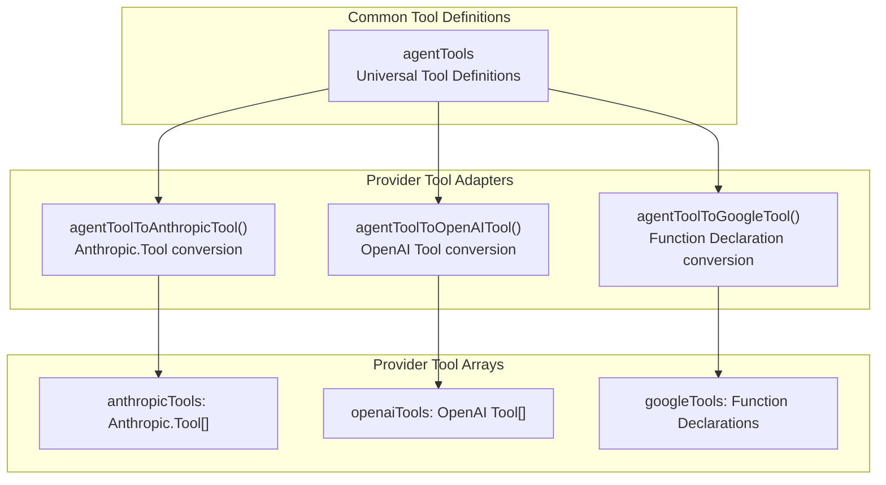
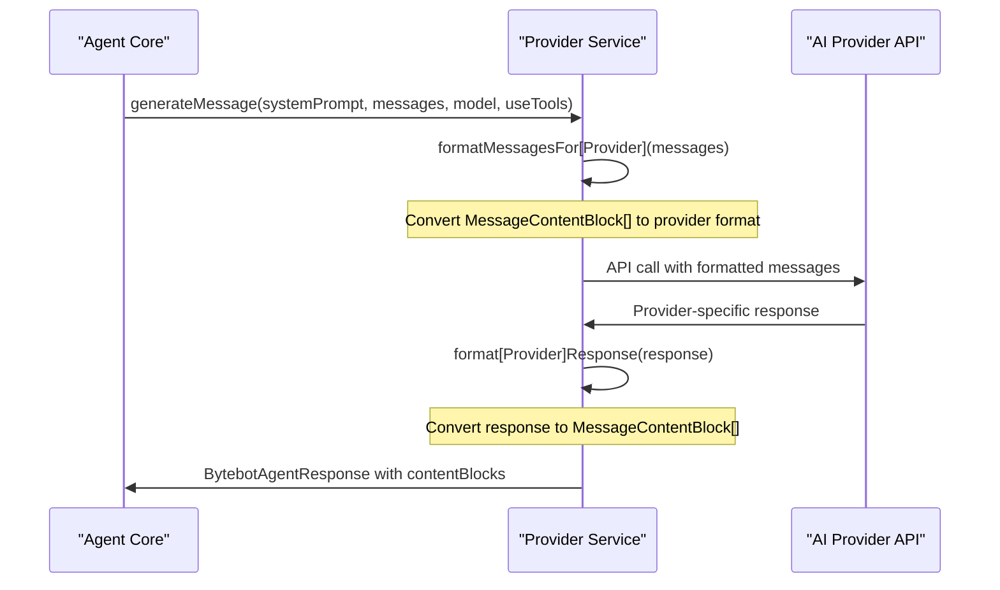

<!-- source: DeepWiki mcp.deepwiki.com · repo bytebot-ai/bytebot · page 6.3 AI Model Integration · fetched 2026-10-29 -->

# AI Model Integration

<details>
<summary>Relevant source files</summary>

The following files were used as context for generating this wiki page:

- [packages/bytebot-agent/src/agent/agent.types.ts](packages/bytebot-agent/src/agent/agent.types.ts)
- [packages/bytebot-agent/src/anthropic/anthropic.constants.ts](packages/bytebot-agent/src/anthropic/anthropic.constants.ts)
- [packages/bytebot-agent/src/anthropic/anthropic.service.ts](packages/bytebot-agent/src/anthropic/anthropic.service.ts)
- [packages/bytebot-agent/src/google/google.constants.ts](packages/bytebot-agent/src/google/google.constants.ts)
- [packages/bytebot-agent/src/google/google.service.ts](packages/bytebot-agent/src/google/google.service.ts)
- [packages/bytebot-agent/src/messages/messages.module.ts](packages/bytebot-agent/src/messages/messages.module.ts)
- [packages/bytebot-agent/src/messages/messages.service.ts](packages/bytebot-agent/src/messages/messages.service.ts)
- [packages/bytebot-agent/src/openai/openai.constants.ts](packages/bytebot-agent/src/openai/openai.constants.ts)
- [packages/bytebot-agent/src/openai/openai.service.ts](packages/bytebot-agent/src/openai/openai.service.ts)

</details>


This document covers Bytebot's multi-provider AI integration system, which enables the agent to work with different AI models from Anthropic, OpenAI, and Google through a unified interface. The system handles message formatting, tool integration, and response processing across different AI providers while maintaining consistent behavior and capabilities.

For information about how the agent processes these AI responses to execute computer actions, see [Computer Use Integration](#6.2). For details on task orchestration and lifecycle management, see [Task Management](#6.1).

## Provider Architecture Overview

The AI model integration system uses a common interface pattern that allows different AI providers to be used interchangeably while maintaining consistent tool access and message formatting.



**Sources**: [packages/bytebot-agent/src/agent/agent.types.ts:13-21](), [packages/bytebot-agent/src/anthropic/anthropic.service.ts:24](), [packages/bytebot-agent/src/openai/openai.service.ts:25](), [packages/bytebot-agent/src/google/google.service.ts:30]()

## Common Interface Design

All AI provider services implement the `BytebotAgentService` interface, which standardizes how the agent interacts with different AI models regardless of their underlying APIs.

### BytebotAgentService Interface

The core interface defines a single method for message generation:

| Method | Parameters | Return Type | Purpose |
|--------|------------|-------------|---------|
| `generateMessage` | `systemPrompt`, `messages`, `model`, `useTools`, `signal?` | `Promise<BytebotAgentResponse>` | Generate AI response with tool support |

### Response Structure

All providers return a standardized `BytebotAgentResponse`:

```typescript
interface BytebotAgentResponse {
  contentBlocks: MessageContentBlock[];
  tokenUsage: {
    inputTokens: number;
    outputTokens: number; 
    totalTokens: number;
  };
}
```

**Sources**: [packages/bytebot-agent/src/agent/agent.types.ts:4-11](), [packages/bytebot-agent/src/agent/agent.types.ts:13-21]()

## Provider-Specific Services

Each AI provider has a dedicated service that handles the specifics of that provider's API while implementing the common interface.

### AnthropicService

The `AnthropicService` integrates with Claude models using the Anthropic SDK:



Key features:
- Supports Claude Opus 4.1 and Claude Sonnet 4 models
- Implements prompt caching with `cache_control` ephemeral markers
- Handles thinking content blocks for reasoning models
- Processes user action content blocks for takeover scenarios

### OpenAIService

The `OpenAIService` provides integration with OpenAI's GPT and o3 models:



Key features:
- Supports o3 and GPT-4.1 models with different context windows
- Uses OpenAI's Responses API for structured interaction
- Handles reasoning models with encrypted content for thinking
- Processes function calls and tool outputs

### GoogleService

The `GoogleService` enables integration with Google's Gemini models:



Key features:
- Supports Gemini 2.5 Pro and Flash models with 1M token context
- Implements thinking budget configuration for reasoning
- Handles function declarations for tool integration
- Processes inline data for image content

**Sources**: [packages/bytebot-agent/src/anthropic/anthropic.service.ts:42-102](), [packages/bytebot-agent/src/openai/openai.service.ts:43-91](), [packages/bytebot-agent/src/google/google.service.ts:48-116]()

## Tool Integration

The system provides consistent tool access across all AI providers by converting from a common tool definition format to provider-specific formats.

### Tool Conversion Architecture



### Available Tools

The system provides these computer automation tools across all providers:

| Tool Category | Tools | Purpose |
|---------------|-------|---------|
| Mouse Control | `moveMouseTool`, `clickMouseTool`, `dragMouseTool` | Cursor manipulation |
| Keyboard Input | `typeKeysTool`, `pressKeysTool`, `typeTextTool`, `pasteTextTool` | Text and key input |
| Screen Operations | `screenshotTool`, `cursorPositionTool`, `scrollTool` | Screen interaction |
| Task Management | `setTaskStatusTool`, `createTaskTool` | Task control |
| System | `waitTool`, `applicationTool` | General operations |

**Sources**: [packages/bytebot-agent/src/anthropic/anthropic.tools.ts:7-54](), [packages/bytebot-agent/src/anthropic/anthropic.tools.ts:34-49]()

## Message Format Translation

Each provider service implements bidirectional message format conversion to translate between Bytebot's internal `MessageContentBlock` format and the provider's expected format.

### Message Processing Flow



### Content Block Type Handling

Each provider handles these content block types:

| Content Type | Anthropic | OpenAI | Google | Internal Type |
|--------------|-----------|---------|--------|---------------|
| Text | `text` block | `input_text`/`output_text` | `text` part | `MessageContentType.Text` |
| Tool Use | `tool_use` block | `function_call` | `functionCall` part | `MessageContentType.ToolUse` |
| Tool Result | `tool_result` block | `function_call_output` | `functionResponse` part | `MessageContentType.ToolResult` |
| Image | `image` block | `input_image` | `inlineData` part | `MessageContentType.Image` |
| Thinking | `thinking` block | `reasoning` | `thought` part | `MessageContentType.Thinking` |

### Special Message Handling

The system handles these special message scenarios:

- **User Action Messages**: When users take control, their actions are formatted as descriptive text for the AI
- **Tool Result Images**: Screenshots from tool execution are embedded as image content
- **Thinking Content**: Reasoning steps from models that support internal reasoning

**Sources**: [packages/bytebot-agent/src/anthropic/anthropic.service.ts:107-154](), [packages/bytebot-agent/src/openai/openai.service.ts:93-240](), [packages/bytebot-agent/src/google/google.service.ts:121-234]()

## Model Configuration

Each provider defines available models with their capabilities and context windows.

### Model Definitions

| Provider | Models | Context Window | Default |
|----------|---------|---------------|---------|
| Anthropic | `claude-opus-4-1-20250805`, `claude-sonnet-4-20250514` | 200,000 tokens | Claude Opus 4.1 |
| OpenAI | `o3-2025-04-16`, `gpt-4.1-2025-04-14` | 200,000 / 1,047,576 tokens | o3 |
| Google | `gemini-2.5-pro`, `gemini-2.5-flash` | 1,000,000 tokens | Gemini 2.5 Pro |

### Provider Selection

The system uses environment variables to configure API access:

| Environment Variable | Provider | Purpose |
|---------------------|----------|---------|
| `ANTHROPIC_API_KEY` | Anthropic | Claude model access |
| `OPENAI_API_KEY` | OpenAI | GPT and o3 model access |
| `GEMINI_API_KEY` | Google | Gemini model access |

**Sources**: [packages/bytebot-agent/src/anthropic/anthropic.constants.ts:3-18](), [packages/bytebot-agent/src/openai/openai.constants.ts:3-18](), [packages/bytebot-agent/src/google/google.constants.ts:3-18]()

---

