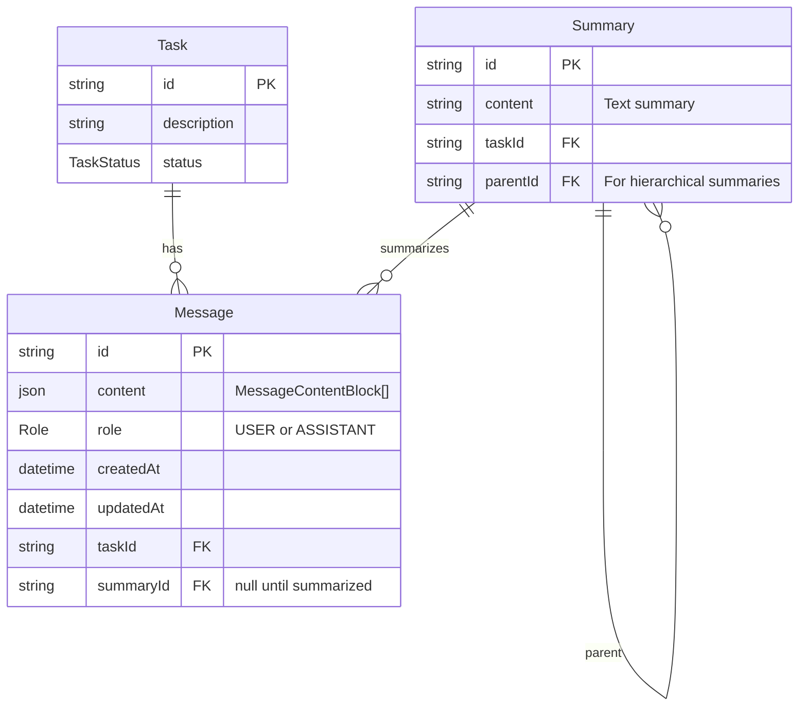
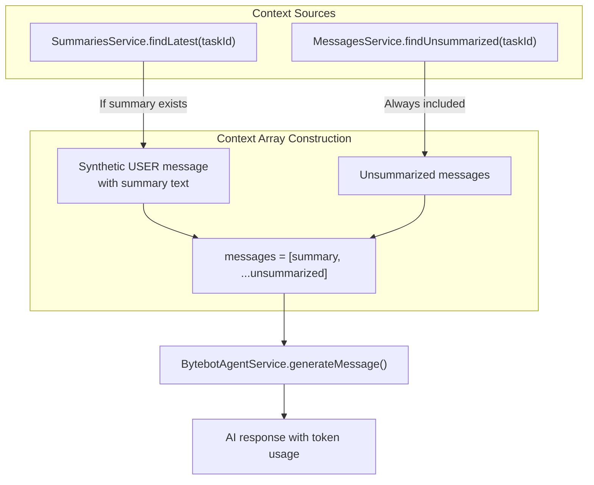
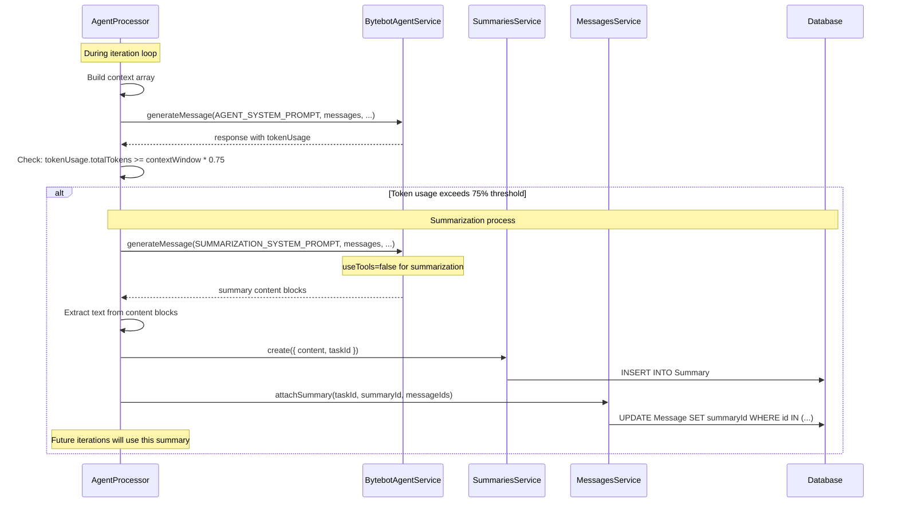
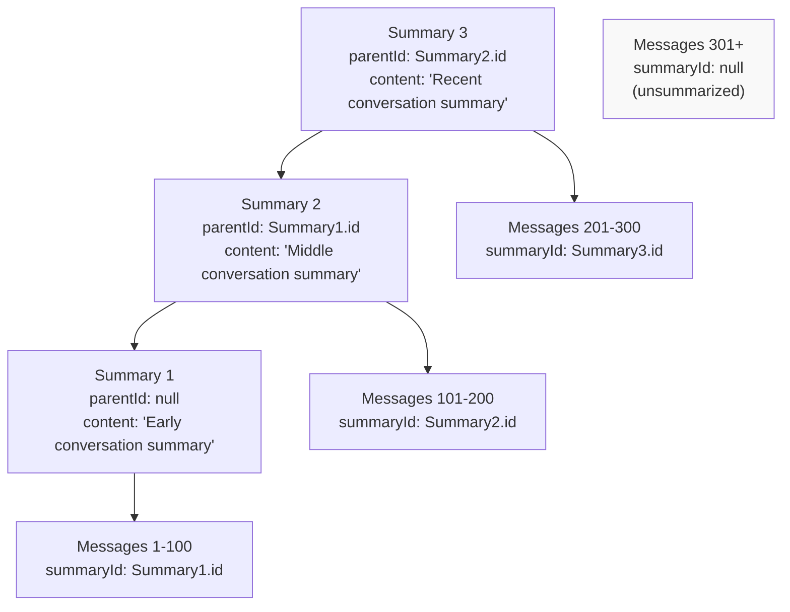
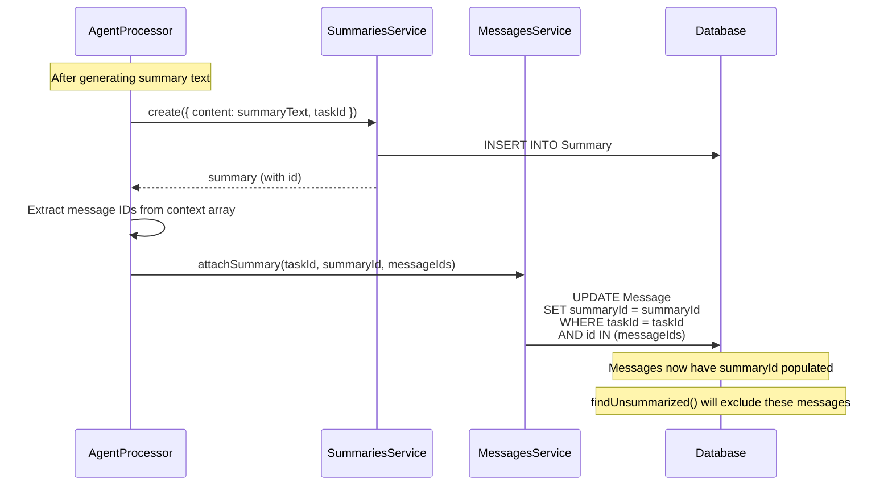
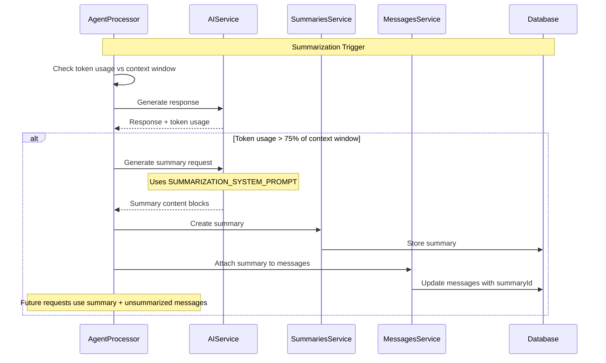

<!-- source: DeepWiki mcp.deepwiki.com · repo bytebot-ai/bytebot · page 6.4 Message and Summarization · fetched 2026-10-29 -->

# Message and Summarization

<details>
<summary>Relevant source files</summary>

The following files were used as context for generating this wiki page:

- [packages/bytebot-agent/src/agent/agent.processor.ts](packages/bytebot-agent/src/agent/agent.processor.ts)
- [packages/bytebot-agent/src/agent/agent.types.ts](packages/bytebot-agent/src/agent/agent.types.ts)
- [packages/bytebot-agent/src/anthropic/anthropic.constants.ts](packages/bytebot-agent/src/anthropic/anthropic.constants.ts)
- [packages/bytebot-agent/src/anthropic/anthropic.service.ts](packages/bytebot-agent/src/anthropic/anthropic.service.ts)
- [packages/bytebot-agent/src/google/google.constants.ts](packages/bytebot-agent/src/google/google.constants.ts)
- [packages/bytebot-agent/src/google/google.service.ts](packages/bytebot-agent/src/google/google.service.ts)
- [packages/bytebot-agent/src/messages/messages.module.ts](packages/bytebot-agent/src/messages/messages.module.ts)
- [packages/bytebot-agent/src/messages/messages.service.ts](packages/bytebot-agent/src/messages/messages.service.ts)
- [packages/bytebot-agent/src/openai/openai.constants.ts](packages/bytebot-agent/src/openai/openai.constants.ts)
- [packages/bytebot-agent/src/openai/openai.service.ts](packages/bytebot-agent/src/openai/openai.service.ts)
- [packages/bytebot-agent/src/tasks/tasks.controller.ts](packages/bytebot-agent/src/tasks/tasks.controller.ts)
- [packages/bytebot-agent/src/tasks/tasks.service.ts](packages/bytebot-agent/src/tasks/tasks.service.ts)
- [packages/bytebot-ui/src/hooks/useChatSession.ts](packages/bytebot-ui/src/hooks/useChatSession.ts)

</details>


This document explains how Bytebot stores messages, builds context for LLM requests, and implements automatic summarization to manage context window limits. The system uses a 75% token threshold to trigger summarization and supports hierarchical summaries for very long conversations.

For information about agent processing flow, see [Agent Processor](#6.1). For message content type definitions, see [Message Content Types](#9.3).

## Message Storage Schema

The `Message` model stores conversation history with flexible content blocks. Each message belongs to a task and optionally links to a summary when it has been summarized.

**Database Schema**



**Key Fields**

| Field | Type | Purpose |
|-------|------|---------|
| `content` | `Json` | Array of `MessageContentBlock` objects |
| `role` | `Role` | Enum: `USER` or `ASSISTANT` |
| `taskId` | `String` | Foreign key to parent task |
| `summaryId` | `String?` | Links to summary when messages are compressed |

**Content Storage**

Messages store content as a JSON array of content blocks. Each block has a `type` field that determines its structure:

- `text`: Plain text content
- `image`: Base64-encoded images
- `tool_use`: AI tool execution requests
- `tool_result`: Tool execution results (including screenshots)
- `thinking`: AI reasoning traces
- `user_action`: Captured user actions during takeover

Sources: [packages/bytebot-agent/prisma/schema.prisma:83-99](), [packages/bytebot-agent/src/messages/messages.service.ts:36-52]()

## Message Content Types

Messages use a flexible content block structure defined in `@bytebot/shared`. See [Message Content Types](#9.3) for detailed type definitions.

**Common Message Patterns**

| Role | Content Type | Example Use Case |
|------|--------------|------------------|
| `USER` | `text` | User provides task instructions |
| `USER` | `tool_result` | Screenshot results from computer actions |
| `ASSISTANT` | `text` | AI explains its reasoning |
| `ASSISTANT` | `tool_use` | AI requests to execute computer actions |
| `ASSISTANT` | `thinking` | AI reasoning traces (extended thinking) |
| `USER` | `user_action` | Captured actions during user takeover |

**Message Creation**

The `MessagesService.create()` method stores new messages and emits WebSocket events:

```typescript
// From packages/bytebot-agent/src/messages/messages.service.ts:36-52
async create(data: {
  content: MessageContentBlock[];
  role: Role;
  taskId: string;
}): Promise<Message>
```

Sources: [packages/bytebot-agent/src/messages/messages.service.ts:36-52](), [@bytebot/shared package types]()

## Context Building for LLM

When the agent makes an LLM request, it assembles context from the latest summary (if any) and all unsummarized messages. This compressed representation keeps token usage manageable while preserving conversation history.

**Context Assembly Process**



**Code Implementation**

The `AgentProcessor` builds context in the iteration loop:

```typescript
// From packages/bytebot-agent/src/agent/agent.processor.ts:157-180
const latestSummary = await this.summariesService.findLatest(taskId);
const unsummarizedMessages = await this.messagesService.findUnsummarized(taskId);

const messages = [
  ...(latestSummary ? [{
    id: '',
    createdAt: new Date(),
    updatedAt: new Date(),
    taskId,
    summaryId: null,
    role: Role.USER,
    content: [{
      type: MessageContentType.Text,
      text: latestSummary.content,
    }],
  }] : []),
  ...unsummarizedMessages,
];
```

**Query Methods**

| Method | Purpose | Returns |
|--------|---------|---------|
| `findLatest(taskId)` | Gets most recent summary | `Summary \| null` |
| `findUnsummarized(taskId)` | Gets messages with `summaryId = null` | `Message[]` |

Sources: [packages/bytebot-agent/src/agent/agent.processor.ts:157-180](), [packages/bytebot-agent/src/messages/messages.service.ts:89-98]()

## Token-Based Summarization

The system monitors token usage against the model's context window and triggers automatic summarization when usage exceeds 75% of the available context. This prevents context overflow and maintains conversation continuity.

**Summarization Trigger Flow**



**Token Threshold Calculation**

```typescript
// From packages/bytebot-agent/src/agent/agent.processor.ts:234-238
const contextWindow = model.contextWindow || 200000; // Default 200k
const contextThreshold = contextWindow * 0.75;
const shouldSummarize = agentResponse.tokenUsage.totalTokens >= contextThreshold;
```

**Model Context Windows**

| Provider | Model | Context Window |
|----------|-------|----------------|
| Anthropic | Claude Opus 4.1 | 200,000 tokens |
| Anthropic | Claude Sonnet 4 | 200,000 tokens |
| OpenAI | o3 | 200,000 tokens |
| OpenAI | GPT-4.1 | 1,047,576 tokens |
| Google | Gemini 2.5 Pro | 1,000,000 tokens |

**Summarization System Prompt**

The agent uses `SUMMARIZATION_SYSTEM_PROMPT` when generating summaries. This prompt instructs the LLM to compress the conversation into a concise summary while preserving key context.

Sources: [packages/bytebot-agent/src/agent/agent.processor.ts:234-299](), [packages/bytebot-agent/src/anthropic/anthropic.constants.ts:3-16](), [packages/bytebot-agent/src/openai/openai.constants.ts:3-16](), [packages/bytebot-agent/src/google/google.constants.ts:3-16]()

## Hierarchical Summaries

For very long conversations that exceed context limits even after initial summarization, the system supports hierarchical summaries where one summary can reference a parent summary. This creates a multi-level compression structure.

**Hierarchical Summary Structure**



**Summary Schema**

```typescript
// From prisma schema
model Summary {
  id        String   @id @default(cuid())
  content   String   @db.Text
  taskId    String
  task      Task     @relation(fields: [taskId], references: [id], onDelete: Cascade)
  parentId  String?
  parent    Summary? @relation("SummaryHierarchy", fields: [parentId], references: [id])
  children  Summary[] @relation("SummaryHierarchy")
  messages  Message[]
  createdAt DateTime @default(now())
  updatedAt DateTime @updatedAt
}
```

**Context Building with Hierarchy**

When a parent summary exists, the `findLatest()` method retrieves the most recent summary, which implicitly includes context from parent summaries through the LLM's compression:

1. First summarization creates Summary1 (parentId=null)
2. When tokens exceed threshold again, create Summary2 (parentId=Summary1.id)
3. Context array uses Summary2 content, which references Summary1's context
4. Each summary level compresses approximately 75% of a context window's worth of messages

Sources: [packages/bytebot-agent/prisma/schema.prisma](), [packages/bytebot-agent/src/summaries/summaries.service.ts]()

## Summary Attachment Process

After creating a summary, the system links the summarized messages to the summary record by updating their `summaryId` field. This marks them as summarized and excludes them from future context builds.

**Attachment Workflow**



**Code Implementation**

```typescript
// From packages/bytebot-agent/src/messages/messages.service.ts:100-113
async attachSummary(
  taskId: string,
  summaryId: string,
  messageIds: string[],
): Promise<void> {
  if (messageIds.length === 0) {
    return;
  }

  await this.prisma.message.updateMany({
    where: { taskId, id: { in: messageIds } },
    data: { summaryId },
  });
}
```

**Query Exclusion**

Once messages have a `summaryId`, they are excluded from context building:

```typescript
// From packages/bytebot-agent/src/messages/messages.service.ts:89-98
async findUnsummarized(taskId: string): Promise<Message[]> {
  return this.prisma.message.findMany({
    where: {
      taskId,
      summaryId: null,  // Only return messages not yet summarized
    },
    orderBy: { createdAt: 'asc' },
  });
}
```

This creates a clear boundary between compressed historical context (in summaries) and active conversation context (unsummarized messages).

Sources: [packages/bytebot-agent/src/agent/agent.processor.ts:279-288](), [packages/bytebot-agent/src/messages/messages.service.ts:89-113]()

## Message Summarization

To manage context window limits, the system automatically summarizes older messages when token usage approaches provider limits. Summaries replace groups of messages while preserving essential context.



**Summarization Process**

1. Monitor token usage during AI generation
2. When approaching context limit (75% of window), trigger summarization
3. Send existing messages to AI with summarization prompt
4. Store summary and link it to original messages
5. Future requests load summary + unsummarized messages only

**Summary Management**

- `SummariesService` handles summary CRUD operations
- `findUnsummarized()` retrieves messages not yet summarized
- Summaries can form hierarchies for very long conversations

Sources: [packages/bytebot-agent/src/agent/agent.processor.ts:234-299](), [packages/bytebot-agent/src/summaries/summaries.service.ts](), [packages/bytebot-agent/src/messages/messages.service.ts:89-98]()

---

