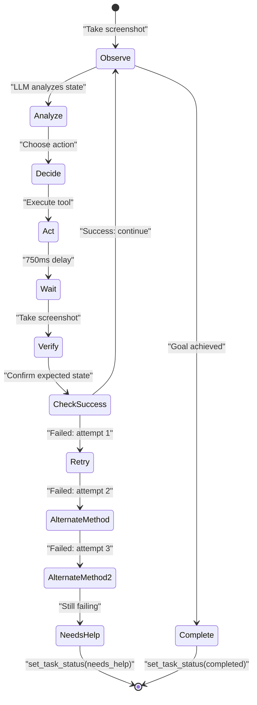
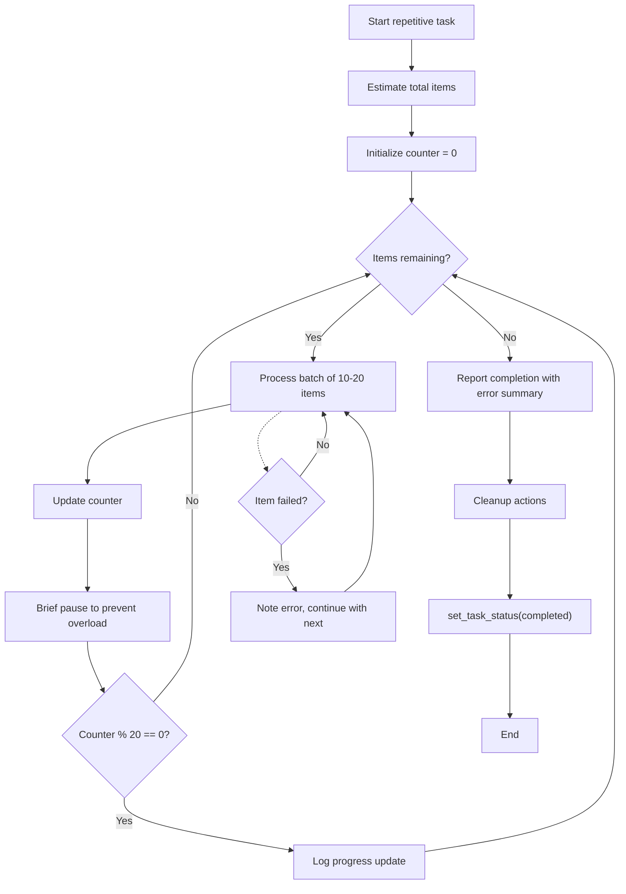
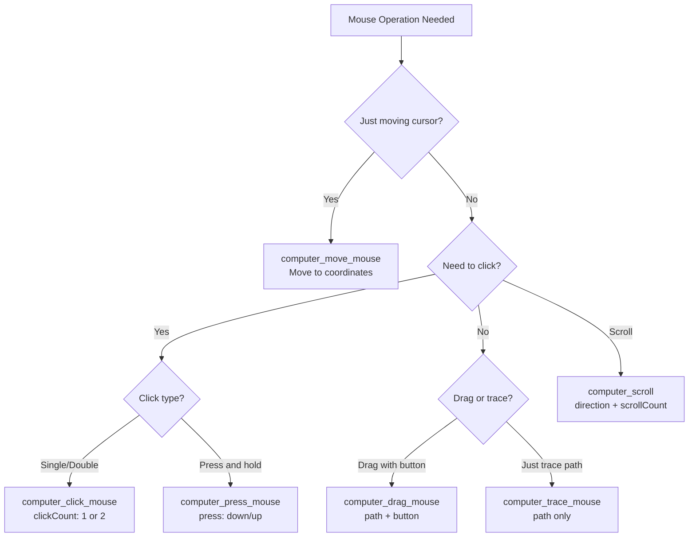
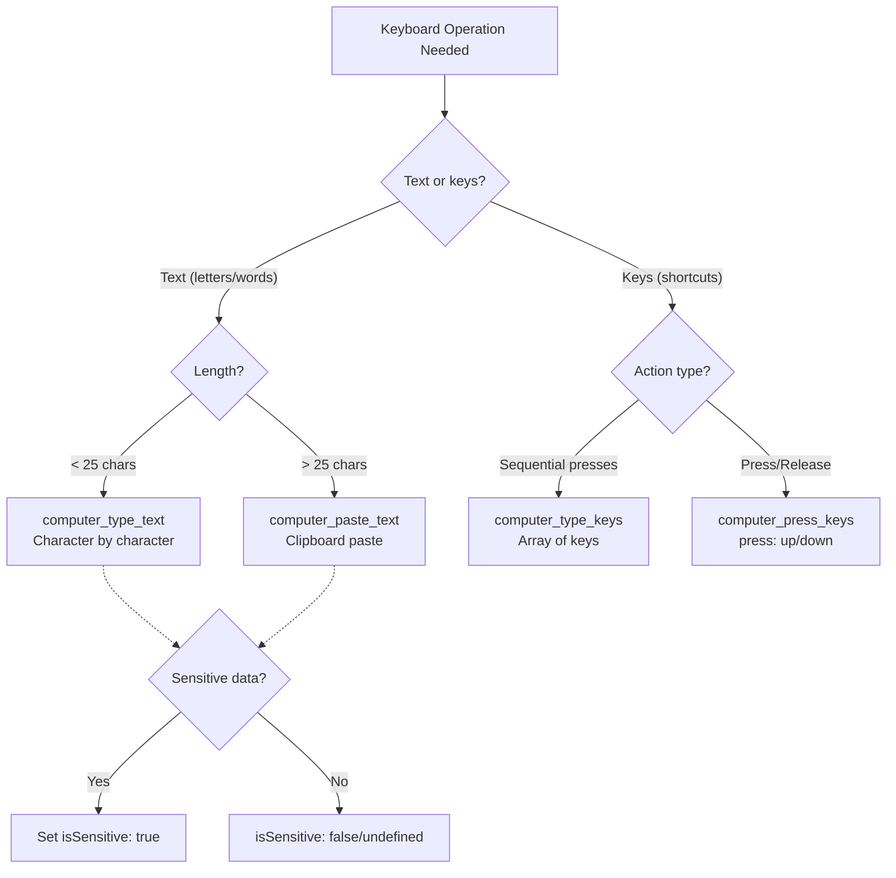
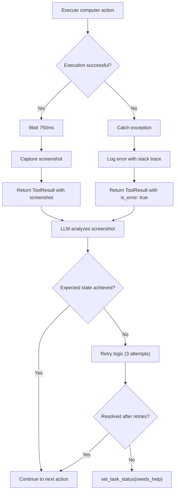

<!-- source: DeepWiki mcp.deepwiki.com · repo bytebot-ai/bytebot · page 6.5 Agent Operating Principles · fetched 2026-10-29 -->

# Agent Operating Principles

<details>
<summary>Relevant source files</summary>

The following files were used as context for generating this wiki page:

- [packages/bytebot-agent/prisma/migrations/20250722041608_files/migration.sql](packages/bytebot-agent/prisma/migrations/20250722041608_files/migration.sql)
- [packages/bytebot-agent/src/agent/agent.computer-use.ts](packages/bytebot-agent/src/agent/agent.computer-use.ts)
- [packages/bytebot-agent/src/agent/agent.constants.ts](packages/bytebot-agent/src/agent/agent.constants.ts)
- [packages/bytebot-agent/src/agent/agent.scheduler.ts](packages/bytebot-agent/src/agent/agent.scheduler.ts)
- [packages/bytebot-agent/src/agent/agent.tools.ts](packages/bytebot-agent/src/agent/agent.tools.ts)
- [packages/bytebotd/src/computer-use/computer-use.controller.ts](packages/bytebotd/src/computer-use/computer-use.controller.ts)
- [packages/bytebotd/src/main.ts](packages/bytebotd/src/main.ts)

</details>


This document describes the guiding principles that govern how the Bytebot AI agent operates when executing tasks. These principles are encoded in the system prompt sent to LLM providers and enforced through code-level mechanisms such as screenshot verification delays and tool usage patterns.

For details on the agent's core processing loop implementation, see [Agent Processor](#6.1). For information about how the agent integrates with LLM providers, see [AI Model Integration](#6.3). For tool execution mechanics, see [Computer Use Integration](#6.2).

---

## Overview

The agent's operating principles are defined in `AGENT_SYSTEM_PROMPT` and guide all decision-making. These principles balance reliability (through observation and verification) with efficiency (through batching and intelligent tool selection). The agent operates on a virtual Ubuntu 22.04 desktop with a 1280x960 display, using tools to perform mouse, keyboard, and application management actions.

**Sources:** [packages/bytebot-agent/src/agent/agent.constants.ts:17-175]()

---

## Core Operating Principles

The agent follows nine fundamental principles when executing tasks. These are embedded in the system prompt sent to every LLM request.

### 1. Observe First

The agent must **always** invoke `computer_screenshot` before its first action and whenever the UI may have changed. This prevents blind actions and ensures decisions are based on current state.

**Key behaviors:**
- Screenshot before every action when filling out forms
- When opening documents or PDFs, scroll through at least the first page to confirm correctness
- Never assume the state of the desktop without visual confirmation

**Code enforcement:** The `handleComputerToolUse` function automatically captures a screenshot after most actions [packages/bytebot-agent/src/agent/agent.computer-use.ts:186-193]() with a 750ms delay to allow UI settling.

### 2. Navigate Applications

The agent must use `computer_application` tool to switch between default applications. Keyboard shortcuts for application switching are explicitly prohibited.

**Available applications:**
- `firefox` - Default web browser
- `thunderbird` - Email client
- `1password` - Password manager
- `vscode` - Code editor
- `terminal` - Command line
- `directory` - File manager
- `desktop` - Return to desktop

**Tool definition:** [packages/bytebot-agent/src/agent/agent.tools.ts:287-309]()

### 3. Human-Like Interaction

The agent should mimic natural human computer usage patterns:

- **Mouse movements:** Smooth, purposeful paths; click near visual centers of targets
- **Desktop icons:** Double-click to open
- **Text input:** 
  - Use `computer_type_text` for short strings (< 25 characters)
  - Use `computer_paste_text` for long strings or special characters
  - Use `computer_type_keys` for keyboard shortcuts

### 4. Valid Keys Only

All key identifiers must match the nut-tree `Key` enum exactly. The system prompt includes a comprehensive list of 150+ valid keys (case-sensitive, no spaces).

**Examples:** `LeftControl`, `Enter`, `Backspace`, `F1`-`F24`, `NumPad0`-`NumPad9`, `AudioVolUp`

**Sources:** [packages/bytebot-agent/src/agent/agent.constants.ts:147-169]()

### 5. Verify Every Step

After each action, the agent must:
1. Take another screenshot
2. Confirm the expected state before continuing
3. If action failed, retry sensibly (try again, then try 2 different methods)
4. If still failing, call `set_task_status` with status `needs_help`

**Implementation:** The 750ms delay [packages/bytebot-agent/src/agent/agent.computer-use.ts:187-189]() ensures UI elements have time to update before verification screenshot.

### 6. Efficiency & Clarity

- Combine related key presses into single operations
- Prefer scrolling or dragging over many small movements
- Minimize unnecessary wait actions
- Use `computer_paste_text` instead of character-by-character typing for long text

### 7. Stay Within Scope

- Do nothing the user didn't request
- Don't suggest unrelated tasks
- For forms and login fields, don't fill in random data unless explicitly instructed

### 8. Security

- Never repeat passwords, secret keys, or sensitive information in conversation
- When typing sensitive information, use `computer_type_text` with `isSensitive: true`
- The `isSensitive` flag is available in both type and paste tools

**Tool schemas:** [packages/bytebot-agent/src/agent/agent.tools.ts:219-223](), [packages/bytebot-agent/src/agent/agent.tools.ts:240-244]()

### 9. Consistency & Persistence

- Continue repetitive tasks until the user's goal is completely met
- For bulk operations, maintain focus and process all items
- Don't end the task prematurely

**Sources:** [packages/bytebot-agent/src/agent/agent.constants.ts:41-58]()

---

## Observe-Act-Verify Cycle

The fundamental operational pattern for every agent action follows this cycle:



**Key code points:**
- Screenshot action: [packages/bytebot-agent/src/agent/agent.computer-use.ts:526-555]()
- Post-action delay: [packages/bytebot-agent/src/agent/agent.computer-use.ts:186-189]()
- Verification screenshot: [packages/bytebot-agent/src/agent/agent.computer-use.ts:191-193]()

**Sources:** [packages/bytebot-agent/src/agent/agent.constants.ts:43-53](), [packages/bytebot-agent/src/agent/agent.computer-use.ts:186-219]()

---

## Repetitive Task Handling

For bulk operations like "visit each profile" or "process all items", the agent follows specialized guidelines to ensure complete execution.

### Progress Tracking

The agent maintains mental count of:
- Total items to process (if known)
- Items completed so far
- Current item being processed
- Any errors encountered

### Batch Processing

For large sets, the agent processes in groups of 10-20 items:



### Error Recovery

- If an item fails, note the error but continue with next item
- Keep a list of failed items to report at end
- Don't let one failure stop the entire operation

### Progress Updates

Every 10-20 items, provide brief status:
- Example: "Processed 20/100 profiles, continuing..."
- No detailed reports unless requested

### Completion Criteria

The task is NOT complete until:
- All items in the set are processed, OR
- A clear endpoint is reached (e.g., "No more profiles to load"), OR
- User explicitly tells agent to stop

**Important:** The agent must not prematurely mark tasks as complete after processing just a few items.

### State Management

For tasks spanning multiple tabs/pages:
- Save progress to a file periodically
- Include timestamps and item identifiers

**Sources:** [packages/bytebot-agent/src/agent/agent.constants.ts:60-105]()

---

## Task Lifecycle Template

The agent follows a structured template for executing tasks, with special consideration for repetitive operations.

### Standard Lifecycle

| Step | Action | Tools Used |
|------|--------|-----------|
| **1. Prepare** | Initial screenshot → plan → estimate scope | `computer_screenshot` |
| **2. Execute Loop** | For each sub-goal: Screenshot → Think → Act → Verify | Various computer tools |
| **3. Batch Loop** | Process items in batches of 10-20, update progress | Task-specific tools |
| **4. Switch Applications** | Open/focus applications in fullscreen | `computer_application` |
| **5. Create Tasks** | Spawn separate tasks if unrelated to current work | `create_task` |
| **6. Schedule Tasks** | Schedule future tasks with ISO dates | `create_task` with `scheduledFor` |
| **7. Read Files** | Read file contents as base64-encoded documents | `computer_read_file` |
| **8. Ask for Help** | Request clarification or report blockers | `set_task_status(needs_help)` |
| **9. Cleanup** | Close windows/apps, return to idle desktop | Various close actions |
| **10. Terminate** | Mark task complete with summary | `set_task_status(completed)` |

### Application Switching Example

```json
{
  "name": "computer_application",
  "input": {
    "application": "firefox"
  }
}
```

Valid application values: `firefox`, `thunderbird`, `1password`, `vscode`, `terminal`, `directory`, `desktop`

### Task Creation Examples

**Immediate task:**
```json
{
  "name": "create_task",
  "input": {
    "description": "Subtask description",
    "type": "IMMEDIATE",
    "priority": "MEDIUM"
  }
}
```

**Scheduled task:**
```json
{
  "name": "create_task",
  "input": {
    "description": "Send reminder email",
    "type": "SCHEDULED",
    "scheduledFor": "2025-01-15T14:30:00Z",
    "priority": "HIGH"
  }
}
```

### File Reading Example

```json
{
  "name": "computer_read_file",
  "input": {
    "path": "/home/user/Desktop/document.pdf"
  }
}
```

Returns a document content block with base64 data, supporting PDFs, DOCX, TXT, images, etc.

### Task Status Management

**Request help:**
```json
{
  "name": "set_task_status",
  "input": {
    "status": "needs_help",
    "description": "Unable to locate the submit button on the form"
  }
}
```

**Mark complete:**
```json
{
  "name": "set_task_status",
  "input": {
    "status": "completed",
    "description": "Successfully processed all 47 profiles and saved results to profiles.csv"
  }
}
```

**Sources:** [packages/bytebot-agent/src/agent/agent.constants.ts:94-138](), [packages/bytebot-agent/src/agent/agent.tools.ts:314-363]()

---

## Tool Usage Guidelines

The agent has access to 17 computer tools plus 2 task management tools. Tool selection follows specific patterns based on the operation type.

### Mouse Operations



**Coordinates:** All coordinates use the 1280x960 display size defined in [packages/bytebot-agent/src/agent/agent.constants.ts:1-4]()

### Keyboard Operations



**Tool definitions:**
- Type text: [packages/bytebot-agent/src/agent/agent.tools.ts:203-227]()
- Paste text: [packages/bytebot-agent/src/agent/agent.tools.ts:229-248]()
- Type keys: [packages/bytebot-agent/src/agent/agent.tools.ts:160-179]()
- Press keys: [packages/bytebot-agent/src/agent/agent.tools.ts:181-201]()

### File Operations

The agent can read files from the desktop environment and receive their contents as base64-encoded document blocks:

**Read file tool:** [packages/bytebot-agent/src/agent/agent.tools.ts:368-382]()

**Read implementation:** [packages/bytebot-agent/src/agent/agent.computer-use.ts:576-610]()

Files uploaded by users are automatically written to `/home/user/Desktop/` before task execution by the scheduler [packages/bytebot-agent/src/agent/agent.scheduler.ts:43-53]().

**Sources:** [packages/bytebot-agent/src/agent/agent.tools.ts:1-406](), [packages/bytebot-agent/src/agent/agent.computer-use.ts:28-239]()

---

## State Verification and Error Recovery

The agent implements a multi-layer verification strategy to ensure reliable execution.

### Post-Action Delay

After executing any computer action (except screenshot and cursor_position), the system waits 750ms before capturing a verification screenshot:

```typescript
const delayMs = 750; // 750ms delay
logger.debug(`Waiting ${delayMs}ms before taking screenshot`);
await new Promise((resolve) => setTimeout(resolve, delayMs));
```

This delay allows:
- UI animations to complete
- Network requests to initiate
- Application state to stabilize
- Window focus changes to settle

**Implementation:** [packages/bytebot-agent/src/agent/agent.computer-use.ts:186-189]()

### Screenshot Verification

Every action returns a `ToolResultContentBlock` containing:
1. Success/error text message
2. Screenshot image (base64 PNG) if applicable

**Screenshot tool result structure:**
```typescript
{
  type: MessageContentType.ToolResult,
  tool_use_id: block.id,
  content: [
    {
      type: MessageContentType.Text,
      text: 'Tool executed successfully'
    },
    {
      type: MessageContentType.Image,
      source: {
        data: image,      // base64 PNG
        media_type: 'image/png',
        type: 'base64'
      }
    }
  ]
}
```

**Source:** [packages/bytebot-agent/src/agent/agent.computer-use.ts:199-221]()

### Error Handling Flow



**Error return structure:**
```typescript
{
  type: MessageContentType.ToolResult,
  tool_use_id: block.id,
  content: [
    {
      type: MessageContentType.Text,
      text: `Error executing ${block.name} tool: ${error.message}`
    }
  ],
  is_error: true
}
```

**Source:** [packages/bytebot-agent/src/agent/agent.computer-use.ts:222-238]()

### Cleanup Protocol

Before marking a task as complete, the agent must:

1. **Close all opened resources:**
   - Browser tabs opened during task
   - Applications launched
   - File windows opened
   - Documents viewed

2. **Return to idle state:**
   - Navigate to desktop using `computer_application` with `application: "desktop"`
   - Ensure clean desktop visible
   - No running processes left behind

3. **Only then call completion:**
   ```json
   {
     "name": "set_task_status",
     "input": {
       "status": "completed",
       "description": "Task summary here"
     }
   }
   ```

This ensures the virtual desktop is ready for the next task without state pollution.

**Sources:** [packages/bytebot-agent/src/agent/agent.constants.ts:131-138](), [packages/bytebot-agent/src/agent/agent.computer-use.ts:184-238]()

---

## Display Configuration

The agent operates on a fixed display size that all coordinates must reference:

| Property | Value |
|----------|-------|
| Width | 1280 pixels |
| Height | 960 pixels |
| Desktop Environment | XFCE |
| Operating System | Ubuntu 22.04 |

**System prompt reference:** The display dimensions are embedded in the system prompt [packages/bytebot-agent/src/agent/agent.constants.ts:18]()

**Constant definition:** [packages/bytebot-agent/src/agent/agent.constants.ts:1-4]()

All mouse coordinates passed to tools like `computer_move_mouse`, `computer_click_mouse`, and `computer_scroll` must fall within the (0,0) to (1280,960) range.

**Sources:** [packages/bytebot-agent/src/agent/agent.constants.ts:1-4](), [packages/bytebot-agent/src/agent/agent.constants.ts:17-18]()

---

