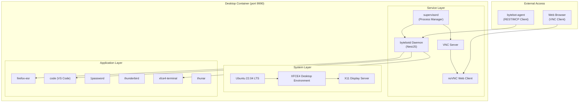
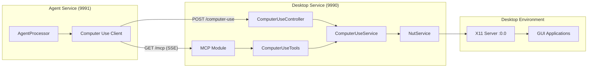
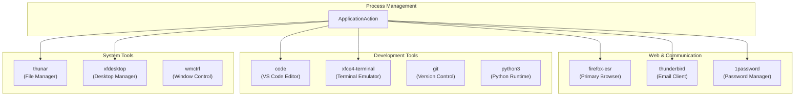
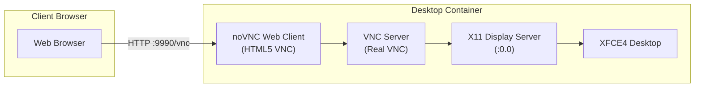

<!-- source: DeepWiki mcp.deepwiki.com · repo bytebot-ai/bytebot · page 7 Desktop Environment · fetched 2026-10-29 -->

# Desktop Environment

<details>
<summary>Relevant source files</summary>

The following files were used as context for generating this wiki page:

- [README.md](README.md)
- [docs/api-reference/agent/tasks.mdx](docs/api-reference/agent/tasks.mdx)
- [docs/core-concepts/desktop-environment.mdx](docs/core-concepts/desktop-environment.mdx)
- [docs/deployment/railway.mdx](docs/deployment/railway.mdx)
- [docs/guides/task-creation.mdx](docs/guides/task-creation.mdx)
- [docs/introduction.mdx](docs/introduction.mdx)
- [docs/quickstart.mdx](docs/quickstart.mdx)
- [packages/bytebotd/src/computer-use/computer-use.service.ts](packages/bytebotd/src/computer-use/computer-use.service.ts)
- [packages/bytebotd/src/computer-use/dto/base.dto.ts](packages/bytebotd/src/computer-use/dto/base.dto.ts)
- [packages/bytebotd/src/computer-use/dto/computer-action-validation.pipe.ts](packages/bytebotd/src/computer-use/dto/computer-action-validation.pipe.ts)
- [packages/bytebotd/src/computer-use/dto/computer-action.dto.ts](packages/bytebotd/src/computer-use/dto/computer-action.dto.ts)
- [packages/bytebotd/src/mcp/computer-use.tools.ts](packages/bytebotd/src/mcp/computer-use.tools.ts)
- [packages/shared/src/types/computerAction.types.ts](packages/shared/src/types/computerAction.types.ts)
- [packages/shared/src/types/messageContent.types.ts](packages/shared/src/types/messageContent.types.ts)
- [packages/shared/src/utils/computerAction.utils.ts](packages/shared/src/utils/computerAction.utils.ts)
- [packages/shared/src/utils/messageContent.utils.ts](packages/shared/src/utils/messageContent.utils.ts)

</details>


This document covers the virtual Linux desktop environment that serves as the execution context for Bytebot's computer automation capabilities. The desktop environment provides a complete, isolated computing environment where AI agents can perform tasks using standard desktop applications and interfaces.

For information about the REST API for programmatic desktop control, see [Computer Use API](#5.1). For details about monitoring user input events, see [Input Tracking System](#5.2).

## System Architecture

The desktop environment is built as a containerized Ubuntu Linux system with a complete graphical desktop interface. It runs independently from the host system, providing isolation and consistency across different deployment environments.

### Core Desktop Stack



**Desktop Environment Stack Architecture**

The desktop runs as a complete Linux system with graphical capabilities, managed by `supervisord` for service orchestration and accessed through multiple interfaces.

Sources: [README.md:103-106](), [docs/core-concepts/desktop-environment.mdx:36-43](), [docs/quickstart.mdx:68-74]()

### Service Integration



**Service Communication Architecture**

The `ComputerUseService` acts as the central coordinator, translating high-level computer actions into low-level desktop operations through `NutService`.

Sources: [packages/bytebotd/src/computer-use/computer-use.service.ts:25-29](), [packages/bytebotd/src/mcp/computer-use.tools.ts:7-9]()

## Container Composition

The desktop environment runs as a Docker container with specific configuration for automation and remote access.

### Runtime Environment

| Component | Details |
|-----------|---------|
| **Base Image** | Ubuntu 22.04 LTS |
| **Desktop** | XFCE4 (lightweight, automation-friendly) |
| **Display** | `:0.0` (X11 display server) |
| **Resolution** | 1920x1080 @ 24-bit color |
| **User Context** | `user` with sudo access |
| **Process Manager** | supervisord |

### File System Layout

```
/home/user/                     # User home directory
├── Desktop/                    # Desktop files and shortcuts
├── Documents/                  # User documents
├── Downloads/                  # Browser downloads
├── .config/                    # Application configurations
│   ├── Code/                   # VS Code settings
│   └── firefox/                # Firefox profile
└── .local/                     # User-local data

/opt/bytebotd/                  # bytebotd service directory
└── src/                        # Service source code

/var/log/supervisor/            # Service logs
├── bytebotd.log               # Desktop daemon logs
└── vnc.log                    # VNC server logs
```

Sources: [docs/core-concepts/desktop-environment.mdx:98-111](), [packages/bytebotd/src/computer-use/computer-use.service.ts:364-417]()

## Pre-installed Applications

The desktop comes with essential applications configured for automation and productivity tasks.

### Application Inventory



**Pre-installed Application Ecosystem**

Applications are managed through the `ApplicationAction` interface, allowing programmatic opening and window management.

Sources: [packages/shared/src/types/computerAction.types.ts:4-11](), [packages/bytebotd/src/computer-use/computer-use.service.ts:287-304](), [packages/bytebotd/src/mcp/computer-use.tools.ts:511-519]()

### Application Management System

The `ComputerUseService` provides application lifecycle management through the `application` action:

```typescript
// Application types supported
type Application = 
  | "firefox" 
  | "1password" 
  | "thunderbird" 
  | "vscode" 
  | "terminal" 
  | "desktop" 
  | "directory"
```

The service handles:
- **Application Detection**: Uses `wmctrl -lx` to check running applications
- **Window Activation**: Brings existing windows to foreground  
- **Process Launching**: Starts new application instances
- **Window Management**: Maximizes and positions windows

Sources: [packages/bytebotd/src/computer-use/computer-use.service.ts:264-362](), [packages/shared/src/types/computerAction.types.ts:4-11]()

## Access Interfaces

The desktop environment provides multiple access methods for different use cases.

### VNC Web Interface



**VNC Web Access Architecture**

The noVNC client provides browser-based desktop access without requiring VNC client software installation.

- **URL**: `http://localhost:9990/vnc`
- **Protocol**: WebSocket-proxied VNC
- **Features**: Full desktop interaction, clipboard sharing
- **Use Cases**: Manual setup, troubleshooting, demonstration

Sources: [docs/core-concepts/desktop-environment.mdx:115-121](), [docs/quickstart.mdx:200]()

### REST API Interface

The `bytebotd` daemon exposes computer control functionality through REST endpoints:

| Endpoint | Purpose |
|----------|---------|
| `POST /computer-use` | Execute computer actions |
| `GET /mcp` | MCP protocol SSE endpoint |
| `GET /vnc` | VNC web client interface |

The API accepts `ComputerAction` objects and delegates execution to `ComputerUseService`:

Sources: [packages/bytebotd/src/computer-use/computer-use.service.ts:31-105](), [docs/core-concepts/desktop-environment.mdx:123-156]()

### MCP Protocol Support

The desktop provides Model Context Protocol (MCP) integration for tool access:

```json
{
  "mcpServers": {
    "bytebot": {
      "command": "npx",
      "args": [
        "mcp-remote", 
        "http://127.0.0.1:9990/mcp",
        "--transport",
        "http-first"
      ]
    }
  }
}
```

The MCP interface exposes computer use tools as callable functions for AI models.

Sources: [docs/core-concepts/desktop-environment.mdx:123-141](), [packages/bytebotd/src/mcp/computer-use.tools.ts:8-698]()

## Computer Action System

The desktop environment executes computer actions through a comprehensive action system that covers all desktop interaction patterns.

### Action Type Hierarchy

```mermaid
graph TB
    ComputerAction["ComputerAction<br/>(Union Type)"]
    
    subgraph "Mouse Actions"
        MoveMouseAction["move_mouse"]
        ClickMouseAction["click_mouse"] 
        DragMouseAction["drag_mouse"]
        ScrollAction["scroll"]
        PressMouseAction["press_mouse"]
        TraceMouseAction["trace_mouse"]
    end
    
    subgraph "Keyboard Actions"
        TypeTextAction["type_text"]
        TypeKeysAction["type_keys"]
        PressKeysAction["press_keys"]
        PasteTextAction["paste_text"]
    end
    
    subgraph "System Actions"
        ScreenshotAction["screenshot"]
        ApplicationAction["application"]
        WaitAction["wait"]
        CursorPositionAction["cursor_position"]
    end
    
    subgraph "File Actions"
        WriteFileAction["write_file"]
        ReadFileAction["read_file"]
    end
    
    ComputerAction --> MoveMouseAction
    ComputerAction --> ClickMouseAction
    ComputerAction --> TypeTextAction
    ComputerAction --> ScreenshotAction
    ComputerAction --> WriteFileAction
    ComputerAction --> ApplicationAction
    ComputerAction --> WaitAction
```



**Computer Action Type System**

All desktop interactions are modeled as strongly-typed action objects processed by `ComputerUseService.action()`.

Sources: [packages/shared/src/types/computerAction.types.ts:109-125](), [packages/bytebotd/src/computer-use/computer-use.service.ts:31-105]()

### Action Execution Pipeline

The execution flow for computer actions follows a consistent pattern:

1. **Action Validation**: DTOs validate action parameters
2. **Service Routing**: `ComputerUseService` routes to specific handlers  
3. **Desktop Execution**: `NutService` performs low-level operations
4. **Result Processing**: Return values or success confirmations

```typescript
// Example action execution flow
await computerUseService.action({
  action: 'click_mouse',
  coordinates: { x: 500, y: 300 },
  button: 'left',
  clickCount: 1
});
```

Sources: [packages/bytebotd/src/computer-use/computer-use.service.ts:31-105](), [packages/bytebotd/src/computer-use/dto/computer-action.dto.ts:22-239]()

## Service Management

The desktop environment uses `supervisord` for process management and service orchestration.

### Service Configuration

Key services managed by supervisor:

- **bytebotd**: Main automation daemon (NestJS application)
- **VNC Server**: Remote desktop access 
- **X11**: Display server
- **Desktop Session**: XFCE4 session management

Each service has dedicated logging and automatic restart capabilities.

### Resource Management

The desktop environment is optimized for automation workloads:

- **Memory Usage**: ~1-2GB typical, 4GB recommended
- **CPU Usage**: Scales with automation complexity
- **Storage**: Persistent user data, temporary execution files
- **Network**: Outbound internet access, inbound API access

Sources: [docs/core-concepts/desktop-environment.mdx:176-189](), [docs/core-concepts/architecture.mdx:194-207]()

## Customization and Extension

The desktop environment supports customization for specific automation requirements.

### Software Installation

Additional software can be installed through standard Ubuntu package management or custom Docker builds:

```dockerfile
FROM ghcr.io/bytebot-ai/bytebot-desktop:edge

# Install additional packages
RUN apt-get update && apt-get install -y \
    slack-desktop \
    zoom \
    custom-enterprise-software

# Copy configuration files  
COPY configs/ /home/user/.config/
```

### Application Configuration

Pre-installed applications can be configured through:
- **Configuration Files**: Standard Linux config directories
- **Environment Variables**: Runtime configuration
- **Startup Scripts**: Custom initialization logic

Sources: [docs/core-concepts/desktop-environment.mdx:160-174](), [docs/quickstart.mdx:163-174]()

## Performance Characteristics

The desktop environment is designed for reliability and consistent performance in automation scenarios.

### Resource Requirements

| Resource | Minimum | Recommended | Notes |
|----------|---------|-------------|--------|
| **Memory** | 2GB | 4GB | Higher for complex applications |
| **CPU** | 1 core | 2+ cores | Scales with concurrency |
| **Storage** | 2GB | 10GB+ | Includes applications and user data |
| **Network** | 10 Mbps | 100+ Mbps | For web automation tasks |

### Optimization Considerations

- **Display Resolution**: Fixed at 1920x1080 for consistent element positioning
- **Application Startup**: Pre-configured for fast launch times
- **Resource Isolation**: Container limits prevent resource contention
- **Session Persistence**: User data survives container restarts

Sources: [docs/core-concepts/desktop-environment.mdx:176-189](), [docs/core-concepts/architecture.mdx:194-207]()

---

