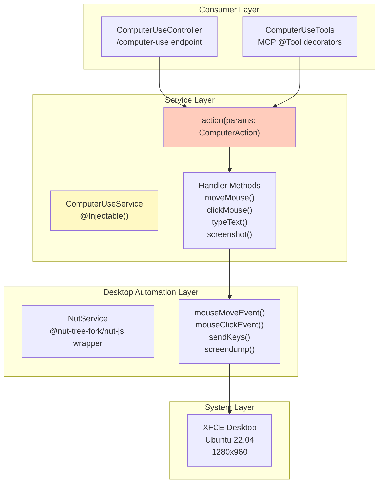
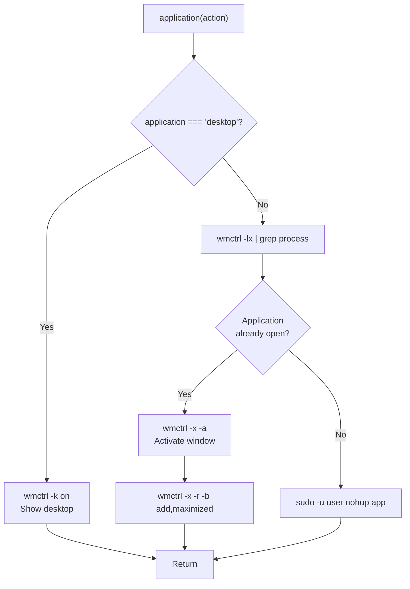
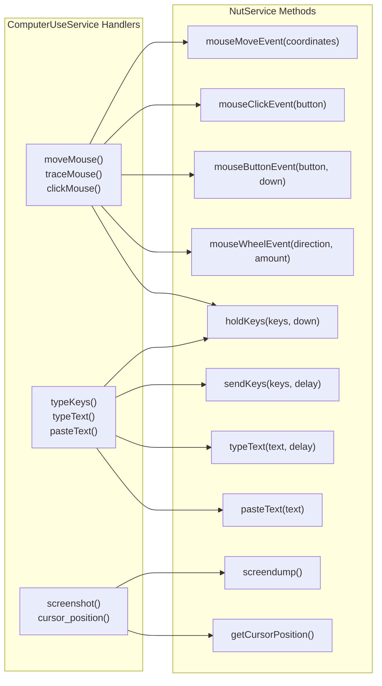
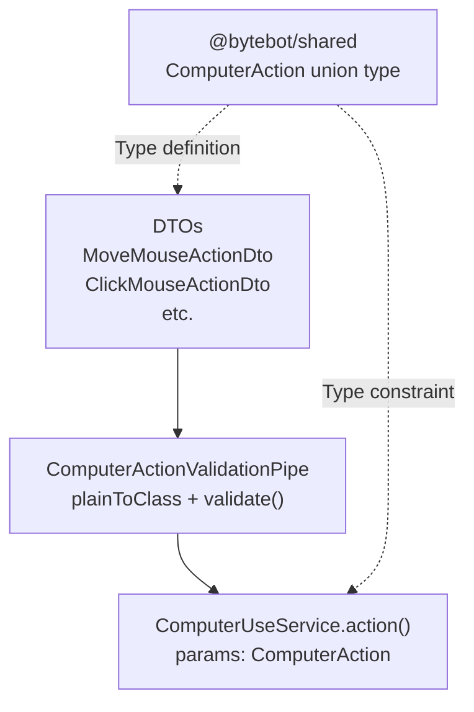
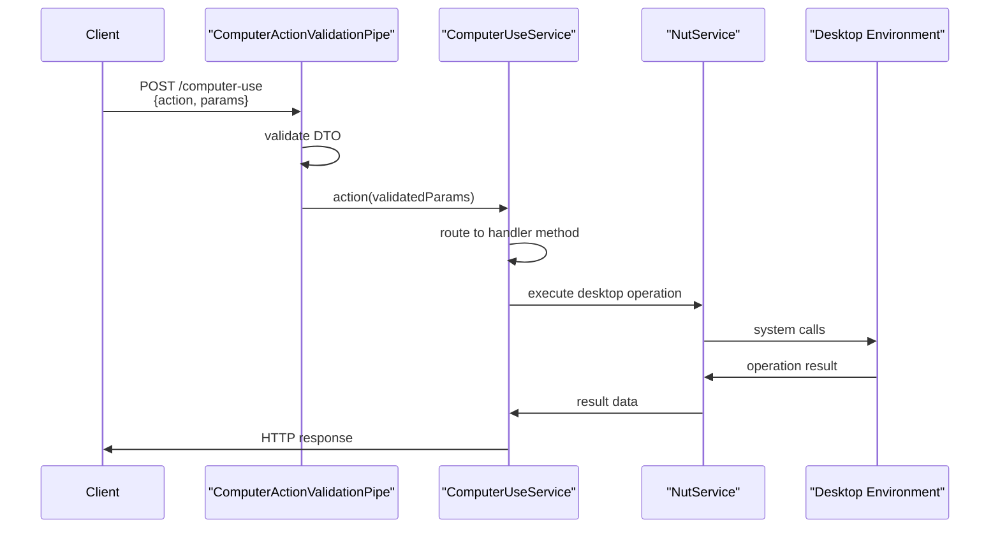

<!-- source: DeepWiki mcp.deepwiki.com · repo bytebot-ai/bytebot · page 7.1 Computer Use Service · fetched 2026-10-29 -->

# Computer Use Service

<details>
<summary>Relevant source files</summary>

The following files were used as context for generating this wiki page:

- [packages/bytebotd/src/computer-use/computer-use.service.ts](packages/bytebotd/src/computer-use/computer-use.service.ts)
- [packages/bytebotd/src/computer-use/dto/base.dto.ts](packages/bytebotd/src/computer-use/dto/base.dto.ts)
- [packages/bytebotd/src/computer-use/dto/computer-action-validation.pipe.ts](packages/bytebotd/src/computer-use/dto/computer-action-validation.pipe.ts)
- [packages/bytebotd/src/computer-use/dto/computer-action.dto.ts](packages/bytebotd/src/computer-use/dto/computer-action.dto.ts)
- [packages/bytebotd/src/mcp/computer-use.tools.ts](packages/bytebotd/src/mcp/computer-use.tools.ts)
- [packages/shared/src/types/computerAction.types.ts](packages/shared/src/types/computerAction.types.ts)
- [packages/shared/src/types/messageContent.types.ts](packages/shared/src/types/messageContent.types.ts)
- [packages/shared/src/utils/computerAction.utils.ts](packages/shared/src/utils/computerAction.utils.ts)
- [packages/shared/src/utils/messageContent.utils.ts](packages/shared/src/utils/messageContent.utils.ts)

</details>


The `ComputerUseService` class in the `bytebotd` daemon serves as the central action execution layer for desktop automation. This service translates high-level computer actions into low-level desktop operations through `NutService`, providing the execution engine for AI agent interactions and direct API calls.

For AI integration via MCP tools, see [MCP Integration](#7.3). For the complete set of desktop tools available to agents, see [Desktop Tools](#7.2). For direct REST API usage, see [Computer Use API](#10.2).

## Service Architecture

The `ComputerUseService` is implemented as a NestJS injectable service that receives `ComputerAction` objects and dispatches them to appropriate handler methods. Each handler coordinates with `NutService` to execute the requested desktop operation.

### Component Hierarchy



The service receives validated `ComputerAction` DTOs from either the REST controller or MCP tools layer, routes them through the central `action()` dispatcher, and delegates execution to specialized handler methods.

**Sources:** [packages/bytebotd/src/computer-use/computer-use.service.ts:25-29](), [packages/bytebotd/src/computer-use/computer-use.service.ts:31-105]()

### Dependency Injection

The service declares a single dependency on `NutService`:

```typescript
constructor(private readonly nutService: NutService) {}
```

This tight coupling with `NutService` reflects the service's role as a facade that provides a higher-level, action-based interface over the low-level desktop automation primitives.

**Sources:** [packages/bytebotd/src/computer-use/computer-use.service.ts:29]()

## Action Dispatch System

The core of `ComputerUseService` is the `action()` method, which implements a switch-based dispatcher pattern. This method receives a `ComputerAction` union type and routes execution to the appropriate handler method.

### Dispatcher Implementation

```mermaid
graph TB
    ActionMethod["action(params: ComputerAction)"]
    SwitchStatement["switch (params.action)"]
    
    MM["case 'move_mouse'<br/>moveMouse(params)"]
    TM["case 'trace_mouse'<br/>traceMouse(params)"]
    CM["case 'click_mouse'<br/>clickMouse(params)"]
    PM["case 'press_mouse'<br/>pressMouse(params)"]
    DM["case 'drag_mouse'<br/>dragMouse(params)"]
    SC["case 'scroll'<br/>scroll(params)"]
    TK["case 'type_keys'<br/>typeKeys(params)"]
    PK["case 'press_keys'<br/>pressKeys(params)"]
    TT["case 'type_text'<br/>typeText(params)"]
    PT["case 'paste_text'<br/>pasteText(params)"]
    WT["case 'wait'<br/>delay(duration)"]
    SS["case 'screenshot'<br/>return screenshot()"]
    CP["case 'cursor_position'<br/>return cursor_position()"]
    AP["case 'application'<br/>application(params)"]
    WF["case 'write_file'<br/>return writeFile(params)"]
    RF["case 'read_file'<br/>return readFile(params)"]
    DF["default<br/>throw Error"]
    
    ActionMethod --> SwitchStatement
    SwitchStatement --> MM
    SwitchStatement --> TM
    SwitchStatement --> CM
    SwitchStatement --> PM
    SwitchStatement --> DM
    SwitchStatement --> SC
    SwitchStatement --> TK
    SwitchStatement --> PK
    SwitchStatement --> TT
    SwitchStatement --> PT
    SwitchStatement --> WT
    SwitchStatement --> SS
    SwitchStatement --> CP
    SwitchStatement --> AP
    SwitchStatement --> WF
    SwitchStatement --> RF
    SwitchStatement --> DF
```



The dispatcher ensures type safety through TypeScript's discriminated union types - each `case` branch narrows the `params` type to the specific action interface.

**Sources:** [packages/bytebotd/src/computer-use/computer-use.service.ts:31-105]()

### Return Value Patterns

Most actions return `Promise<void>` and execute for their side effects. Three actions return data:

| Action | Return Type | Data Structure |
|--------|-------------|----------------|
| `screenshot` | `Promise<{ image: string }>` | Base64-encoded PNG image |
| `cursor_position` | `Promise<{ x: number; y: number }>` | Current cursor coordinates |
| `read_file` | `Promise<{ success, data?, name?, size?, mediaType?, message? }>` | File contents and metadata |
| `write_file` | `Promise<{ success, message }>` | Operation result |

**Sources:** [packages/bytebotd/src/computer-use/computer-use.service.ts:253-257](), [packages/bytebotd/src/computer-use/computer-use.service.ts:259-262](), [packages/bytebotd/src/computer-use/computer-use.service.ts:419-505]()

## Action Categories

The service implements 17 distinct action types organized into four functional categories.

### Mouse Operations

| Action | Handler Method | NutService Calls | Parameters |
|--------|---------------|------------------|------------|
| `move_mouse` | `moveMouse()` | `mouseMoveEvent()` | `coordinates: {x, y}` |
| `trace_mouse` | `traceMouse()` | `mouseMoveEvent()` + `holdKeys()` | `path: Coordinates[]`, `holdKeys?` |
| `click_mouse` | `clickMouse()` | `mouseClickEvent()` + optional `mouseMoveEvent()` | `button`, `clickCount`, `coordinates?`, `holdKeys?` |
| `press_mouse` | `pressMouse()` | `mouseButtonEvent()` | `button`, `press: "up"/"down"`, `coordinates?` |
| `drag_mouse` | `dragMouse()` | `mouseButtonEvent()` + `mouseMoveEvent()` | `path: Coordinates[]`, `button`, `holdKeys?` |
| `scroll` | `scroll()` | `mouseWheelEvent()` | `direction`, `scrollCount`, `coordinates?`, `holdKeys?` |

Mouse operations demonstrate the service's coordination capabilities. For example, `clickMouse()` orchestrates multiple NutService calls:

1. Move to coordinates (if provided): `await this.nutService.mouseMoveEvent(coordinates)`
2. Hold modifier keys (if provided): `await this.nutService.holdKeys(holdKeys, true)`
3. Perform clicks with delay: `await this.nutService.mouseClickEvent(button)` + `await this.delay(150)`
4. Release modifier keys: `await this.nutService.holdKeys(holdKeys, false)`

**Sources:** [packages/bytebotd/src/computer-use/computer-use.service.ts:107-227](), [packages/shared/src/types/computerAction.types.ts:14-53]()

### Keyboard Operations

| Action | Handler Method | NutService Calls | Parameters |
|--------|---------------|------------------|------------|
| `type_keys` | `typeKeys()` | `sendKeys()` | `keys: string[]`, `delay?` |
| `press_keys` | `pressKeys()` | `holdKeys()` | `keys: string[]`, `press: "up"/"down"` |
| `type_text` | `typeText()` | `typeText()` | `text: string`, `delay?` |
| `paste_text` | `pasteText()` | `pasteText()` | `text: string` |

Keyboard handlers are thin wrappers that delegate directly to `NutService` methods. The complexity of key mapping and event generation is handled by the underlying NutJS library.

The `type_keys` action supports 100+ key names including:
- **Modifiers**: `LeftControl`, `RightControl`, `LeftShift`, `RightShift`, `LeftAlt`, `RightAlt`, `LeftCmd`, `RightCmd`
- **Function keys**: `F1` through `F24`
- **Navigation**: `Up`, `Down`, `Left`, `Right`, `Home`, `End`, `PageUp`, `PageDown`
- **Special**: `Enter`, `Tab`, `Escape`, `Backspace`, `Delete`, `Space`
- **Alphanumeric**: `A-Z`, `Num0-Num9`, `NumPad0-NumPad9`

**Sources:** [packages/bytebotd/src/computer-use/computer-use.service.ts:229-247](), [packages/bytebotd/src/mcp/computer-use.tools.ts:317-426]()

### System Operations

| Action | Handler Method | Implementation | Parameters |
|--------|---------------|----------------|------------|
| `screenshot` | `screenshot()` | `nutService.screendump()` + base64 encoding | None |
| `cursor_position` | `cursor_position()` | `nutService.getCursorPosition()` | None |
| `wait` | `delay()` | `new Promise(setTimeout)` | `duration: number` (ms) |
| `application` | `application()` | Shell commands via `exec`/`spawn` | `application: Application` |

The `wait` action provides a simple utility method for pausing execution:

```typescript
private async delay(ms: number): Promise<void> {
  return new Promise((resolve) => setTimeout(resolve, ms));
}
```

**Sources:** [packages/bytebotd/src/computer-use/computer-use.service.ts:249-262]()

### Application Management

The `application()` handler implements sophisticated window management using `wmctrl` commands:



The service maintains two mapping tables:

- **Command map**: Application name → executable command
  - `firefox` → `firefox-esr`
  - `vscode` → `code`
  - `terminal` → `xfce4-terminal`
  - etc.

- **Process map**: Application name → WM_CLASS identifier
  - `firefox` → `Navigator.firefox-esr`
  - `vscode` → `code.Code`
  - `terminal` → `xfce4-terminal.Xfce4-Terminal`
  - etc.

All application commands are executed via `spawn()` with `detached: true` and `unref()` to prevent blocking the service.

**Sources:** [packages/bytebotd/src/computer-use/computer-use.service.ts:264-362]()

### File Operations

| Action | Handler Method | Implementation Strategy | Return Data |
|--------|---------------|------------------------|-------------|
| `write_file` | `writeFile()` | Temp file + `sudo cp` + chown | `{success, message}` |
| `read_file` | `readFile()` | `sudo cp` to temp + read + cleanup | `{success, data?, name?, size?, mediaType?, message?}` |

Both file operations require elevated permissions since files are accessed in the user context. The service uses a temporary file pattern:

**Write flow:**
1. Decode base64 data to Buffer
2. Resolve path (relative → `/home/user/Desktop/...`)
3. Create directory: `sudo mkdir -p`
4. Write to temp file: `/tmp/bytebot_temp_*`
5. Copy with permissions: `sudo cp`, `sudo chown user:user`, `sudo chmod 644`
6. Clean up temp file

**Read flow:**
1. Resolve path
2. Copy to temp: `sudo cp target tempFile`
3. Change permissions: `sudo chmod 644 tempFile`
4. Read as Buffer
5. Get file size: `sudo stat -c "%s"`
6. Clean up temp file
7. Encode to base64 and determine MIME type

The service includes MIME type detection for 20+ file extensions including documents (PDF, DOCX, TXT), images (PNG, JPEG, WebP), and structured formats (JSON, XML, CSV).

**Sources:** [packages/bytebotd/src/computer-use/computer-use.service.ts:364-506]()

## NutService Integration

The `ComputerUseService` delegates all actual desktop interaction to the `NutService` wrapper around `@nut-tree-fork/nut-js`. This creates a clean separation between action orchestration (ComputerUseService) and low-level automation primitives (NutService).

### NutService Method Mapping



### Coordinate System

All mouse operations use absolute screen coordinates in the 1280x960 desktop resolution:
- X-axis: 0 (left) to 1280 (right)
- Y-axis: 0 (top) to 960 (bottom)
- Origin: Top-left corner

The `Coordinates` type enforces this contract: `{ x: number, y: number }`

**Sources:** [packages/bytebotd/src/computer-use/computer-use.service.ts:29](), [packages/shared/src/types/computerAction.types.ts:1]()

### Timing and Synchronization

The service implements explicit delays between certain operations to ensure desktop stability:

- **Multi-click delay**: 150ms between clicks in `clickMouse()`
- **Scroll delay**: 150ms between scroll events in `scroll()`
- **User-controlled wait**: `wait` action accepts duration in milliseconds

These delays prevent race conditions where the desktop hasn't finished rendering the result of one action before the next action executes.

**Sources:** [packages/bytebotd/src/computer-use/computer-use.service.ts:151](), [packages/bytebotd/src/computer-use/computer-use.service.ts:220]()

## Validation and Type Safety

The service benefits from multi-layer type safety through TypeScript discriminated unions, class-validator DTOs, and Zod schemas.

### Type Hierarchy



### Validation Pipeline

The `ComputerActionValidationPipe` implements a two-stage validation process:

**Stage 1: DTO Selection**
```typescript
switch (value.action) {
  case 'move_mouse':
    dto = plainToClass(MoveMouseActionDto, value);
    break;
  case 'click_mouse':
    dto = plainToClass(ClickMouseActionDto, value);
    break;
  // ... 15 more cases
}
```

**Stage 2: Constraint Validation**
```typescript
const errors = await validate(dto);
if (errors.length > 0) {
  throw new BadRequestException(errors);
}
```

Each DTO class uses `class-validator` decorators to enforce constraints:

| Decorator | Purpose | Example Usage |
|-----------|---------|---------------|
| `@IsIn(['action_name'])` | Ensure action field matches | `@IsIn(['move_mouse'])` |
| `@ValidateNested()` | Validate nested objects | Coordinates validation |
| `@Type(() => Class)` | Transform plain object to class | `@Type(() => CoordinatesDto)` |
| `@IsEnum(EnumType)` | Validate against enum | `@IsEnum(ButtonType)` |
| `@IsNumber()` / `@IsString()` | Primitive type validation | Basic fields |
| `@Min(n)` | Numeric range validation | `@Min(1)` for clickCount |
| `@IsOptional()` | Allow undefined | Optional parameters |
| `@IsArray()` | Array validation | Key arrays, path arrays |

**Sources:** [packages/bytebotd/src/computer-use/dto/computer-action-validation.pipe.ts:29-96](), [packages/bytebotd/src/computer-use/dto/computer-action.dto.ts:1-240]()

## Integration Patterns

### MCP Tool Interface

The Computer Use API is exposed to AI agents through MCP (Model Context Protocol) tools. Each computer action becomes a tool that AI models can invoke:

```typescript
@Tool({
  name: 'computer_move_mouse',
  description: 'Moves the mouse cursor to the specified coordinates.',
  parameters: z.object({
    coordinates: z.object({
      x: z.number(),
      y: z.number(),
    }),
  }),
})
async moveMouse({ coordinates }) {
  await this.computerUse.action({ action: 'move_mouse', coordinates });
  return { content: [{ type: 'text', text: 'mouse moved' }] };
}
```

Each MCP tool wraps the corresponding computer action, providing AI-friendly descriptions and structured parameter schemas using Zod validation.

**Sources:** [packages/bytebotd/src/mcp/computer-use.tools.ts:11-35](), [packages/bytebotd/src/mcp/computer-use.tools.ts:80-138]()

### Message Content Integration

Computer actions integrate with Bytebot's message system through content block types. Actions can be converted between different representations:

- `ComputerAction` types for internal processing
- `ToolUseContentBlock` types for AI agent communication  
- `UserActionContentBlock` types for user interaction tracking

**Sources:** [packages/shared/src/types/messageContent.types.ts:187-203](), [packages/shared/src/utils/computerAction.utils.ts:299-342]()

### Request/Response Patterns



The API follows a consistent request/response pattern where most actions return `{success: true}` on completion, while information-gathering actions like `screenshot` and `cursor_position` return additional data.

**Sources:** [packages/bytebotd/src/computer-use/computer-use.service.ts:31-105](), [docs/api-reference/computer-use/unified-endpoint.mdx:388-453]()

---

