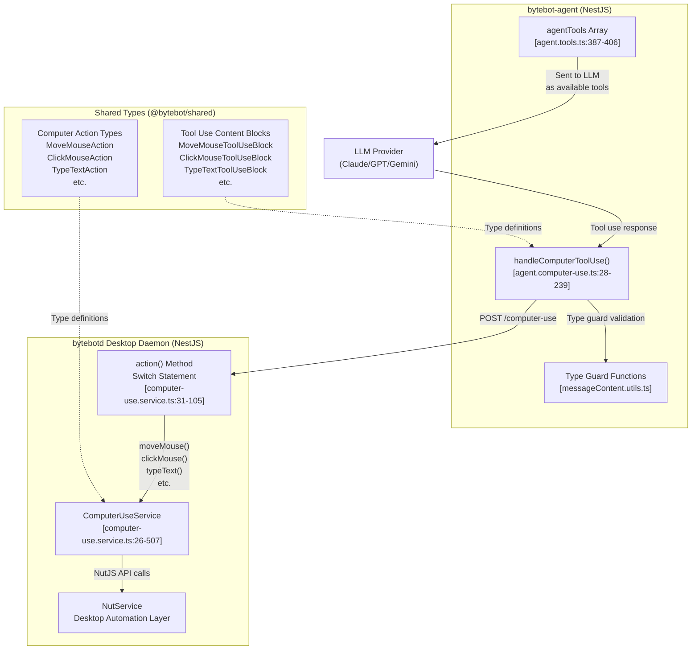
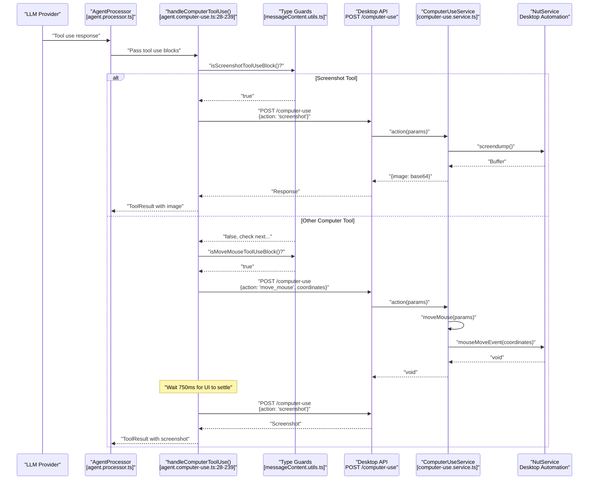
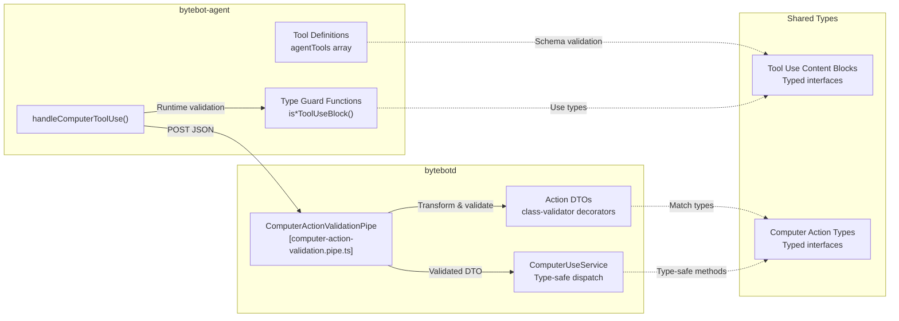

<!-- source: DeepWiki mcp.deepwiki.com · repo bytebot-ai/bytebot · page 7.2 Desktop Tools · fetched 2026-10-29 -->

# Desktop Tools

<details>
<summary>Relevant source files</summary>

The following files were used as context for generating this wiki page:

- [packages/bytebot-agent/prisma/migrations/20250722041608_files/migration.sql](packages/bytebot-agent/prisma/migrations/20250722041608_files/migration.sql)
- [packages/bytebot-agent/src/agent/agent.computer-use.ts](packages/bytebot-agent/src/agent/agent.computer-use.ts)
- [packages/bytebot-agent/src/agent/agent.constants.ts](packages/bytebot-agent/src/agent/agent.constants.ts)
- [packages/bytebot-agent/src/agent/agent.scheduler.ts](packages/bytebot-agent/src/agent/agent.scheduler.ts)
- [packages/bytebot-agent/src/agent/agent.tools.ts](packages/bytebot-agent/src/agent/agent.tools.ts)
- [packages/bytebotd/src/computer-use/computer-use.controller.ts](packages/bytebotd/src/computer-use/computer-use.controller.ts)
- [packages/bytebotd/src/computer-use/computer-use.service.ts](packages/bytebotd/src/computer-use/computer-use.service.ts)
- [packages/bytebotd/src/computer-use/dto/base.dto.ts](packages/bytebotd/src/computer-use/dto/base.dto.ts)
- [packages/bytebotd/src/computer-use/dto/computer-action-validation.pipe.ts](packages/bytebotd/src/computer-use/dto/computer-action-validation.pipe.ts)
- [packages/bytebotd/src/computer-use/dto/computer-action.dto.ts](packages/bytebotd/src/computer-use/dto/computer-action.dto.ts)
- [packages/bytebotd/src/main.ts](packages/bytebotd/src/main.ts)
- [packages/bytebotd/src/mcp/computer-use.tools.ts](packages/bytebotd/src/mcp/computer-use.tools.ts)
- [packages/shared/src/types/computerAction.types.ts](packages/shared/src/types/computerAction.types.ts)
- [packages/shared/src/types/messageContent.types.ts](packages/shared/src/types/messageContent.types.ts)
- [packages/shared/src/utils/computerAction.utils.ts](packages/shared/src/utils/computerAction.utils.ts)
- [packages/shared/src/utils/messageContent.utils.ts](packages/shared/src/utils/messageContent.utils.ts)

</details>


This page documents all 17 desktop automation tools available to the AI agent for controlling the virtual desktop environment. These tools provide mouse control, keyboard input, screenshot capture, application management, file operations, and task control capabilities.

For information about how these tools are executed by the desktop daemon, see [Computer Use Service](#7.1). For details on how the agent processes and invokes these tools, see [Computer Use Integration](#6.2). For MCP exposure of these tools, see [MCP Integration](#7.3).

## Tool Categories

The desktop tools are organized into five functional categories:

| Category | Tool Count | Purpose |
|----------|------------|---------|
| **Mouse Tools** | 7 | Control cursor position and clicking behavior |
| **Keyboard Tools** | 4 | Simulate keyboard input and shortcuts |
| **Utility Tools** | 3 | Screenshot capture, waiting, and application management |
| **File Operations** | 2 | Read and write files on the desktop |
| **Task Management** | 2 | Control task status and create subtasks |

**Sources:** [packages/bytebot-agent/src/agent/agent.tools.ts:387-406]()

## Tool Architecture



**Sources:** [packages/bytebot-agent/src/agent/agent.tools.ts:1-406](), [packages/bytebot-agent/src/agent/agent.computer-use.ts:1-647](), [packages/bytebotd/src/computer-use/computer-use.service.ts:1-507]()

## Mouse Tools

### computer_move_mouse

Moves the mouse cursor to absolute screen coordinates.

**Parameters:**
- `coordinates` (required): Target `{x, y}` position in pixels

**Tool Definition:**
```typescript
{
  name: 'computer_move_mouse',
  description: 'Moves the mouse cursor to the specified coordinates',
  input_schema: {
    type: 'object',
    properties: {
      coordinates: { type: 'object', properties: { x: 'number', y: 'number' } }
    },
    required: ['coordinates']
  }
}
```

**Execution:** Calls `NutService.mouseMoveEvent(coordinates)` in [computer-use.service.ts:107-109]().

**Sources:** [packages/bytebot-agent/src/agent/agent.tools.ts:35-48](), [packages/bytebotd/src/computer-use/computer-use.service.ts:107-109]()

### computer_trace_mouse

Moves the mouse cursor smoothly along a path of coordinates, optionally holding modifier keys.

**Parameters:**
- `path` (required): Array of `{x, y}` coordinates defining the path
- `holdKeys` (optional): Array of key names to hold during trace (e.g., `["LeftShift"]`)

**Execution:** Moves to first coordinate, holds keys if specified, traces through all path points, then releases keys. See [computer-use.service.ts:111-131]().

**Sources:** [packages/bytebot-agent/src/agent/agent.tools.ts:50-65](), [packages/bytebotd/src/computer-use/computer-use.service.ts:111-131]()

### computer_click_mouse

Performs single or multiple mouse button clicks at specified coordinates or current position.

**Parameters:**
- `coordinates` (optional): Click location; defaults to current position
- `button` (required): `"left"`, `"right"`, or `"middle"`
- `holdKeys` (optional): Array of modifier keys to hold during click
- `clickCount` (required): Number of clicks (e.g., `2` for double-click)

**Execution:** Moves to coordinates if provided, holds modifier keys, performs clicks with 150ms delay between each, releases modifiers. See [computer-use.service.ts:133-162]().

**Sources:** [packages/bytebot-agent/src/agent/agent.tools.ts:67-90](), [packages/bytebotd/src/computer-use/computer-use.service.ts:133-162]()

### computer_press_mouse

Presses down or releases up a specific mouse button without completing a click.

**Parameters:**
- `coordinates` (optional): Position to press at; defaults to current position
- `button` (required): Mouse button to press/release
- `press` (required): `"down"` or `"up"`

**Use Case:** Enables drag operations by separating press and release actions.

**Sources:** [packages/bytebot-agent/src/agent/agent.tools.ts:92-112](), [packages/bytebotd/src/computer-use/computer-use.service.ts:164-178]()

### computer_drag_mouse

Drags the mouse along a path while holding a button down.

**Parameters:**
- `path` (required): Array of coordinates for the drag path
- `button` (required): Button to hold during drag
- `holdKeys` (optional): Modifier keys to hold

**Execution Flow:**
1. Move to first path coordinate
2. Hold modifier keys if specified
3. Press mouse button down
4. Move through all path coordinates
5. Release mouse button
6. Release modifier keys

**Sources:** [packages/bytebot-agent/src/agent/agent.tools.ts:114-130](), [packages/bytebotd/src/computer-use/computer-use.service.ts:180-202]()

### computer_scroll

Scrolls the mouse wheel in a specified direction.

**Parameters:**
- `coordinates` (optional): Position to scroll at
- `direction` (required): `"up"`, `"down"`, `"left"`, or `"right"`
- `scrollCount` (required): Number of scroll steps
- `holdKeys` (optional): Modifier keys to hold during scroll

**Execution:** Performs each scroll step with a 150ms delay between steps. See [computer-use.service.ts:204-227]().

**Sources:** [packages/bytebot-agent/src/agent/agent.tools.ts:132-155](), [packages/bytebotd/src/computer-use/computer-use.service.ts:204-227]()

### computer_cursor_position

Returns the current `{x, y}` coordinates of the mouse cursor.

**Returns:** `{ x: number, y: number }`

**Use Case:** Allows the agent to determine current cursor position for relative movements.

**Sources:** [packages/bytebot-agent/src/agent/agent.tools.ts:278-285](), [packages/bytebotd/src/computer-use/computer-use.service.ts:259-262]()

## Keyboard Tools

### computer_type_keys

Types a sequence of keys in order, pressing and releasing each. Used primarily for keyboard shortcuts.

**Parameters:**
- `keys` (required): Array of key names to type (e.g., `["LeftControl", "C"]`)
- `delay` (optional): Milliseconds to wait between key presses

**Valid Keys:** Must use exact identifiers from nut-tree's `Key` enum. See the full list in [agent.constants.ts:148-169]() including:
- Modifiers: `LeftControl`, `LeftShift`, `LeftAlt`, `LeftCmd`
- Letters: `A`-`Z` (case-sensitive)
- Function keys: `F1`-`F24`
- Special keys: `Enter`, `Backspace`, `Delete`, `Tab`, `Escape`
- Navigation: `Up`, `Down`, `Left`, `Right`, `Home`, `End`, `PageUp`, `PageDown`

**Sources:** [packages/bytebot-agent/src/agent/agent.tools.ts:160-179](), [packages/bytebotd/src/computer-use/computer-use.service.ts:229-232](), [packages/bytebot-agent/src/agent/agent.constants.ts:148-169]()

### computer_press_keys

Presses down or releases keys without completing a full press-release cycle. Used for holding modifier keys.

**Parameters:**
- `keys` (required): Array of key names
- `press` (required): `"down"` or `"up"`

**Use Case:** Hold Shift while performing other actions, then release it.

**Sources:** [packages/bytebot-agent/src/agent/agent.tools.ts:181-201](), [packages/bytebotd/src/computer-use/computer-use.service.ts:234-237]()

### computer_type_text

Types a text string character by character. Recommended for strings less than 25 characters or sensitive fields.

**Parameters:**
- `text` (required): String to type
- `delay` (optional): Milliseconds between characters
- `isSensitive` (optional): Boolean flag indicating sensitive information (e.g., passwords)

**Note:** The agent system prompt instructs the LLM not to repeat sensitive text when `isSensitive` is true. See [agent.constants.ts:56]().

**Sources:** [packages/bytebot-agent/src/agent/agent.tools.ts:203-227](), [packages/bytebotd/src/computer-use/computer-use.service.ts:239-242]()

### computer_paste_text

Copies text to clipboard and pastes it using Ctrl+V. Recommended for long strings or special characters.

**Parameters:**
- `text` (required): String to paste
- `isSensitive` (optional): Boolean flag for sensitive data

**Execution:** Uses clipboard manipulation via NutJS. More efficient than `type_text` for large content.

**Sources:** [packages/bytebot-agent/src/agent/agent.tools.ts:229-248](), [packages/bytebotd/src/computer-use/computer-use.service.ts:244-247]()

## Utility Tools

### computer_wait

Pauses execution for a specified duration.

**Parameters:**
- `duration` (required): Milliseconds to wait (enum constrained to `500`)

**Use Case:** Allow time for UI animations or slow operations to complete.

**Execution:** Simple `setTimeout` promise. See [computer-use.service.ts:249-251]().

**Sources:** [packages/bytebot-agent/src/agent/agent.tools.ts:253-267](), [packages/bytebotd/src/computer-use/computer-use.service.ts:76-80]()

### computer_screenshot

Captures a screenshot of the entire desktop display (1280x960).

**Returns:** Base64-encoded PNG image in response format:
```typescript
{
  type: 'tool_result',
  tool_use_id: string,
  content: [{
    type: 'image',
    source: {
      data: string,  // base64
      media_type: 'image/png',
      type: 'base64'
    }
  }]
}
```

**Execution:** Calls `NutService.screendump()` which captures via Sharp image processing library. See [computer-use.service.ts:253-257]().

**Sources:** [packages/bytebot-agent/src/agent/agent.tools.ts:269-276](), [packages/bytebotd/src/computer-use/computer-use.service.ts:253-257]()

### computer_application

Opens or focuses a desktop application and maximizes it.

**Parameters:**
- `application` (required): Application name from enum

**Available Applications:**
- `firefox` - Firefox ESR browser
- `1password` - 1Password password manager
- `thunderbird` - Thunderbird email client
- `vscode` - Visual Studio Code editor
- `terminal` - XFCE4 Terminal
- `directory` - Thunar file manager
- `desktop` - Return to desktop/show desktop

**Execution Logic:**
1. Check if application is already open using `wmctrl -lx`
2. If open: activate and maximize window
3. If not open: launch application using `sudo -u user nohup <command>`
4. Uses fire-and-forget pattern (detached processes)

See the command and process mappings in [computer-use.service.ts:287-304]().

**Sources:** [packages/bytebot-agent/src/agent/agent.tools.ts:287-309](), [packages/bytebotd/src/computer-use/computer-use.service.ts:264-362]()

## File Operations

### computer_read_file

Reads a file from the desktop filesystem and returns it as a document content block.

**Parameters:**
- `path` (required): File path (relative paths are resolved to `/home/user/Desktop/`)

**Returns:** Document content block with:
```typescript
{
  type: 'tool_result',
  content: [{
    type: 'document',
    source: {
      type: 'base64',
      media_type: string,  // MIME type based on extension
      data: string         // base64 encoded file
    },
    name: string,
    size: number
  }]
}
```

**Supported File Types:** PDF, DOCX, DOC, TXT, HTML, JSON, XML, CSV, RTF, ODT, EPUB, PNG, JPG, JPEG, WEBP, GIF, SVG. See MIME type mapping in [computer-use.service.ts:464-482]().

**Execution:**
1. Resolve relative path to `/home/user/Desktop/`
2. Copy file to temp location using `sudo cp`
3. Read file buffer from temp location
4. Get file stats for size
5. Determine MIME type from extension
6. Clean up temp file
7. Return base64-encoded content

**Sources:** [packages/bytebot-agent/src/agent/agent.tools.ts:368-382](), [packages/bytebotd/src/computer-use/computer-use.service.ts:419-506]()

### computer_write_file

Writes base64-encoded data to a file on the desktop.

**Parameters:**
- `path` (required): Target file path (relative paths resolved to `/home/user/Desktop/`)
- `data` (required): Base64-encoded file content

**Returns:**
```typescript
{
  success: boolean,
  message: string
}
```

**Execution:**
1. Decode base64 data to buffer
2. Resolve relative path
3. Create directory structure using `sudo mkdir -p`
4. Write to temp file
5. Copy temp file to target using `sudo cp`
6. Set ownership to `user:user` and permissions to 644
7. Clean up temp file

**Sources:** [packages/bytebot-agent/src/agent/agent.computer-use.ts:612-646](), [packages/bytebotd/src/computer-use/computer-use.service.ts:364-417]()

## Task Management Tools

These tools control task lifecycle and are not exposed via the Computer Use API. They are handled directly in the agent processor.

### set_task_status

Sets the status of the current task to `completed` or `needs_help`.

**Parameters:**
- `status` (required): `"completed"` or `"needs_help"`
- `description` (required): Summary of completion or issue description

**Behavior:**
- `completed`: Task is marked complete, agent stops processing
- `needs_help`: Task pauses, user can provide guidance and resume

**Sources:** [packages/bytebot-agent/src/agent/agent.tools.ts:314-333]()

### create_task

Creates a new task to be executed after the current task completes.

**Parameters:**
- `description` (required): Task description
- `type` (optional): `"IMMEDIATE"` (default) or `"SCHEDULED"`
- `scheduledFor` (optional): ISO 8601 datetime for scheduled tasks
- `priority` (optional): `"LOW"`, `"MEDIUM"` (default), `"HIGH"`, or `"URGENT"`

**Use Case:** Break down complex work into separate tasks or schedule future actions.

**Sources:** [packages/bytebot-agent/src/agent/agent.tools.ts:335-363]()

## Tool Execution Flow



**Sources:** [packages/bytebot-agent/src/agent/agent.computer-use.ts:28-239](), [packages/bytebotd/src/computer-use/computer-use.service.ts:31-105]()

## Validation Architecture



**Validation Layers:**

1. **Tool Schema Definition** - JSON Schema in tool definitions ensures LLM generates valid inputs
2. **Type Guards** - Runtime checks in agent using type predicates from [messageContent.utils.ts]()
3. **DTO Validation** - class-validator decorators in bytebotd DTOs, see [computer-action.dto.ts]()
4. **Validation Pipe** - `ComputerActionValidationPipe` transforms and validates requests at API boundary

**Sources:** [packages/bytebot-agent/src/agent/agent.tools.ts:1-406](), [packages/shared/src/utils/messageContent.utils.ts:1-516](), [packages/bytebotd/src/computer-use/dto/computer-action.dto.ts:1-240](), [packages/bytebotd/src/computer-use/dto/computer-action-validation.pipe.ts:1-97]()

## Complete Tool Reference

| Tool Name | Category | Parameters | Returns | Key File Reference |
|-----------|----------|------------|---------|-------------------|
| `computer_move_mouse` | Mouse | coordinates | void + screenshot | [agent.tools.ts:35-48]() |
| `computer_trace_mouse` | Mouse | path, holdKeys? | void + screenshot | [agent.tools.ts:50-65]() |
| `computer_click_mouse` | Mouse | coordinates?, button, holdKeys?, clickCount | void + screenshot | [agent.tools.ts:67-90]() |
| `computer_press_mouse` | Mouse | coordinates?, button, press | void + screenshot | [agent.tools.ts:92-112]() |
| `computer_drag_mouse` | Mouse | path, button, holdKeys? | void + screenshot | [agent.tools.ts:114-130]() |
| `computer_scroll` | Mouse | coordinates?, direction, scrollCount, holdKeys? | void + screenshot | [agent.tools.ts:132-155]() |
| `computer_cursor_position` | Mouse | none | {x, y} | [agent.tools.ts:278-285]() |
| `computer_type_keys` | Keyboard | keys, delay? | void + screenshot | [agent.tools.ts:160-179]() |
| `computer_press_keys` | Keyboard | keys, press | void + screenshot | [agent.tools.ts:181-201]() |
| `computer_type_text` | Keyboard | text, delay?, isSensitive? | void + screenshot | [agent.tools.ts:203-227]() |
| `computer_paste_text` | Keyboard | text, isSensitive? | void + screenshot | [agent.tools.ts:229-248]() |
| `computer_wait` | Utility | duration | void | [agent.tools.ts:253-267]() |
| `computer_screenshot` | Utility | none | image (base64) | [agent.tools.ts:269-276]() |
| `computer_application` | Utility | application | void + screenshot | [agent.tools.ts:287-309]() |
| `computer_read_file` | File | path | document (base64) | [agent.tools.ts:368-382]() |
| `set_task_status` | Task | status, description | N/A (internal) | [agent.tools.ts:314-333]() |
| `create_task` | Task | description, type?, scheduledFor?, priority? | N/A (internal) | [agent.tools.ts:335-363]() |

**Note:** All computer tools except `screenshot`, `cursor_position`, and `read_file` automatically capture a verification screenshot after execution with a 750ms delay to allow UI settling. See [agent.computer-use.ts:186-219]().

**Sources:** [packages/bytebot-agent/src/agent/agent.tools.ts:387-406](), [packages/bytebot-agent/src/agent/agent.computer-use.ts:28-239]()

---

