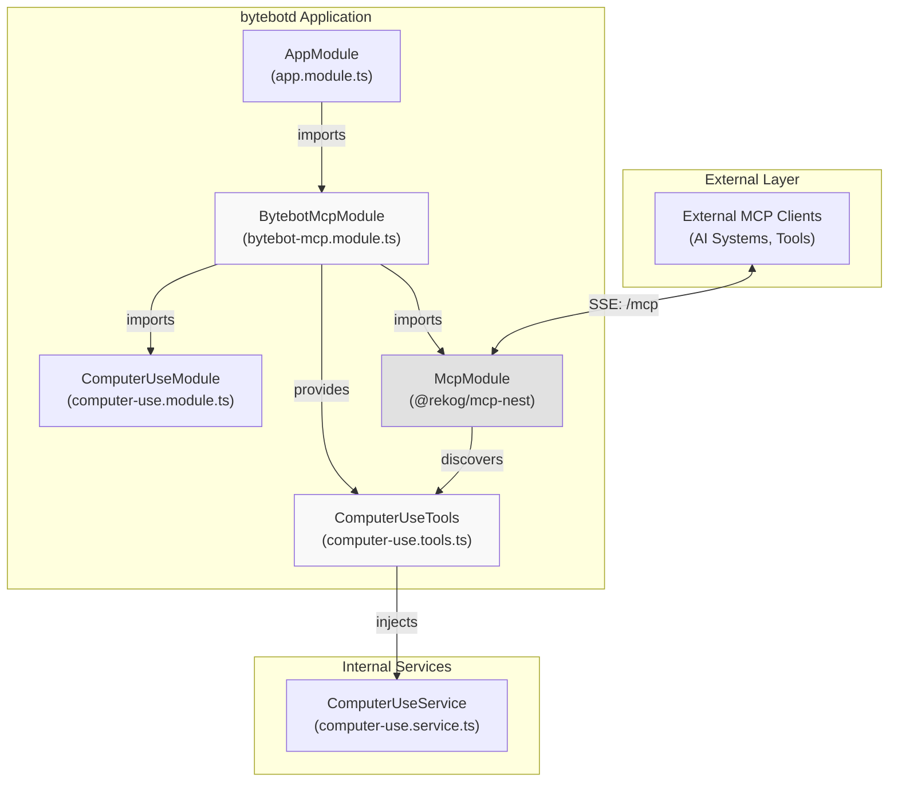
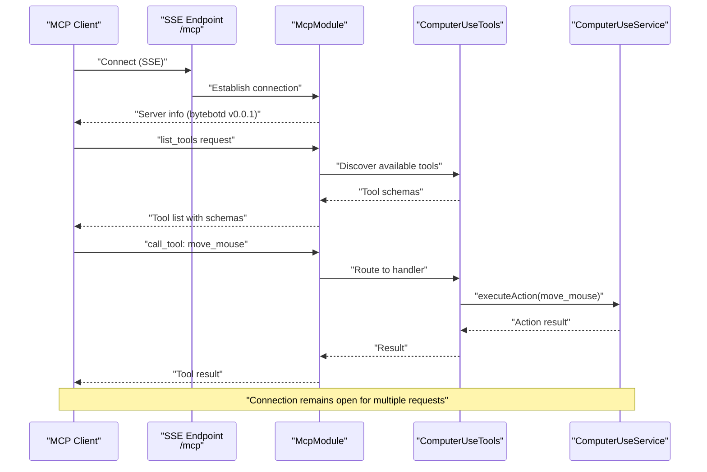
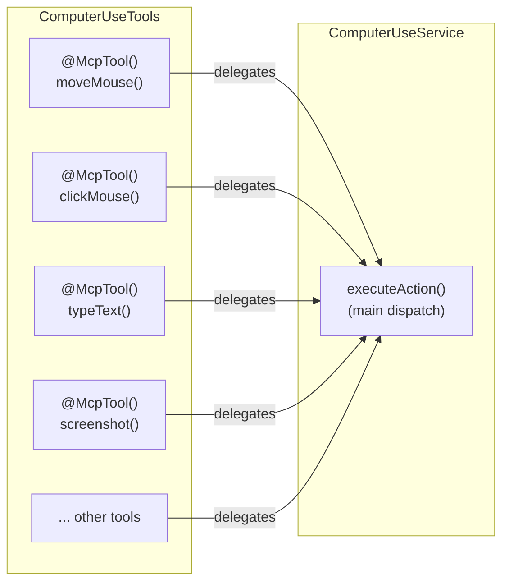
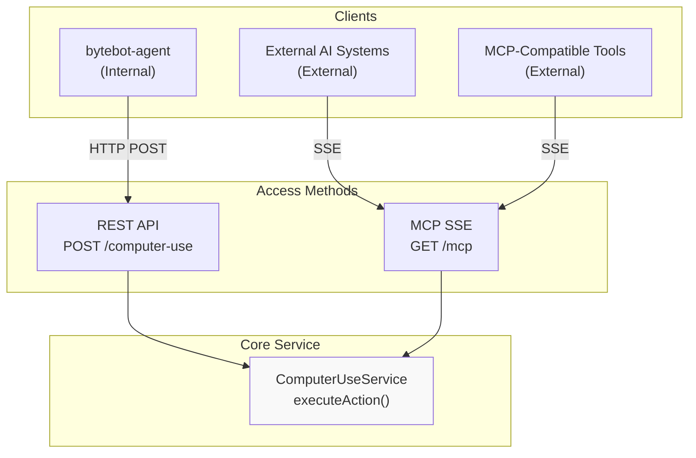

<!-- source: DeepWiki mcp.deepwiki.com · repo bytebot-ai/bytebot · page 7.3 MCP Integration · fetched 2026-10-29 -->

# MCP Integration

<details>
<summary>Relevant source files</summary>

The following files were used as context for generating this wiki page:

- [packages/bytebotd/package-lock.json](packages/bytebotd/package-lock.json)
- [packages/bytebotd/package.json](packages/bytebotd/package.json)
- [packages/bytebotd/src/app.controller.ts](packages/bytebotd/src/app.controller.ts)
- [packages/bytebotd/src/app.module.ts](packages/bytebotd/src/app.module.ts)
- [packages/bytebotd/src/mcp/bytebot-mcp.module.ts](packages/bytebotd/src/mcp/bytebot-mcp.module.ts)
- [packages/bytebotd/src/mcp/index.ts](packages/bytebotd/src/mcp/index.ts)

</details>


## Purpose and Scope

This document describes the Model Context Protocol (MCP) integration in the bytebotd service. MCP provides a standardized way for AI systems to discover and invoke tools via Server-Sent Events (SSE). The integration exposes computer automation capabilities as MCP-compliant tools, enabling external AI agents to control the virtual desktop.

For information about the underlying computer automation capabilities, see [Computer Use Service](#7.1). For details on the individual desktop actions available, see [Desktop Tools](#7.2). For the REST API alternative, see [Computer Use API](#10.2).

---

## Overview

The MCP integration serves as an alternative interface to the computer automation system. While the REST API at `POST /computer-use` is used by the bytebot-agent service for task execution, the MCP endpoint at `/mcp` allows external AI systems and tools to discover and invoke the same capabilities through a standardized protocol.

### Key Characteristics

| Feature | Description |
|---------|-------------|
| **Protocol** | Server-Sent Events (SSE) for bidirectional communication |
| **Endpoint** | `/mcp` on port 9990 |
| **Library** | `@rekog/mcp-nest` v1.6.2 |
| **Exposed Tools** | All computer automation actions from ComputerUseService |
| **Use Case** | External AI agent integration, tool discovery, remote desktop control |

**Sources:** [packages/bytebotd/package.json:38](), [packages/bytebotd/src/mcp/bytebot-mcp.module.ts:9-13]()

---

## Module Architecture



**Module Structure Diagram** - Shows the NestJS module hierarchy and MCP integration point

The `BytebotMcpModule` serves as the integration point between the MCP protocol library and the computer automation system. It imports `ComputerUseModule` to access the underlying automation services and configures `McpModule` with the SSE endpoint.

**Sources:** [packages/bytebotd/src/app.module.ts:21](), [packages/bytebotd/src/mcp/bytebot-mcp.module.ts:1-17]()

---

## BytebotMcpModule Configuration

The module is defined in [packages/bytebotd/src/mcp/bytebot-mcp.module.ts:6-17]() and follows NestJS module conventions:

```typescript
@Module({
  imports: [
    ComputerUseModule,
    McpModule.forRoot({
      name: 'bytebotd',
      version: '0.0.1',
      sseEndpoint: '/mcp',
    }),
  ],
  providers: [ComputerUseTools],
})
export class BytebotMcpModule {}
```

### Configuration Properties

| Property | Value | Purpose |
|----------|-------|---------|
| `name` | `'bytebotd'` | Service identifier for MCP clients |
| `version` | `'0.0.1'` | Version number exposed to clients |
| `sseEndpoint` | `'/mcp'` | URL path where SSE connection is established |

The `McpModule.forRoot()` method sets up the SSE server infrastructure, tool discovery mechanism, and protocol handlers. The module automatically discovers providers decorated with MCP tool decorators (like `ComputerUseTools`) and exposes them through the SSE endpoint.

**Sources:** [packages/bytebotd/src/mcp/bytebot-mcp.module.ts:6-17]()

---

## SSE Communication Flow



**MCP SSE Communication Flow** - Shows the lifecycle of tool discovery and invocation

The SSE connection provides a persistent channel for:
1. **Discovery**: Clients can query available tools and their schemas
2. **Invocation**: Clients can call tools with typed parameters
3. **Streaming**: Real-time results and events can be pushed to clients

Unlike the REST API, the SSE connection remains open, allowing for efficient repeated tool calls without connection overhead.

**Sources:** [packages/bytebotd/src/mcp/bytebot-mcp.module.ts:12]()

---

## ComputerUseTools Provider

While the specific implementation of `ComputerUseTools` is not visible in the provided files, based on the module structure and MCP conventions, this provider:

1. **Decorates methods** with `@McpTool()` or similar decorators to expose them
2. **Injects ComputerUseService** to delegate actual computer automation
3. **Defines schemas** for each tool's parameters using the MCP protocol format
4. **Handles errors** and formats responses according to MCP standards

### Expected Tool Exposure Pattern



**Tool Delegation Pattern** - Each MCP tool method delegates to ComputerUseService.executeAction()

The tools exposed through MCP correspond to the same action types available through the REST API (see [Desktop Tools](#7.2) for the complete list of 17 actions).

**Sources:** [packages/bytebotd/src/mcp/bytebot-mcp.module.ts:4](), [packages/bytebotd/src/mcp/bytebot-mcp.module.ts:15]()

---

## Client Integration

External MCP clients connect to the bytebotd SSE endpoint to access desktop automation:

### Connection URL

```
http://localhost:9990/mcp
```

Or in production/Docker environments:
```
http://bytebotd:9990/mcp
```

### Client Workflow

1. **Establish SSE Connection**: Client opens connection to `/mcp` endpoint
2. **Receive Server Info**: Server sends service name and version
3. **List Tools**: Client sends `list_tools` message to discover capabilities
4. **Validate Schemas**: Client receives tool schemas with parameter types
5. **Invoke Tools**: Client sends `call_tool` messages with typed parameters
6. **Process Results**: Client receives tool execution results

### MCP Protocol Messages

| Message Type | Direction | Purpose |
|--------------|-----------|---------|
| `initialize` | Client → Server | Establish protocol version |
| `initialized` | Server → Client | Confirm initialization |
| `list_tools` | Client → Server | Request available tools |
| `tools_list` | Server → Client | Send tool schemas |
| `call_tool` | Client → Server | Execute a specific tool |
| `tool_result` | Server → Client | Return execution result |

**Sources:** [packages/bytebotd/src/mcp/bytebot-mcp.module.ts:12]()

---

## Integration Points



**Access Method Comparison** - Two interfaces to the same underlying automation service

### REST API vs MCP SSE

| Aspect | REST API | MCP SSE |
|--------|----------|---------|
| **Protocol** | HTTP POST | Server-Sent Events |
| **Connection** | Request-response | Persistent connection |
| **Discovery** | Fixed schema | Dynamic tool discovery |
| **Primary User** | bytebot-agent | External AI systems |
| **Endpoint** | `/computer-use` | `/mcp` |
| **Standards** | Custom | MCP protocol |

Both interfaces provide access to the identical set of computer automation actions. The REST API is optimized for the internal agent's observe-act loop, while MCP enables standardized integration with external AI frameworks and tools.

**Sources:** [packages/bytebotd/src/mcp/bytebot-mcp.module.ts:1-17](), [packages/bytebotd/src/app.module.ts:21]()

---

## Module Exports

The module's public interface is defined in [packages/bytebotd/src/mcp/index.ts:1]():

```typescript
export * from './bytebot-mcp.module';
```

This makes `BytebotMcpModule` available for import by the main `AppModule` at [packages/bytebotd/src/app.module.ts:8]().

**Sources:** [packages/bytebotd/src/mcp/index.ts:1](), [packages/bytebotd/src/app.module.ts:8]()

---

## Dependencies

The MCP integration relies on the following packages:

| Package | Version | Purpose |
|---------|---------|---------|
| `@rekog/mcp-nest` | ^1.6.2 | MCP protocol implementation for NestJS |
| `@nestjs/common` | ^11.1.2 | NestJS core module decorators |
| `@nestjs/core` | ^11.0.1 | NestJS dependency injection |

The `@rekog/mcp-nest` library provides:
- SSE server infrastructure
- MCP protocol message handling
- Tool discovery and registration
- Schema validation
- Error handling

**Sources:** [packages/bytebotd/package.json:38](), [packages/bytebotd/package.json:30-32]()

---

## Deployment Configuration

The MCP endpoint is exposed through the main bytebotd service on port 9990. In Docker deployments, this port is mapped to the host, making the SSE endpoint accessible at:

```
http://localhost:9990/mcp
```

No additional configuration is required beyond the standard bytebotd service setup. The endpoint is automatically available when the service starts.

For Railway or other cloud deployments, ensure that:
1. Port 9990 is exposed
2. SSE connections are allowed by the load balancer/proxy
3. Long-lived connections are supported (SSE requires persistent HTTP connections)

**Sources:** [packages/bytebotd/src/mcp/bytebot-mcp.module.ts:12]()

---

