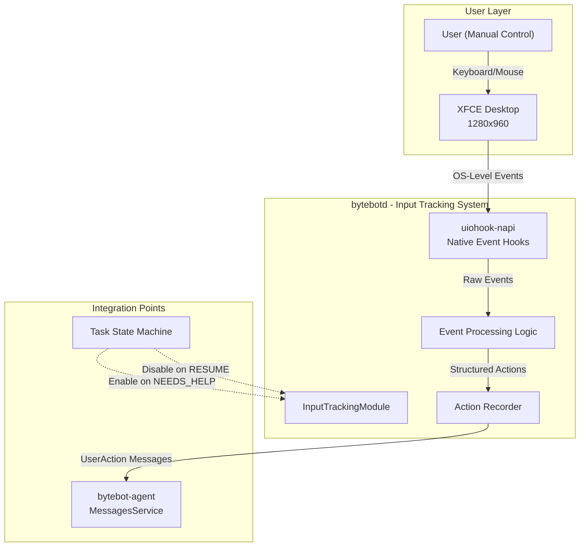
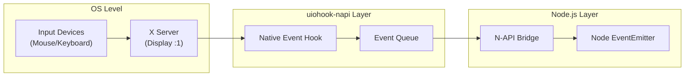
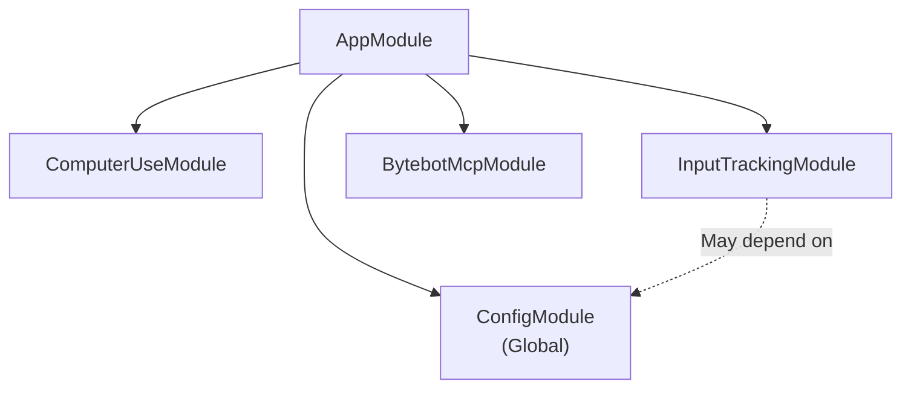
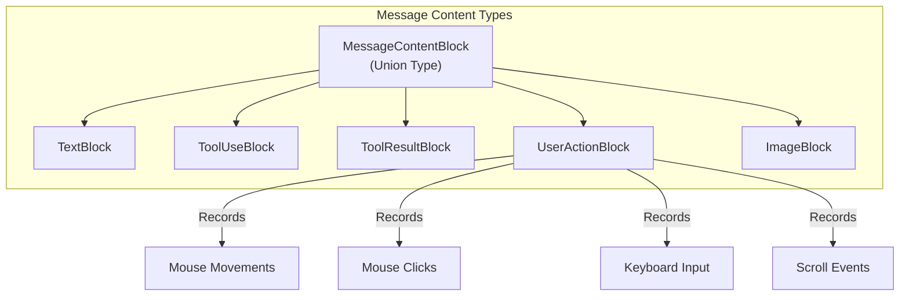
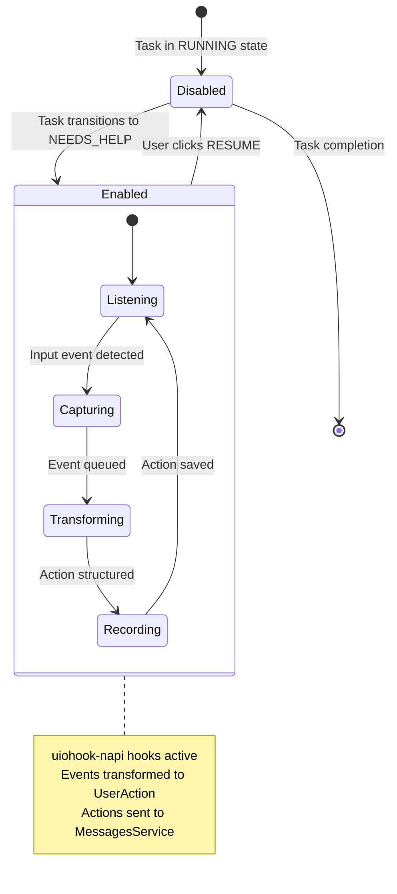
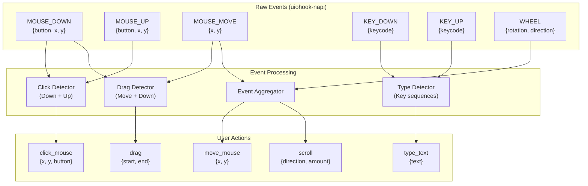
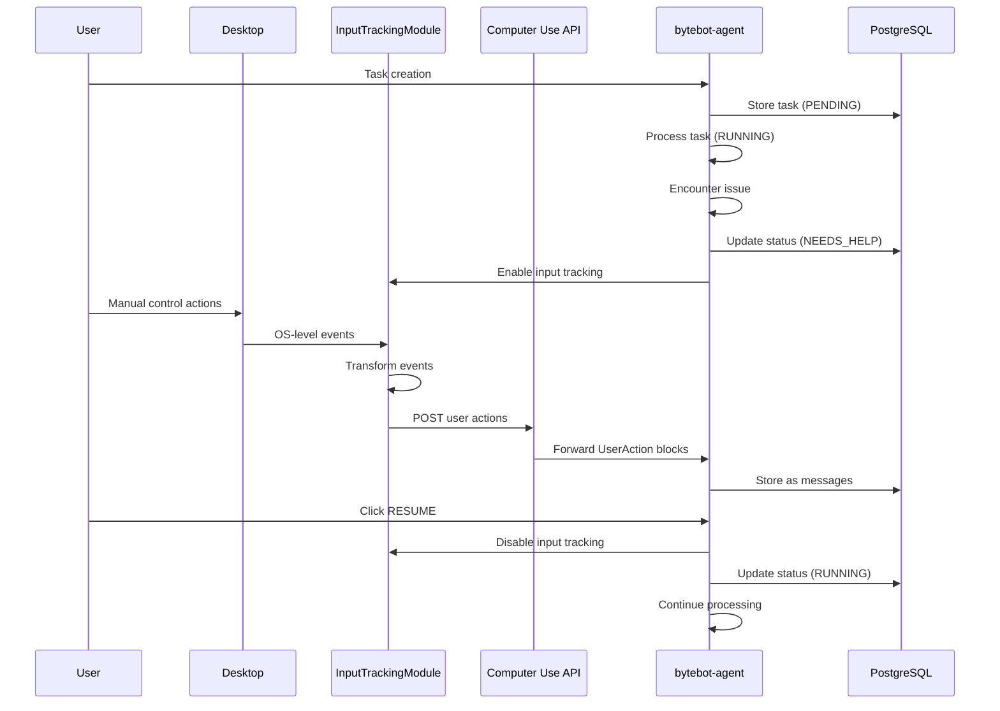

<!-- source: DeepWiki mcp.deepwiki.com · repo bytebot-ai/bytebot · page 7.4 Input Tracking · fetched 2026-10-29 -->

# Input Tracking

Relevant source files

The following files were used as context for generating this wiki page:

- [packages/bytebotd/package-lock.json](packages/bytebotd/package-lock.json)
- [packages/bytebotd/package.json](packages/bytebotd/package.json)
- [packages/bytebotd/src/app.controller.ts](packages/bytebotd/src/app.controller.ts)
- [packages/bytebotd/src/app.module.ts](packages/bytebotd/src/app.module.ts)
- [packages/bytebotd/src/mcp/bytebot-mcp.module.ts](packages/bytebotd/src/mcp/bytebot-mcp.module.ts)
- [packages/bytebotd/src/mcp/index.ts](packages/bytebotd/src/mcp/index.ts)

## Purpose and Scope

This document describes the input tracking system in bytebotd, which captures user keyboard and mouse events during manual control sessions. The system uses the `uiohook-napi` library to monitor user interactions and record them as structured actions that can be processed by the AI agent.

For information about executing computer actions programmatically, see [Computer Use Service](#7.1). For details on specific desktop automation tools, see [Desktop Tools](#7.2).

**Sources:** [packages/bytebotd/src/app.module.ts:1-27]()

---

## System Architecture

The Input Tracking system is implemented as a NestJS module within bytebotd and operates as a passive monitoring layer that captures low-level input events and transforms them into high-level user actions.

**Diagram: Input Tracking Architecture**

The system operates in three stages:
1. **Event Capture**: uiohook-napi hooks into OS-level input events
2. **Event Processing**: Raw events are transformed into meaningful actions
3. **Action Recording**: Structured actions are stored as message content blocks

**Sources:** [packages/bytebotd/src/app.module.ts:1-27](), [packages/bytebotd/package.json:46]()

---

## uiohook-napi Integration

### Library Overview

The bytebotd service uses `uiohook-napi` version 1.5.4 as its input capture backend. This library provides cross-platform native bindings for capturing global keyboard and mouse events at the operating system level.

| Feature | Details |
|---------|---------|
| **Package** | `uiohook-napi@1.5.4` |
| **Type** | Native Addon (N-API) |
| **Scope** | Global input event capture |
| **Platform** | Linux (Ubuntu 22.04 in container) |
| **Events Captured** | Mouse movement, clicks, keyboard presses/releases, wheel events |

**Sources:** [packages/bytebotd/package.json:46]()

### Event Hook Implementation

**Diagram: uiohook-napi Event Capture Pipeline**

The library operates by:
1. Installing global event hooks at the X Server level
2. Capturing events before they reach application windows
3. Queueing events for processing by the Node.js runtime
4. Exposing events through a Node.js EventEmitter interface

**Sources:** [packages/bytebotd/package.json:28-46]()

---

## InputTrackingModule Structure

### Module Configuration

The `InputTrackingModule` is registered in the root `AppModule` and operates as a global service within bytebotd.

**Diagram: InputTrackingModule in App Structure**

The module is imported alongside other core modules:
- **ComputerUseModule**: Handles outbound actions (agent → desktop)
- **InputTrackingModule**: Handles inbound events (user → system)
- **BytebotMcpModule**: Provides MCP management interface

**Sources:** [packages/bytebotd/src/app.module.ts:1-27]()

### Module Dependencies

The InputTrackingModule likely provides:
- An event listener service that subscribes to uiohook-napi events
- An action transformation service that converts raw events to user actions
- Integration hooks for notifying the bytebot-agent service of captured actions

**Sources:** [packages/bytebotd/src/app.module.ts:19-20]()

---

## User Action Recording

### Action Data Structure

When a user takes manual control of a task (status = `NEEDS_HELP`), the input tracking system records their actions as `UserAction` content blocks within the message stream.

**Diagram: UserAction in Message Content Type Hierarchy**

The `UserAction` content block structure includes:
- **Action Type**: The type of input (click, type, move, scroll)
- **Parameters**: Action-specific data (coordinates, text, button)
- **Timestamp**: When the action occurred
- **Metadata**: Additional context (modifier keys, duration)

**Sources:** [packages/bytebotd/src/app.module.ts:19-20]()

### Recording Lifecycle

**Diagram: Input Tracking State Machine**

The recording lifecycle is controlled by task state:
1. **Disabled State**: No event capture when agent is in control
2. **Transition to NEEDS_HELP**: Input tracking begins
3. **Active Recording**: User actions are captured and stored
4. **Transition to RUNNING**: Input tracking stops when user resumes agent

**Sources:** [packages/bytebotd/src/app.module.ts:1-27]()

---

## Event Processing Pipeline

### Raw Event to Action Transformation

The input tracking system transforms low-level OS events into high-level actions that the AI agent can understand and potentially replay.

**Diagram: Event Processing and Action Detection**

The transformation process includes:
- **Event Aggregation**: Grouping related events (e.g., key presses into words)
- **Pattern Detection**: Identifying high-level actions from event sequences
- **Noise Filtering**: Ignoring spurious events (e.g., small mouse movements)
- **Action Structuring**: Creating well-formed action objects matching ComputerAction schema

**Sources:** [packages/bytebotd/package.json:46]()

### Event Filtering and Debouncing

| Event Type | Processing Strategy | Rationale |
|------------|-------------------|-----------|
| **Mouse Move** | Debounced (sampled at intervals) | Reduces noise from continuous movement |
| **Mouse Click** | Immediate capture | Critical interaction points |
| **Key Press** | Buffered into sequences | Groups characters into words/commands |
| **Scroll** | Aggregated by direction | Combines multiple wheel events |
| **Modifier Keys** | State tracking | Captures Ctrl, Shift, Alt context |

The filtering logic ensures that only meaningful user actions are recorded, avoiding log spam from minor cursor adjustments.

**Sources:** [packages/bytebotd/src/app.module.ts:19-20]()

---

## Integration with Task System

### Communication with bytebot-agent

The input tracking system communicates captured actions back to the bytebot-agent service, where they are stored in the message history for context.

**Diagram: Input Tracking Integration Flow**

The integration flow:
1. Agent sets task to `NEEDS_HELP` when user intervention is required
2. Input tracking is enabled on the bytebotd side
3. User actions are captured and sent to bytebot-agent via internal API
4. Actions are stored as `UserAction` message content blocks
5. When user clicks "RESUME", input tracking is disabled
6. Agent continues with full context of user's manual actions

**Sources:** [packages/bytebotd/src/app.module.ts:1-27]()

### UserAction Message Format

The captured user actions are stored as messages with role `USER` and content type `UserAction`:

| Field | Type | Description |
|-------|------|-------------|
| **type** | `"user_action"` | Identifies this as a user action block |
| **action** | `string` | Action name (e.g., "click_mouse", "type_text") |
| **parameters** | `object` | Action-specific parameters matching ComputerAction schema |
| **timestamp** | `number` | Unix timestamp in milliseconds |
| **sequence** | `number` | Sequential order within the session |

These UserAction blocks are interspersed with other message types in the conversation history, providing the agent with a complete picture of what the user did during manual control.

**Sources:** [packages/bytebotd/src/app.module.ts:19-20]()

---

## Configuration and Control

### Environment Variables

The input tracking system may be configured through environment variables in bytebotd:

| Variable | Purpose | Default |
|----------|---------|---------|
| `INPUT_TRACKING_ENABLED` | Enable/disable tracking globally | `true` |
| `INPUT_TRACKING_SAMPLE_RATE` | Mouse move sampling rate (ms) | `100` |
| `INPUT_TRACKING_DEBOUNCE` | Key press debounce period (ms) | `50` |

**Note**: Actual configuration variables would be defined in the ConfigModule and consumed by the InputTrackingModule.

**Sources:** [packages/bytebotd/src/app.module.ts:12-14]()

### Runtime Control

Input tracking can be controlled at runtime through:
- **Task State Transitions**: Automatically enabled/disabled based on task status
- **WebSocket Commands**: Manual enable/disable via administrative interface
- **MCP Tools**: Management commands through the MCP endpoint

**Sources:** [packages/bytebotd/src/mcp/bytebot-mcp.module.ts:1-18]()

---

## Performance Considerations

### Resource Usage

| Metric | Impact | Mitigation Strategy |
|--------|--------|---------------------|
| **CPU Overhead** | Event processing in real-time | Event debouncing and sampling |
| **Memory Usage** | Event queue buffering | Bounded queue size with overflow handling |
| **Network Traffic** | Sending actions to bytebot-agent | Batching multiple actions in single requests |
| **Disk I/O** | Database writes for messages | Handled by bytebot-agent's message batching |

The input tracking system is designed to have minimal performance impact on the desktop environment while providing comprehensive action recording.

**Sources:** [packages/bytebotd/package.json:28-46]()

### Event Throughput

Under typical usage:
- **Mouse events**: 10-50 per second during active movement
- **Keyboard events**: 5-20 per second during typing
- **Processed actions**: 1-5 per second after aggregation
- **Network requests**: 1-2 per second to bytebot-agent

The aggregation and debouncing logic significantly reduces the downstream load while preserving all meaningful user actions.

**Sources:** [packages/bytebotd/src/app.module.ts:19-20]()

---

## Summary

The Input Tracking system provides essential functionality for human-in-the-loop AI workflows by:

1. **Capturing user input** via native OS hooks using uiohook-napi
2. **Transforming low-level events** into structured, meaningful actions
3. **Recording actions** as UserAction message content blocks
4. **Integrating with task lifecycle** through automatic enable/disable based on task state
5. **Maintaining context** for the AI agent to learn from human demonstrations

This system enables the agent to observe and potentially learn from user interventions, creating a feedback loop that improves the AI's capabilities over time.

**Sources:** [packages/bytebotd/src/app.module.ts:1-27](), [packages/bytebotd/package.json:46]()

---

