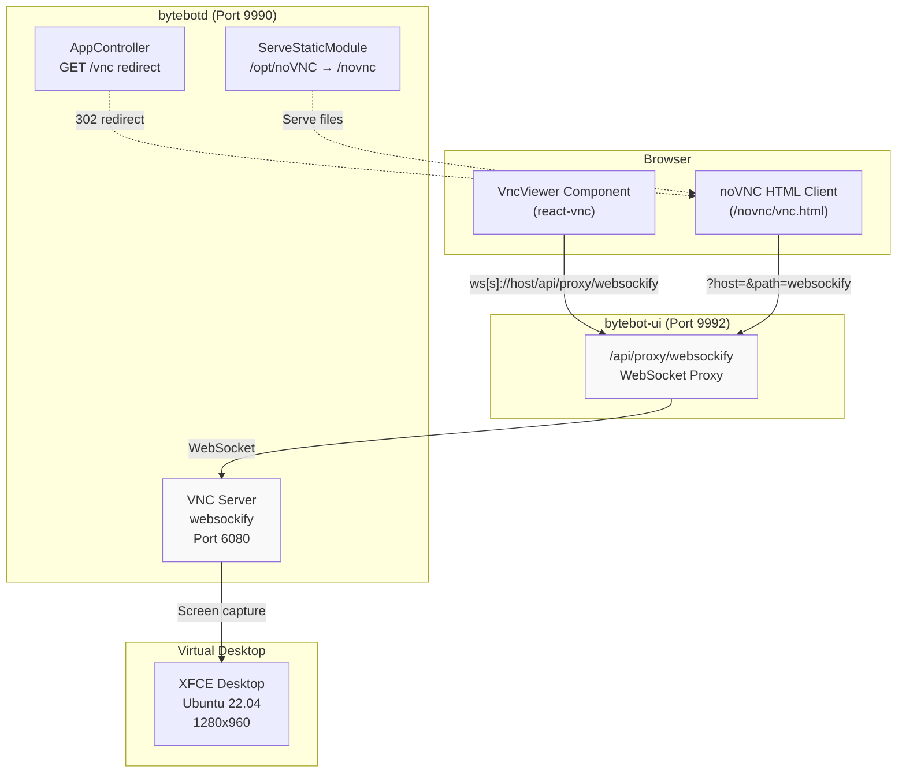
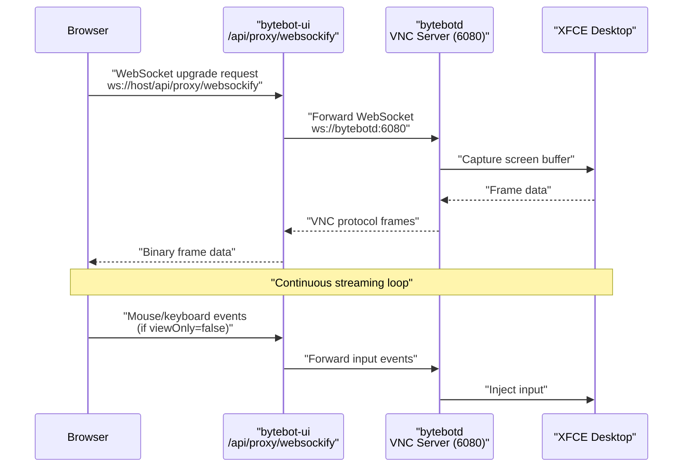

<!-- source: DeepWiki mcp.deepwiki.com · repo bytebot-ai/bytebot · page 7.5 VNC Access · fetched 2026-10-29 -->

# VNC Access

<details>
<summary>Relevant source files</summary>

The following files were used as context for generating this wiki page:

- [packages/bytebot-ui/.gitignore](packages/bytebot-ui/.gitignore)
- [packages/bytebot-ui/src/components/vnc/VncViewer.tsx](packages/bytebot-ui/src/components/vnc/VncViewer.tsx)
- [packages/bytebot-ui/src/utils/taskUtils.ts](packages/bytebot-ui/src/utils/taskUtils.ts)
- [packages/bytebotd/package-lock.json](packages/bytebotd/package-lock.json)
- [packages/bytebotd/package.json](packages/bytebotd/package.json)
- [packages/bytebotd/src/app.controller.ts](packages/bytebotd/src/app.controller.ts)
- [packages/bytebotd/src/app.module.ts](packages/bytebotd/src/app.module.ts)
- [packages/bytebotd/src/mcp/bytebot-mcp.module.ts](packages/bytebotd/src/mcp/bytebot-mcp.module.ts)
- [packages/bytebotd/src/mcp/index.ts](packages/bytebotd/src/mcp/index.ts)

</details>


This document explains the VNC (Virtual Network Computing) access system that enables browser-based viewing and control of the bytebotd desktop environment. VNC access provides real-time visual feedback during task execution and allows users to monitor or manually interact with the XFCE desktop.

For information about desktop automation and action execution, see [Computer Use Service](#7.1). For details on input capture during user takeover, see [Input Tracking](#7.4). For the UI component that displays the desktop stream, see [Desktop Viewer](#8.4).

---

## Architecture Overview

The VNC access system consists of three layers: the noVNC web client, a WebSocket proxy in bytebot-ui, and the VNC server in bytebotd. This architecture allows secure browser-based access without requiring VNC client software installation.



**Sources:** [packages/bytebot-ui/src/components/vnc/VncViewer.tsx:1-48](), [packages/bytebotd/src/app.controller.ts:1-19](), [packages/bytebotd/src/app.module.ts:1-27]()

---

## noVNC Static Files

The bytebotd service serves the noVNC web client as static files. The `ServeStaticModule` configuration maps the `/opt/noVNC` directory to the `/novnc` web path.

| Configuration | Value |
|---------------|-------|
| Physical path | `/opt/noVNC` |
| Web route | `/novnc` |
| Entry point | `/novnc/vnc.html` |
| Module | `@nestjs/serve-static` |

The noVNC client provides a full-featured VNC viewer implemented in JavaScript, supporting keyboard and mouse input when `viewOnly` is disabled.

**Configuration:**
[packages/bytebotd/src/app.module.ts:15-18]()

```typescript
ServeStaticModule.forRoot({
  rootPath: '/opt/noVNC',
  serveRoot: '/novnc',
})
```

**Sources:** [packages/bytebotd/src/app.module.ts:1-27]()

---

## VNC Redirect Endpoint

The bytebotd service exposes a convenience endpoint at `GET /vnc` that redirects to the noVNC client with pre-configured connection parameters.

### Redirect Controller

[packages/bytebotd/src/app.controller.ts:8-17]()

| Parameter | Description |
|-----------|-------------|
| `host` | Server hostname from request headers |
| `path` | WebSocket path: `websockify` |
| `resize` | Viewport scaling: `scale` |

The redirect URL is constructed dynamically using the `host` header from the incoming request, ensuring correct connection parameters regardless of how the service is accessed.

**Example redirect:**
```
GET /vnc
→ 302 /novnc/vnc.html?host=localhost:9990&path=websockify&resize=scale
```

**Sources:** [packages/bytebotd/src/app.controller.ts:1-19]()

---

## WebSocket Proxy Architecture

The bytebot-ui frontend proxies VNC WebSocket connections to bytebotd. This proxy allows the React application to connect to VNC through a single origin, avoiding CORS issues and simplifying deployment.



**Sources:** High-level architecture diagrams, [packages/bytebot-ui/src/components/vnc/VncViewer.tsx:22-26]()

---

## VncViewer React Component

The `VncViewer` component provides browser-based VNC access using the `react-vnc` library. It dynamically constructs the WebSocket URL and renders the VNC client.

### Component Implementation

[packages/bytebot-ui/src/components/vnc/VncViewer.tsx:1-48]()

| Prop | Type | Default | Description |
|------|------|---------|-------------|
| `viewOnly` | boolean | `true` | Disable mouse/keyboard input |

### WebSocket URL Construction

The component builds the WebSocket URL based on the current page protocol:

```typescript
const proto = window.location.protocol === "https:" ? "wss" : "ws";
const wsUrl = `${proto}://${window.location.host}/api/proxy/websockify`;
```

This ensures TLS is used for WebSocket connections when the page is served over HTTPS.

### RFB Options

| Option | Value | Purpose |
|--------|-------|---------|
| `secure` | `false` | Encryption handled by proxy |
| `shared` | `true` | Allow multiple connections |
| `wsProtocols` | `["binary"]` | Use binary WebSocket protocol |
| `scaleViewport` | `true` | Scale to fit container |

### Dynamic Import

The component uses dynamic import for `react-vnc` to ensure client-side only loading:

[packages/bytebot-ui/src/components/vnc/VncViewer.tsx:16-19]()

This prevents SSR (Server-Side Rendering) issues since VNC requires browser APIs.

**Sources:** [packages/bytebot-ui/src/components/vnc/VncViewer.tsx:1-48]()

---

## Connection Flow

The complete flow from user action to desktop visualization involves multiple service layers and protocol conversions.

```mermaid
graph LR
    User["User Browser"]
    UIComp["VncViewer<br/>Component"]
    ReactVNC["react-vnc<br/>Library"]
    WSConn["WebSocket<br/>Connection"]
    UIServer["bytebot-ui<br/>Next.js Server"]
    Proxy["http-proxy-<br/>middleware"]
    BytebotdWS["bytebotd<br/>WebSocket<br/>Handler"]
    VncProto["VNC Server<br/>Port 6080"]
    XDisplay["X11 Display<br/>:99"]
    
    User -->|"Navigate to<br/>/tasks/[id]"| UIComp
    UIComp -->|"Mount & connect"| ReactVNC
    ReactVNC -->|"ws[s]://host/api/<br/>proxy/websockify"| WSConn
    WSConn -->|"Upgrade request"| UIServer
    UIServer -->|"Proxy config"| Proxy
    Proxy -->|"Forward to<br/>bytebotd:6080"| BytebotdWS
    BytebotdWS -->|"VNC handshake"| VncProto
    VncProto -->|"Screen capture"| XDisplay
    
    XDisplay -.->|"Frame buffer"| VncProto
    VncProto -.->|"RFB protocol"| BytebotdWS
    BytebotdWS -.->|"Binary frames"| Proxy
    Proxy -.->|"Forward"| UIServer
    UIServer -.->|"WebSocket data"| WSConn
    WSConn -.->|"Render frames"| ReactVNC
    ReactVNC -.->|"Display canvas"| UIComp
    UIComp -.->|"Show to user"| User
    
    style VncProto fill:#f9f9f9
    style Proxy fill:#f9f9f9
```



**Sources:** [packages/bytebot-ui/src/components/vnc/VncViewer.tsx:1-48](), High-level architecture diagrams

---

## Access Methods

Users can access the VNC desktop through two primary methods:

### 1. Task Detail Page (Recommended)

The `VncViewer` component is embedded in the task detail page as part of the `DesktopContainer`. This provides integrated viewing alongside task messages and controls.

- **Route:** `/tasks/[taskId]`
- **Component:** `VncViewer` with `viewOnly={true}`
- **Use case:** Monitoring agent activity during task execution
- **Reference:** See [Desktop Viewer](#8.4) for UI integration details

### 2. Direct noVNC Access

Users can access the full noVNC client directly for advanced features or manual interaction.

- **Route:** `http://bytebotd:9990/vnc` (redirects to noVNC)
- **Client:** Full-featured noVNC HTML interface
- **Use case:** Manual desktop control, troubleshooting
- **Note:** Requires network access to bytebotd service

**Sources:** [packages/bytebot-ui/src/components/vnc/VncViewer.tsx:1-48](), [packages/bytebotd/src/app.controller.ts:8-17]()

---

## Technical Details

### Port Configuration

| Service | Port | Protocol | Purpose |
|---------|------|----------|---------|
| bytebotd VNC | 6080 | WebSocket | VNC server endpoint |
| bytebot-ui proxy | 9992 | HTTP/WS | User-facing VNC proxy |
| bytebotd HTTP | 9990 | HTTP | noVNC static files |

### Protocol Stack

The VNC access system uses multiple protocol layers:

1. **RFB (Remote Framebuffer Protocol):** Core VNC protocol for screen data and input
2. **WebSocket:** Transport layer for browser compatibility
3. **HTTP/HTTPS:** Initial connection and upgrade negotiation
4. **Binary Protocol:** Efficient frame data transmission using `wsProtocols: ["binary"]`

### Security Considerations

- **View-Only Mode:** Default configuration prevents accidental input during monitoring
- **Proxy Isolation:** WebSocket proxy prevents direct bytebotd exposure
- **Shared Access:** Multiple users can view simultaneously with `shared: true`
- **No TLS Termination:** Encryption handled at the proxy layer, not VNC server

**Sources:** [packages/bytebot-ui/src/components/vnc/VncViewer.tsx:32-36](), [packages/bytebotd/package.json:1-93]()

---

## Integration with Desktop Viewer

The `VncViewer` component is consumed by the `DesktopContainer` component, which provides adaptive rendering between VNC streaming and static screenshots based on task state.

When task status is `RUNNING`, the desktop viewer switches to VNC streaming mode, allowing real-time observation of agent actions. For completed or paused tasks, static screenshots provide a more efficient viewing experience.

For details on this adaptive rendering logic, see [Desktop Viewer](#8.4).

**Sources:** [packages/bytebot-ui/src/components/vnc/VncViewer.tsx:1-48]()

---

