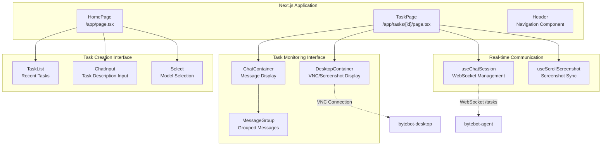
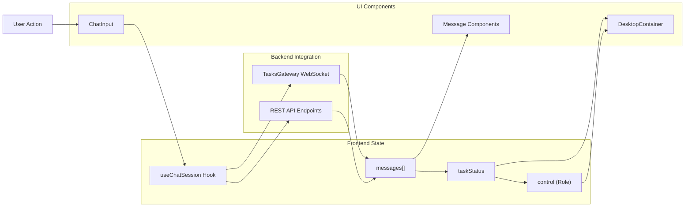
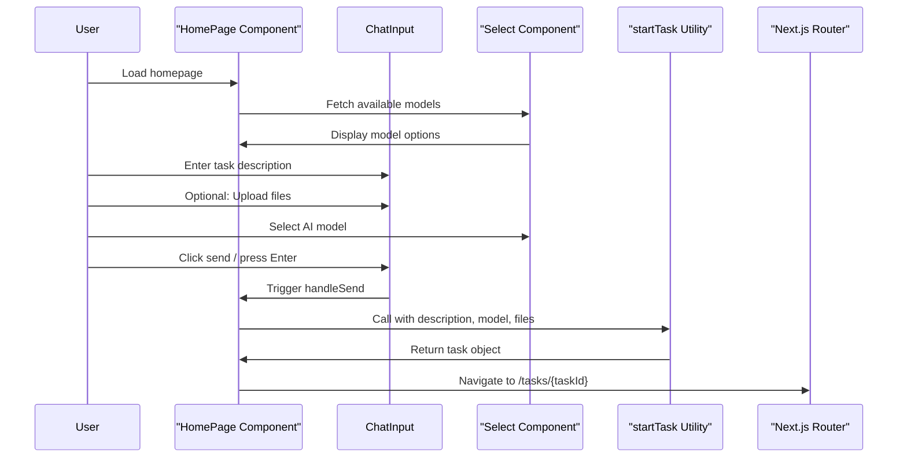
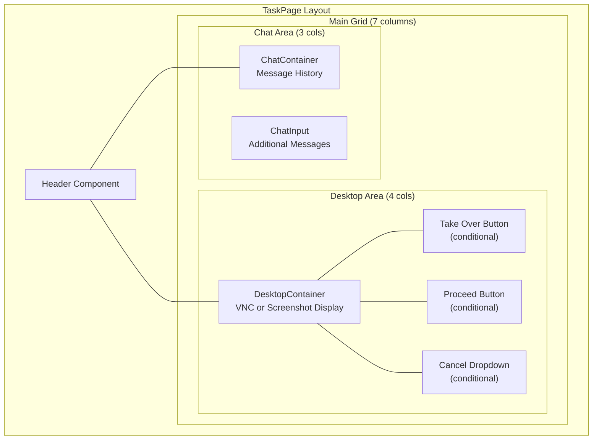
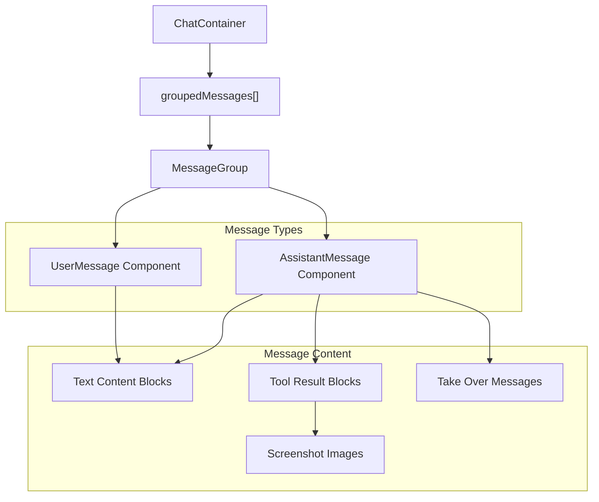
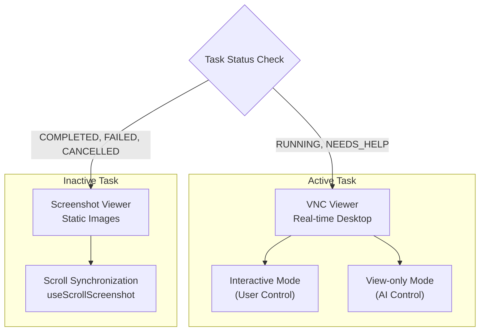
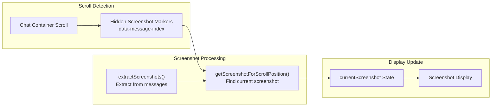
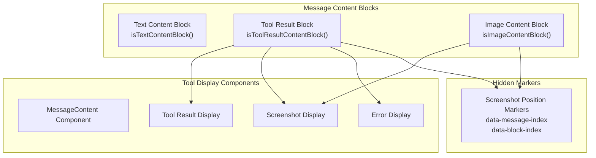
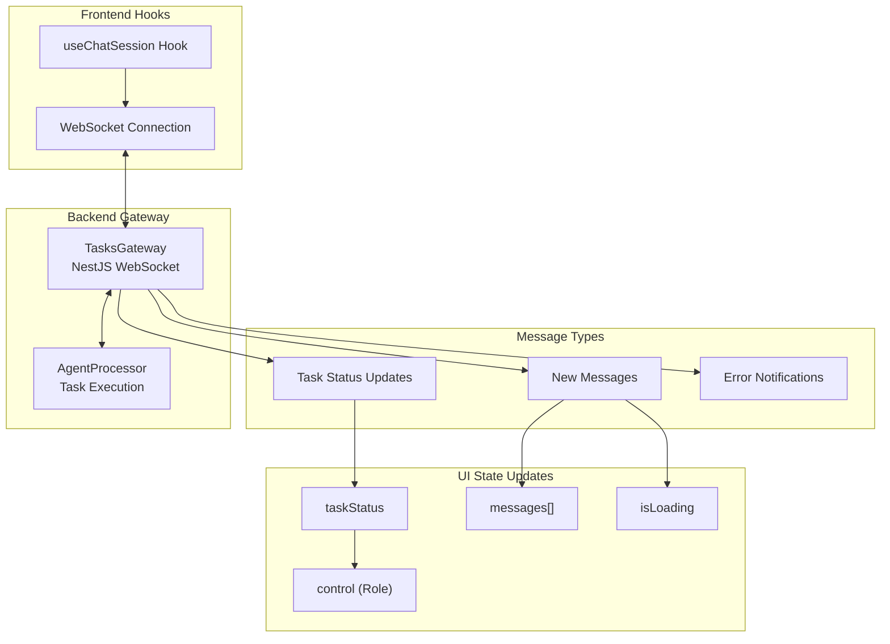

<!-- source: DeepWiki mcp.deepwiki.com · repo bytebot-ai/bytebot · page 8 User Interface · fetched 2026-10-29 -->

# User Interface

Relevant source files

The following files were used as context for generating this wiki page:

- [packages/bytebot-ui/package-lock.json](packages/bytebot-ui/package-lock.json)
- [packages/bytebot-ui/package.json](packages/bytebot-ui/package.json)
- [packages/bytebot-ui/src/app/layout.tsx](packages/bytebot-ui/src/app/layout.tsx)
- [packages/bytebot-ui/src/app/page.tsx](packages/bytebot-ui/src/app/page.tsx)
- [packages/bytebot-ui/src/components/layout/Header.tsx](packages/bytebot-ui/src/components/layout/Header.tsx)
- [packages/bytebot-ui/src/components/messages/ChatInput.tsx](packages/bytebot-ui/src/components/messages/ChatInput.tsx)
- [packages/bytebot-ui/src/components/ui/select.tsx](packages/bytebot-ui/src/components/ui/select.tsx)

The user interface provides a web-based frontend for creating, managing, and monitoring AI-powered desktop automation tasks. Built with Next.js, it offers real-time task monitoring, chat-based interaction, and integrated desktop viewing capabilities.

This document covers the frontend web application components and user interaction patterns. For backend task processing, see [Agent System](#6). For desktop environment details, see [Desktop Environment](#5). For deployment configuration, see [Installation and Setup](#3).

## Architecture Overview

The UI is built as a Next.js application with two primary interfaces: a task creation homepage and detailed task monitoring pages. The architecture emphasizes real-time communication through WebSocket connections and seamless integration with the virtual desktop environment.

### Component Architecture

**Sources:** [packages/bytebot-ui/src/app/page.tsx:1-256](), [packages/bytebot-ui/src/app/tasks/[id]/page.tsx:1-220](), [packages/bytebot-ui/src/components/messages/ChatContainer.tsx:1-154]()

### UI State Management Flow

**Sources:** [packages/bytebot-ui/src/hooks/useChatSession.ts]() (referenced in task page), [packages/bytebot-ui/src/components/messages/ChatContainer.tsx:26-40]()

## Task Management Interface

The homepage (`/`) serves as the primary task creation interface, featuring a conversational input system and model selection capabilities.

### Task Creation Components

| Component | Location | Purpose |
|-----------|----------|---------|
| `ChatInput` | [packages/bytebot-ui/src/components/messages/ChatInput.tsx:24-254]() | Multi-line task description input with file upload |
| `Select` | [packages/bytebot-ui/src/components/ui/select.tsx:10-121]() | AI model selection dropdown |
| `TaskList` | Referenced in homepage | Recent task history display |
| `startTask` | [packages/bytebot-ui/src/utils/taskUtils.ts]() (imported) | Task creation utility |

The task creation flow handles model selection, file uploads, and task initialization:

**Sources:** [packages/bytebot-ui/src/app/page.tsx:97-133](), [packages/bytebot-ui/src/components/messages/ChatInput.tsx:41-133]()

### File Upload Handling

The `ChatInput` component supports file uploads with validation and preview:

- Maximum 5 files per task
- 30MB limit per file
- Base64 encoding for API transmission
- Real-time file list management with removal capabilities

**Sources:** [packages/bytebot-ui/src/components/messages/ChatInput.tsx:46-98](), [packages/bytebot-ui/src/components/messages/ChatInput.tsx:169-196]()

## Task Detail Interface

Individual task pages (`/tasks/[id]`) provide comprehensive task monitoring with split-screen layout: desktop view on the left, chat interface on the right.

### Layout Structure

**Sources:** [packages/bytebot-ui/src/app/tasks/[id]/page.tsx:119-219]()

### Task Control States

The interface dynamically shows different controls based on task status and control ownership:

| State | Condition | Available Actions |
|-------|-----------|------------------|
| AI Running | `taskStatus === RUNNING && control === ASSISTANT` | Take Over, Cancel |
| User Control | `taskStatus === RUNNING && control === USER` | Proceed, Cancel |
| Needs Help | `taskStatus === NEEDS_HELP` | Proceed, Cancel |
| Completed/Failed | `taskStatus === COMPLETED/FAILED/CANCELLED` | View-only mode |

**Sources:** [packages/bytebot-ui/src/app/tasks/[id]/page.tsx:50-84]()

### Message Display System

**Sources:** [packages/bytebot-ui/src/components/messages/MessageGroup.tsx:13-18](), [packages/bytebot-ui/src/components/messages/AssistantMessage.tsx:15-136](), [packages/bytebot-ui/src/components/messages/UserMessage.tsx:16-135]()

## Desktop Viewer Integration

The `DesktopContainer` provides two modes of desktop interaction based on task state:

### VNC Mode vs Screenshot Mode

The task page determines display mode using the `isTaskInactive()` function:

**Sources:** [packages/bytebot-ui/src/app/tasks/[id]/page.tsx:51-57](), [packages/bytebot-ui/src/app/tasks/[id]/page.tsx:81-83](), [packages/bytebot-ui/src/app/tasks/[id]/page.tsx:127-129]()

### Screenshot Synchronization

For completed tasks, the interface synchronizes screenshot display with chat scroll position:

**Sources:** [packages/bytebot-ui/src/hooks/useScrollScreenshot.ts:10-114](), [packages/bytebot-ui/src/utils/screenshotUtils.ts:14-147](), [packages/bytebot-ui/src/app/tasks/[id]/page.tsx:86-89]()

## Computer Tool Display

The interface visualizes AI computer actions through specialized message content rendering that displays tool usage, screenshots, and action results.

### Tool Result Rendering

Tool results are processed and displayed with hidden markers for screenshot synchronization:

**Sources:** [packages/bytebot-ui/src/components/messages/AssistantMessage.tsx:95-125](), [packages/bytebot-ui/src/components/messages/UserMessage.tsx:89-118]()

### Take-Over Message Display

Special rendering for user intervention messages with visual indicators:

**Sources:** [packages/bytebot-ui/src/components/messages/AssistantMessage.tsx:29-86]()

## Real-time Communication

The UI maintains persistent WebSocket connections for live task updates and user interaction.

### WebSocket Integration

**Sources:** Referenced through [packages/bytebot-ui/src/app/tasks/[id]/page.tsx:31-48]() hook usage

### Infinite Scroll Implementation

The chat interface supports loading historical messages through scroll-based pagination:

**Sources:** [packages/bytebot-ui/src/components/messages/ChatContainer.tsx:44-66](), [packages/bytebot-ui/src/components/messages/ChatContainer.tsx:118-123]()

### Auto-scroll Behavior

During active tasks, the chat automatically scrolls to show the latest messages:

**Sources:** [packages/bytebot-ui/src/components/messages/ChatContainer.tsx:68-81]()

## State Management Architecture

The UI uses React hooks and context for state management, with real-time synchronization through WebSocket connections.

### Key State Flows

| State | Source | Purpose |
|-------|--------|---------|
| `messages[]` | WebSocket + API | Complete message history |
| `groupedMessages[]` | Computed | Messages grouped by role for display |
| `taskStatus` | WebSocket | Current task execution state |
| `control` | WebSocket | Whether user or AI has control |
| `isLoading` | Local | UI loading states |
| `input` | Local | Current chat input value |

**Sources:** [packages/bytebot-ui/src/app/tasks/[id]/page.tsx:31-48]()

---

