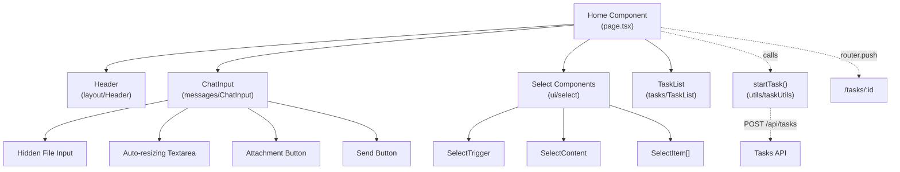
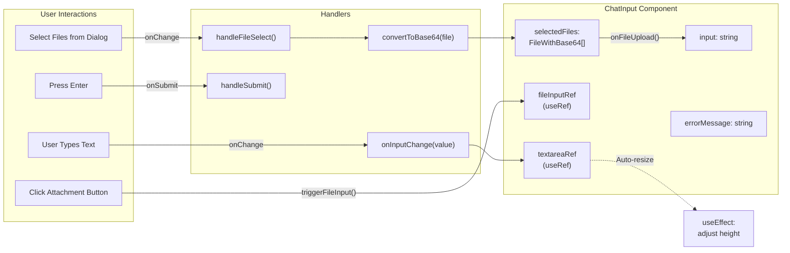
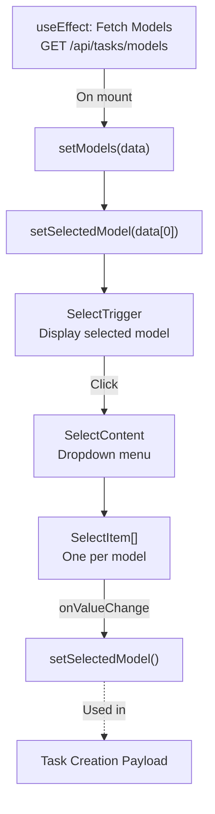
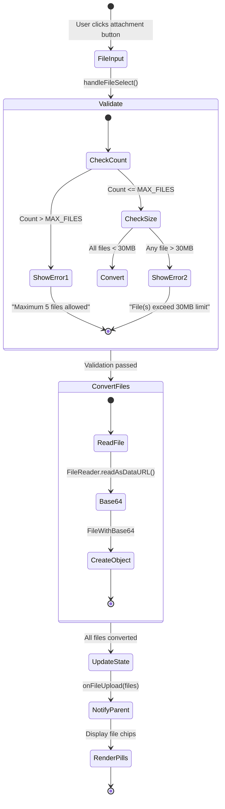
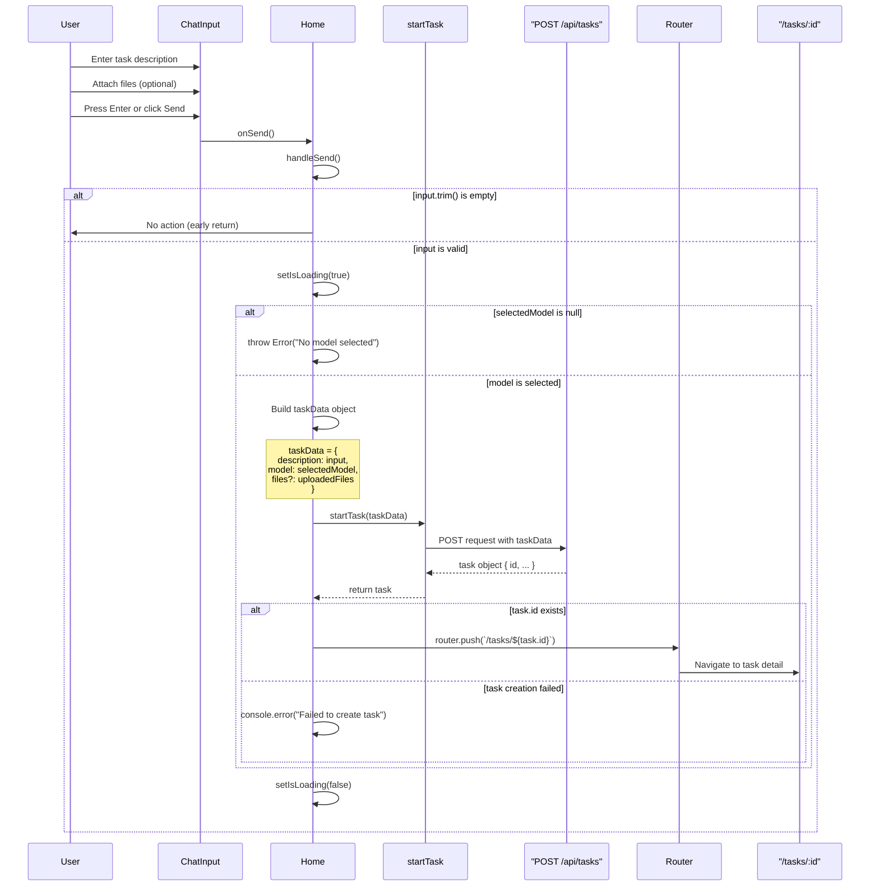
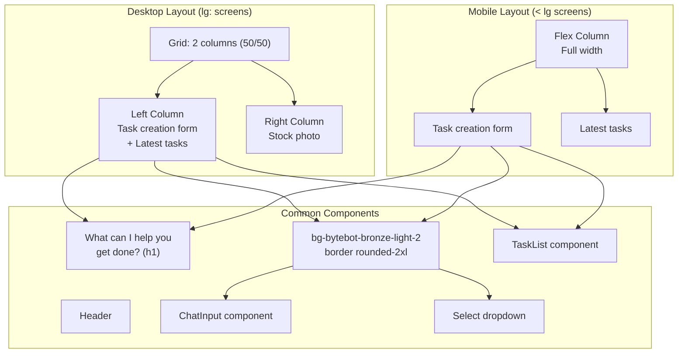
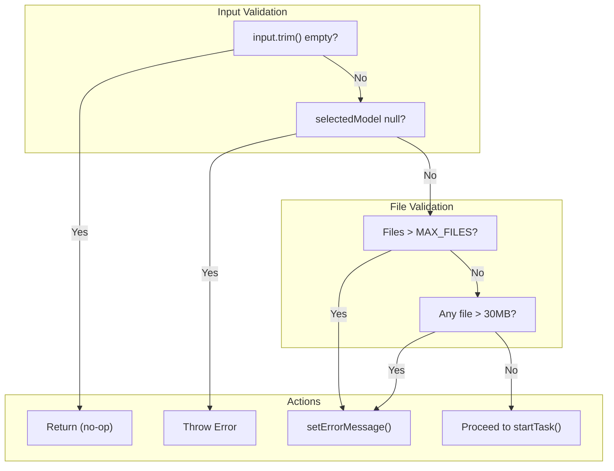
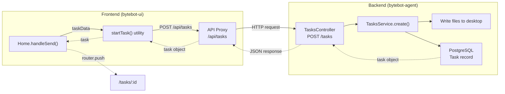

<!-- source: DeepWiki mcp.deepwiki.com · repo bytebot-ai/bytebot · page 8.1 Task Creation Interface · fetched 2026-10-29 -->

# Task Creation Interface

<details>
<summary>Relevant source files</summary>

The following files were used as context for generating this wiki page:

- [packages/bytebot-ui/src/app/page.tsx](packages/bytebot-ui/src/app/page.tsx)
- [packages/bytebot-ui/src/components/messages/ChatInput.tsx](packages/bytebot-ui/src/components/messages/ChatInput.tsx)
- [packages/bytebot-ui/src/components/ui/select.tsx](packages/bytebot-ui/src/components/ui/select.tsx)

</details>


The Task Creation Interface is the primary entry point for users to submit tasks to the Bytebot system. Located at the home page (`/`), it provides a form-based interface for entering task descriptions, selecting AI models, and uploading files. This page serves as both the task creation form and a dashboard showing the latest tasks.

For information about viewing task details and monitoring execution, see [Task Detail Page](#8.3). For the task list browsing interface, see [Task List Interface](#8.2).

## Purpose and Scope

This document covers the implementation of the task creation form in [packages/bytebot-ui/src/app/page.tsx](), including:
- The main `Home` component structure and state management
- The `ChatInput` component for text and file input
- Model selection via Radix UI `Select` component
- Client-side validation and file handling
- Integration with the `startTask` API utility

## Component Architecture

The task creation interface is built using a compositional React architecture with three primary components:



**Component Hierarchy and Data Flow**

Sources: [packages/bytebot-ui/src/app/page.tsx:1-256]()

### Home Component State

The `Home` component manages the following state:

| State Variable | Type | Purpose |
|----------------|------|---------|
| `input` | `string` | Task description text |
| `isLoading` | `boolean` | Loading state during task creation |
| `models` | `Model[]` | Available AI models from backend |
| `selectedModel` | `Model \| null` | Currently selected model |
| `uploadedFiles` | `FileWithBase64[]` | Base64-encoded file attachments |
| `activePopoverIndex` | `number \| null` | Manages popover state (unused in current implementation) |

Sources: [packages/bytebot-ui/src/app/page.tsx:44-55]()

## Task Input System

The task input system uses the `ChatInput` component, which provides a multi-line auto-resizing textarea with file attachment capabilities.



**ChatInput Auto-Resize Logic**

Sources: [packages/bytebot-ui/src/components/messages/ChatInput.tsx:24-254]()

### FileWithBase64 Interface

The system uses a custom interface to represent uploaded files with their base64-encoded content:

```typescript
interface FileWithBase64 {
  name: string;      // Original filename
  base64: string;    // Data URL (e.g., "data:image/png;base64,...")
  type: string;      // MIME type
  size: number;      // File size in bytes
}
```

This interface is defined identically in both [packages/bytebot-ui/src/app/page.tsx:37-42]() and [packages/bytebot-ui/src/components/messages/ChatInput.tsx:7-12]().

Sources: [packages/bytebot-ui/src/app/page.tsx:37-42](), [packages/bytebot-ui/src/components/messages/ChatInput.tsx:7-12]()

## Model Selection

The model selection dropdown is implemented using Radix UI's `Select` components, which provide accessible, keyboard-navigable selection.



**Model Selection Flow**

The component fetches available models on mount and automatically selects the first model:

| Step | Action | Code Reference |
|------|--------|----------------|
| 1. Mount | Fetch models from `/api/tasks/models` | [page.tsx:57-65]() |
| 2. Response | Store in `models` state | [page.tsx:61]() |
| 3. Default | Set first model as selected | [page.tsx:62]() |
| 4. Render | Display model dropdown | [page.tsx:165-183]() |
| 5. Change | Update `selectedModel` on selection | [page.tsx:167-171]() |

Sources: [packages/bytebot-ui/src/app/page.tsx:57-65](), [packages/bytebot-ui/src/app/page.tsx:165-183]()

## File Upload System

The file upload system provides multi-file support with client-side validation for file size and count limits.

### Upload Constraints

| Constraint | Value | Constant |
|------------|-------|----------|
| Maximum files | 5 | `MAX_FILES` |
| Maximum size per file | 30 MB | `MAX_FILE_SIZE` (30 × 1024 × 1024 bytes) |

Sources: [packages/bytebot-ui/src/components/messages/ChatInput.tsx:38-39]()

### File Selection and Validation Flow



**File Validation and Conversion Process**

The `handleFileSelect` function implements comprehensive validation:

1. **Count Validation**: Checks if `selectedFiles.length + files.length > MAX_FILES` at [ChatInput.tsx:53-57]()
2. **Size Validation**: Iterates through files and validates `file.size <= MAX_FILE_SIZE` at [ChatInput.tsx:60-73]()
3. **Base64 Conversion**: Uses `FileReader.readAsDataURL()` at [ChatInput.tsx:100-107]()
4. **Error Display**: Shows red error banner above file list at [ChatInput.tsx:163-167]()

Sources: [packages/bytebot-ui/src/components/messages/ChatInput.tsx:46-117]()

### File Display and Removal

Selected files are displayed as removable chips showing the filename:

- Files rendered in a flex-wrap container at [ChatInput.tsx:169-196]()
- Each chip includes a cancel button that calls `removeFile(index)` at [ChatInput.tsx:109-117]()
- Counter shows `{selectedFiles.length} / {MAX_FILES} files` at [ChatInput.tsx:172]()

Sources: [packages/bytebot-ui/src/components/messages/ChatInput.tsx:169-196]()

## Task Creation Flow

The task creation flow orchestrates user input validation, API communication, and navigation to the task detail page.



**Task Creation Sequence**

Sources: [packages/bytebot-ui/src/app/page.tsx:97-133]()

### handleSend Implementation

The `handleSend` function at [page.tsx:97-133]() implements the following logic:

1. **Input Validation**: Returns early if `!input.trim()` at line 98
2. **Loading State**: Sets `isLoading` to true at line 100
3. **Model Validation**: Throws error if no model selected at line 103
4. **Payload Construction**: Builds `taskData` object with required fields at lines 105-117
   - Always includes: `description`, `model`
   - Conditionally includes: `files` (if `uploadedFiles.length > 0`)
5. **API Call**: Invokes `startTask(taskData)` at line 119
6. **Navigation**: Redirects to `/tasks/${task.id}` using Next.js router at line 123
7. **Error Handling**: Catches and logs errors at lines 128-129
8. **Cleanup**: Sets `isLoading` to false in finally block at line 131

Sources: [packages/bytebot-ui/src/app/page.tsx:97-133]()

### startTask API Integration

The `startTask` utility function (referenced but not shown in provided files) performs the following:

| Function | Location | Purpose |
|----------|----------|---------|
| `startTask(taskData)` | `@/utils/taskUtils` | Sends POST request to `/api/tasks`, returns created task object |

The function is imported at [page.tsx:15]() and called at [page.tsx:119]().

Sources: [packages/bytebot-ui/src/app/page.tsx:15](), [packages/bytebot-ui/src/app/page.tsx:119]()

## Layout System

The interface implements responsive layouts optimized for desktop and mobile viewports using Tailwind CSS utility classes.

### Layout Variants



**Responsive Layout Architecture**

### Desktop Layout

The desktop layout uses a CSS Grid with `lg:grid lg:grid-cols-2` at [page.tsx:145]():

- **Left Panel**: Task creation form with centered content, max-width `xl` (672px) at [page.tsx:148]()
- **Right Panel**: Decorative stock photo, centered with `aspect-square` at [page.tsx:196-199]()
- **Visibility**: Hidden on mobile with `hidden` class, shown on desktop with `lg:grid` at [page.tsx:145]()

Sources: [packages/bytebot-ui/src/app/page.tsx:145-201]()

### Mobile Layout

The mobile layout uses a flex column at [page.tsx:204]():

- **Single Column**: Full-width flex column with `flex-col`
- **Padding**: `px-4 pt-10` for top and horizontal spacing at [page.tsx:205]()
- **Visibility**: Visible by default, hidden on desktop with `lg:hidden` at [page.tsx:204]()
- **No Stock Photo**: Image omitted to save vertical space

Sources: [packages/bytebot-ui/src/app/page.tsx:204-252]()

### Common UI Elements

Both layouts share these components:

| Component | Styling | Location |
|-----------|---------|----------|
| Title (h1) | `text-bytebot-bronze-light-12 text-2xl` | [page.tsx:150-152]() |
| Input Container | `bg-bytebot-bronze-light-2 border-bytebot-bronze-light-7 rounded-2xl` | [page.tsx:155]() |
| ChatInput | `minLines={3}` | [page.tsx:156-163]() |
| Model Select | `w-auto` trigger | [page.tsx:165-183]() |
| TaskList | `w-full` with title "Latest Tasks" | [page.tsx:187-191]() |

Sources: [packages/bytebot-ui/src/app/page.tsx:150-191]()

## Validation and Error Handling

The interface implements multi-layered validation to ensure data integrity before task creation.

### Client-Side Validation



**Validation Chain**

### Validation Rules

| Validation Type | Rule | Error Behavior | Code Reference |
|----------------|------|----------------|----------------|
| **Empty Input** | `input.trim()` must not be empty | Silent return (no action) | [page.tsx:98]() |
| **Model Selection** | `selectedModel` must not be null | Throws error | [page.tsx:103]() |
| **File Count** | `selectedFiles.length + files.length <= 5` | Red error banner | [ChatInput.tsx:53-57]() |
| **File Size** | Each file `size <= 30 MB` | Red error banner with filenames | [ChatInput.tsx:60-73]() |

Sources: [packages/bytebot-ui/src/app/page.tsx:98-103](), [packages/bytebot-ui/src/components/messages/ChatInput.tsx:53-73]()

### Error Display Mechanisms

**File Upload Errors**

Error messages are displayed in a red banner above the file list:

- Component: `<div>` with classes `bg-red-50 text-red-600` at [ChatInput.tsx:163-167]()
- State: `errorMessage` string state variable at [ChatInput.tsx:36]()
- Clear: Error cleared on successful file selection or file removal at [ChatInput.tsx:50](), [ChatInput.tsx:112]()

**Error Messages**

The system displays specific error messages:

```typescript
"Maximum 5 files allowed"                          // File count exceeded
"File(s) exceed 30MB limit: filename1 (size), ..." // File size exceeded
```

Sources: [packages/bytebot-ui/src/components/messages/ChatInput.tsx:36](), [packages/bytebot-ui/src/components/messages/ChatInput.tsx:163-167]()

### Loading State

The `isLoading` state provides user feedback during async operations:

- **Button State**: Send button replaced with spinning loader at [ChatInput.tsx:234-249]()
- **Input Disabled**: Textarea disabled when `isLoading={true}` at [ChatInput.tsx:210]()
- **Duration**: Set to `true` before API call, reset in finally block at [page.tsx:100](), [page.tsx:131]()

Sources: [packages/bytebot-ui/src/app/page.tsx:100-131](), [packages/bytebot-ui/src/components/messages/ChatInput.tsx:210](), [packages/bytebot-ui/src/components/messages/ChatInput.tsx:234-249]()

## Integration with Backend

The task creation interface communicates with the backend through a well-defined API contract.

### API Request Payload

```typescript
// Constructed in handleSend()
const taskData: {
  description: string;
  model: Model;
  files?: FileWithBase64[];
} = {
  description: input,
  model: selectedModel,
};

// Files conditionally added
if (uploadedFiles.length > 0) {
  taskData.files = uploadedFiles;
}
```

### API Communication Flow



**End-to-End Task Creation**

The complete flow from user input to task detail page:

1. User submits form → `handleSend()` called
2. `startTask(taskData)` sends POST to `/api/tasks` via proxy at [page.tsx:119]()
3. Backend creates task record in database
4. Backend writes files to `/home/user/Desktop` if provided
5. Backend returns task object with `id`
6. Frontend navigates to `/tasks/${task.id}` at [page.tsx:123]()

For details on the backend task creation process, see [TasksService API](#5.2). For file handling specifics, see [File Handling](#5.5).

Sources: [packages/bytebot-ui/src/app/page.tsx:97-133]()

---

