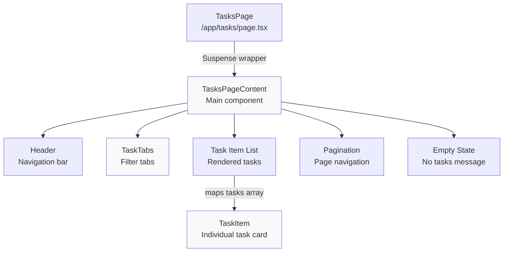
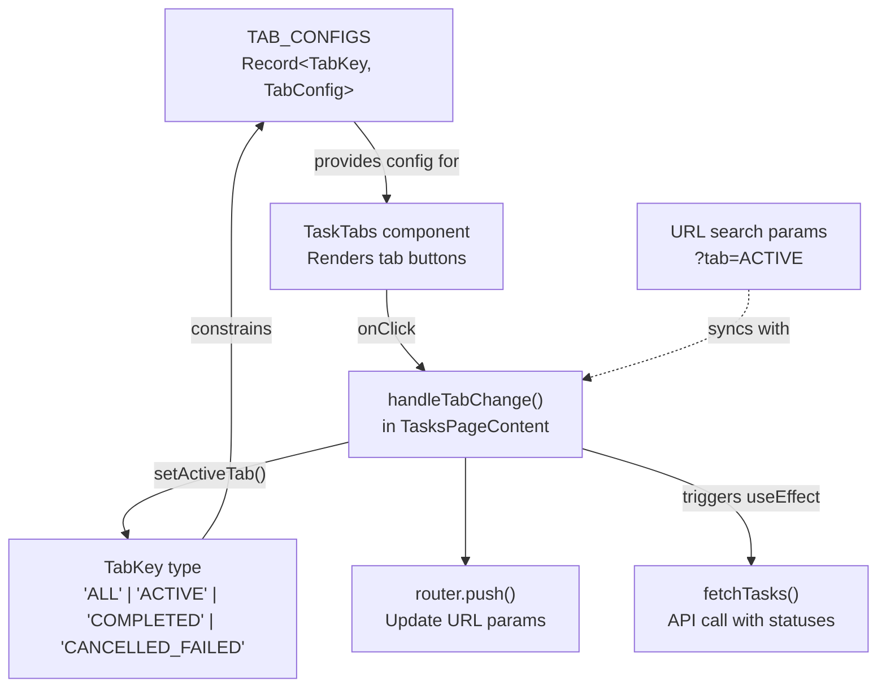
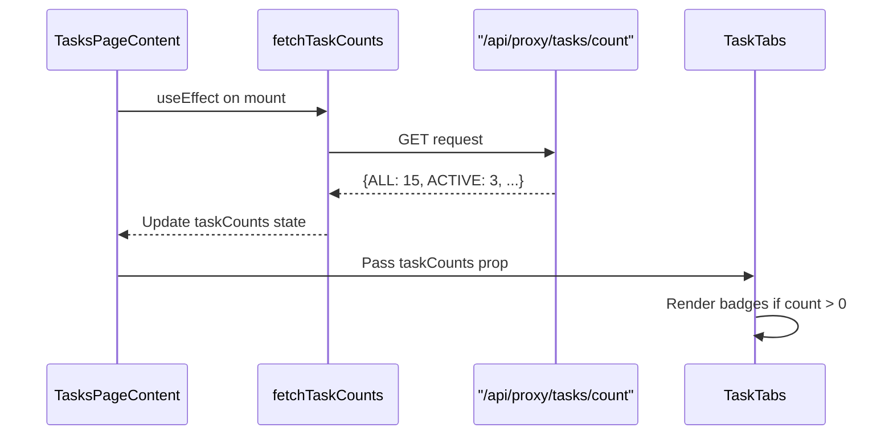
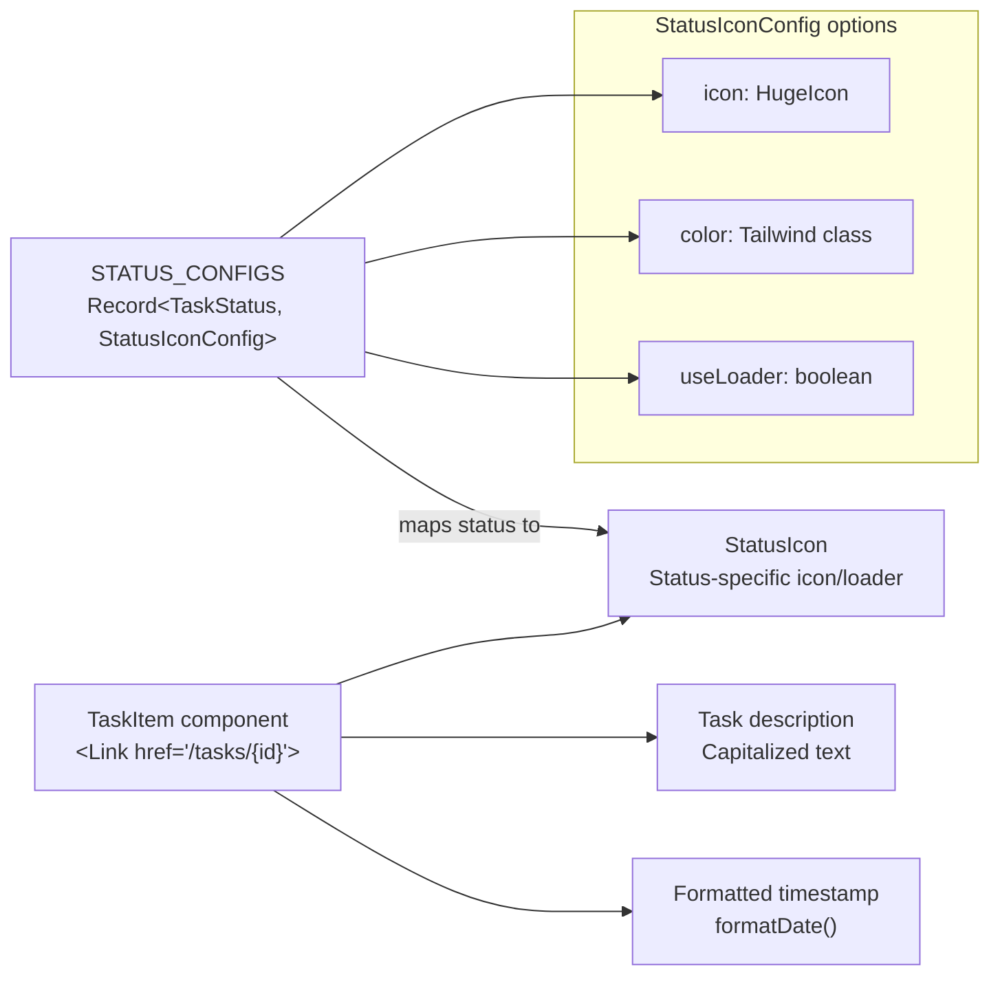
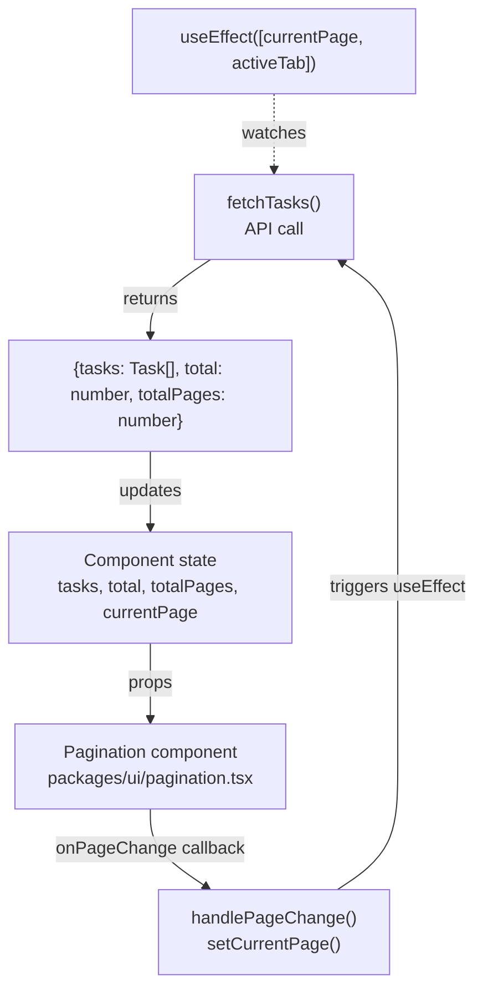
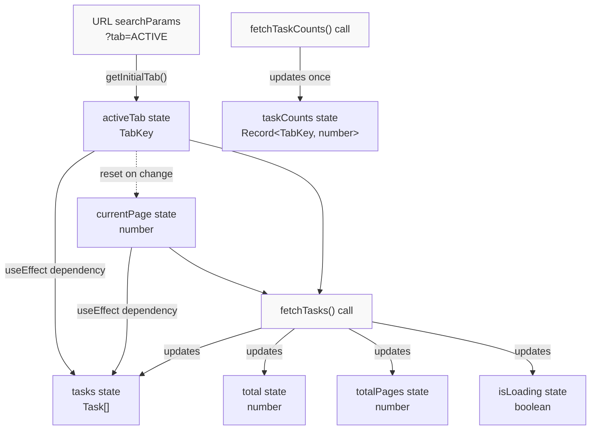
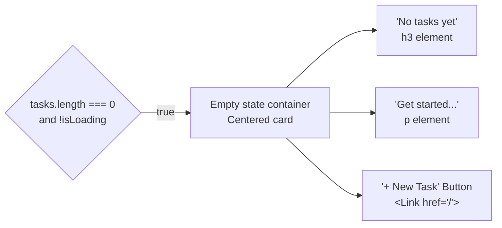
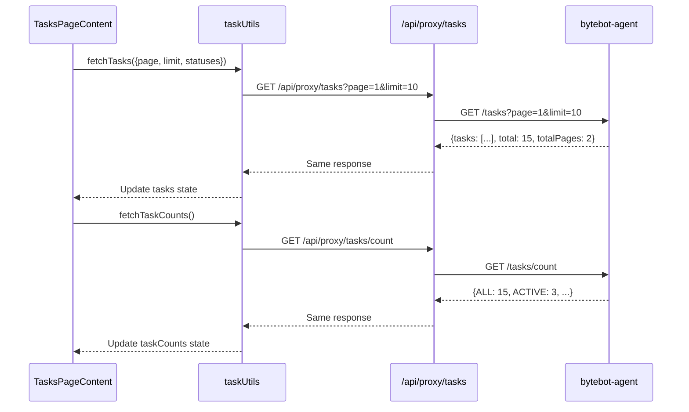

<!-- source: DeepWiki mcp.deepwiki.com · repo bytebot-ai/bytebot · page 8.2 Task List Interface · fetched 2026-10-29 -->

# Task List Interface

Relevant source files

The following files were used as context for generating this wiki page:

- [packages/bytebot-ui/src/app/tasks/page.tsx](packages/bytebot-ui/src/app/tasks/page.tsx)
- [packages/bytebot-ui/src/components/tasks/TaskItem.tsx](packages/bytebot-ui/src/components/tasks/TaskItem.tsx)
- [packages/bytebot-ui/src/components/tasks/TaskTabs.tsx](packages/bytebot-ui/src/components/tasks/TaskTabs.tsx)
- [packages/bytebot-ui/src/components/ui/button.tsx](packages/bytebot-ui/src/components/ui/button.tsx)

## Purpose and Scope

The Task List Interface provides a paginated, tab-based view for browsing all tasks in the system. Located at `/tasks`, this page enables users to filter tasks by status category, navigate through pages of results, and access individual task details. The interface displays task metadata including status indicators, descriptions, and creation timestamps.

For creating new tasks, see [Task Creation Interface](#8.1). For viewing individual task details and messages, see [Task Detail Page](#8.3). For the underlying API operations, see [Tasks REST API](#10.1).

## Page Architecture

The Task List Interface consists of three primary components that work together to provide the browsing experience:

**Component Hierarchy Diagram**

**Sources:** [packages/bytebot-ui/src/app/tasks/page.tsx:1-191]()

The `TasksPage` component uses React Suspense to wrap `TasksPageContent`, providing a loading fallback during initial render. The main component manages state and coordinates child components.

## Tab-Based Filtering System

The interface provides four predefined filter tabs, each mapping to specific task status combinations:

| Tab Key | Label | Included Statuses | Icon |
|---------|-------|-------------------|------|
| `ALL` | All | All statuses | `ListViewIcon` |
| `ACTIVE` | Active | `PENDING`, `RUNNING`, `NEEDS_HELP`, `NEEDS_REVIEW` | `CursorProgress04Icon` |
| `COMPLETED` | Completed | `COMPLETED` | `Tick02Icon` |
| `CANCELLED_FAILED` | Cancelled/Failed | `CANCELLED`, `FAILED` | `MultiplicationSignIcon` |

**Tab Configuration and Filtering Flow**

**Sources:** [packages/bytebot-ui/src/components/tasks/TaskTabs.tsx:11-60](), [packages/bytebot-ui/src/app/tasks/page.tsx:94-108]()

The `TAB_CONFIGS` constant at [packages/bytebot-ui/src/components/tasks/TaskTabs.tsx:30-60]() defines the mapping between tab keys and their status arrays. When a user clicks a tab:

1. `handleTabChange()` at [packages/bytebot-ui/src/app/tasks/page.tsx:94-108]() updates `activeTab` state
2. URL parameters are updated (tab parameter added/removed)
3. `currentPage` resets to 1
4. A `useEffect` hook triggers `fetchTasks()` with the new status filter

### Task Count Badges

Each tab displays a count badge showing the number of tasks in that category:

**Task Count Loading Flow**

**Sources:** [packages/bytebot-ui/src/app/tasks/page.tsx:67-78](), [packages/bytebot-ui/src/components/tasks/TaskTabs.tsx:91-101]()

The `fetchTaskCounts()` utility at [packages/bytebot-ui/src/app/tasks/page.tsx:68-77]() loads all counts once on component mount. The `TaskTabs` component conditionally renders count badges at [packages/bytebot-ui/src/components/tasks/TaskTabs.tsx:91-101]() when `count > 0`.

## Task Item Display

Each task is rendered as a `TaskItem` component, displaying status, description, and timestamp:

**TaskItem Component Structure**

**Sources:** [packages/bytebot-ui/src/components/tasks/TaskItem.tsx:1-111]()

### Status Icon Mapping

The `STATUS_CONFIGS` constant at [packages/bytebot-ui/src/components/tasks/TaskItem.tsx:25-52]() defines the visual representation for each `TaskStatus`:

| Status | Display | Color Class |
|--------|---------|-------------|
| `COMPLETED` | `Tick02Icon` | `text-bytebot-green-8` |
| `RUNNING` | `Loader` spinner | N/A |
| `NEEDS_HELP` | `AlertCircleIcon` | `text-[#FF9D00]` (orange) |
| `PENDING` | `Loader` spinner | N/A |
| `FAILED` | `AlertCircleIcon` | `text-bytebot-red-light-9` |
| `NEEDS_REVIEW` | `AlertCircleIcon` | `text-[#FF9D00]` (orange) |
| `CANCELLED` | `CancelCircleIcon` | `text-bytebot-bronze-light-10` |

The `StatusIcon` function at [packages/bytebot-ui/src/components/tasks/TaskItem.tsx:71-90]() determines whether to render an icon or loader based on the configuration.

### Date Formatting

The `formatDate()` function at [packages/bytebot-ui/src/components/tasks/TaskItem.tsx:56-69]() provides human-readable timestamps:

- **Same day:** "Today 9:13am"
- **Different day:** "April 13, 2025 12:01pm"

The formatted date appears below the task description at [packages/bytebot-ui/src/components/tasks/TaskItem.tsx:103-106]().

### Navigation

Each `TaskItem` is wrapped in a Next.js `Link` component at [packages/bytebot-ui/src/components/tasks/TaskItem.tsx:93](), pointing to `/tasks/${task.id}`. Clicking anywhere on the card navigates to the task detail page.

## Pagination System

When task results exceed the page size limit (10 tasks), pagination controls appear:

**Pagination Data Flow**

**Sources:** [packages/bytebot-ui/src/app/tasks/page.tsx:43-65](), [packages/bytebot-ui/src/app/tasks/page.tsx:110-112](), [packages/bytebot-ui/src/app/tasks/page.tsx:159-167]()

The pagination system operates through:

1. **API Response:** `fetchTasks()` at [packages/bytebot-ui/src/app/tasks/page.tsx:49]() returns `total` and `totalPages` from the backend
2. **Conditional Rendering:** Pagination only displays when `totalPages > 1` at [packages/bytebot-ui/src/app/tasks/page.tsx:159]()
3. **Page Navigation:** `handlePageChange()` at [packages/bytebot-ui/src/app/tasks/page.tsx:110-112]() updates `currentPage` state
4. **Effect Trigger:** A `useEffect` at [packages/bytebot-ui/src/app/tasks/page.tsx:43-65]() watches `currentPage` and `activeTab`, fetching new data on change

The `PAGE_SIZE` constant is set to 10 at [packages/bytebot-ui/src/app/tasks/page.tsx:41]().

## State Management

The interface manages multiple interconnected state variables:

**State Variable Dependencies**

**Sources:** [packages/bytebot-ui/src/app/tasks/page.tsx:15-78]()

### URL Parameter Synchronization

The interface maintains bidirectional sync between URL parameters and component state:

1. **Initial Load:** `getInitialTab()` at [packages/bytebot-ui/src/app/tasks/page.tsx:23-29]() reads the `tab` URL parameter
2. **Tab Change:** `handleTabChange()` at [packages/bytebot-ui/src/app/tasks/page.tsx:94-108]() updates URL via `router.push()`
3. **URL Change:** A `useEffect` at [packages/bytebot-ui/src/app/tasks/page.tsx:81-92]() watches `searchParams` and syncs to state

The URL format is:
- **All tasks:** `/tasks` (no parameter)
- **Filtered:** `/tasks?tab=ACTIVE`, `/tasks?tab=COMPLETED`, etc.

### Loading States

The `isLoading` state at [packages/bytebot-ui/src/app/tasks/page.tsx:20]() controls three UI variations:

1. **Loading:** Spinner displayed at [packages/bytebot-ui/src/app/tasks/page.tsx:130-134]()
2. **Empty:** No tasks message at [packages/bytebot-ui/src/app/tasks/page.tsx:135-150]()
3. **Loaded:** Task list at [packages/bytebot-ui/src/app/tasks/page.tsx:151-168]()

## Empty State

When no tasks match the current filter, an empty state component appears:

**Empty State Structure**

**Sources:** [packages/bytebot-ui/src/app/tasks/page.tsx:135-150]()

The empty state at [packages/bytebot-ui/src/app/tasks/page.tsx:136-149]() provides:

- A heading: "No tasks yet"
- Description text: "Get started by creating a first task"
- A "New Task" button linking to the home page (`/`)

This appears when the `tasks` array is empty but loading has completed (preventing flash during initial load).

## API Integration Points

The interface integrates with multiple API endpoints through the `taskUtils` module:

| Function | Endpoint | Purpose | Returns |
|----------|----------|---------|---------|
| `fetchTasks()` | `/api/proxy/tasks` | Load paginated tasks | `{tasks: Task[], total: number, totalPages: number}` |
| `fetchTaskCounts()` | `/api/proxy/tasks/count` | Load status counts | `Record<TabKey, number>` |

**API Request Flow**

**Sources:** [packages/bytebot-ui/src/app/tasks/page.tsx:49-56](), [packages/bytebot-ui/src/app/tasks/page.tsx:68-77]()

Both API calls pass through the Next.js proxy layer at `/api/proxy/tasks` which forwards requests to the `bytebot-agent` service. For detailed API specifications, see [Tasks REST API](#10.1). For the utility implementation, see [API Client Utilities](#8.6).

---

