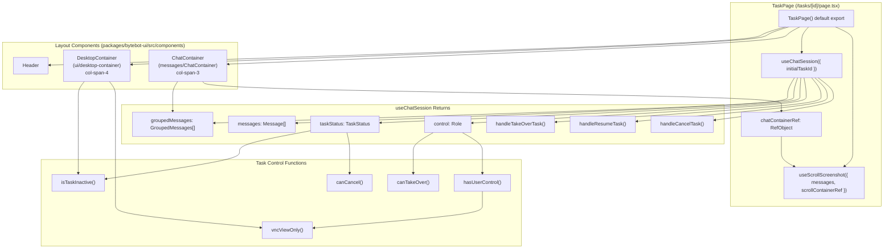
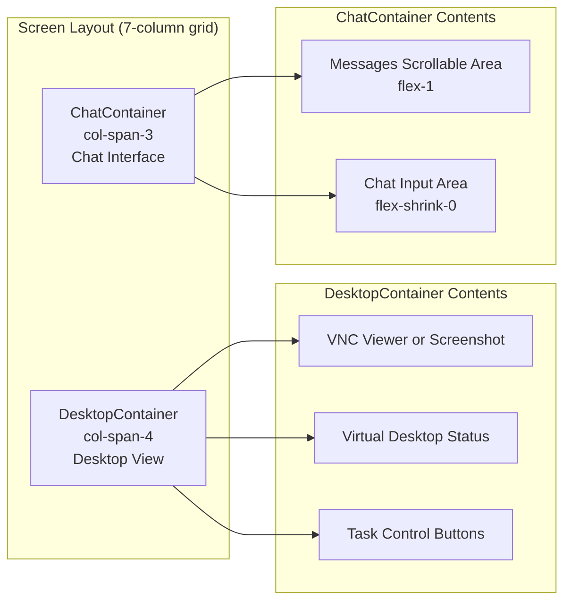
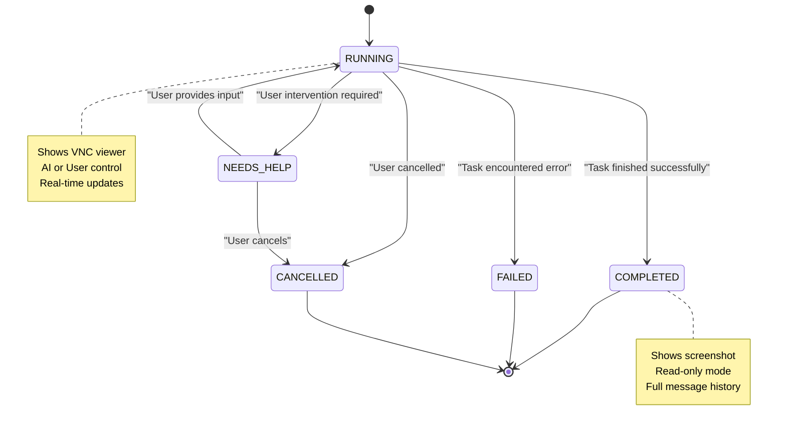
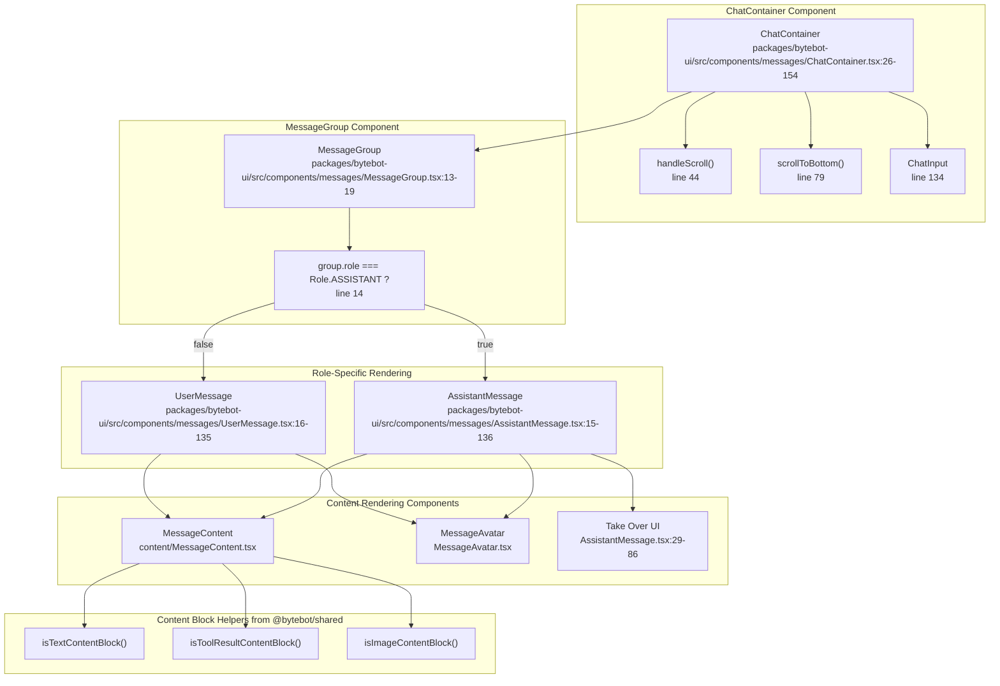
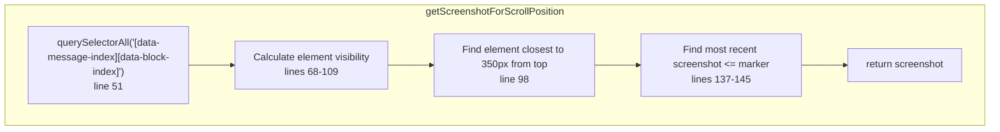
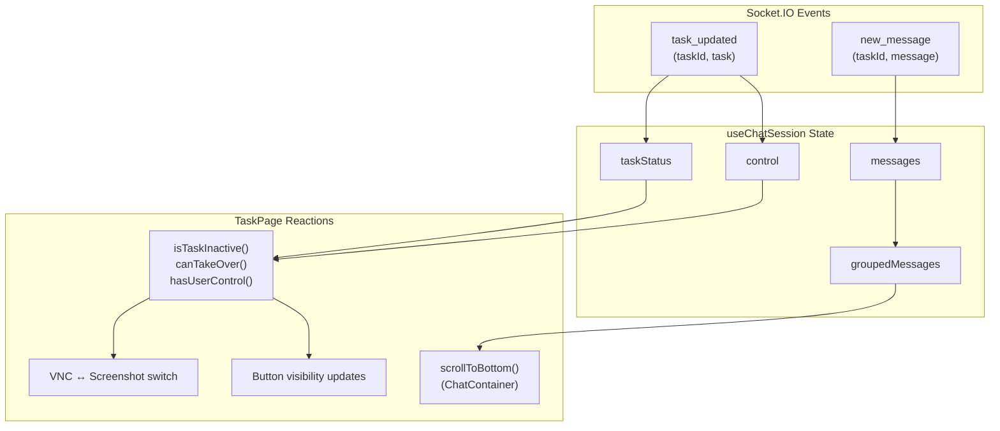

<!-- source: DeepWiki mcp.deepwiki.com · repo bytebot-ai/bytebot · page 8.3 Task Detail Page · fetched 2026-10-29 -->

# Task Detail Page

<details>
<summary>Relevant source files</summary>

The following files were used as context for generating this wiki page:

- [packages/bytebot-ui/src/app/tasks/[id]/page.tsx](packages/bytebot-ui/src/app/tasks/[id]/page.tsx)
- [packages/bytebot-ui/src/components/messages/AssistantMessage.tsx](packages/bytebot-ui/src/components/messages/AssistantMessage.tsx)
- [packages/bytebot-ui/src/components/messages/ChatContainer.tsx](packages/bytebot-ui/src/components/messages/ChatContainer.tsx)
- [packages/bytebot-ui/src/components/messages/MessageGroup.tsx](packages/bytebot-ui/src/components/messages/MessageGroup.tsx)
- [packages/bytebot-ui/src/components/messages/UserMessage.tsx](packages/bytebot-ui/src/components/messages/UserMessage.tsx)
- [packages/bytebot-ui/src/components/screenshot/ScreenshotViewer.tsx](packages/bytebot-ui/src/components/screenshot/ScreenshotViewer.tsx)
- [packages/bytebot-ui/src/hooks/useScrollScreenshot.ts](packages/bytebot-ui/src/hooks/useScrollScreenshot.ts)
- [packages/bytebot-ui/src/utils/screenshotUtils.ts](packages/bytebot-ui/src/utils/screenshotUtils.ts)

</details>


The Task Detail Page (`/tasks/[id]`) provides real-time interaction with individual AI tasks through a dual-pane interface. It combines desktop visualization (VNC or screenshots) with a chat-based messaging system, supporting both autonomous AI execution and manual user takeover.

For task creation, see page 8.1. For desktop viewing implementation, see page 8.4. For message display components, see page 8.5.

## Component Architecture

The task detail page is implemented in [packages/bytebot-ui/src/app/tasks/[id]/page.tsx:25-220]() as a Next.js dynamic route. The `TaskPage` component orchestrates state management, real-time updates, and UI rendering for individual task sessions.

**TaskPage Component Architecture**



Sources: [packages/bytebot-ui/src/app/tasks/[id]/page.tsx:25-48](), [packages/bytebot-ui/src/app/tasks/[id]/page.tsx:50-83](), [packages/bytebot-ui/src/hooks/useChatSession.ts](), [packages/bytebot-ui/src/hooks/useScrollScreenshot.ts:5-14]()

## Layout and Structure

The task detail interface uses a responsive grid layout that divides the screen into two main areas: desktop visualization and chat interaction.

### Grid Layout

The page uses a 7-column CSS Grid layout defined in [packages/bytebot-ui/src/app/tasks/[id]/page.tsx:119-217](). The desktop container spans 4 columns (left), and the chat container spans 3 columns (right):



Sources: [packages/bytebot-ui/src/app/tasks/[id]/page.tsx:119-217]()

### Key Component Props

The `TaskPage` component renders child components with state-derived props:

| Component | Purpose | Key Props |
|-----------|---------|-----------|
| `DesktopContainer` | Desktop visualization and status | `screenshot`, `viewOnly`, `status` |
| `ChatContainer` | Message display and input | `groupedMessages`, `taskStatus`, `control` |
| `Header` | Navigation and branding | None |
| Task Control Buttons | Task state management | Conditional rendering based on task status |

The `DesktopContainer` receives `screenshot`, `viewOnly`, and `status` props determined by task state [packages/bytebot-ui/src/app/tasks/[id]/page.tsx:127-146](). The `ChatContainer` receives `groupedMessages`, `taskStatus`, `control`, and message handling callbacks [packages/bytebot-ui/src/app/tasks/[id]/page.tsx:198-213]().

Sources: [packages/bytebot-ui/src/app/tasks/[id]/page.tsx:127-146](), [packages/bytebot-ui/src/app/tasks/[id]/page.tsx:198-213](), [packages/bytebot-ui/src/components/messages/ChatContainer.tsx:9-24]()

## State Management Logic

The page implements five boolean state functions in [packages/bytebot-ui/src/app/tasks/[id]/page.tsx:50-83]() that determine UI behavior based on `taskStatus` and `control` state from `useChatSession`.

### Task State Functions



The following functions determine conditional rendering and interaction modes:

| Function | Implementation | Return Condition |
|----------|----------------|------------------|
| `isTaskInactive()` | [packages/bytebot-ui/src/app/tasks/[id]/page.tsx:51-57]() | `TaskStatus.COMPLETED \|\| TaskStatus.FAILED \|\| TaskStatus.CANCELLED` |
| `canTakeOver()` | [packages/bytebot-ui/src/app/tasks/[id]/page.tsx:60-62]() | `control === Role.ASSISTANT && taskStatus === TaskStatus.RUNNING` |
| `hasUserControl()` | [packages/bytebot-ui/src/app/tasks/[id]/page.tsx:65-71]() | `control === Role.USER && (TaskStatus.RUNNING \|\| TaskStatus.NEEDS_HELP)` |
| `canCancel()` | [packages/bytebot-ui/src/app/tasks/[id]/page.tsx:74-77]() | `TaskStatus.RUNNING \|\| TaskStatus.NEEDS_HELP` |
| `vncViewOnly()` | [packages/bytebot-ui/src/app/tasks/[id]/page.tsx:81-83]() | `!hasUserControl()` |

These functions are used throughout the component to conditionally render buttons, switch between VNC and screenshot modes, and control message auto-loading.

Sources: [packages/bytebot-ui/src/app/tasks/[id]/page.tsx:50-83]()

### Control Handoff Flow

Task control transitions between AI (`Role.ASSISTANT`) and user (`Role.USER`) through handler functions from `useChatSession`:

| Current State | Available Actions | Result |
|---------------|-------------------|---------|
| AI Control + RUNNING | Take Over | User gains control, VNC becomes interactive |
| User Control + RUNNING/NEEDS_HELP | Proceed | AI resumes control |
| Any Active State | Cancel | Task terminates, interface becomes read-only |

The `handleTakeOverTask` function updates the task's `control` field to `USER`, while `handleResumeTask` sets it back to `ASSISTANT`. The `handleCancelTask` function sets task status to `CANCELLED`.

Sources: [packages/bytebot-ui/src/app/tasks/[id]/page.tsx:148-182](), [packages/bytebot-ui/src/hooks/useChatSession.ts]()

## Message Display System

The `ChatContainer` component renders grouped messages using a three-tier component hierarchy: `ChatContainer` → `MessageGroup` → `AssistantMessage` or `UserMessage`.

**ChatContainer Message Rendering Pipeline**



Sources: [packages/bytebot-ui/src/components/messages/ChatContainer.tsx:26-154](), [packages/bytebot-ui/src/components/messages/MessageGroup.tsx:13-19](), [packages/bytebot-ui/src/components/messages/AssistantMessage.tsx:15-136](), [packages/bytebot-ui/src/components/messages/UserMessage.tsx:16-135]()

### Infinite Scroll for Message History

The `ChatContainer` implements bottom-triggered infinite scroll in [packages/bytebot-ui/src/components/messages/ChatContainer.tsx:44-66](). When the user scrolls within 20 pixels of the bottom, it calls `loadMoreMessages()` from `useChatSession`:

```mermaid
sequenceDiagram
    participant User
    participant scrollListener["scroll listener<br/>(line 60-66)"]
    participant handleScroll["handleScroll()<br/>(line 44-57)"]
    participant loadMoreMessages["loadMoreMessages()<br/>(useChatSession)"]
    participant APICall["taskUtils API call"]
    
    User->>scrollListener: "Scrolls near bottom"
    scrollListener->>handleScroll: "scroll event"
    handleScroll->>handleScroll: "distanceFromBottom <= 20"
    handleScroll->>loadMoreMessages: "if hasMoreMessages"
    loadMoreMessages->>APICall: "GET /tasks/:id/messages?cursor"
    APICall-->>loadMoreMessages: "older messages"
    loadMoreMessages-->>handleScroll: "update groupedMessages"
    handleScroll-->>User: "render new messages"
```

The `isLoadingMoreMessages` flag prevents duplicate requests during loading. The scroll listener is attached in a `useEffect` at [packages/bytebot-ui/src/components/messages/ChatContainer.tsx:60-66]().

Sources: [packages/bytebot-ui/src/components/messages/ChatContainer.tsx:44-66]()

## Screenshot Navigation

For completed, failed, or cancelled tasks, the page displays static screenshots that update based on chat scroll position. This system extracts screenshots from message content and maps them to scroll markers.

### Screenshot Data Structure

The `ScreenshotData` interface defined in [packages/bytebot-ui/src/utils/screenshotUtils.ts:4-9]() tracks individual screenshots extracted from messages:

| Field | Type | Purpose |
|-------|------|---------|
| `id` | `string` | Unique identifier: `${messageId}-${blockIndex}-${contentIndex}` |
| `base64Data` | `string` | Base64-encoded PNG image data |
| `messageIndex` | `number` | Flat index in messages array |
| `blockIndex` | `number` | Index within message's content array |

### Screenshot Extraction Process

The `extractScreenshots` function in [packages/bytebot-ui/src/utils/screenshotUtils.ts:14-36]() processes all messages to find image content blocks:

```mermaid
graph TB
    subgraph "extractScreenshots Function"
        ExtractFn["extractScreenshots(messages)<br/>screenshotUtils.ts:14"]
        MessageLoopFn["messages.forEach<br/>line 17"]
        ContentLoopFn["message.content.forEach<br/>line 18"]
        ToolResultCheckFn["isToolResultContentBlock(block)<br/>line 20"]
        ContentItemLoopFn["block.content.forEach<br/>line 22"]
        ImageCheckFn["isImageContentBlock(contentItem)<br/>line 23"]
        PushScreenshotFn["screenshots.push({ id, base64Data, ... })<br/>line 24"]
    end
    
    ExtractFn --> MessageLoopFn
    MessageLoopFn --> ContentLoopFn
    ContentLoopFn --> ToolResultCheckFn
    ToolResultCheckFn -->|"has content"| ContentItemLoopFn
    ContentItemLoopFn --> ImageCheckFn
    ImageCheckFn -->|"is image"| PushScreenshotFn
```



This function iterates through all messages, checks each content block for tool results with images, and creates `ScreenshotData` objects for each image found. The `contentIndex` tracks multiple images within a single tool result block.

Sources: [packages/bytebot-ui/src/utils/screenshotUtils.ts:14-36]()

### Scroll Position Mapping

The system uses hidden marker `<div>` elements in the chat to map scroll position to screenshots. These markers are rendered in [packages/bytebot-ui/src/components/messages/AssistantMessage.tsx:48-78]() and [packages/bytebot-ui/src/components/messages/UserMessage.tsx:30-59]() with data attributes:

```html
<div 
  data-message-index="5"
  data-block-index="2"
  data-content-index="0"
  style={{ position: 'absolute', width: 0, height: 0, overflow: 'hidden' }}
/>
```

The `getScreenshotForScrollPosition` function in [packages/bytebot-ui/src/utils/screenshotUtils.ts:41-148]() queries these markers and selects the appropriate screenshot:



The algorithm uses a target position of 350 pixels from the top of the viewport. It finds the visible marker closest to this position, then returns the most recent screenshot at or before that marker's message/block index.

Sources: [packages/bytebot-ui/src/utils/screenshotUtils.ts:41-148]()

### useScrollScreenshot Hook

The `useScrollScreenshot` hook in [packages/bytebot-ui/src/hooks/useScrollScreenshot.ts:10-115]() integrates screenshot extraction and scroll tracking:

- **Lines 15-45**: Extracts screenshots when messages change, sets initial screenshot
- **Lines 47-67**: Uses `MutationObserver` to detect DOM changes and re-trigger scroll events
- **Lines 70-90**: Implements throttled `handleScroll` callback (100ms throttle)
- **Lines 92-108**: Attaches scroll event listener to container

The hook returns `{ currentScreenshot, allScreenshots, hasScreenshots }` which is consumed by the `TaskPage` component.

Sources: [packages/bytebot-ui/src/hooks/useScrollScreenshot.ts:10-115]()

## Real-Time Updates

The page receives real-time updates through the `useChatSession` hook, which subscribes to WebSocket events via Socket.IO. Task status changes, new messages, and control transitions trigger automatic UI updates.

### Update Flow



Sources: [packages/bytebot-ui/src/hooks/useChatSession.ts](), [packages/bytebot-ui/src/app/tasks/[id]/page.tsx:50-83]()

### Auto-Scroll Behavior

The `ChatContainer` implements conditional auto-scroll in [packages/bytebot-ui/src/components/messages/ChatContainer.tsx:68-81]():

```typescript
// Trigger when messages or status changes
useEffect(() => {
  if (
    taskStatus === TaskStatus.RUNNING ||
    taskStatus === TaskStatus.NEEDS_HELP
  ) {
    scrollToBottom();
  }
}, [taskStatus, groupedMessages]);

// scrollToBottom implementation
const scrollToBottom = () => {
  messagesEndRef.current?.scrollIntoView({ behavior: "smooth" });
};
```

The effect only triggers auto-scroll for active tasks (`RUNNING` or `NEEDS_HELP`). Inactive tasks preserve scroll position to support screenshot navigation. The `messagesEndRef` is a ref to an empty `<div>` at the end of the message list [packages/bytebot-ui/src/components/messages/ChatContainer.tsx:126]().

For inactive tasks, the page triggers auto-loading of all messages in [packages/bytebot-ui/src/app/tasks/[id]/page.tsx:92-101]() to ensure all screenshot markers are available for navigation.

Sources: [packages/bytebot-ui/src/components/messages/ChatContainer.tsx:68-81](), [packages/bytebot-ui/src/components/messages/ChatContainer.tsx:126](), [packages/bytebot-ui/src/app/tasks/[id]/page.tsx:92-101]()

## Task Control Buttons

The page renders three possible control buttons as children of the `DesktopContainer`: **Take Over**, **Proceed**, and **Cancel**. Button visibility is determined by task state functions.

### Button Rendering Logic

Each button is conditionally rendered as a child of `DesktopContainer` in [packages/bytebot-ui/src/app/tasks/[id]/page.tsx:148-187]():

| Button | Condition | Handler | Effect |
|--------|-----------|---------|--------|
| **Take Over** | `canTakeOver()` | `handleTakeOverTask` | Sets `control` to `USER`, enables interactive VNC |
| **Proceed** | `hasUserControl()` | `handleResumeTask` | Sets `control` to `ASSISTANT`, resumes AI execution |
| **Cancel** | `canCancel()` | `handleCancelTask` | Sets status to `CANCELLED`, terminates task |

The buttons are rendered using the `Button` component from Radix UI with Bytebot styling. The **Take Over** button includes a waving hand icon, and the **Cancel** button is nested in a dropdown menu for destructive actions.

Sources: [packages/bytebot-ui/src/app/tasks/[id]/page.tsx:148-187]()

### Desktop Status Display

The `DesktopContainer` receives a `status` prop that determines the visual status indicator displayed. The `TaskPage` component maps task state to status values in [packages/bytebot-ui/src/app/tasks/[id]/page.tsx:130-145]():

| Task State | Desktop Status | VNC Mode | Available Controls |
|------------|----------------|----------|-------------------|
| AI Control + RUNNING | "running" | view-only | Take Over, Cancel |
| User Control + RUNNING | "user_control" | interactive | Proceed, Cancel |
| NEEDS_HELP | "needs_attention" | interactive | Proceed, Cancel |
| COMPLETED | "completed" | screenshot | None |
| FAILED | "failed" | screenshot | None |
| CANCELLED | "canceled" | screenshot | None |

Sources: [packages/bytebot-ui/src/app/tasks/[id]/page.tsx:125-141]()

---

