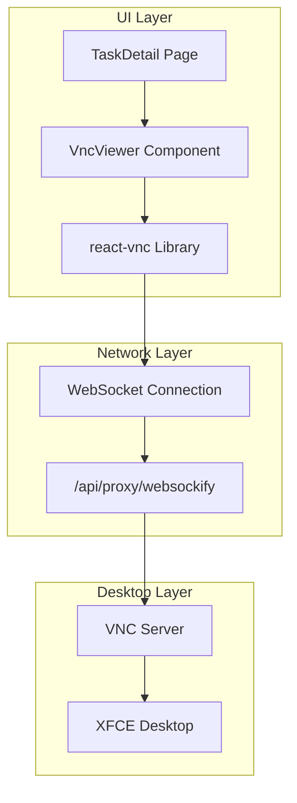
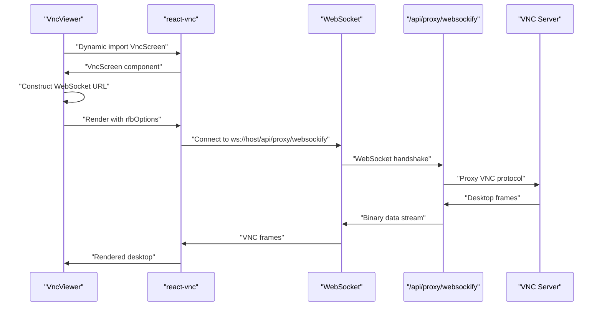
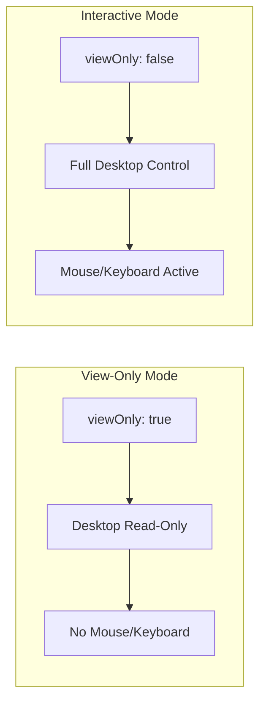
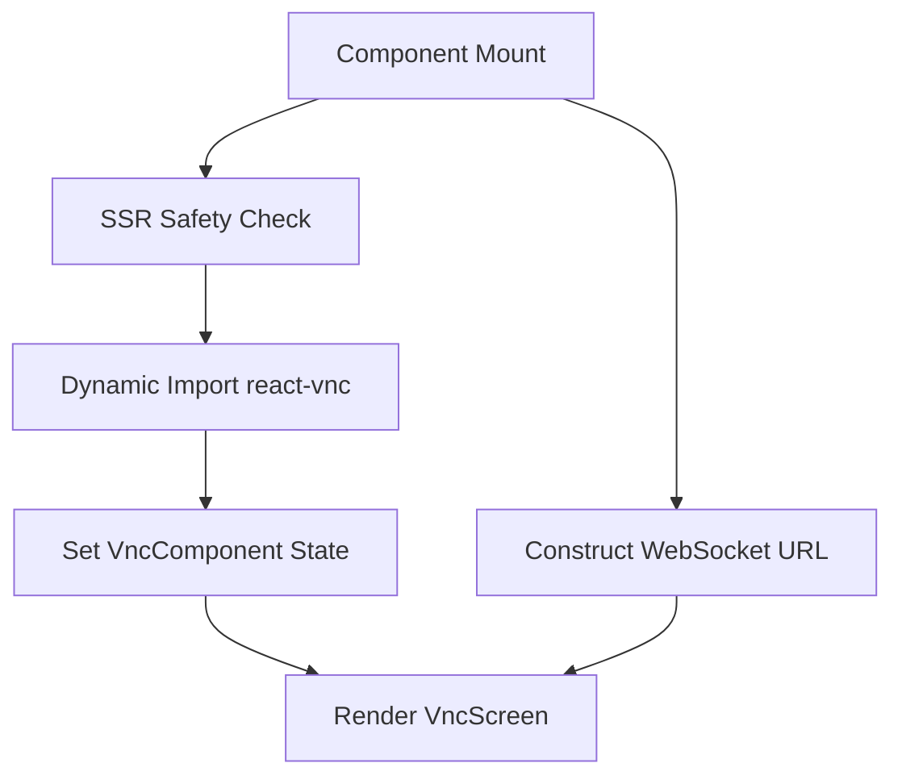

<!-- source: DeepWiki mcp.deepwiki.com · repo bytebot-ai/bytebot · page 8.4 Desktop Viewer · fetched 2026-10-29 -->

# Desktop Viewer

Relevant source files

The following files were used as context for generating this wiki page:

- [packages/bytebot-ui/.gitignore](packages/bytebot-ui/.gitignore)
- [packages/bytebot-ui/src/app/tasks/[id]/page.tsx](packages/bytebot-ui/src/app/tasks/[id]/page.tsx)
- [packages/bytebot-ui/src/components/messages/AssistantMessage.tsx](packages/bytebot-ui/src/components/messages/AssistantMessage.tsx)
- [packages/bytebot-ui/src/components/messages/ChatContainer.tsx](packages/bytebot-ui/src/components/messages/ChatContainer.tsx)
- [packages/bytebot-ui/src/components/messages/MessageGroup.tsx](packages/bytebot-ui/src/components/messages/MessageGroup.tsx)
- [packages/bytebot-ui/src/components/messages/UserMessage.tsx](packages/bytebot-ui/src/components/messages/UserMessage.tsx)
- [packages/bytebot-ui/src/components/screenshot/ScreenshotViewer.tsx](packages/bytebot-ui/src/components/screenshot/ScreenshotViewer.tsx)
- [packages/bytebot-ui/src/components/vnc/VncViewer.tsx](packages/bytebot-ui/src/components/vnc/VncViewer.tsx)
- [packages/bytebot-ui/src/hooks/useScrollScreenshot.ts](packages/bytebot-ui/src/hooks/useScrollScreenshot.ts)
- [packages/bytebot-ui/src/utils/screenshotUtils.ts](packages/bytebot-ui/src/utils/screenshotUtils.ts)
- [packages/bytebot-ui/src/utils/taskUtils.ts](packages/bytebot-ui/src/utils/taskUtils.ts)

The Desktop Viewer provides real-time visual access to the virtual desktop environment through VNC streaming technology. This component enables users to observe AI agent actions as they execute computer automation tasks and optionally take manual control when intervention is needed.

This document covers the VNC client implementation and desktop streaming architecture. For information about the underlying desktop environment, see [Desktop Service](#4.2). For details on how the desktop viewer integrates with task monitoring, see [Task Detail Interface](#7.2).

## Component Architecture

The Desktop Viewer is implemented as a React component that wraps the `react-vnc` library to provide VNC connectivity within the web interface. The component handles dynamic loading, connection management, and viewport scaling.

**VNC Component Flow**
This diagram shows how the `VncViewer` component integrates with the broader system to provide desktop access through VNC protocol streaming.

Sources: [packages/bytebot-ui/src/components/vnc/VncViewer.tsx:1-48]()

## VNC Integration Implementation

The `VncViewer` component dynamically imports the `VncScreen` component from `react-vnc` to ensure client-side only rendering and avoid server-side rendering issues.

**VNC Connection Sequence**
This sequence shows the initialization and connection process for establishing VNC desktop streaming through the WebSocket proxy.

Sources: [packages/bytebot-ui/src/components/vnc/VncViewer.tsx:15-26](), [packages/bytebot-ui/src/components/vnc/VncViewer.tsx:30-44]()

## Connection Management

The component manages WebSocket URL construction based on the current protocol and hostname, ensuring secure connections when the UI is served over HTTPS.

| Configuration | Value | Purpose |
|---------------|--------|---------|
| `secure` | `false` | Disables TLS for VNC protocol |
| `shared` | `true` | Allows multiple concurrent viewers |
| `wsProtocols` | `["binary"]` | Specifies binary WebSocket protocol |
| `scaleViewport` | `true` | Automatically scales desktop to fit viewer |

The WebSocket URL is dynamically constructed using the pattern:
- HTTPS sites: `wss://hostname/api/proxy/websockify`
- HTTP sites: `ws://hostname/api/proxy/websockify`

Sources: [packages/bytebot-ui/src/components/vnc/VncViewer.tsx:22-26](), [packages/bytebot-ui/src/components/vnc/VncViewer.tsx:32-36]()

## User Interaction Modes

The `VncViewer` component supports two interaction modes controlled by the `viewOnly` prop:

**Interaction Mode Configuration**
This diagram shows how the `viewOnly` prop controls user interaction capabilities with the virtual desktop.

The component uses the `viewOnly` value as a React key to force re-rendering when the interaction mode changes, ensuring the VNC connection properly reflects the new permission level.

Sources: [packages/bytebot-ui/src/components/vnc/VncViewer.tsx:5-7](), [packages/bytebot-ui/src/components/vnc/VncViewer.tsx:38-41]()

## Technical Implementation Details

### Client-Side Loading Strategy

The component implements a client-side only loading pattern to avoid server-side rendering conflicts:

**Component Loading Flow**
This flowchart shows the initialization sequence that ensures proper client-side rendering of the VNC component.

### RFB Options Configuration

The Remote Framebuffer (RFB) protocol options are configured for optimal web-based VNC streaming:

- **Secure**: Disabled to allow unencrypted VNC traffic through the WebSocket proxy
- **Shared**: Enabled to support multiple simultaneous viewers
- **WS Protocols**: Set to binary mode for efficient frame transmission
- **Scale Viewport**: Automatically adjusts desktop size to fit the container

Sources: [packages/bytebot-ui/src/components/vnc/VncViewer.tsx:15-20](), [packages/bytebot-ui/src/components/vnc/VncViewer.tsx:32-43]()

## Container and Styling

The component renders within a full-width and full-height container div that references `containerRef`. The VNC screen component inherits these dimensions and applies responsive scaling to fit the available viewport space.

The styling ensures the desktop viewer integrates seamlessly with the parent task detail interface while maintaining aspect ratio and providing smooth scaling across different screen sizes.

Sources: [packages/bytebot-ui/src/components/vnc/VncViewer.tsx:28-47]()

---

