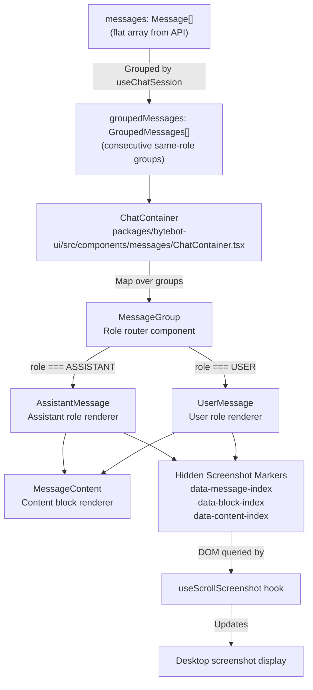
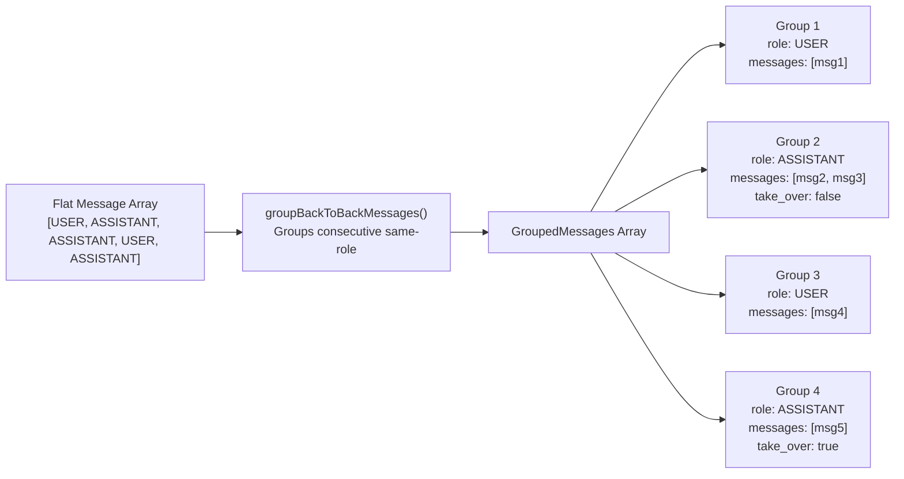
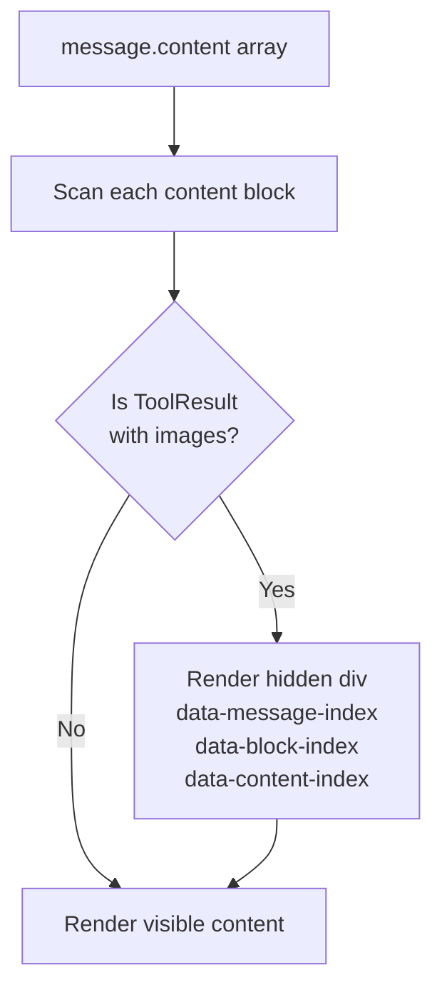
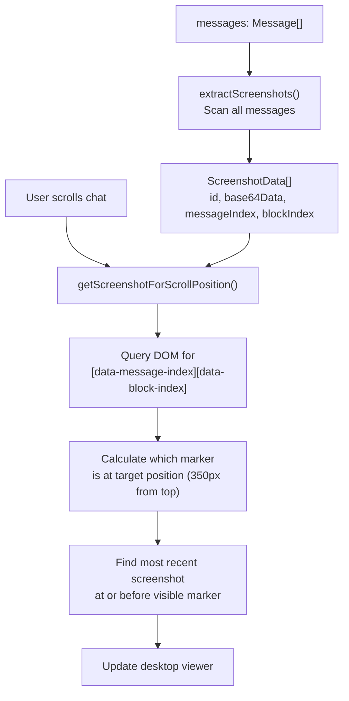
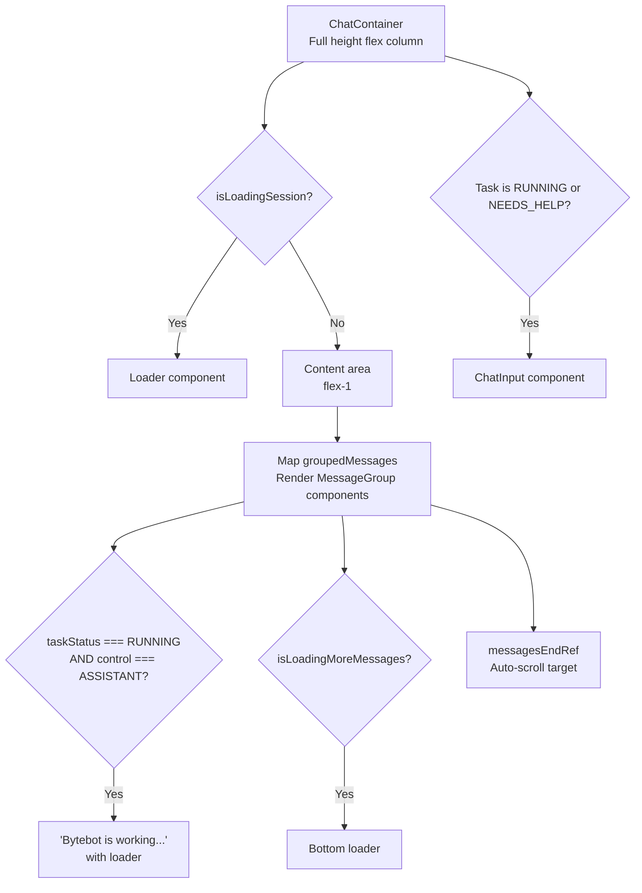
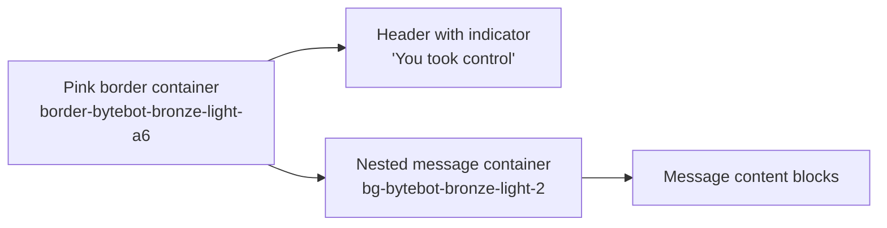
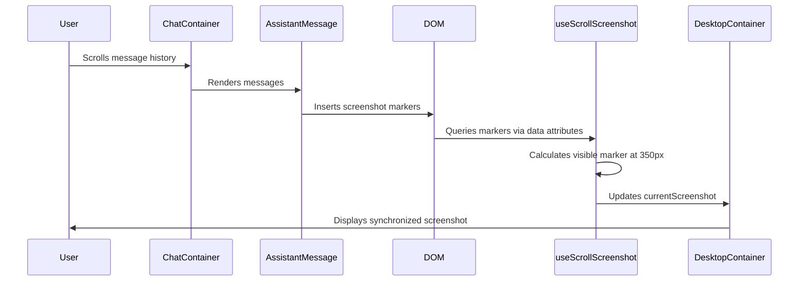

<!-- source: DeepWiki mcp.deepwiki.com · repo bytebot-ai/bytebot · page 8.5 Message Display System · fetched 2026-10-29 -->

# Message Display System

<details>
<summary>Relevant source files</summary>

The following files were used as context for generating this wiki page:

- [packages/bytebot-ui/src/app/tasks/[id]/page.tsx](packages/bytebot-ui/src/app/tasks/[id]/page.tsx)
- [packages/bytebot-ui/src/components/messages/AssistantMessage.tsx](packages/bytebot-ui/src/components/messages/AssistantMessage.tsx)
- [packages/bytebot-ui/src/components/messages/ChatContainer.tsx](packages/bytebot-ui/src/components/messages/ChatContainer.tsx)
- [packages/bytebot-ui/src/components/messages/MessageGroup.tsx](packages/bytebot-ui/src/components/messages/MessageGroup.tsx)
- [packages/bytebot-ui/src/components/messages/UserMessage.tsx](packages/bytebot-ui/src/components/messages/UserMessage.tsx)
- [packages/bytebot-ui/src/components/screenshot/ScreenshotViewer.tsx](packages/bytebot-ui/src/components/screenshot/ScreenshotViewer.tsx)
- [packages/bytebot-ui/src/hooks/useScrollScreenshot.ts](packages/bytebot-ui/src/hooks/useScrollScreenshot.ts)
- [packages/bytebot-ui/src/utils/screenshotUtils.ts](packages/bytebot-ui/src/utils/screenshotUtils.ts)

</details>


## Purpose and Scope

The Message Display System is responsible for rendering the conversation history between users and the AI agent in the task detail view. This system handles message grouping, role-based rendering, screenshot marker placement, and special UI states like user takeover mode. 

For information about the overall task detail page structure, see [Task Detail Page](#8.3). For information about the desktop viewer that displays screenshots, see [Desktop Viewer](#8.4). For information about how messages are created and stored, see [Message and Summarization](#6.4).

**Sources:** [packages/bytebot-ui/src/components/messages/ChatContainer.tsx:1-154](), [packages/bytebot-ui/src/components/messages/MessageGroup.tsx:1-19]()

---

## Message Rendering Architecture

The message display system transforms flat message arrays into grouped, role-separated UI elements with embedded screenshot markers for scroll-synchronized desktop viewing.



**Sources:** [packages/bytebot-ui/src/components/messages/ChatContainer.tsx:26-154](), [packages/bytebot-ui/src/components/messages/MessageGroup.tsx:1-19](), [packages/bytebot-ui/src/app/tasks/[id]/page.tsx:30-48]()

---

## Component Hierarchy

The message display system is organized as a three-level component hierarchy with specialized rendering for each role.

| Component | File | Responsibility |
|-----------|------|----------------|
| `ChatContainer` | [packages/bytebot-ui/src/components/messages/ChatContainer.tsx]() | Container for all messages, infinite scroll, loading states, chat input |
| `MessageGroup` | [packages/bytebot-ui/src/components/messages/MessageGroup.tsx]() | Routes to role-specific renderers based on `group.role` |
| `AssistantMessage` | [packages/bytebot-ui/src/components/messages/AssistantMessage.tsx]() | Renders assistant messages with avatar, take-over detection |
| `UserMessage` | [packages/bytebot-ui/src/components/messages/UserMessage.tsx]() | Renders user messages with special styling for first message |
| `MessageContent` | [packages/bytebot-ui/src/components/messages/content/MessageContent.tsx]() | Renders individual content blocks (text, tool use, tool result, etc.) |

**Sources:** [packages/bytebot-ui/src/components/messages/ChatContainer.tsx:9-24](), [packages/bytebot-ui/src/components/messages/MessageGroup.tsx:7-19]()

---

## GroupedMessages Data Structure

Messages are grouped by consecutive same-role sequences to create chat bubble groupings. The `GroupedMessages` type contains an array of messages with the same role, plus metadata.



The `take_over` flag indicates when a user has taken control of the desktop from the agent, triggering special UI rendering. This grouping logic is handled by the backend's `MessagesService` and provided to the UI via the `useChatSession` hook.

**Sources:** [packages/bytebot-ui/src/components/messages/ChatContainer.tsx:17](), [packages/bytebot-ui/src/hooks/useChatSession.ts]()

---

## Screenshot Marker System

The message display system embeds invisible DOM markers at screenshot locations to enable scroll-synchronized desktop viewing. These markers allow the desktop viewer to display the screenshot corresponding to the user's current scroll position in the message history.

### Marker Placement

Each message component (both `AssistantMessage` and `UserMessage`) scans its content blocks for tool results containing images and renders hidden `<div>` elements at those positions:



The markers are absolutely positioned with zero dimensions:

```typescript
style={{
  position: "absolute",
  width: 0,
  height: 0,
  overflow: "hidden",
}}
```

**Sources:** [packages/bytebot-ui/src/components/messages/AssistantMessage.tsx:48-78](), [packages/bytebot-ui/src/components/messages/UserMessage.tsx:88-117]()

### Marker Data Attributes

Each screenshot marker contains three data attributes that identify its position in the message hierarchy:

| Attribute | Purpose | Example |
|-----------|---------|---------|
| `data-message-index` | Flat index in the message array | `"5"` |
| `data-block-index` | Index within message's content array | `"2"` |
| `data-content-index` | Index within tool result's content array | `"0"` |

These attributes are queried by the `useScrollScreenshot` hook to determine which screenshot should be displayed based on scroll position.

**Sources:** [packages/bytebot-ui/src/components/messages/AssistantMessage.tsx:59-71](), [packages/bytebot-ui/src/hooks/useScrollScreenshot.ts:71-90]()

### Screenshot Extraction and Positioning

The `screenshotUtils.ts` module provides functions to extract screenshots and determine which one to display:



The system targets a position 350 pixels down from the top of the scroll container, finding the marker closest to this position and displaying the corresponding screenshot.

**Sources:** [packages/bytebot-ui/src/utils/screenshotUtils.ts:14-36](), [packages/bytebot-ui/src/utils/screenshotUtils.ts:41-148]()

---

## ChatContainer Component

The `ChatContainer` component serves as the main orchestrator for message display, handling infinite scroll, loading states, and the chat input.

### Layout Structure



**Sources:** [packages/bytebot-ui/src/components/messages/ChatContainer.tsx:83-154]()

### Infinite Scroll Implementation

The container monitors scroll events to load additional messages when the user scrolls near the bottom:

- Scroll event listener attached to parent `scrollRef` [packages/bytebot-ui/src/components/messages/ChatContainer.tsx:60-66]()
- Triggers when within 20px of bottom [packages/bytebot-ui/src/components/messages/ChatContainer.tsx:54]()
- Calls `loadMoreMessages()` if `hasMoreMessages` is true and not already loading [packages/bytebot-ui/src/components/messages/ChatContainer.tsx:54-56]()

### Auto-Scroll Behavior

The container automatically scrolls to the newest message when the task is active:

- Tracks `messagesEndRef` as scroll target [packages/bytebot-ui/src/components/messages/ChatContainer.tsx:41]()
- Triggers on `groupedMessages` or `taskStatus` change [packages/bytebot-ui/src/components/messages/ChatContainer.tsx:69-76]()
- Only scrolls when `taskStatus` is `RUNNING` or `NEEDS_HELP` [packages/bytebot-ui/src/components/messages/ChatContainer.tsx:71-75]()

**Sources:** [packages/bytebot-ui/src/components/messages/ChatContainer.tsx:44-81]()

---

## AssistantMessage Component

The `AssistantMessage` component renders messages from the AI agent, with special handling for take-over mode.

### Standard Rendering

In normal mode, assistant messages display with:
- Left-aligned layout with avatar [packages/bytebot-ui/src/components/messages/AssistantMessage.tsx:21-26]()
- Border on left, right, and conditionally bottom [packages/bytebot-ui/src/components/messages/AssistantMessage.tsx:23-24]()
- Screenshot markers for each image in tool results [packages/bytebot-ui/src/components/messages/AssistantMessage.tsx:94-125]()
- `MessageContent` rendering for visible content [packages/bytebot-ui/src/components/messages/AssistantMessage.tsx:126-129]()

### Take-Over Mode Rendering

When `group.take_over` is true, the component applies special styling:



This creates a visually distinct card indicating that the user has taken control from the agent. The messages within the take-over group are rendered in a nested container with different background color.

**Sources:** [packages/bytebot-ui/src/components/messages/AssistantMessage.tsx:29-86]()

---

## UserMessage Component

The `UserMessage` component renders messages from the user, with special styling for the initial task description.

### First Message (Task Description)

The first message (index 0) receives special treatment:
- Sticky positioning at top of scroll container [packages/bytebot-ui/src/components/messages/UserMessage.tsx:19]()
- Different background color (`bg-bytebot-bronze-light-2`) [packages/bytebot-ui/src/components/messages/UserMessage.tsx:20]()
- Rounded top corners [packages/bytebot-ui/src/components/messages/UserMessage.tsx:20]()
- Contains the original task description provided by the user

**Sources:** [packages/bytebot-ui/src/components/messages/UserMessage.tsx:17-78]()

### Subsequent User Messages

User messages after the first are:
- Right-aligned with avatar on right [packages/bytebot-ui/src/components/messages/UserMessage.tsx:81-82]()
- Styled in fuchsia color (`text-fuchsia-600`) [packages/bytebot-ui/src/components/messages/UserMessage.tsx:119]()
- Rendered with ReactMarkdown for text content [packages/bytebot-ui/src/components/messages/UserMessage.tsx:123]()

Both rendering modes include screenshot marker generation for any tool results containing images, following the same pattern as `AssistantMessage`.

**Sources:** [packages/bytebot-ui/src/components/messages/UserMessage.tsx:80-135]()

---

## Message Content Rendering

The `MessageContent` component (referenced but not provided in files) handles rendering of individual content blocks within messages. Based on the usage patterns, it processes:

### Content Block Types

| Block Type | Rendering Behavior | Detection Function |
|------------|-------------------|-------------------|
| Text | Rendered as text or markdown | `isTextContentBlock()` |
| Tool Use | Displays tool invocation details | `isToolUseContentBlock()` |
| Tool Result | Displays tool execution results | `isToolResultContentBlock()` |
| Image | Screenshot/image display | `isImageContentBlock()` |
| Thinking | Agent reasoning display | `isThinkingContentBlock()` |
| User Action | User intervention display | `isUserActionContentBlock()` |

Type guards from `@bytebot/shared` are used to determine block types and render appropriately. The `MessageContent` component receives the content array and optional `isTakeOver` flag for conditional styling.

**Sources:** [packages/bytebot-ui/src/components/messages/AssistantMessage.tsx:79-82](), [packages/bytebot-ui/src/components/messages/UserMessage.tsx:61-70]()

---

## Integration with Desktop Viewer

The message display system coordinates with the desktop viewer through the screenshot marker system:



This creates a synchronized viewing experience where scrolling through the conversation history automatically updates the desktop screenshot to show the state at that point in the task execution.

**Sources:** [packages/bytebot-ui/src/app/tasks/[id]/page.tsx:86-89](), [packages/bytebot-ui/src/hooks/useScrollScreenshot.ts:70-90](), [packages/bytebot-ui/src/utils/screenshotUtils.ts:51-148]()

---

## Styling and Visual Design

The message display system uses a consistent design language with the Bytebot bronze color palette:

### Color Scheme

| Element | Background | Border | Text |
|---------|-----------|--------|------|
| Container | `bg-bytebot-bronze-light-3` | `border-bytebot-bronze-light-7` | - |
| First message | `bg-bytebot-bronze-light-2` | `border-bytebot-bronze-light-7` | `text-bytebot-bronze-light-12` |
| User messages | - | - | `text-fuchsia-600` |
| Take-over card | `bg-bytebot-bronze-light-a1` | `border-bytebot-bronze-light-a6` | `text-bytebot-bronze-light-12` |

### Layout Specifications

- Avatar gap: 2 units (`gap-2`) [packages/bytebot-ui/src/components/messages/AssistantMessage.tsx:23]()
- Message padding: 4 units horizontal, 3 units vertical (`px-4 py-3`) [packages/bytebot-ui/src/components/messages/AssistantMessage.tsx:23]()
- Rounded corners: `rounded-lg` or `rounded-2xl` for cards
- Border width: 1px on relevant sides

**Sources:** [packages/bytebot-ui/src/components/messages/AssistantMessage.tsx:21-26](), [packages/bytebot-ui/src/components/messages/UserMessage.tsx:19-20](), [packages/bytebot-ui/src/components/messages/UserMessage.tsx:81]()

---

