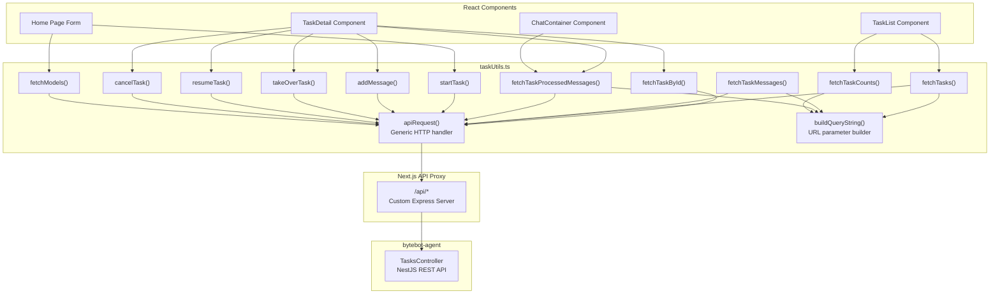
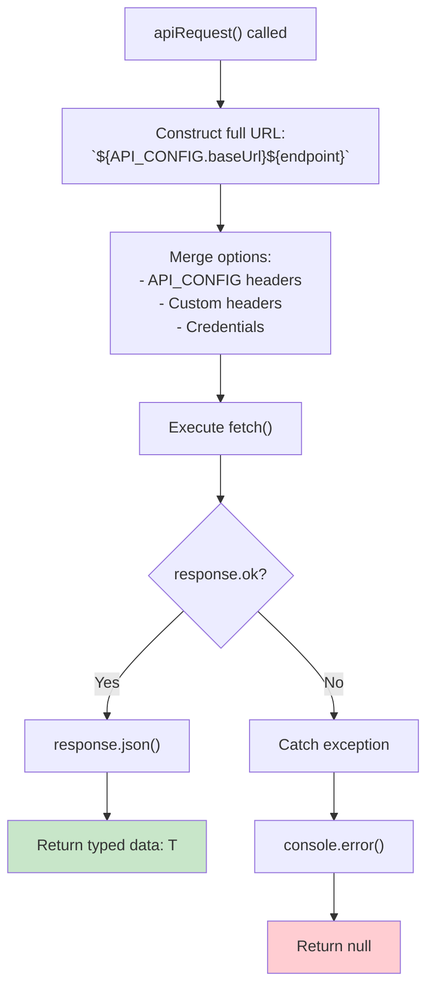
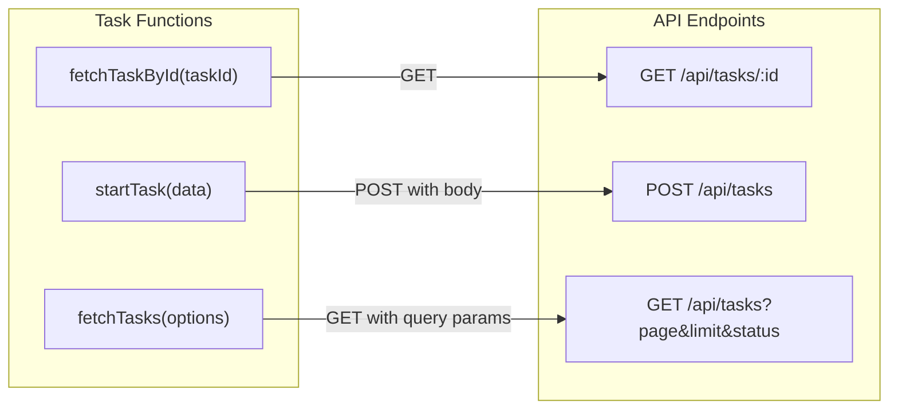
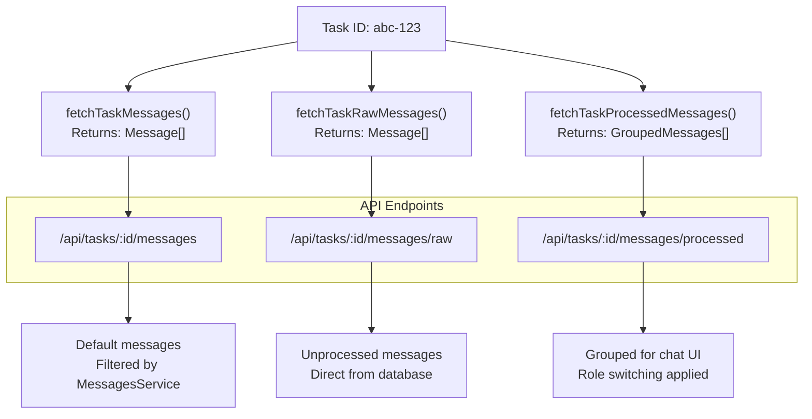
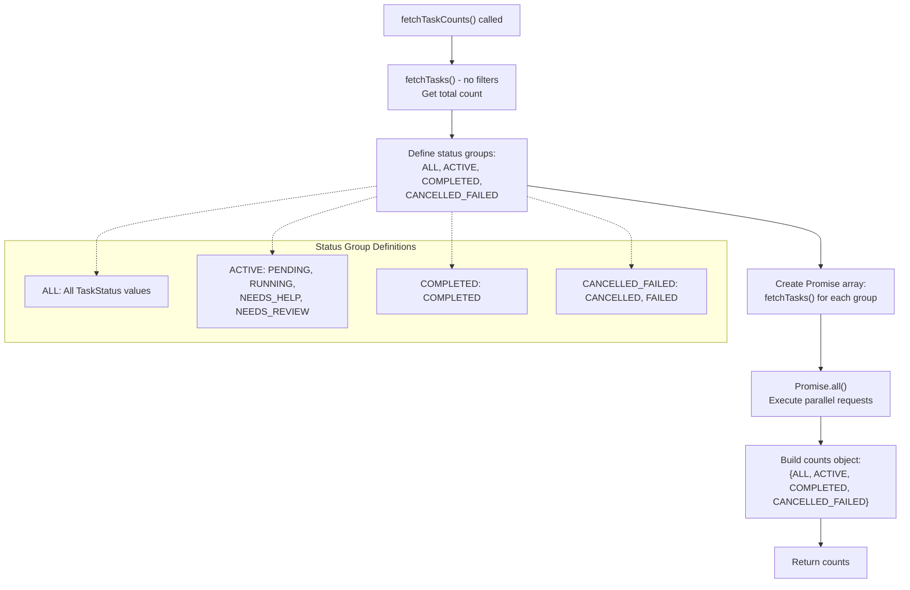
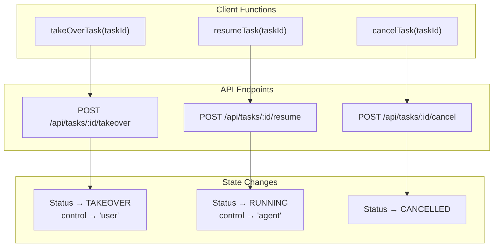
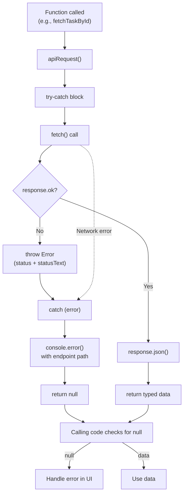

<!-- source: DeepWiki mcp.deepwiki.com · repo bytebot-ai/bytebot · page 8.6 API Client Utilities · fetched 2026-10-29 -->

# API Client Utilities

<details>
<summary>Relevant source files</summary>

The following files were used as context for generating this wiki page:

- [packages/bytebot-ui/.gitignore](packages/bytebot-ui/.gitignore)
- [packages/bytebot-ui/src/components/vnc/VncViewer.tsx](packages/bytebot-ui/src/components/vnc/VncViewer.tsx)
- [packages/bytebot-ui/src/utils/taskUtils.ts](packages/bytebot-ui/src/utils/taskUtils.ts)

</details>


## Purpose and Scope

This document describes the client-side API utilities provided by `taskUtils.ts` in the bytebot-ui package. These utilities abstract HTTP communication between React components and the backend bytebot-agent service, providing type-safe functions for task management, message handling, and real-time updates.

For information about the underlying REST API endpoints, see [Tasks REST API](#10.1). For real-time communication patterns, see [WebSocket Events](#5.3). For UI components that consume these utilities, see [Task Detail Page](#8.3) and [Task List Interface](#8.2).

---

## Architecture Overview

The API client utilities implement a centralized abstraction layer that handles:
- HTTP request configuration and credentials
- Error handling and null safety
- Query parameter serialization
- Type-safe request/response contracts
- API endpoint routing through the Next.js proxy



**Sources:** [packages/bytebot-ui/src/utils/taskUtils.ts:1-260]()

---

## API Configuration

The utility module maintains a centralized configuration object that defines base request parameters applied to all API calls.

### Base Configuration

[packages/bytebot-ui/src/utils/taskUtils.ts:6-12]() defines the `API_CONFIG` object:

| Property | Value | Purpose |
|----------|-------|---------|
| `baseUrl` | `"/api"` | Routes requests through Next.js API proxy |
| `headers` | `{"Content-Type": "application/json"}` | Ensures JSON request bodies |
| `credentials` | `"include"` | Sends cookies for session management |

The `baseUrl` points to `/api` rather than directly to the bytebot-agent service (port 9991) because the Next.js frontend implements a custom Express server that proxies all `/api/*` requests to the backend. This architecture provides:
- CORS management
- Single-origin deployment
- Simplified client configuration

**Sources:** [packages/bytebot-ui/src/utils/taskUtils.ts:6-12]()

---

## Generic Request Handler

The `apiRequest<T>()` function provides a type-safe wrapper around the Fetch API with consistent error handling.

### Function Signature

```typescript
async function apiRequest<T>(
  endpoint: string,
  options: RequestInit = {},
): Promise<T | null>
```

### Request Flow



### Error Handling Strategy

The function implements defensive programming:
1. **HTTP errors** (non-2xx status codes) throw an error with status and statusText
2. **Network errors** (connection failures) are caught by the catch block
3. **All errors** are logged to console with the endpoint path
4. **All errors** result in returning `null` rather than propagating exceptions

This null-return pattern allows calling components to handle failures gracefully without try-catch blocks, though it requires null checks at call sites.

**Sources:** [packages/bytebot-ui/src/utils/taskUtils.ts:17-42]()

---

## Query String Builder

The `buildQueryString()` utility constructs URL query parameters from key-value objects.

### Implementation

[packages/bytebot-ui/src/utils/taskUtils.ts:47-58]() implements parameter serialization:

```typescript
function buildQueryString(
  params: Record<string, string | number | boolean>,
): string
```

### Behavior

| Input | Output |
|-------|--------|
| `{ page: 2, limit: 10 }` | `"?page=2&limit=10"` |
| `{ status: "RUNNING" }` | `"?status=RUNNING"` |
| `{ statuses: "PENDING,RUNNING" }` | `"?statuses=PENDING%2CRUNNING"` |
| `{}` | `""` |
| `{ value: undefined }` | `""` |
| `{ value: null }` | `""` |

The function:
1. Creates a `URLSearchParams` instance
2. Filters out `undefined` and `null` values
3. Converts all values to strings
4. Prepends `?` only if parameters exist
5. Returns empty string if no valid parameters

**Sources:** [packages/bytebot-ui/src/utils/taskUtils.ts:47-58]()

---

## Task Operations

Task operations handle CRUD operations for the primary Task entity.

### Endpoint Mapping



### fetchTaskById

[packages/bytebot-ui/src/utils/taskUtils.ts:117-119]() retrieves a single task by its UUID:

```typescript
export async function fetchTaskById(taskId: string): Promise<Task | null>
```

Returns the complete Task object or null if not found or on error.

### startTask

[packages/bytebot-ui/src/utils/taskUtils.ts:124-133]() creates a new task:

```typescript
export async function startTask(data: {
  description: string;
  model: Model;
  files?: FileWithBase64[];
}): Promise<Task | null>
```

The `FileWithBase64` type includes base64-encoded file data that gets materialized to the virtual desktop's `/home/user/Desktop` directory. See [File Handling](#5.5) for details on file processing.

### fetchTasks

[packages/bytebot-ui/src/utils/taskUtils.ts:151-172]() retrieves paginated task lists with filtering:

```typescript
export async function fetchTasks(options?: {
  page?: number;
  limit?: number;
  status?: string;
  statuses?: string[];
}): Promise<{ tasks: Task[]; total: number; totalPages: number }>
```

**Special handling for `statuses` array:** The function joins multiple status values with commas [packages/bytebot-ui/src/utils/taskUtils.ts:162-164](), allowing queries like `?statuses=PENDING,RUNNING,NEEDS_HELP` to filter for multiple states simultaneously.

**Sources:** [packages/bytebot-ui/src/utils/taskUtils.ts:117-172]()

---

## Message Operations

Message operations retrieve conversation history for tasks in various formats.

### Message Retrieval Variants



### fetchTaskMessages

[packages/bytebot-ui/src/utils/taskUtils.ts:63-76]() retrieves default message processing:

```typescript
export async function fetchTaskMessages(
  taskId: string,
  options?: { limit?: number; page?: number }
): Promise<Message[]>
```

Returns messages with basic filtering applied by MessagesService.

### fetchTaskRawMessages

[packages/bytebot-ui/src/utils/taskUtils.ts:81-94]() retrieves unprocessed messages:

```typescript
export async function fetchTaskRawMessages(
  taskId: string,
  options?: { limit?: number; page?: number }
): Promise<Message[]>
```

Returns messages exactly as stored in the database, without role switching or grouping.

### fetchTaskProcessedMessages

[packages/bytebot-ui/src/utils/taskUtils.ts:99-112]() retrieves UI-optimized messages:

```typescript
export async function fetchTaskProcessedMessages(
  taskId: string,
  options?: { limit?: number; page?: number }
): Promise<GroupedMessages[]>
```

Returns messages grouped by consecutive same-role messages, with role switching applied (pure tool results become ASSISTANT messages). This is the format used by chat UI components. See [Message Display System](#8.5) for details on how GroupedMessages are rendered.

### addMessage

[packages/bytebot-ui/src/utils/taskUtils.ts:138-146]() posts a user message to a task:

```typescript
export async function addMessage(
  taskId: string,
  message: string
): Promise<Task | null>
```

Creates a new USER role message and returns the updated task. When a task is in NEEDS_HELP status, adding a message provides guidance to the agent.

**Sources:** [packages/bytebot-ui/src/utils/taskUtils.ts:63-146]()

---

## Task List Operations

Task list operations support the task browsing interface with counts and filtering.

### fetchTaskCounts

[packages/bytebot-ui/src/utils/taskUtils.ts:177-221]() calculates task counts for filtered views:

```typescript
export async function fetchTaskCounts(): Promise<Record<string, number>>
```

### Count Calculation Logic



The function:
1. Fetches all tasks to get the total count
2. Defines four status groups based on TaskStatus enum
3. Issues parallel requests for each group using `Promise.all()` [packages/bytebot-ui/src/utils/taskUtils.ts:196-206]()
4. Returns a counts object used to populate tab badges in the task list UI

The ACTIVE group aggregates multiple "in-progress" states, while CANCELLED_FAILED groups terminal failure states. This grouping matches the tab structure in the task list interface.

**Sources:** [packages/bytebot-ui/src/utils/taskUtils.ts:177-221]()

---

## Model Configuration Operations

### fetchModels

[packages/bytebot-ui/src/utils/taskUtils.ts:223-238]() retrieves available LLM models:

```typescript
export async function fetchModels(): Promise<Model[]>
```

Unlike other operations, this function directly calls `fetch()` rather than using `apiRequest()`, likely because it was implemented separately or has different error handling requirements. It queries `/api/tasks/models` to get the list of configured models that users can select when creating tasks.

**Sources:** [packages/bytebot-ui/src/utils/taskUtils.ts:223-238]()

---

## Task Control Operations

Task control operations manage task state transitions through user actions.

### Control Operation Mapping



### takeOverTask

[packages/bytebot-ui/src/utils/taskUtils.ts:243-245]() hands control to the user:

```typescript
export async function takeOverTask(taskId: string): Promise<Task | null>
```

Sets task status to TAKEOVER and control field to "user", pausing agent execution. The user can then manually interact with the desktop or add guidance messages.

### resumeTask

[packages/bytebot-ui/src/utils/taskUtils.ts:250-252]() returns control to the agent:

```typescript
export async function resumeTask(taskId: string): Promise<Task | null>
```

Sets task status to RUNNING and control field to "agent", allowing the agent processor to resume execution from where it stopped.

### cancelTask

[packages/bytebot-ui/src/utils/taskUtils.ts:257-259]() terminates task execution:

```typescript
export async function cancelTask(taskId: string): Promise<Task | null>
```

Sets task status to CANCELLED, permanently stopping execution. This action is irreversible—the task cannot be resumed after cancellation.

**Sources:** [packages/bytebot-ui/src/utils/taskUtils.ts:243-259]()

---

## WebSocket Integration

While `taskUtils.ts` focuses on HTTP operations, the UI also uses WebSocket connections for real-time updates. The VNC viewer component demonstrates WebSocket client usage.

### VNC WebSocket Connection

[packages/bytebot-ui/src/components/vnc/VncViewer.tsx:1-48]() establishes a WebSocket connection to the VNC server:

```typescript
const proto = window.location.protocol === "https:" ? "wss" : "ws";
setWsUrl(`${proto}://${window.location.host}/api/proxy/websockify`);
```

The VNC viewer:
1. Dynamically imports the `react-vnc` library client-side to avoid SSR issues [packages/bytebot-ui/src/components/vnc/VncViewer.tsx:16-20]()
2. Constructs the WebSocket URL based on the page protocol (wss for HTTPS, ws for HTTP)
3. Routes through `/api/proxy/websockify`, which proxies to bytebotd's VNC server on port 6080

For task event WebSocket connections, see the `useWebSocket` hook documented in [WebSocket Events](#5.3).

**Sources:** [packages/bytebot-ui/src/components/vnc/VncViewer.tsx:1-48]()

---

## Error Handling Patterns

The API utilities implement a consistent error handling strategy across all functions.

### Error Flow



### Error Categories

| Error Type | Cause | Logged Information | Return Value |
|------------|-------|-------------------|--------------|
| HTTP 4xx/5xx | Server returns error status | Endpoint + status + statusText | `null` |
| Network failure | Connection refused, timeout | Endpoint + error message | `null` |
| JSON parse error | Invalid response body | Endpoint + error message | `null` |

### Calling Pattern

All functions that use `apiRequest()` follow this pattern:

```typescript
const result = await apiRequest<Task>(`/tasks/${taskId}`, { method: "GET" });
return result || []; // Or null, or default value
```

Some functions provide empty defaults:
- `fetchTaskMessages` returns `[]` on error [packages/bytebot-ui/src/utils/taskUtils.ts:75]()
- `fetchTasks` returns `{ tasks: [], total: 0, totalPages: 0 }` [packages/bytebot-ui/src/utils/taskUtils.ts:171]()
- `fetchTaskCounts` returns zeroed counts [packages/bytebot-ui/src/utils/taskUtils.ts:214-220]()

This approach allows UI components to degrade gracefully—empty lists display no items rather than crashing, and zero counts show empty tabs rather than undefined badges.

**Sources:** [packages/bytebot-ui/src/utils/taskUtils.ts:17-42](), [packages/bytebot-ui/src/utils/taskUtils.ts:63-221]()

---

## Type Safety

All utility functions use TypeScript generics and explicit return types to ensure compile-time type checking.

### Type Imports

[packages/bytebot-ui/src/utils/taskUtils.ts:1]() imports shared types:

```typescript
import { Message, Task, Model, GroupedMessages, FileWithBase64, TaskStatus } from "@/types";
```

These types mirror the Prisma database schema and provide consistency across the UI codebase. The `@/types` alias resolves to `packages/bytebot-ui/src/types`, which re-exports types from the `@bytebot/shared` package.

### Generic Type Parameter

The `apiRequest<T>()` function uses a generic type parameter to enforce return type contracts:

```typescript
async function apiRequest<T>(
  endpoint: string,
  options: RequestInit = {},
): Promise<T | null>
```

When calling `apiRequest<Task>()`, TypeScript ensures the JSON response matches the Task interface, catching type mismatches at compile time.

**Sources:** [packages/bytebot-ui/src/utils/taskUtils.ts:1](), [packages/bytebot-ui/src/utils/taskUtils.ts:17-20]()

---

## Usage Examples

### Creating a Task

```typescript
import { startTask } from '@/utils/taskUtils';

const task = await startTask({
  description: "Open Firefox and navigate to example.com",
  model: "claude-3-5-sonnet-20241022",
  files: [] // Optional file attachments
});

if (task) {
  // Task created successfully, redirect to task page
  router.push(`/task/${task.id}`);
} else {
  // Handle error
  setError("Failed to create task");
}
```

### Fetching and Displaying Messages

```typescript
import { fetchTaskProcessedMessages } from '@/utils/taskUtils';

const messages = await fetchTaskProcessedMessages(taskId, {
  limit: 50,
  page: 1
});

// messages is GroupedMessages[] ready for chat UI rendering
setMessages(messages);
```

### Handling Task Control

```typescript
import { takeOverTask, resumeTask } from '@/utils/taskUtils';

// User clicks "Take Over" button
const handleTakeOver = async () => {
  const updatedTask = await takeOverTask(taskId);
  if (updatedTask) {
    setTask(updatedTask); // Update local state
  }
};

// User clicks "Resume" button after providing guidance
const handleResume = async () => {
  const updatedTask = await resumeTask(taskId);
  if (updatedTask) {
    setTask(updatedTask); // Agent will resume processing
  }
};
```

**Sources:** [packages/bytebot-ui/src/utils/taskUtils.ts:124-259]()

---

