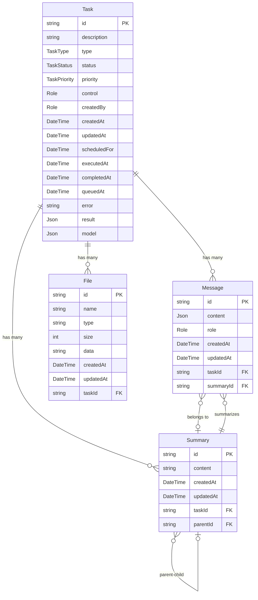
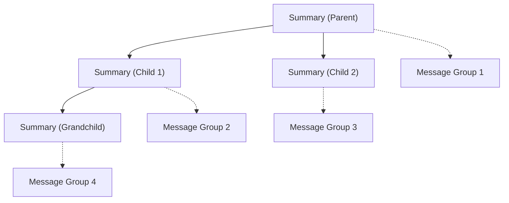
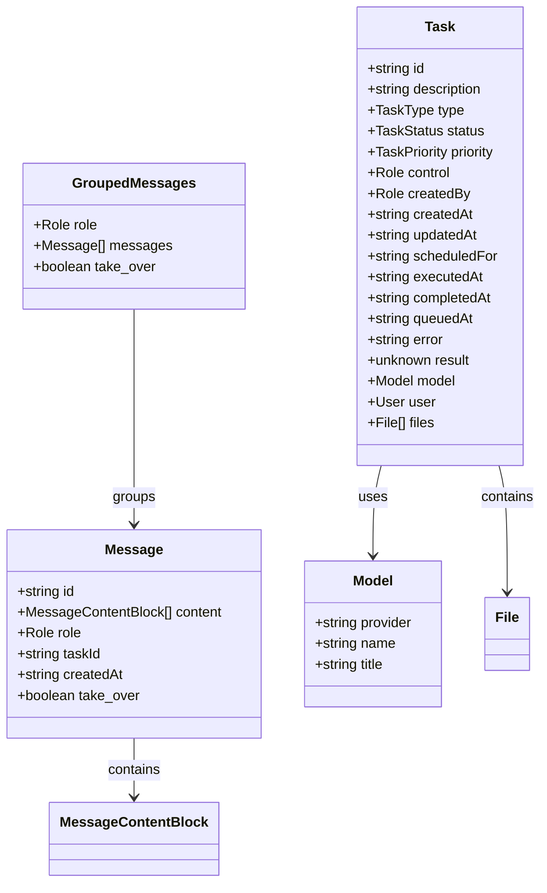
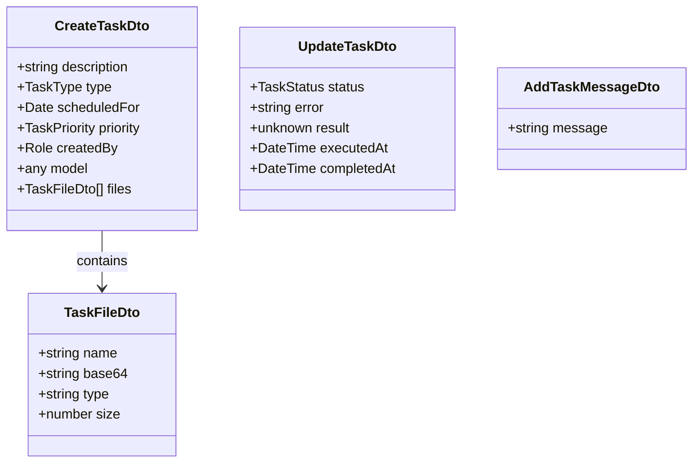
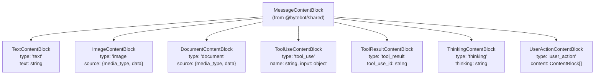
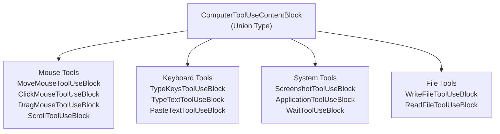
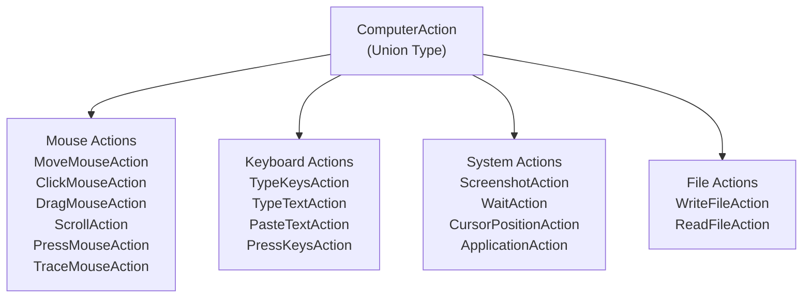
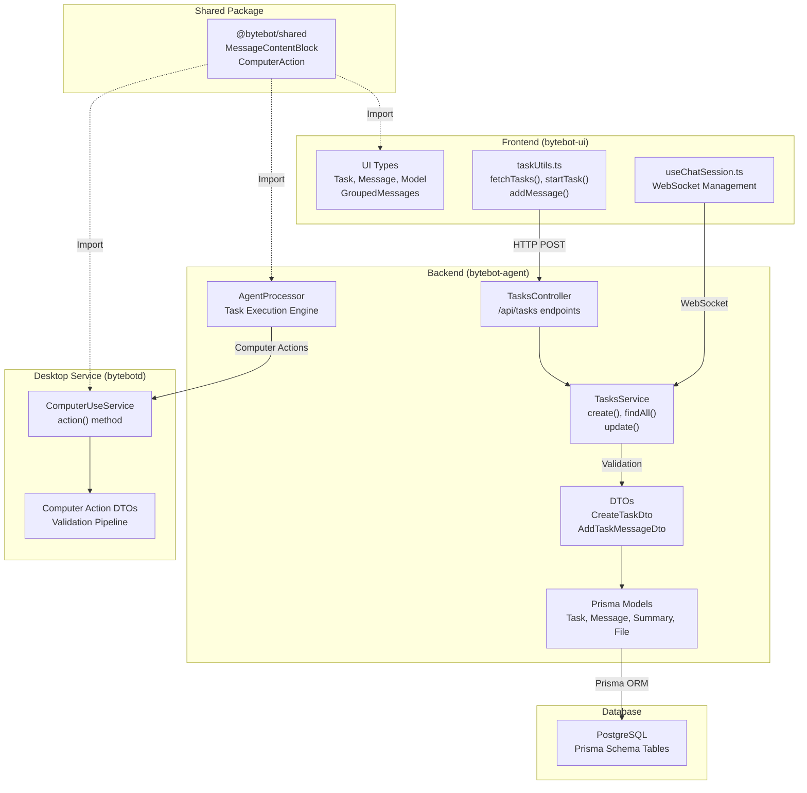
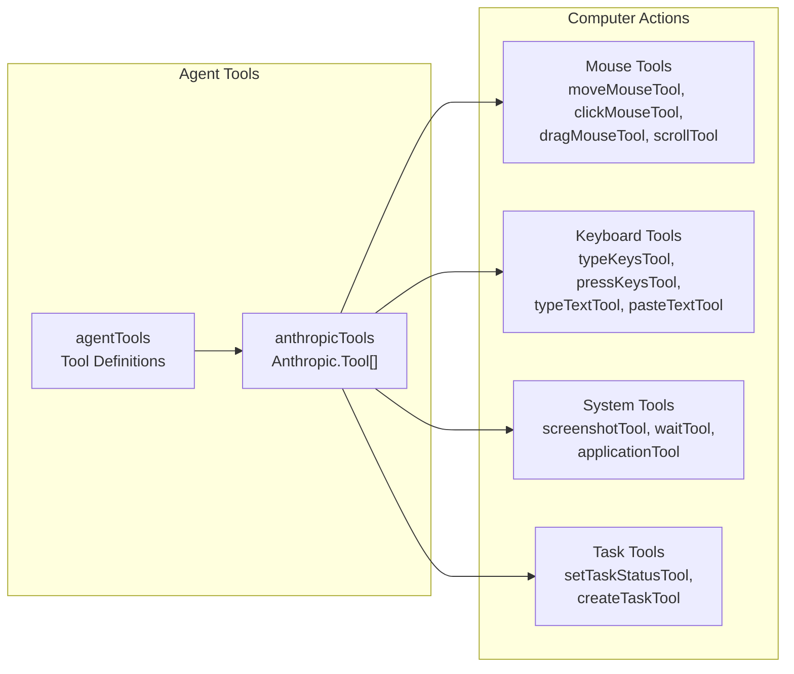

<!-- source: DeepWiki mcp.deepwiki.com · repo bytebot-ai/bytebot · page 9 Data Models · fetched 2026-10-29 -->

# Data Models

Relevant source files

The following files were used as context for generating this wiki page:

- [packages/bytebot-agent/prisma/schema.prisma](packages/bytebot-agent/prisma/schema.prisma)
- [packages/bytebot-agent/src/anthropic/anthropic.tools.ts](packages/bytebot-agent/src/anthropic/anthropic.tools.ts)
- [packages/bytebot-agent/src/tasks/dto/create-task.dto.ts](packages/bytebot-agent/src/tasks/dto/create-task.dto.ts)
- [packages/bytebot-ui/src/types/index.ts](packages/bytebot-ui/src/types/index.ts)

This document provides comprehensive documentation of the data structures, database schema, and type definitions used throughout the Bytebot system. It covers the PostgreSQL database schema, TypeScript interfaces, data transfer objects (DTOs), and shared type definitions that enable communication between services.

## Database Schema

The Bytebot system uses PostgreSQL as its primary database with Prisma as the ORM. The schema defines the core entities and their relationships for task management, message persistence, and file storage.

### Core Entity Models

**Database Entity Relationship Diagram**

The database schema centers around four primary entities: `Task`, `Message`, `Summary`, and `File`, with hierarchical relationships for conversation summarization.

**Sources:** [packages/bytebot-agent/prisma/schema.prisma:43-115]()

### Enumeration Types

The system defines several enums to constrain values and ensure data consistency:

| Enum | Values | Usage |
|------|--------|-------|
| `TaskStatus` | `PENDING`, `RUNNING`, `NEEDS_HELP`, `NEEDS_REVIEW`, `COMPLETED`, `CANCELLED`, `FAILED` | Tracks task lifecycle state |
| `TaskPriority` | `LOW`, `MEDIUM`, `HIGH`, `URGENT` | Prioritizes task execution |
| `TaskType` | `IMMEDIATE`, `SCHEDULED` | Distinguishes execution timing |
| `Role` | `USER`, `ASSISTANT` | Identifies message sender and task control |

**Sources:** [packages/bytebot-agent/prisma/schema.prisma:16-41]()

### Summary Model Hierarchy

The `Summary` model supports hierarchical summarization with self-referential relationships to enable progressive conversation compression:

This enables the system to maintain context while managing token limits by creating nested summaries of conversation history.

**Sources:** [packages/bytebot-agent/prisma/schema.prisma:67-81]()

## TypeScript Interfaces

The frontend and shared packages define TypeScript interfaces that correspond to database models with additional client-side properties and computed fields.

### Frontend Data Models

**Client-Side Type Structure**

**Sources:** [packages/bytebot-ui/src/types/index.ts:78-98](), [packages/bytebot-ui/src/types/index.ts:8-29]()

### File Handling Types

The system defines two file interfaces for different contexts:

| Interface | Purpose | Fields |
|-----------|---------|--------|
| `FileWithBase64` | Client-side file upload | `name`, `base64`, `type`, `size` |
| `File` | Persisted database file | `id`, `name`, `type`, `size`, `data`, `createdAt`, `updatedAt`, `taskId` |

**Sources:** [packages/bytebot-ui/src/types/index.ts:60-76]()

## Data Transfer Objects

The backend uses DTOs for request validation and type safety during API operations.

### Task Management DTOs

**Task Creation and Update DTOs**

The DTOs include validation decorators from `class-validator`:
- `@IsNotEmpty()` for required fields like `description`
- `@IsOptional()` for optional fields like `scheduledFor`  
- `@ValidateNested()` for nested object validation with `TaskFileDto[]`

**Sources:** [packages/bytebot-agent/src/tasks/dto/create-task.dto.ts:31-60](), [packages/bytebot-agent/src/tasks/dto/update-task.dto.ts]()

## Message Content Structure

Messages in Bytebot follow Anthropic's content blocks structure, stored as JSON in the database and typed via the shared package. The `@bytebot/shared` package provides comprehensive type definitions for all content block variants.

### Content Block Type Hierarchy

**MessageContentBlock Type Structure**

### Computer Tool Use Types

The system defines specialized tool use blocks for computer automation:

**Computer Tool Use Content Blocks**

Content blocks are stored as JSON arrays in the database `Message.content` field and consumed by both the frontend chat interface and AI model processing.

**Sources:** [packages/shared/src/types/messageContent.types.ts:4-258](), [packages/bytebot-agent/prisma/schema.prisma:91]()

## Computer Action Types

The system defines comprehensive types for computer automation actions that correspond to desktop control operations.

### Computer Action Type Structure

**Computer Action Definitions**

These types are used by `ComputerUseService` in the desktop service to perform actual desktop automation, and are validated using DTOs and pipes.

**Sources:** [packages/shared/src/types/computerAction.types.ts:109-125](), [packages/bytebotd/src/computer-use/dto/computer-action.dto.ts:223-239]()

## Data Flow and Type Mapping

**System Data Flow Architecture**

**Sources:** [packages/bytebot-ui/src/utils/taskUtils.ts:1-260](), [packages/bytebot-agent/src/tasks/tasks.service.ts:1-393](), [packages/bytebotd/src/computer-use/computer-use.service.ts:25-507]()

## Tool Definitions and Computer Actions

The system defines tools that the AI agent can use to interact with the desktop environment:

Tool definitions are converted from generic agent tools to Anthropic-specific format and exposed as individual exports for type safety.

**Sources:** [packages/bytebot-agent/src/anthropic/anthropic.tools.ts:7-54]()

---

