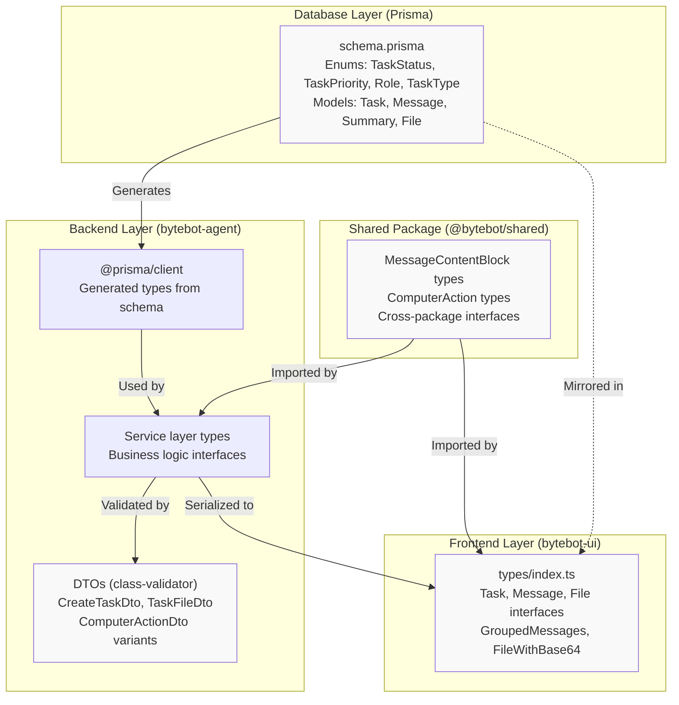
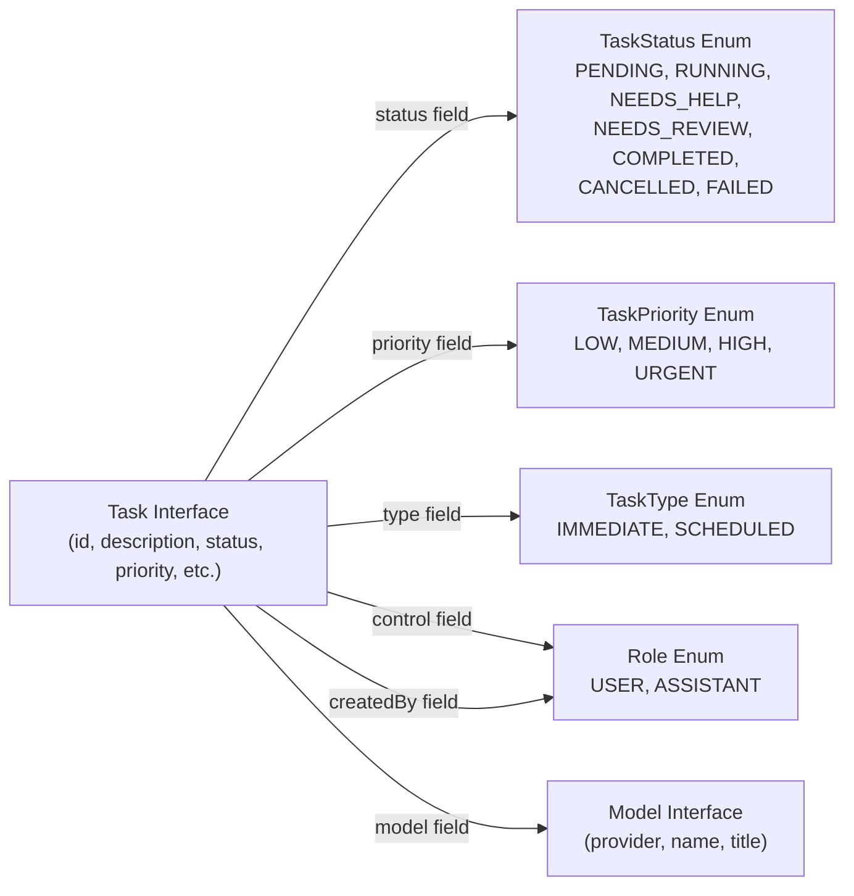
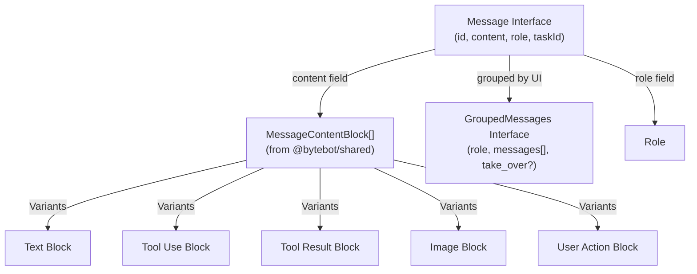
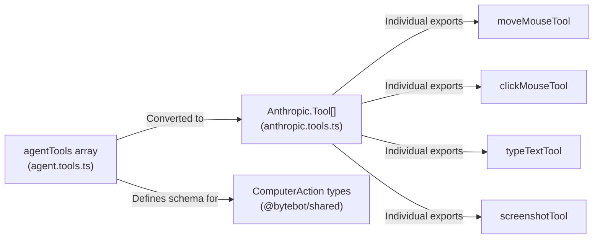
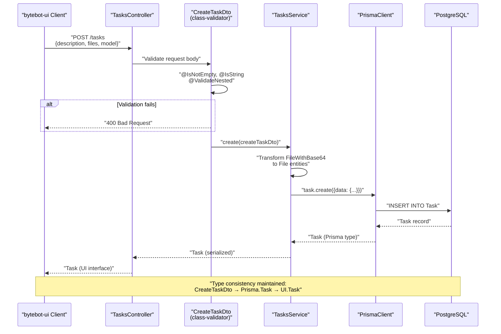

<!-- source: DeepWiki mcp.deepwiki.com · repo bytebot-ai/bytebot · page 9.1 Type System Overview · fetched 2026-10-29 -->

# Type System Overview

<details>
<summary>Relevant source files</summary>

The following files were used as context for generating this wiki page:

- [packages/bytebot-agent/prisma/schema.prisma](packages/bytebot-agent/prisma/schema.prisma)
- [packages/bytebot-agent/src/anthropic/anthropic.tools.ts](packages/bytebot-agent/src/anthropic/anthropic.tools.ts)
- [packages/bytebot-agent/src/tasks/dto/create-task.dto.ts](packages/bytebot-agent/src/tasks/dto/create-task.dto.ts)
- [packages/bytebot-ui/src/types/index.ts](packages/bytebot-ui/src/types/index.ts)

</details>


## Purpose and Scope

This document explains how Bytebot maintains type consistency across its three-tier architecture. It describes the type definition strategy, the relationship between Prisma database schemas and TypeScript interfaces, the role of shared type packages, and validation mechanisms at API boundaries.

For details on specific database models and relationships, see [Database Schema](#9.2). For message content structure, see [Message Content Types](#9.3). For computer action type hierarchies, see [Computer Action Types](#9.4).

---

## Type Architecture

Bytebot employs a **multi-layered type system** to ensure type safety from the database through the API layer to the UI. Types are defined at four distinct layers, each serving a specific purpose in the data flow.

### Type Definition Layers



**Sources:** [packages/bytebot-agent/prisma/schema.prisma:1-115](), [packages/bytebot-ui/src/types/index.ts:1-91]()

---

## Type Consistency Strategy

Bytebot maintains type consistency through **schema mirroring** and **shared type packages** rather than code generation from a single source of truth. This approach balances flexibility with type safety.

### Enum Synchronization

Core enums are defined in the Prisma schema and manually mirrored in the UI types. This requires discipline but avoids complex build-time code generation across packages.

| Enum | Prisma Location | UI Location | Purpose |
|------|----------------|-------------|---------|
| `TaskStatus` | [schema.prisma:16-24]() | [types/index.ts:32-40]() | Task lifecycle states |
| `TaskPriority` | [schema.prisma:26-31]() | [types/index.ts:42-47]() | Task urgency levels |
| `Role` | [schema.prisma:33-36]() | [types/index.ts:3-6]() | Message authorship |
| `TaskType` | [schema.prisma:38-41]() | [types/index.ts:49-52]() | Immediate vs scheduled |

### Interface Mirroring

The `Task` interface in the UI exactly mirrors the Prisma `Task` model, ensuring API responses can be directly consumed by UI components without transformation.

**Prisma Model:**
```prisma
model Task {
  id            String        @id @default(uuid())
  description   String
  type          TaskType      @default(IMMEDIATE)
  status        TaskStatus    @default(PENDING)
  priority      TaskPriority  @default(MEDIUM)
  control       Role          @default(ASSISTANT)
  // ... additional fields
}
```

**UI Interface:**
```typescript
export interface Task {
  id: string;
  description: string;
  type: TaskType;
  status: TaskStatus;
  priority: TaskPriority;
  control: Role;
  // ... additional fields
}
```

**Sources:** [packages/bytebot-agent/prisma/schema.prisma:43-65](), [packages/bytebot-ui/src/types/index.ts:72-90]()

---

## Core Type Categories

### Task Types

Task-related types define the structure and lifecycle of work units in Bytebot.



**Key Fields:**
- `id`: UUID string identifier
- `description`: User-provided task instructions
- `status`: Current lifecycle state (see [Task Lifecycle](#5.1))
- `control`: Whether `USER` or `ASSISTANT` has control
- `model`: JSON object specifying LLM provider and model name
- `scheduledFor`: Optional future execution timestamp
- `error`: Optional error message if `status` is `FAILED`

**Sources:** [packages/bytebot-ui/src/types/index.ts:72-90](), [packages/bytebot-agent/prisma/schema.prisma:43-65]()

### Message Types

Message types support the conversation history between users and AI agents, with structured content blocks.



**Message Interface:**
- [packages/bytebot-ui/src/types/index.ts:9-16]() defines the core structure
- `content`: Array of `MessageContentBlock` objects from `@bytebot/shared`
- `role`: Either `USER` or `ASSISTANT`
- `take_over`: Optional boolean indicating user takeover events

**GroupedMessages:**
- [packages/bytebot-ui/src/types/index.ts:19-23]() defines the grouped structure
- Used by the UI to display consecutive messages from the same role
- See [Message Display System](#8.5) for rendering details

**Sources:** [packages/bytebot-ui/src/types/index.ts:9-23](), [packages/bytebot-agent/prisma/schema.prisma:83-99]()

### File Types

File types handle attachment uploads and desktop filesystem materialization.

**FileWithBase64** (Upload Format):
```typescript
export interface FileWithBase64 {
  name: string;
  base64: string;  // Base64-encoded file data
  type: string;    // MIME type
  size: number;    // Bytes
}
```

**File** (Database Model):
```typescript
export interface File {
  id: string;
  name: string;
  type: string;
  size: number;
  data: string;    // Base64-encoded
  createdAt: string;
  updatedAt: string;
  taskId: string;
}
```

The transformation occurs at the API boundary:
1. UI uploads `FileWithBase64` objects via `CreateTaskDto`
2. Backend stores as `File` records in database
3. Agent materializes `data` field to `/home/user/Desktop/` filesystem

**Sources:** [packages/bytebot-ui/src/types/index.ts:54-70](), [packages/bytebot-agent/prisma/schema.prisma:101-113]()

### Tool and Action Types

Tool definitions use a shared format across LLM providers, with provider-specific adapters.



The conversion pattern:
- [packages/bytebot-agent/src/anthropic/anthropic.tools.ts:7-9]() converts generic tool definitions
- [packages/bytebot-agent/src/anthropic/anthropic.tools.ts:14-31]() creates named exports
- Tools include: mouse operations, keyboard operations, screenshot, application management, task control

**Sources:** [packages/bytebot-agent/src/anthropic/anthropic.tools.ts:1-55]()

---

## Type Flow Across Package Boundaries

This diagram shows how types flow from client requests through validation, database operations, and back to the client.



**Sources:** [packages/bytebot-agent/src/tasks/dto/create-task.dto.ts:1-61]()

---

## Validation and Runtime Type Safety

Bytebot employs multiple validation strategies at different layers.

### DTO Validation (API Boundary)

The backend uses `class-validator` decorators to enforce type constraints at REST API endpoints.

**CreateTaskDto Example:**
```typescript
export class CreateTaskDto {
  @IsNotEmpty()
  @IsString()
  description: string;

  @IsOptional()
  @IsString()
  type?: TaskType;

  @IsOptional()
  @IsArray()
  @ValidateNested({ each: true })
  @Type(() => TaskFileDto)
  files?: TaskFileDto[];
}
```

**Validation Decorators:**
- `@IsNotEmpty()`: Rejects null/undefined/empty values
- `@IsString()`, `@IsNumber()`: Type checking
- `@IsOptional()`: Field not required
- `@ValidateNested()`: Recursively validate nested objects
- `@Type(() => Class)`: Transform plain objects to class instances

**Sources:** [packages/bytebot-agent/src/tasks/dto/create-task.dto.ts:1-61]()

### Prisma Type Generation

Prisma generates TypeScript types from the schema automatically:

```bash
npx prisma generate
```

This creates the `@prisma/client` package with:
- Type-safe model interfaces
- Enum exports matching schema definitions
- Query builder with autocomplete
- Type inference for relations

The generated types are imported throughout the backend:
```typescript
import { TaskStatus, TaskPriority, Role, TaskType } from '@prisma/client';
```

**Sources:** [packages/bytebot-agent/prisma/schema.prisma:7-9]()

### Shared Package Types

The `@bytebot/shared` package (referenced in imports but not shown in provided files) defines cross-cutting types:
- `MessageContentBlock` and its variants
- `ComputerAction` type hierarchy
- Common interfaces used by both frontend and backend

This prevents duplication and ensures consistency for types that need to cross package boundaries.

**Sources:** [packages/bytebot-ui/src/types/index.ts:1]()

---

## Type Safety Benefits

The multi-layered type system provides several guarantees:

1. **Compile-Time Safety**: TypeScript catches type mismatches before runtime
2. **API Contract Enforcement**: DTOs validate incoming requests against expected schemas
3. **Database Consistency**: Prisma ensures database operations match schema definitions
4. **UI Rendering Safety**: Frontend components receive properly typed data structures

This architecture trades some duplication (manual enum mirroring) for flexibility and clarity, avoiding complex code generation pipelines while maintaining strong type safety across all layers.

**Sources:** All files referenced throughout this document

---

