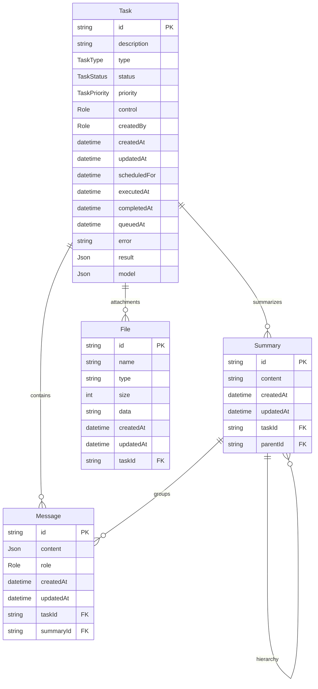
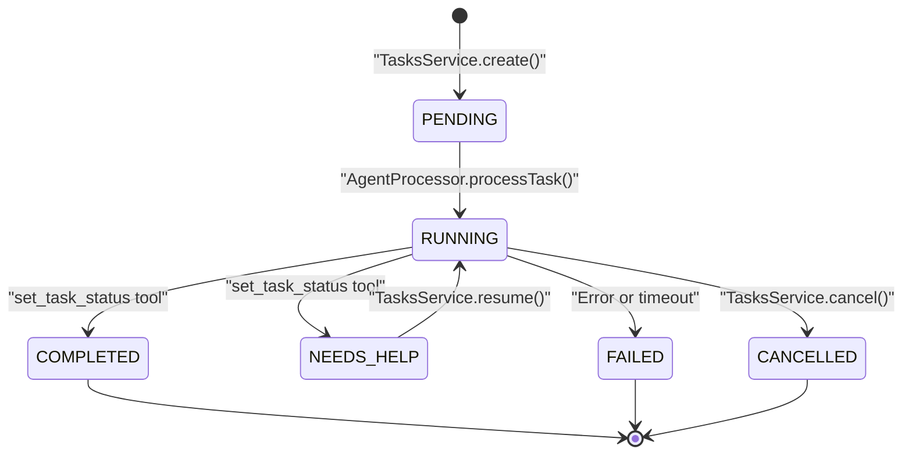
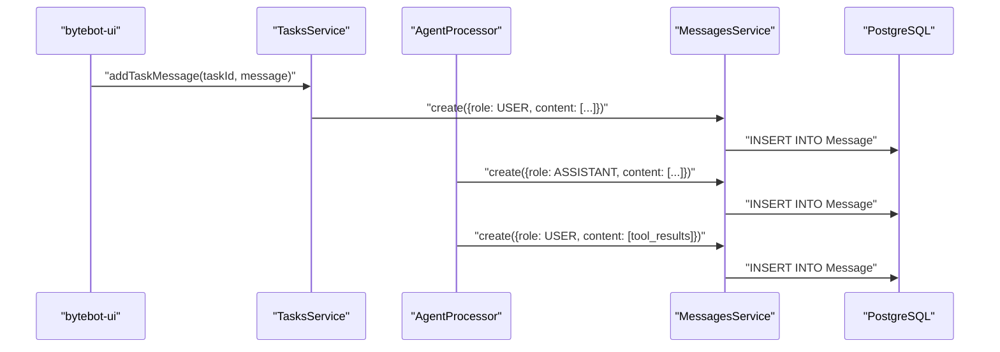
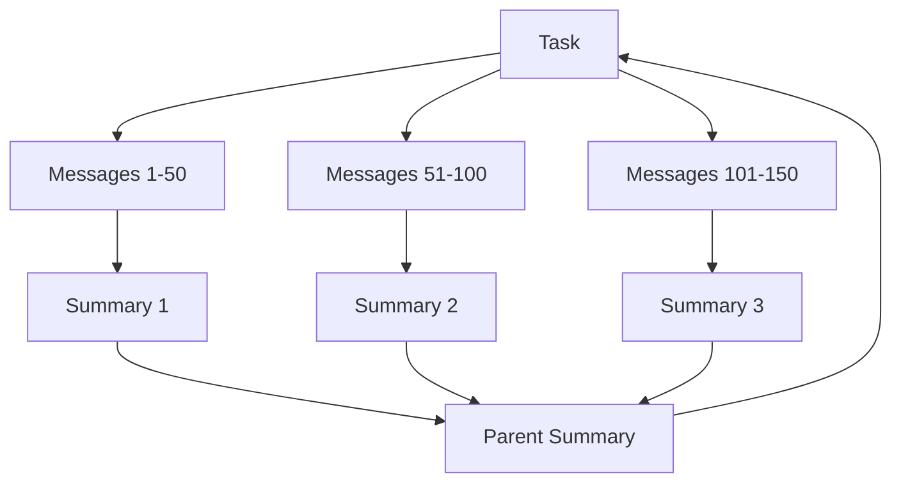
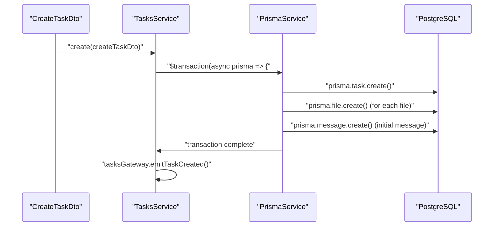

<!-- source: DeepWiki mcp.deepwiki.com · repo bytebot-ai/bytebot · page 9.2 Database Schema · fetched 2026-10-29 -->

# Database Schema

<details>
<summary>Relevant source files</summary>

The following files were used as context for generating this wiki page:

- [packages/bytebot-agent/prisma/schema.prisma](packages/bytebot-agent/prisma/schema.prisma)
- [packages/bytebot-agent/src/anthropic/anthropic.tools.ts](packages/bytebot-agent/src/anthropic/anthropic.tools.ts)
- [packages/bytebot-agent/src/tasks/dto/create-task.dto.ts](packages/bytebot-agent/src/tasks/dto/create-task.dto.ts)
- [packages/bytebot-ui/src/types/index.ts](packages/bytebot-ui/src/types/index.ts)

</details>


This document describes the PostgreSQL database schema used by Bytebot to store tasks, messages, summaries, and file attachments. The schema is managed using Prisma ORM and provides the persistence layer for the AI agent task processing system.

For information about the TypeScript interfaces and data types used in the application layer, see [Types and Interfaces](8.1). For details about task lifecycle management, see [Task Management](6.1).

## Database Technology

Bytebot uses PostgreSQL as its primary database, deployed as a containerized service within the Docker/Kubernetes infrastructure. The database schema is managed through Prisma ORM with migration-based schema evolution.

The database runs on port 5432 and is accessed by the `bytebot-agent` service through the `PrismaService`, which provides type-safe database operations and automatic query generation.

Sources: [packages/bytebot-agent/prisma/schema.prisma:11-14]()

## Schema Overview

The database schema consists of four core entities that support Bytebot's AI agent task processing:

| Entity | Purpose | Key Features |
|--------|---------|--------------|
| `Task` | AI agent task lifecycle and orchestration | Status tracking, priority, control handoff |
| `Message` | Conversation history and AI interactions | Structured content blocks, role-based attribution |
| `Summary` | Message history compression for context management | Hierarchical summarization, token optimization |
| `File` | Task attachments and file processing | Base64 storage, MIME type support |

**Core Database Schema**


Sources: [packages/bytebot-agent/prisma/schema.prisma:43-114]()

## Task Entity Schema

The `Task` entity is the central component of Bytebot's database schema, representing individual AI agent tasks with comprehensive lifecycle management.

### Task Table Structure

The `Task` table stores all task-related information and state:

```sql
-- Core task fields
id            UUID PRIMARY KEY DEFAULT gen_random_uuid()
description   TEXT NOT NULL
type          TaskType DEFAULT 'IMMEDIATE'
status        TaskStatus DEFAULT 'PENDING'
priority      TaskPriority DEFAULT 'MEDIUM'
control       Role DEFAULT 'ASSISTANT'
createdBy     Role DEFAULT 'USER'

-- Timestamps for lifecycle tracking  
createdAt     TIMESTAMP DEFAULT now()
updatedAt     TIMESTAMP DEFAULT now()
scheduledFor  TIMESTAMP NULL
executedAt    TIMESTAMP NULL
completedAt   TIMESTAMP NULL
queuedAt      TIMESTAMP NULL

-- Execution results and errors
error         TEXT NULL
result        JSONB NULL

-- AI model configuration
model         JSONB NOT NULL
```

### Task Status Management

The task status follows a defined lifecycle managed by the `AgentProcessor`:

**Task Status Flow**


### Task Control Handoff

The `control` field manages handoff between AI agent and user:

| Control State | Description | Managed By |
|---------------|-------------|------------|
| `ASSISTANT` | AI agent has control, executing actions | `AgentProcessor` |
| `USER` | User has control, can provide guidance | `TasksService.takeOver()` |

Sources: [packages/bytebot-agent/prisma/schema.prisma:43-65](), [packages/bytebot-agent/src/agent/agent.processor.ts:84-420]()

## Message Storage Schema

The `Message` table stores conversation history between users and AI agents using Anthropic's content block structure for flexible multimedia support.

### Message Content Structure

Messages use a JSON `content` field following Anthropic's format:

```typescript
// Example message content structures
[
  {"type": "text", "text": "Hello world"}
]

[
  {"type": "text", "text": "Please analyze this image"},
  {"type": "image", "source": {"type": "base64", "media_type": "image/jpeg", "data": "..."}}
]

[
  {"type": "tool_use", "id": "toolu_123", "name": "computer", "input": {"action": "screenshot"}}
]
```

### Message Role System

The `role` field distinguishes message sources:

| Role | Purpose | Created By |
|------|---------|------------|
| `USER` | User input, guidance, task descriptions | `TasksService.addTaskMessage()` |
| `ASSISTANT` | AI agent responses, tool usage | `AgentProcessor.runIteration()` |

**Message Processing Flow**


Sources: [packages/bytebot-agent/prisma/schema.prisma:83-99](), [packages/bytebot-agent/src/tasks/tasks.service.ts:263-280]()

## Summary and File Storage

The schema includes specialized entities for message summarization and file attachment handling to support long-running tasks and multimedia processing.

### Summary Table for Context Management

The `Summary` table enables context compression when message history exceeds AI model token limits:

```sql
-- Summary table structure
id             UUID PRIMARY KEY DEFAULT gen_random_uuid()
content        TEXT NOT NULL
createdAt      TIMESTAMP DEFAULT now()
updatedAt      TIMESTAMP DEFAULT now()
taskId         UUID REFERENCES Task(id) ON DELETE CASCADE
parentId       UUID REFERENCES Summary(id) -- Self-referential hierarchy
```

**Hierarchical Summarization**


### File Attachment Storage

The `File` table stores task-related file attachments as base64-encoded data:

```sql
-- File table structure
id            UUID PRIMARY KEY DEFAULT gen_random_uuid()
name          TEXT NOT NULL
type          TEXT NOT NULL        -- MIME type (e.g., 'image/jpeg')
size          INTEGER NOT NULL     -- Size in bytes
data          TEXT NOT NULL        -- Base64 encoded file data
createdAt     TIMESTAMP DEFAULT now()
updatedAt     TIMESTAMP DEFAULT now()
taskId        UUID REFERENCES Task(id) ON DELETE CASCADE
```

Files are processed during task creation in `TasksService.create()` and written to the desktop environment for agent access.

Sources: [packages/bytebot-agent/prisma/schema.prisma:67-114](), [packages/bytebot-agent/src/tasks/tasks.service.ts:66-93]()

## Database Transactions and Operations

The schema supports complex operations through Prisma transactions, particularly for task creation and message processing.

### Task Creation Transaction

Task creation involves multiple related operations in a single transaction:

**Task Creation Process**


### Message Processing with Summaries

When token usage exceeds thresholds, the `AgentProcessor` triggers summarization:

```typescript
// Token usage check in AgentProcessor
const contextWindow = model.contextWindow || 200000;
const contextThreshold = contextWindow * 0.75;
const shouldSummarize = agentResponse.tokenUsage.totalTokens >= contextThreshold;
```

This creates new `Summary` records and links existing messages to maintain context while reducing token consumption.

Sources: [packages/bytebot-agent/src/tasks/tasks.service.ts:45-117](), [packages/bytebot-agent/src/agent/agent.processor.ts:234-299]()

## Enum Definitions and Constraints

The schema defines several enums that constrain field values and provide type safety across the application.

### Core Enums

| Enum | Values | Usage |
|------|--------|-------|
| `TaskStatus` | `PENDING`, `RUNNING`, `NEEDS_HELP`, `NEEDS_REVIEW`, `COMPLETED`, `CANCELLED`, `FAILED` | Task lifecycle state |
| `TaskPriority` | `LOW`, `MEDIUM`, `HIGH`, `URGENT` | Task execution priority |
| `Role` | `USER`, `ASSISTANT` | Message attribution and control |
| `TaskType` | `IMMEDIATE`, `SCHEDULED` | Task execution timing |

### Data Integrity Constraints

The schema enforces data integrity through:

- **UUID Primary Keys**: All entities use UUID primary keys for global uniqueness
- **Cascade Deletions**: Task deletion automatically removes related messages, summaries, and files
- **Default Values**: Sensible defaults for status (`PENDING`), priority (`MEDIUM`), and control (`ASSISTANT`)
- **JSON Validation**: The `model` field stores structured AI provider configuration
- **Timestamp Tracking**: Automatic `createdAt` and `updatedAt` timestamps on all entities

Sources: [packages/bytebot-agent/prisma/schema.prisma:16-41]()

## Migration Strategy

The database schema follows a migration-based approach using Prisma's migration system. The migration file shows the addition of the Better Auth schema to an existing database with a `Message` table.

Migration characteristics:
- Incremental schema changes through numbered migration files
- Backward-compatible additions (adding `userId` column as nullable)
- Foreign key constraints with appropriate cascade behaviors
- Index creation for performance optimization

The migration pattern supports:
- Zero-downtime deployments
- Schema version tracking
- Rollback capabilities
- Multi-environment consistency

Sources: [packages/bytebot-agent/prisma/migrations/20250619013027_add_better_auth_schema/migration.sql:1-82]()

---

