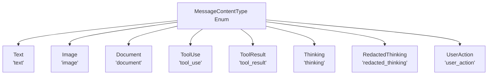
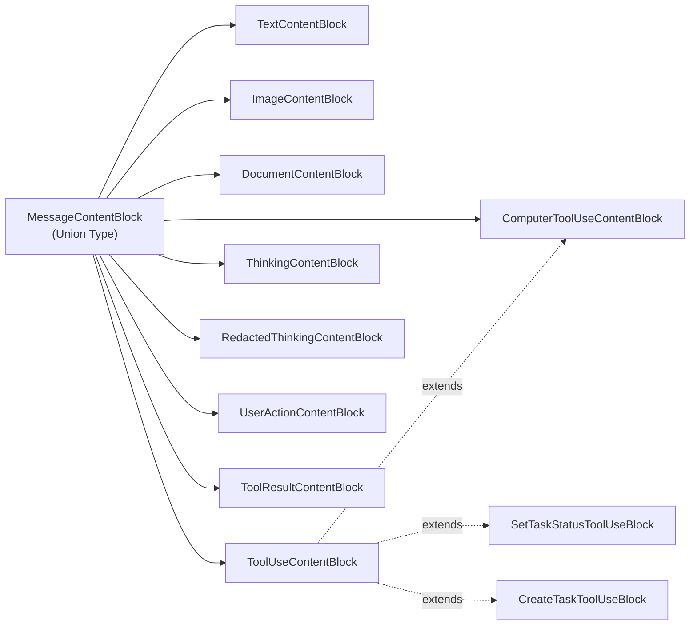
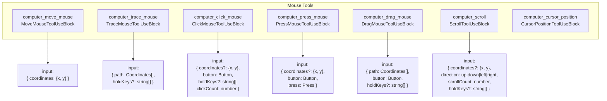
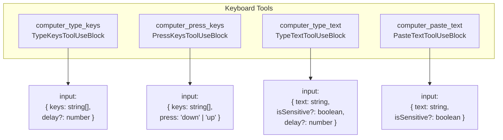
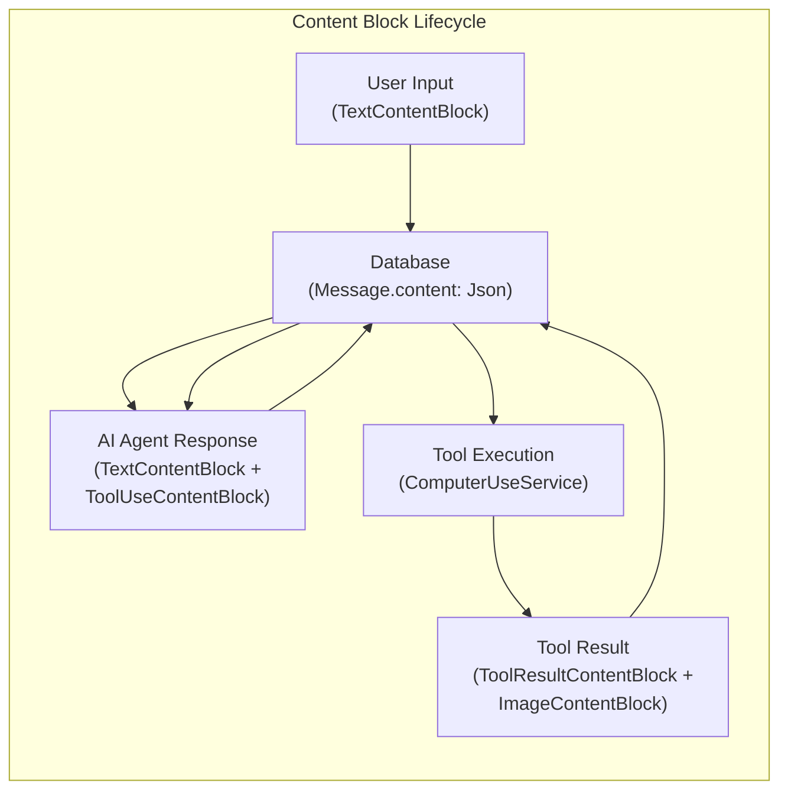
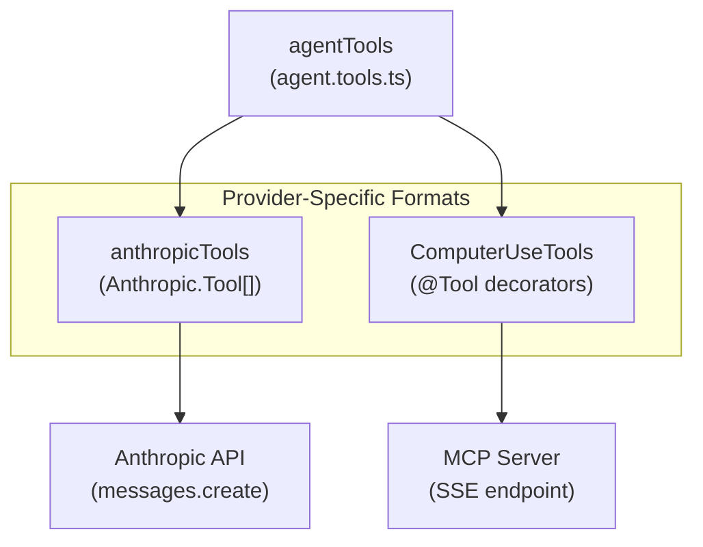

<!-- source: DeepWiki mcp.deepwiki.com · repo bytebot-ai/bytebot · page 9.3 Message Content Types · fetched 2026-10-29 -->

# Message Content Types

<details>
<summary>Relevant source files</summary>

The following files were used as context for generating this wiki page:

- [packages/bytebot-agent/prisma/schema.prisma](packages/bytebot-agent/prisma/schema.prisma)
- [packages/bytebot-agent/src/anthropic/anthropic.tools.ts](packages/bytebot-agent/src/anthropic/anthropic.tools.ts)
- [packages/bytebot-agent/src/tasks/dto/create-task.dto.ts](packages/bytebot-agent/src/tasks/dto/create-task.dto.ts)
- [packages/bytebot-ui/src/types/index.ts](packages/bytebot-ui/src/types/index.ts)
- [packages/bytebotd/src/computer-use/computer-use.service.ts](packages/bytebotd/src/computer-use/computer-use.service.ts)
- [packages/bytebotd/src/computer-use/dto/base.dto.ts](packages/bytebotd/src/computer-use/dto/base.dto.ts)
- [packages/bytebotd/src/computer-use/dto/computer-action-validation.pipe.ts](packages/bytebotd/src/computer-use/dto/computer-action-validation.pipe.ts)
- [packages/bytebotd/src/computer-use/dto/computer-action.dto.ts](packages/bytebotd/src/computer-use/dto/computer-action.dto.ts)
- [packages/bytebotd/src/mcp/computer-use.tools.ts](packages/bytebotd/src/mcp/computer-use.tools.ts)
- [packages/shared/src/types/computerAction.types.ts](packages/shared/src/types/computerAction.types.ts)
- [packages/shared/src/types/messageContent.types.ts](packages/shared/src/types/messageContent.types.ts)
- [packages/shared/src/utils/computerAction.utils.ts](packages/shared/src/utils/computerAction.utils.ts)
- [packages/shared/src/utils/messageContent.utils.ts](packages/shared/src/utils/messageContent.utils.ts)

</details>


This document provides a comprehensive reference for the `MessageContentBlock` type system, which defines the structure of message content exchanged between users, AI agents, and tools throughout the Bytebot system. These types enable rich, structured communication that includes text, images, documents, LLM reasoning steps, tool invocations, and tool results.

For information about how messages are stored in the database, see [Database Schema](#9.2). For details about computer action execution, see [Computer Action Types](#9.4). For broader context on type consistency across packages, see [Type System Overview](#9.1).

## Purpose and Scope

Message content blocks form the vocabulary for all conversation-style interactions in Bytebot. They represent:

- User input (text, images, documents)
- AI agent responses (text, reasoning, tool usage)
- Tool execution results (screenshots, file data, action confirmations)
- User manual interventions (captured desktop actions)

All message content is stored as JSON arrays in the database's `Message.content` field and validated using TypeScript discriminated unions defined in the `@bytebot/shared` package.

**Sources:** [packages/shared/src/types/messageContent.types.ts:1-258](), [packages/bytebot-agent/prisma/schema.prisma:83-99]()

## Type Hierarchy

The message content system uses TypeScript's discriminated union pattern with a `type` field as the discriminator. All content blocks extend `MessageContentBlockBase` and specify their specific type via the `MessageContentType` enum.

### Type Discriminator Enum



**Sources:** [packages/shared/src/types/messageContent.types.ts:4-13]()

### Union Structure

The `MessageContentBlock` type is a discriminated union of all possible content block variants:



**Sources:** [packages/shared/src/types/messageContent.types.ts:248-258]()

## Base Type Structure

All content blocks share a common base structure:

| Field | Type | Description |
|-------|------|-------------|
| `type` | `MessageContentType` | Discriminator field identifying the specific content block type |
| `content` | `MessageContentBlock[]` (optional) | Nested content blocks for hierarchical structures |

**Sources:** [packages/shared/src/types/messageContent.types.ts:15-19]()

## Text Content

### TextContentBlock

Represents plain text content from users or AI responses.

```typescript
type: MessageContentType.Text
text: string
```

**Structure:**
- `type`: Always `"text"`
- `text`: The actual text content

**Usage:** User messages, AI text responses, simple confirmations

**Sources:** [packages/shared/src/types/messageContent.types.ts:21-24]()

## Media Content

### ImageContentBlock

Represents image data, typically screenshots captured by the agent or uploaded by users.

```typescript
type: MessageContentType.Image
source: {
  media_type: "image/png"
  type: "base64"
  data: string
}
```

**Structure:**
- `type`: Always `"image"`
- `source.media_type`: Always `"image/png"`
- `source.type`: Always `"base64"`
- `source.data`: Base64-encoded PNG image data

**Usage:** Screenshots from desktop automation, user-uploaded images

**Sources:** [packages/shared/src/types/messageContent.types.ts:26-33]()

### DocumentContentBlock

Represents document files with arbitrary MIME types.

```typescript
type: MessageContentType.Document
source: {
  type: "base64"
  media_type: string
  data: string
}
name?: string
size?: number
```

**Structure:**
- `type`: Always `"document"`
- `source.media_type`: MIME type (e.g., `"application/pdf"`, `"text/plain"`)
- `source.type`: Always `"base64"`
- `source.data`: Base64-encoded document data
- `name`: Optional filename
- `size`: Optional file size in bytes

**Usage:** User-uploaded files, files read from the virtual desktop

**Sources:** [packages/shared/src/types/messageContent.types.ts:35-44](), [packages/bytebotd/src/computer-use/computer-use.service.ts:419-506]()

## LLM Reasoning Content

### ThinkingContentBlock

Represents the AI model's explicit reasoning process (for models that support extended thinking).

```typescript
type: MessageContentType.Thinking
thinking: string
signature: string
```

**Structure:**
- `type`: Always `"thinking"`
- `thinking`: The actual reasoning text
- `signature`: Cryptographic signature verifying authenticity

**Usage:** Extended thinking from models like Claude with thinking features enabled

**Sources:** [packages/shared/src/types/messageContent.types.ts:46-50]()

### RedactedThinkingContentBlock

Represents redacted or compressed thinking content.

```typescript
type: MessageContentType.RedactedThinking
data: string
```

**Structure:**
- `type`: Always `"redacted_thinking"`
- `data`: Redacted or placeholder data

**Usage:** Privacy-preserving storage of thinking content

**Sources:** [packages/shared/src/types/messageContent.types.ts:52-55]()

## Tool Interaction Content

### ToolUseContentBlock

Base type for all tool invocations by the AI agent.

```typescript
type: MessageContentType.ToolUse
name: string
id: string
input: Record<string, any>
```

**Structure:**
- `type`: Always `"tool_use"`
- `name`: Tool name (e.g., `"computer_click_mouse"`, `"set_task_status"`)
- `id`: Unique identifier linking to corresponding `ToolResultContentBlock`
- `input`: Tool-specific input parameters

**Usage:** AI agent requests tool execution

**Sources:** [packages/shared/src/types/messageContent.types.ts:57-62]()

### ToolResultContentBlock

Represents the result of a tool execution.

```typescript
type: MessageContentType.ToolResult
tool_use_id: string
content: MessageContentBlock[]
is_error?: boolean
```

**Structure:**
- `type`: Always `"tool_result"`
- `tool_use_id`: ID of the corresponding `ToolUseContentBlock`
- `content`: Array of content blocks representing the result (text, images, etc.)
- `is_error`: Optional flag indicating execution failure

**Usage:** System responses after tool execution

**Sources:** [packages/shared/src/types/messageContent.types.ts:240-245]()

## Computer Tool Use Blocks

Computer tool use blocks are specialized `ToolUseContentBlock` variants for desktop automation. Each has a specific `name` and typed `input` structure.

### Mouse Control Tools



**Sources:** [packages/shared/src/types/messageContent.types.ts:64-115]()

### Keyboard Control Tools



**Sources:** [packages/shared/src/types/messageContent.types.ts:117-148]()

### System Control Tools

| Tool Name | Type | Input Parameters | Purpose |
|-----------|------|------------------|---------|
| `computer_wait` | `WaitToolUseBlock` | `{ duration: number }` | Pause execution |
| `computer_screenshot` | `ScreenshotToolUseBlock` | (none) | Capture screen |
| `computer_application` | `ApplicationToolUseBlock` | `{ application: string }` | Open/switch app |
| `computer_write_file` | `WriteFileToolUseBlock` | `{ path: string, data: string }` | Write file to desktop |
| `computer_read_file` | `ReadFileToolUseBlock` | `{ path: string }` | Read file from desktop |

**Sources:** [packages/shared/src/types/messageContent.types.ts:150-185]()

### Computer Tool Use Union Type

All computer tool use blocks are combined into a union type:

```typescript
type ComputerToolUseContentBlock =
  | MoveMouseToolUseBlock
  | TraceMouseToolUseBlock
  | ClickMouseToolUseBlock
  | PressMouseToolUseBlock
  | TypeKeysToolUseBlock
  | PressKeysToolUseBlock
  | TypeTextToolUseBlock
  | PasteTextToolUseBlock
  | WaitToolUseBlock
  | ScreenshotToolUseBlock
  | DragMouseToolUseBlock
  | ScrollToolUseBlock
  | CursorPositionToolUseBlock
  | ApplicationToolUseBlock
  | WriteFileToolUseBlock
  | ReadFileToolUseBlock
```

**Sources:** [packages/shared/src/types/messageContent.types.ts:187-204]()

## Task Management Tool Use Blocks

### SetTaskStatusToolUseBlock

Allows the agent to mark a task as completed, failed, or needing help.

```typescript
name: "set_task_status"
input: {
  status: "completed" | "failed" | "needs_help"
  description: string
}
```

**Structure:**
- `status`: Target task status
- `description`: Explanation of the status change

**Usage:** Task completion, failure reporting, requesting human assistance

**Sources:** [packages/shared/src/types/messageContent.types.ts:221-227]()

### CreateTaskToolUseBlock

Allows the agent to spawn subtasks.

```typescript
name: "create_task"
input: {
  name: string
  description: string
  type?: "immediate" | "scheduled"
  scheduledFor?: string
  priority: "low" | "medium" | "high" | "urgent"
}
```

**Structure:**
- `name`: Short task name
- `description`: Detailed task description
- `type`: Task scheduling type (defaults to immediate)
- `scheduledFor`: ISO timestamp for scheduled tasks
- `priority`: Task priority level

**Usage:** Breaking down complex tasks, scheduling future work

**Sources:** [packages/shared/src/types/messageContent.types.ts:229-238]()

## User Action Content

### UserActionContentBlock

Represents user actions captured during manual desktop control (takeover mode).

```typescript
type: MessageContentType.UserAction
content: (
  | ImageContentBlock
  | MoveMouseToolUseBlock
  | TraceMouseToolUseBlock
  | ClickMouseToolUseBlock
  | PressMouseToolUseBlock
  | TypeKeysToolUseBlock
  | PressKeysToolUseBlock
  | TypeTextToolUseBlock
  | DragMouseToolUseBlock
  | ScrollToolUseBlock
)[]
```

**Structure:**
- `type`: Always `"user_action"`
- `content`: Array of captured actions and screenshots

**Usage:** Recording user demonstrations during task execution handoff

**Sources:** [packages/shared/src/types/messageContent.types.ts:205-219]()

## Type Guards and Validation

The system provides comprehensive type guards for runtime validation and type narrowing.

### Type Guard Functions

```mermaid
graph TB
    subgraph "Type Guard Utilities"
        isMessageContentBlock["isMessageContentBlock()"]
        isTextContentBlock["isTextContentBlock()"]
        isImageContentBlock["isImageContentBlock()"]
        isDocumentContentBlock["isDocumentContentBlock()"]
        isToolUseContentBlock["isToolUseContentBlock()"]
        isComputerToolUseContentBlock["isComputerToolUseContentBlock()"]
        isToolResultContentBlock["isToolResultContentBlock()"]
        isThinkingContentBlock["isThinkingContentBlock()"]
        isUserActionContentBlock["isUserActionContentBlock()"]
    end
    
    subgraph "Specific Computer Tool Guards"
        isMoveMouseToolUseBlock["isMoveMouseToolUseBlock()"]
        isClickMouseToolUseBlock["isClickMouseToolUseBlock()"]
        isTypeTextToolUseBlock["isTypeTextToolUseBlock()"]
        isScreenshotToolUseBlock["isScreenshotToolUseBlock()"]
        isSetTaskStatusToolUseBlock["isSetTaskStatusToolUseBlock()"]
        isCreateTaskToolUseBlock["isCreateTaskToolUseBlock()"]
    end
    
    isComputerToolUseContentBlock -.->|"used by"| isMoveMouseToolUseBlock
    isComputerToolUseContentBlock -.->|"used by"| isClickMouseToolUseBlock
    isComputerToolUseContentBlock -.->|"used by"| isTypeTextToolUseBlock
    isComputerToolUseContentBlock -.->|"used by"| isScreenshotToolUseBlock
```



**Key Type Guards:**

| Function | Purpose | Returns True If |
|----------|---------|-----------------|
| `isMessageContentBlock()` | General content block validation | Object is any valid `MessageContentBlock` |
| `isToolUseContentBlock()` | Tool use validation | `type === "tool_use"` with required fields |
| `isComputerToolUseContentBlock()` | Computer tool detection | Tool name starts with `"computer_"` |
| `isToolResultContentBlock()` | Tool result validation | `type === "tool_result"` with `tool_use_id` |
| `isUserActionContentBlock()` | User action detection | `type === "user_action"` |

**Sources:** [packages/shared/src/utils/messageContent.utils.ts:33-516]()

### Type Guard Example Usage

```typescript
// Runtime type checking and narrowing
if (isTextContentBlock(block)) {
  console.log(block.text);  // TypeScript knows block.text exists
}

if (isComputerToolUseContentBlock(block)) {
  if (isClickMouseToolUseBlock(block)) {
    const { coordinates, button } = block.input;  // Fully typed
  }
}
```

**Sources:** [packages/shared/src/utils/messageContent.utils.ts:38-47](), [packages/shared/src/utils/messageContent.utils.ts:300-309]()

## Storage and Serialization

### Database Storage

Message content blocks are stored as JSON in the `Message` model's `content` field:

```prisma
model Message {
  id        String      @id @default(uuid())
  content   Json        // Array of MessageContentBlock
  role      Role        @default(ASSISTANT)
  taskId    String
  summaryId String?
}
```

**Example JSON storage:**
```json
[
  {
    "type": "text",
    "text": "I'll click the search button"
  },
  {
    "type": "tool_use",
    "id": "toolu_123",
    "name": "computer_click_mouse",
    "input": {
      "coordinates": { "x": 640, "y": 480 },
      "button": "left",
      "clickCount": 1
    }
  }
]
```

**Sources:** [packages/bytebot-agent/prisma/schema.prisma:83-99]()

### Type Consistency Across Packages

The `Message` interface in the UI mirrors the database structure:

```typescript
// bytebot-ui/src/types/index.ts
interface Message {
  id: string;
  content: MessageContentBlock[];  // From @bytebot/shared
  role: Role;
  taskId?: string;
  createdAt?: string;
}
```

This ensures type safety from database to frontend rendering.

**Sources:** [packages/bytebot-ui/src/types/index.ts:8-16]()

## Message Content Flow



**Flow Description:**
1. User creates `TextContentBlock` messages
2. Agent responds with `TextContentBlock` + `ToolUseContentBlock` arrays
3. System executes tools via `ComputerUseService.action()`
4. Results stored as `ToolResultContentBlock` with nested content
5. All content serialized to JSON in `Message.content`
6. Agent receives context including previous tool results

**Sources:** [packages/bytebot-agent/src/agent/agent.processor.ts](), [packages/bytebotd/src/computer-use/computer-use.service.ts:31-105]()

## Integration with LLM Providers

The content block types are designed to be compatible with LLM provider APIs, particularly Anthropic's message format.

### Provider Tool Conversion



**Conversion Process:**
- Agent tools defined in generic format
- Converted to provider-specific schemas
- Anthropic receives `Anthropic.Tool[]` definitions
- MCP uses `@Tool` decorator with Zod schemas

**Sources:** [packages/bytebot-agent/src/anthropic/anthropic.tools.ts:4-54](), [packages/bytebotd/src/mcp/computer-use.tools.ts:8-698]()

---

