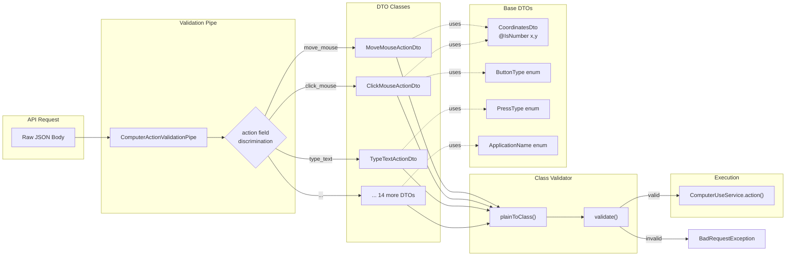
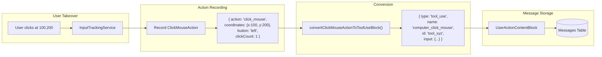
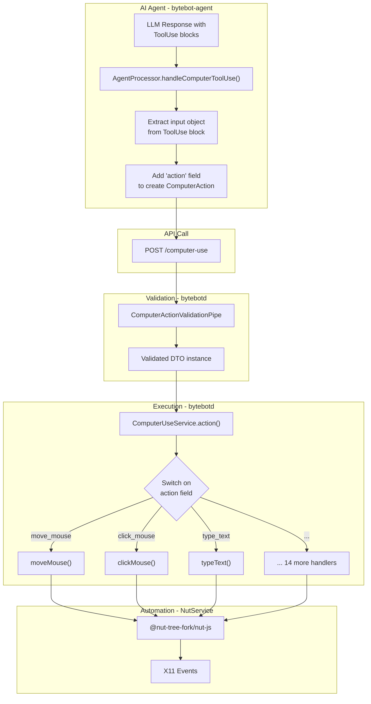

<!-- source: DeepWiki mcp.deepwiki.com · repo bytebot-ai/bytebot · page 9.4 Computer Action Types · fetched 2026-10-29 -->

# Computer Action Types

<details>
<summary>Relevant source files</summary>

The following files were used as context for generating this wiki page:

- [packages/bytebotd/src/computer-use/computer-use.service.ts](packages/bytebotd/src/computer-use/computer-use.service.ts)
- [packages/bytebotd/src/computer-use/dto/base.dto.ts](packages/bytebotd/src/computer-use/dto/base.dto.ts)
- [packages/bytebotd/src/computer-use/dto/computer-action-validation.pipe.ts](packages/bytebotd/src/computer-use/dto/computer-action-validation.pipe.ts)
- [packages/bytebotd/src/computer-use/dto/computer-action.dto.ts](packages/bytebotd/src/computer-use/dto/computer-action.dto.ts)
- [packages/bytebotd/src/mcp/computer-use.tools.ts](packages/bytebotd/src/mcp/computer-use.tools.ts)
- [packages/shared/src/types/computerAction.types.ts](packages/shared/src/types/computerAction.types.ts)
- [packages/shared/src/types/messageContent.types.ts](packages/shared/src/types/messageContent.types.ts)
- [packages/shared/src/utils/computerAction.utils.ts](packages/shared/src/utils/computerAction.utils.ts)
- [packages/shared/src/utils/messageContent.utils.ts](packages/shared/src/utils/messageContent.utils.ts)

</details>


This page documents the `ComputerAction` type system, which defines the structured data format for all desktop automation operations in Bytebot. These types represent the low-level actions that the AI agent can request the bytebotd daemon to execute on the virtual desktop.

For information about how these actions are represented in AI conversations, see [Message Content Types](#9.3). For the execution implementation, see [Computer Use Service](#7.1).

---

## Purpose and Scope

Computer Action Types provide a type-safe abstraction layer between AI decision-making and desktop automation. The type system serves three key functions:

1. **Type Safety**: TypeScript discriminated unions ensure compile-time correctness across the shared package, bytebot-agent, and bytebotd
2. **Validation**: Runtime validation DTOs in bytebotd enforce API contract integrity at the service boundary
3. **Serialization**: Structured types enable seamless conversion between tool use requests (from LLMs) and executable commands

The type hierarchy is defined in [packages/shared/src/types/computerAction.types.ts:1-126]() and consumed by both the agent orchestration layer and the desktop execution daemon.

**Sources**: [packages/shared/src/types/computerAction.types.ts:1-126]()

---

## Type Hierarchy Overview

```mermaid
graph TB
    ComputerAction["ComputerAction<br/>(Discriminated Union)"]
    
    subgraph "Mouse Actions"
        MoveMouseAction["MoveMouseAction<br/>move_mouse"]
        TraceMouseAction["TraceMouseAction<br/>trace_mouse"]
        ClickMouseAction["ClickMouseAction<br/>click_mouse"]
        PressMouseAction["PressMouseAction<br/>press_mouse"]
        DragMouseAction["DragMouseAction<br/>drag_mouse"]
        ScrollAction["ScrollAction<br/>scroll"]
    end
    
    subgraph "Keyboard Actions"
        TypeKeysAction["TypeKeysAction<br/>type_keys"]
        PressKeysAction["PressKeysAction<br/>press_keys"]
        TypeTextAction["TypeTextAction<br/>type_text"]
        PasteTextAction["PasteTextAction<br/>paste_text"]
    end
    
    subgraph "System Actions"
        WaitAction["WaitAction<br/>wait"]
        ScreenshotAction["ScreenshotAction<br/>screenshot"]
        CursorPositionAction["CursorPositionAction<br/>cursor_position"]
        ApplicationAction["ApplicationAction<br/>application"]
    end
    
    subgraph "File Actions"
        WriteFileAction["WriteFileAction<br/>write_file"]
        ReadFileAction["ReadFileAction<br/>read_file"]
    end
    
    ComputerAction --> MoveMouseAction
    ComputerAction --> TraceMouseAction
    ComputerAction --> ClickMouseAction
    ComputerAction --> PressMouseAction
    ComputerAction --> DragMouseAction
    ComputerAction --> ScrollAction
    
    ComputerAction --> TypeKeysAction
    ComputerAction --> PressKeysAction
    ComputerAction --> TypeTextAction
    ComputerAction --> PasteTextAction
    
    ComputerAction --> WaitAction
    ComputerAction --> ScreenshotAction
    ComputerAction --> CursorPositionAction
    ComputerAction --> ApplicationAction
    
    ComputerAction --> WriteFileAction
    ComputerAction --> ReadFileAction
```



The `ComputerAction` type is a discriminated union of 17 distinct action types, each identified by its `action` field. This enables exhaustive pattern matching in the [ComputerUseService.action]() method at [packages/bytebotd/src/computer-use/computer-use.service.ts:34-104]().

**Sources**: [packages/shared/src/types/computerAction.types.ts:109-125](), [packages/bytebotd/src/computer-use/computer-use.service.ts:31-105]()

---

## Common Type Definitions

The following types are shared across multiple action definitions:

| Type | Definition | Usage |
|------|------------|-------|
| `Coordinates` | `{ x: number; y: number }` | Mouse position in pixels (0,0 = top-left, max = 1280x960) |
| `Button` | `"left" \| "right" \| "middle"` | Mouse button identifier for click/press/drag operations |
| `Press` | `"up" \| "down"` | Key or button state change direction |
| `Application` | `"firefox" \| "1password" \| "thunderbird" \| "vscode" \| "terminal" \| "desktop" \| "directory"` | Pre-installed applications available on the virtual desktop |

**Sources**: [packages/shared/src/types/computerAction.types.ts:1-11]()

---

## Action Type Reference

### Mouse Actions

| Action Type | Properties | Description |
|-------------|------------|-------------|
| **MoveMouseAction** | `coordinates: Coordinates` | Moves cursor to absolute position without clicking |
| **TraceMouseAction** | `path: Coordinates[]`<br/>`holdKeys?: string[]` | Moves cursor through multiple points, optionally holding modifier keys |
| **ClickMouseAction** | `coordinates?: Coordinates`<br/>`button: Button`<br/>`holdKeys?: string[]`<br/>`clickCount: number` | Performs single/double/triple click at position or current location |
| **PressMouseAction** | `coordinates?: Coordinates`<br/>`button: Button`<br/>`press: Press` | Press down or release mouse button without full click cycle |
| **DragMouseAction** | `path: Coordinates[]`<br/>`button: Button`<br/>`holdKeys?: string[]` | Hold button down and drag through path coordinates |
| **ScrollAction** | `coordinates?: Coordinates`<br/>`direction: "up"\|"down"\|"left"\|"right"`<br/>`scrollCount: number`<br/>`holdKeys?: string[]` | Scroll mouse wheel specified number of times |

**Sources**: [packages/shared/src/types/computerAction.types.ts:14-53]()

### Keyboard Actions

| Action Type | Properties | Description |
|-------------|------------|-------------|
| **TypeKeysAction** | `keys: string[]`<br/>`delay?: number` | Type sequence of keys (press+release each), used for shortcuts like `["LeftControl", "C"]` |
| **PressKeysAction** | `keys: string[]`<br/>`press: Press` | Press down or release keys without auto-release, for holding modifiers |
| **TypeTextAction** | `text: string`<br/>`delay?: number`<br/>`sensitive?: boolean` | Type text character-by-character, recommended for <25 characters or passwords |
| **PasteTextAction** | `text: string` | Copy text to clipboard and paste via Ctrl+V, recommended for long text or special characters |

The distinction between `TypeKeysAction` and `TypeTextAction` is critical: `type_keys` uses key codes (e.g., `"LeftControl"`, `"A"`) for shortcuts, while `type_text` uses literal character strings. Valid key names are documented in [packages/bytebotd/src/mcp/computer-use.tools.ts:319-344]().

**Sources**: [packages/shared/src/types/computerAction.types.ts:55-77](), [packages/bytebotd/src/mcp/computer-use.tools.ts:317-371]()

### System Actions

| Action Type | Properties | Description |
|-------------|------------|-------------|
| **WaitAction** | `duration: number` | Pause execution for specified milliseconds |
| **ScreenshotAction** | _(none)_ | Capture current desktop state as base64 PNG |
| **CursorPositionAction** | _(none)_ | Query current mouse coordinates |
| **ApplicationAction** | `application: Application` | Open or activate application window and maximize |

The `ApplicationAction` uses `wmctrl` to detect if the application is already running via process name matching defined in [packages/bytebotd/src/computer-use/computer-use.service.ts:296-304](), then either activates the existing window or launches a new instance.

**Sources**: [packages/shared/src/types/computerAction.types.ts:79-95](), [packages/bytebotd/src/computer-use/computer-use.service.ts:264-362]()

### File Actions

| Action Type | Properties | Description |
|-------------|------------|-------------|
| **WriteFileAction** | `path: string`<br/>`data: string` | Write base64-encoded data to file path (relative to `/home/user/Desktop/` if not absolute) |
| **ReadFileAction** | `path: string` | Read file and return base64-encoded data with media type detection |

File operations use sudo commands to manage permissions and default to the desktop directory if relative paths are provided. Media type mapping for common extensions is defined at [packages/bytebotd/src/computer-use/computer-use.service.ts:464-482]().

**Sources**: [packages/shared/src/types/computerAction.types.ts:97-106](), [packages/bytebotd/src/computer-use/computer-use.service.ts:364-506]()

---

## Validation Layer

### DTO Architecture



The validation layer transforms untrusted JSON into type-safe DTOs through a multi-step pipeline:

1. **Discrimination**: [ComputerActionValidationPipe]() inspects the `action` field at [packages/bytebotd/src/computer-use/dto/computer-action-validation.pipe.ts:36-87]()
2. **Transformation**: `plainToClass()` converts plain objects to DTO instances with proper types
3. **Validation**: `class-validator` decorators enforce constraints (e.g., `@Min(1)` for clickCount)
4. **Execution**: Validated DTO is passed to [ComputerUseService.action()]()

**Sources**: [packages/bytebotd/src/computer-use/dto/computer-action-validation.pipe.ts:1-97](), [packages/bytebotd/src/computer-use/dto/computer-action.dto.ts:1-240]()

### DTO Decorators

Each DTO class uses `class-validator` decorators for runtime enforcement:

```typescript
// Example from ClickMouseActionDto
@IsIn(['click_mouse'])
action: 'click_mouse';

@IsOptional()
@ValidateNested()
@Type(() => CoordinatesDto)
coordinates?: CoordinatesDto;

@IsEnum(ButtonType)
button: ButtonType;

@IsNumber()
@Min(1)
clickCount: number;
```

Base enums are defined in [packages/bytebotd/src/computer-use/dto/base.dto.ts:11-37]() to provide compile-time and runtime validation.

**Sources**: [packages/bytebotd/src/computer-use/dto/computer-action.dto.ts:51-71](), [packages/bytebotd/src/computer-use/dto/base.dto.ts:1-38]()

---

## Type Guards and Converters

### Type Guard Pattern

The shared package provides type guards for runtime type discrimination:

```typescript
// Factory pattern for creating type guards
function createActionTypeGuard<T extends ComputerAction>(
  actionType: T["action"]
): (obj: unknown) => obj is T {
  return (obj: unknown): obj is T => {
    if (!obj || typeof obj !== "object") {
      return false;
    }
    const action = obj as Record<string, any>;
    return action.action === actionType;
  };
}

// Generated type guards
export const isMoveMouseAction = createActionTypeGuard<MoveMouseAction>("move_mouse");
export const isClickMouseAction = createActionTypeGuard<ClickMouseAction>("click_mouse");
// ... etc for all 17 types
```

**Sources**: [packages/shared/src/utils/computerAction.utils.ts:28-66]()

### Conversion to ToolUse Blocks

The `convertComputerActionToToolUseBlock()` function at [packages/shared/src/utils/computerAction.utils.ts:299-342]() transforms `ComputerAction` types into `ComputerToolUseContentBlock` types, which are used in AI conversation messages. This enables the agent to record user actions during takeover mode and include them in the LLM context.

**Example conversion flow**:



**Sources**: [packages/shared/src/utils/computerAction.utils.ts:103-294](), [packages/shared/src/types/messageContent.types.ts:205-219]()

---

## Integration with Message Content Types

### ToolUse Block Mapping

Each `ComputerAction` type has a corresponding `ComputerToolUseContentBlock` variant defined in [packages/shared/src/types/messageContent.types.ts:64-203](). The mapping uses the `computer_` prefix convention:

| ComputerAction | ToolUse Block Name |
|----------------|-------------------|
| `move_mouse` | `computer_move_mouse` |
| `click_mouse` | `computer_click_mouse` |
| `type_text` | `computer_type_text` |
| `screenshot` | `computer_screenshot` |
| `write_file` | `computer_write_file` |
| _(etc for all 17 types)_ | _(consistent naming)_ |

This dual representation exists because:
- **ComputerAction**: Used by bytebotd for execution (internal API contract)
- **ToolUse Block**: Used by LLMs for decision-making and conversation history (AI interface)

The agent converts between these representations when processing LLM responses at [packages/bytebot-agent/src/agent/agent.processor.ts]() (see [Agent Processor](#6.1) for details).

**Sources**: [packages/shared/src/types/messageContent.types.ts:187-203]()

### MCP Tool Definitions

The MCP integration layer defines Zod schemas that mirror the DTO validation but use the MCP SDK's `@Tool()` decorator pattern at [packages/bytebotd/src/mcp/computer-use.tools.ts:11-697](). Each tool method wraps a call to `ComputerUseService.action()`:

```typescript
@Tool({
  name: 'computer_click_mouse',
  description: 'Performs a mouse click at the specified coordinates or current position.',
  parameters: z.object({
    coordinates: z.object({
      x: z.number().describe('The x-coordinate to move the mouse to.'),
      y: z.number().describe('The y-coordinate to move the mouse to.'),
    }).optional(),
    button: z.enum(['left', 'right', 'middle']),
    holdKeys: z.array(z.string()).optional(),
    clickCount: z.number(),
  }),
})
async clickMouse({ coordinates, button, holdKeys, clickCount }) {
  await this.computerUse.action({
    action: 'click_mouse',
    coordinates,
    button,
    holdKeys,
    clickCount,
  });
  return { content: [{ type: 'text', text: 'mouse clicked' }] };
}
```

**Sources**: [packages/bytebotd/src/mcp/computer-use.tools.ts:80-138]()

---

## Execution Flow



The complete flow from AI decision to desktop action involves:

1. **LLM generates ToolUse block** with tool name (e.g., `computer_click_mouse`) and input parameters
2. **AgentProcessor extracts input** and adds the `action` field to create a valid `ComputerAction`
3. **HTTP POST to bytebotd** at `/computer-use` endpoint
4. **Validation pipe discriminates** on `action` field and validates against appropriate DTO
5. **ComputerUseService dispatches** to action-specific handler method
6. **NutService executes** low-level automation via NutJS library
7. **X11 events** manipulate the virtual desktop

**Sources**: [packages/bytebotd/src/computer-use/computer-use.service.ts:31-105](), [packages/bytebot-agent/src/agent/agent.processor.ts]()

---

## Summary Table

| Component | Location | Purpose |
|-----------|----------|---------|
| **Type Definitions** | [packages/shared/src/types/computerAction.types.ts]() | Shared TypeScript types for compile-time safety |
| **Validation DTOs** | [packages/bytebotd/src/computer-use/dto/computer-action.dto.ts]() | Runtime validation via class-validator decorators |
| **Validation Pipe** | [packages/bytebotd/src/computer-use/dto/computer-action-validation.pipe.ts]() | NestJS pipe for discriminating and validating requests |
| **Type Guards** | [packages/shared/src/utils/computerAction.utils.ts]() | Runtime type checking utilities |
| **Converters** | [packages/shared/src/utils/computerAction.utils.ts]() | Convert between ComputerAction and ToolUse blocks |
| **MCP Tools** | [packages/bytebotd/src/mcp/computer-use.tools.ts]() | Zod-based MCP tool definitions |
| **Execution Service** | [packages/bytebotd/src/computer-use/computer-use.service.ts]() | Dispatches actions to NutService for execution |

**Sources**: Multiple files cited in table

---

