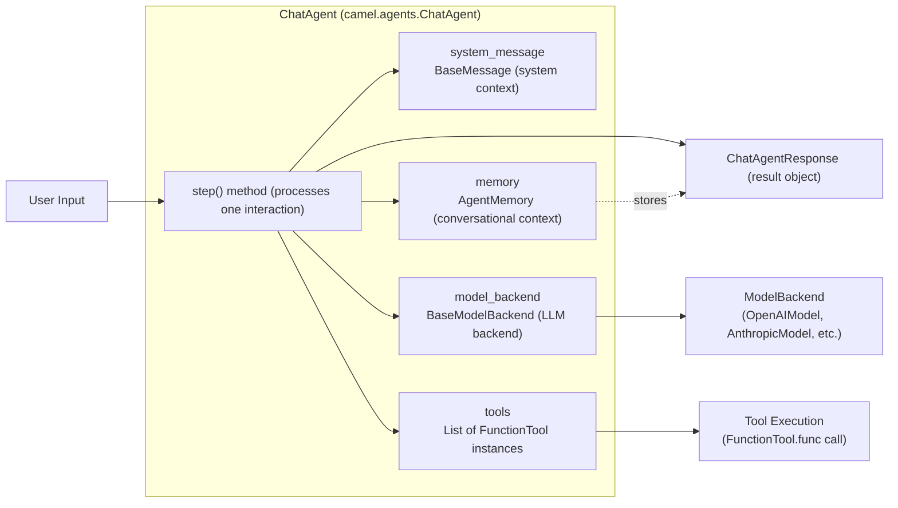
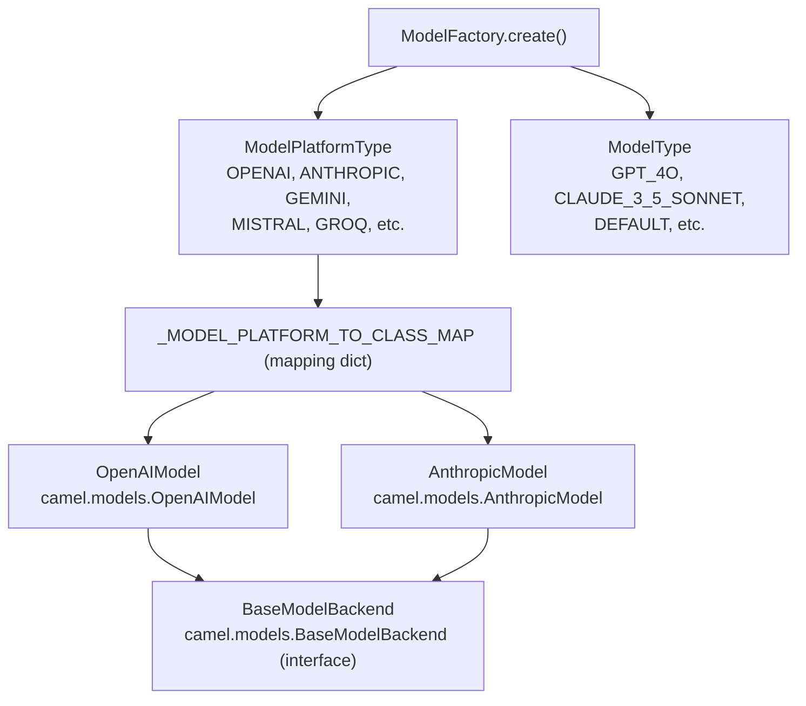

<!-- source: DeepWiki mcp.deepwiki.com · repo camel-ai/camel · page 1 Introduction to CAMEL-AI · fetched 2026-10-29 -->

# Introduction to CAMEL-AI

Relevant source files

The following files were used as context for generating this wiki page:

- [.github/ISSUE_TEMPLATE/bug_report.yml](.github/ISSUE_TEMPLATE/bug_report.yml)
- [README.md](README.md)
- [camel/__init__.py](camel/__init__.py)
- [camel/agents/chat_agent.py](camel/agents/chat_agent.py)
- [docs/conf.py](docs/conf.py)
- [docs/get_started/installation.md](docs/get_started/installation.md)
- [docs/get_started/setup.md](docs/get_started/setup.md)
- [docs/key_modules/loaders.md](docs/key_modules/loaders.md)
- [docs/mintlify/convert_notebook2mdx.py](docs/mintlify/convert_notebook2mdx.py)
- [docs/mintlify/get_started/introduction.mdx](docs/mintlify/get_started/introduction.mdx)
- [docs/mintlify/get_started/setup.mdx](docs/mintlify/get_started/setup.mdx)
- [docs/mintlify/reference/camel.toolkits.excel_toolkit.mdx](docs/mintlify/reference/camel.toolkits.excel_toolkit.mdx)
- [docs/mintlify/reference/camel.toolkits.message_integration.mdx](docs/mintlify/reference/camel.toolkits.message_integration.mdx)
- [misc/wechat.jpeg](misc/wechat.jpeg)
- [pyproject.toml](pyproject.toml)
- [test/agents/test_chat_agent.py](test/agents/test_chat_agent.py)
- [uv.lock](uv.lock)

## Purpose and Scope

This document provides a high-level introduction to the CAMEL-AI framework, describing its purpose as a platform for building and studying communicative multi-agent AI systems. It covers the framework’s key design principles, architecture, and major components at a conceptual level. For detailed step-by-step installation instructions, see [Installation and Setup](#1.1), and for an in-depth explanation of the architecture and component interactions, refer to [Core Architecture Overview](#1.2).

**Sources:** [docs/conf.py:27-30](), [README.md:108-126]()

## What is CAMEL-AI?

CAMEL (Communicative Agents for AI Society Study) is an open-source framework designed to enable the creation, orchestration, and study of multi-agent AI systems at scale. It supports modeling intelligent agents that communicate, collaborate, and evolve to accomplish complex tasks.

Key capabilities include:
- Construction of autonomous conversational agents with advanced task-solving and tool-integration capabilities.
- Coordination and orchestration of multi-agent workflows for cooperative or role-playing scenarios.
- Integration support for over 40 LLM model providers via a unified model abstraction layer.
- Extension with 50+ specialized toolkits spanning search, data ingestion, media processing, and communication platforms.
- Support for retrieval-augmented generation (RAG) and knowledge management to enrich agent context.
- Synthetic data generation pipelines for training data creation and agent self-improvement.

CAMEL aims to facilitate research into the scaling laws and emergent properties of agent societies by providing a flexible, scalable, and stateful multi-agent platform [README.md:46-47](), [pyproject.toml:6-22](), [camel/__init__.py:17]()

**Sources:** [README.md:45-46](), [pyproject.toml:6-22](), [camel/__init__.py:17]()

## Core Design Principles

CAMEL’s architecture is guided by four fundamental principles that influence every aspect of the framework:

| Principle          | Description                                                                                          | CAMEL Implementation Highlights                             |
|--------------------|--------------------------------------------------------------------------------------------------|------------------------------------------------------------|
| **🧬 Evolvability**  | Multi-agent systems evolve continuously by generating data and interacting with their environment. | Agents have stateful memory and continuous interaction loops; data generation pipelines support evolvable agent behaviors. |
| **📈 Scalability**   | Designed to scale seamlessly to millions of agents with efficient communication and coordination.   | `Workforce` system enables distributed task execution and dynamic worker pools with async and parallel processing.        |
| **💾 Statefulness**  | Agents maintain persistent state and memory, enabling multi-turn dialogs and sophisticated decision-making. | Memory interfaces (`AgentMemory`, `ChatHistoryMemory`, `VectorDBMemory`) maintain extensive conversational and task context. |
| **📖 Code-as-Prompt** | Every line of code and comment serves effectively as a prompt, enabling clear human-agent comprehension. | System messages, role definitions, and prompts are expressed in code with rich docstrings, enabling interpretable agent contexts. |

**Sources:** [README.md:108-126]()

## High-Level System Architecture

CAMEL is organized into layered components that together build the multi-agent ecosystem. Below is a conceptual overview showing primary modules and their relationships.

```mermaid
graph TB
    %% Application Layer: Agent Societies and Orchestration
    subgraph "Application Layer"
      RolePlaying["RolePlaying<br/>camel.societies.RolePlaying"]
      Workforce["Workforce<br/>camel.societies.workforce.Workforce"]
    end
    
    %% Core Agent Layer: Agents and Memory
    subgraph "Agent Core Layer"
      ChatAgent["ChatAgent<br/>camel.agents.ChatAgent"]
      TaskAgent["TaskAgent<br/>camel.agents.TaskAgent"]
      AgentMemory["AgentMemory<br/>camel.memories.AgentMemory"]
    end
    
    %% Model Layer: Model Factory and Backend Abstractions
    subgraph "Model Abstraction Layer"
      ModelFactory["ModelFactory<br/>camel.models.ModelFactory"]
      BaseModelBackend["BaseModelBackend<br/>camel.models.BaseModelBackend"]
      ModelType["ModelType<br/>camel.types.ModelType"]
    end
    
    %% Tools Ecosystem Layer
    subgraph "Tools & Extensions Layer"
      FunctionTool["FunctionTool<br/>camel.toolkits.FunctionTool"]
      SearchToolkit["SearchToolkit<br/>camel.toolkits.SearchToolkit"]
      BrowserToolkit["BrowserToolkit<br/>camel.toolkits.BrowserToolkit"]
    end
    
    %% Data Ingestion & Storage Layer
    subgraph "Data & Storage Layer"
      UnstructuredIO["UnstructuredIO<br/>camel.loaders.UnstructuredIO"]
      ChunkrReader["ChunkrReader<br/>camel.loaders.ChunkrReader"]
      BaseVectorStorage["BaseVectorStorage<br/>camel.storages.BaseVectorStorage"]
    end
    
    %% Supporting Infrastructure Layer
    subgraph "Infrastructure Layer"
      Decorators["@api_keys_required<br/>@dependencies_required (decorators)"]
      BatchProcessor["BatchProcessor<br/>camel.utils.BatchProcessor"]
    end
    
    %% Relationships
    RolePlaying --> ChatAgent
    Workforce --> ChatAgent
    
    ChatAgent --> AgentMemory
    ChatAgent --> ModelFactory
    ChatAgent --> FunctionTool
    
    ModelFactory --> BaseModelBackend
    ModelFactory --> ModelType
    
    FunctionTool --> SearchToolkit
    FunctionTool --> BrowserToolkit
    
    AgentMemory --> BaseVectorStorage
    
    ChatAgent --> UnstructuredIO
    UnstructuredIO --> ChunkrReader
    
    FunctionTool --> Decorators
    ChatAgent --> BatchProcessor
```

This layered design modularizes concerns, allowing:
- Application-level multi-agent orchestration via RolePlaying and Workforce.
- Core conversational agents (e.g., ChatAgent) that use memory and tools.
- Model platform abstraction providing seamless integration of many LLM backends.
- Tools ecosystem that equips agents with extended domain capabilities.
- Data ingestion and storage systems for external knowledge integration.
- Infrastructure helpers for decorators and batch processing utilities.

**Sources:** [camel/agents/chat_agent.py:69-109](), [camel/models/__init__.py:1-50](), [pyproject.toml:23-36]()

## Core Component Overview

### ChatAgent: The Central Agent Implementation

The `ChatAgent` class is the foundational conversational AI agent in CAMEL. It orchestrates natural language interactions by managing memory, calling models through a unified backend, and executing tools wrapped as function calls.

Key features of `ChatAgent` include:
- Stateful handling of conversations and established roles.
- Tool execution support to call integrated toolkits like search or browsers.
- Management of message transformation, response formatting, and streaming.
- Facilitates multi-turn dialogs with reasoning transparency.

Below is a high-level flow of `ChatAgent` processing a user input:

The `step()` method is the core driver advancing the conversation one turn by integrating all these components [camel/agents/chat_agent.py:133-176](), [camel/agents/chat_agent.py:336-418]().

**Sources:** [camel/agents/chat_agent.py:133-176](), [camel/agents/chat_agent.py:336-418]()

### Model Integration System

CAMEL abstracts large language model providers through the `ModelFactory`, allowing users to instantiate any supported model backend with a consistent API. This supports over 40 model platforms like OpenAI, Anthropic Claude, Google Gemini, and Mistral.

The model backend components facilitate:
- Standardized message formatting and streaming.
- Token counting and limit management.
- Pre-processing for platform-specific adaptations.
- Handling structured outputs and tool-calling responses.

The following diagram shows how `ModelFactory` delegates platform and model type to backend implementations:

This abstraction simplifies swapping model providers and leverages each platform’s unique capabilities transparently [camel/models/__init__.py:42-47](), [camel/types/__init__.py:54-62](), [test/agents/test_chat_agent.py:93-99]()

**Sources:** [camel/models/__init__.py:42-47](), [camel/types/__init__.py:54-62](), [test/agents/test_chat_agent.py:93-99]()

### Data and Message Systems

Effective multi-agent interaction requires robust data ingestion and message handling. CAMEL incorporates flexible loaders supporting:
- Parsing and cleaning unstructured text data from URLs or files (`UnstructuredIO`).
- Advanced document and OCR processing via `ChunkrReader`.
- Chunking and staging data into agent-consumable formats.

Example features include text cleaning operations and document chunking pipelines that enhance retrieval-augmented generation and context management [docs/key_modules/loaders.md:9-16](), [docs/key_modules/loaders.md:107-119]()

**Sources:** [docs/key_modules/loaders.md:9-16](), [docs/key_modules/loaders.md:107-119]()

## Package Structure

The CAMEL codebase is structured to separate concerns and simplify extension:

| Package                | Purpose                                                        |
|------------------------|----------------------------------------------------------------|
| `camel.agents`         | Core agent code including `ChatAgent` and other agent classes.|
| `camel.models`         | Model backends, `ModelFactory`, and platform abstractions.     |
| `camel.toolkits`       | Toolkits providing external integrations and plugins (50+).    |
| `camel.memories`       | Memory handling modules such as conversational and vector DB memory.  |
| `camel.societies`      | Multi-agent orchestration frameworks like `RolePlaying` and `Workforce`. |
| `camel.loaders`        | Data ingestion utilities such as `UnstructuredIO` and `ChunkrReader`. |
| `camel.datagen`        | Synthetic dataset generation tools and pipelines.              |

This modular setup facilitates flexible research, development, and experimentation with sophisticated multi-agent AI systems [camel/__init__.py:1-24](), [pyproject.toml:23-38](), [pyproject.toml:75-238]()

**Sources:** [camel/__init__.py:1-24](), [pyproject.toml:23-38](), [pyproject.toml:75-238]()

## The "Code-as-Prompt" Philosophy

A unique CAMEL design philosophy is the concept of "Code-as-Prompt." Rather than relying exclusively on static natural language prompts, CAMEL treats code — including comments, docstrings, class and function definitions — as integral prompt components that clarify agent behavior and reasoning.

This approach emphasizes writing code that is:
- Clear and readable by both humans and AI agents.
- Expressive in defining roles, tasks, and interaction protocols.
- Explicit with docstrings and comments to inform agent contexts.

The philosophy ensures:
- Higher interpretability of agent systems.
- Easier debugging and enhancement.
- Richer, dynamic prompts encoded directly in the system code.

This principle guides architectural decisions like embedding system messages in code objects (`BaseMessage`), role modeling, prompt templates, and tool interface definitions.

## Next Steps

To get started exploring CAMEL:

- **Installation and Setup:** Follow the installation guide to configure your environment and API keys [Installation and Setup](#1.1).
- **Core Architecture Overview:** Understand the abstractions of agents, models, memory, and tools, and how they interoperate [Core Architecture Overview](#1.2).
- **Core Agent System:** Delve deeper into agent lifecycles, memory systems, role playing, and task orchestration.
- **Toolkit Ecosystem:** Explore the rich suite of toolkits available to extend agent capabilities.
- **Model Integration:** Learn to configure and use over 40 model providers with CAMEL’s unified backend.

This foundational knowledge will enable you to effectively build and study communicative AI agents using CAMEL-AI.

---

**Sources:**  
[docs/conf.py:27-30](), [README.md:46-126](), [camel/__init__.py:1-24](), [pyproject.toml:6-38](), [camel/agents/chat_agent.py:69-109](), [camel/agents/chat_agent.py:133-418](), [camel/models/__init__.py:1-50](), [test/agents/test_chat_agent.py:93-99](), [docs/key_modules/loaders.md:9-16](), [docs/key_modules/loaders.md:107-119](), [pyproject.toml:75-238]()

---

