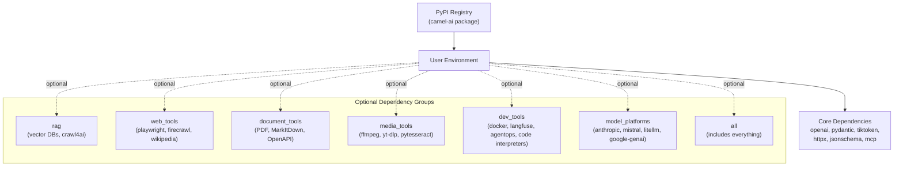
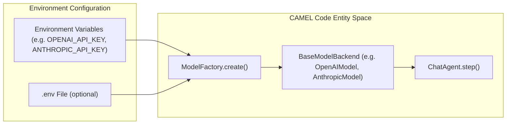

<!-- source: DeepWiki mcp.deepwiki.com · repo camel-ai/camel · page 1.1 Installation and Setup · fetched 2026-10-29 -->

# Installation and Setup

<details>
<summary>Relevant source files</summary>

The following files were used as context for generating this wiki page:

- [.container/.env.example](.container/.env.example)
- [.container/Dockerfile](.container/Dockerfile)
- [.container/README.md](.container/README.md)
- [.container/docker-compose.yaml](.container/docker-compose.yaml)
- [.container/minimal_build/Dockerfile](.container/minimal_build/Dockerfile)
- [.github/ISSUE_TEMPLATE/bug_report.yml](.github/ISSUE_TEMPLATE/bug_report.yml)
- [README.md](README.md)
- [camel/__init__.py](camel/__init__.py)
- [camel/agents/chat_agent.py](camel/agents/chat_agent.py)
- [camel/interpreters/docker/Dockerfile](camel/interpreters/docker/Dockerfile)
- [docs/conf.py](docs/conf.py)
- [docs/cookbooks/multi_agent_society/agents_society.md](docs/cookbooks/multi_agent_society/agents_society.md)
- [docs/get_started/installation.md](docs/get_started/installation.md)
- [docs/get_started/setup.md](docs/get_started/setup.md)
- [docs/key_modules/loaders.md](docs/key_modules/loaders.md)
- [docs/mintlify/get_started/installation.mdx](docs/mintlify/get_started/installation.mdx)
- [docs/mintlify/key_modules/society.mdx](docs/mintlify/key_modules/society.mdx)
- [docs/mintlify/key_modules/storages.mdx](docs/mintlify/key_modules/storages.mdx)
- [docs/mintlify/reference/camel.caches.base.mdx](docs/mintlify/reference/camel.caches.base.mdx)
- [docs/mintlify/reference/camel.caches.semantic_cache.mdx](docs/mintlify/reference/camel.caches.semantic_cache.mdx)
- [docs/mintlify/reference/camel.storages.vectordb_storages.chroma.mdx](docs/mintlify/reference/camel.storages.vectordb_storages.chroma.mdx)
- [docs/mintlify/reference/camel.storages.vectordb_storages.pgvector.mdx](docs/mintlify/reference/camel.storages.vectordb_storages.pgvector.mdx)
- [docs/mintlify/reference/camel.storages.vectordb_storages.surreal.mdx](docs/mintlify/reference/camel.storages.vectordb_storages.surreal.mdx)
- [docs/mintlify/reference/camel.storages.vectordb_storages.weaviate.mdx](docs/mintlify/reference/camel.storages.vectordb_storages.weaviate.mdx)
- [pyproject.toml](pyproject.toml)
- [test/agents/test_chat_agent.py](test/agents/test_chat_agent.py)
- [uv.lock](uv.lock)

</details>


This guide covers installing the CAMEL framework, configuring API credentials, and verifying your setup. For detailed architecture and core concept explanations, see section 1.2. For example-driven learning about creating your first agent, refer to section 9.

---

## Purpose and Scope

This page provides:

- Methods to install CAMEL-AI for end-users and contributors.
- Details on Python version and dependency group management.
- Instructions on configuring API keys for model platforms.
- Verification steps for installation success and troubleshooting advice.

---

## System Requirements

### Python Version

CAMEL requires **Python >=3.10 and <3.15**.

```toml
requires-python = ">=3.10,<3.15"
```
[pyproject.toml:10-10]()

> **Note on Python 3.13+:**  
> - Certain packages such as `unstructured` and `pyobvector` are unavailable on Python 3.13+ due to incompatibilities with NumPy versions.  
> - For RAG and document-related features using these packages, use Python 3.10-3.12.  
> - All other features including the core agents and most model platforms support Python 3.13+ normally.

[docs/get_started/installation.md:143-149]()

### Supported Operating Systems

Linux, macOS, and Windows platforms are supported for running CAMEL.

---

## Installation Methods

### Basic Installation for End Users

To get started quickly with CAMEL, install the core package from PyPI:

```bash
pip install camel-ai
```

This installs the essential dependencies like `openai`, `pydantic`, `tiktoken`, `httpx`, and others.

[pyproject.toml:23-38]()

### Installation Dependency Overview



Sources: [pyproject.toml:23-237](), [docs/get_started/installation.md:43-57]()

### Installing with Optional Feature Groups

CAMEL groups optional dependencies by functionality so you can install only what you need:

| Dependency Group   | Use Case                       | Key Libraries                                         |
| ------------------ | ------------------------------| ---------------------------------------------------- |
| **`web_tools`**    | Web search and automation      | `playwright`, `firecrawl-py`, `beautifulsoup4`, `ddgs` |
| **`rag`**          | Retrieval-augmented generation | `qdrant-client`, `pymilvus`, `chromadb`, `weaviate-client` |
| **`document_tools`** | Document parsing and conversion| `PyMuPDF`, `markitdown`, `python-pptx`, `openpyxl`  |
| **`media_tools`**  | Image, video, audio processing | `ffmpeg-python`, `yt-dlp`, `pytesseract`, `pydub`   |
| **`model_platforms`** | Alternative LLM backends      | `anthropic`, `mistralai`, `litellm`, `google-genai` |
| **`storage`**      | Persistent storage backends    | `redis`, `neo4j`, `pgvector`, `surrealdb`            |
| **`dev_tools`**    | Development & observability    | `docker`, `agentops`, `langfuse`, `e2b-code-interpreter` |

Install multiple groups by combining extras:

```bash
pip install 'camel-ai[rag,web_tools,document_tools]'
```

Or install all dependencies recommended for full feature support:

```bash
pip install 'camel-ai[all]'
```

[pyproject.toml:75-237](), [docs/get_started/installation.md:31-62]()

---

### Installing from Source for Contributors

Developers and contributors use the `uv` tool for deterministic, fast environment setup. CAMEL provides a `uv.lock` file that pins exact versions.

```bash
# Clone the CAMEL repository
git clone https://github.com/camel-ai/camel.git
cd camel

# Install uv and create a virtual environment with Python 3.10
pip install uv
uv venv .venv --python=3.10

# Activate the virtual environment
source .venv/bin/activate   # Linux/macOS
# .venv\Scripts\activate    # Windows

# Install CAMEL in editable mode with all dependencies, including dev and docs
uv pip install -e ".[all, dev, docs]"
```

[docs/get_started/installation.md:151-168](), [uv.lock:1-21]()

---

## Configuring API Keys and Environment Variables

CAMEL supports over 40 model platforms, each requiring credentials configured as environment variables or through `.env` files.

### How CAMEL Loads Model Configurations



The `ModelFactory.create()` method reads environment credentials and returns an appropriate `BaseModelBackend` instance, such as `OpenAIModel` or `AnthropicModel`. These backend models are then used by `ChatAgent.step()` to process messages.

Sources: [camel/agents/chat_agent.py:81-86](), [docs/get_started/setup.md:7-55]()

### Setting Up Your Environment Variables

**Using a `.env` file (recommended):**

Create a `.env` file in your project root:

```dotenv
OPENAI_API_KEY=sk-xxxxxxx
ANTHROPIC_API_KEY=an-xxxxxxx
GOOGLE_API_KEY=xxxxxx
```

Load these variables in your Python code early:

```python
from dotenv import load_dotenv
load_dotenv()
```

[docs/get_started/installation.md:211-221]()

### Default Model Platform and Type Override

You can set global environment variables to specify the default model platform and type CAMEL uses if none is specified programmatically:

```bash
export DEFAULT_MODEL_PLATFORM_TYPE=openai       # e.g., openai, anthropic, litellm
export DEFAULT_MODEL_TYPE=gpt-4o-mini           # e.g., gpt-3.5-turbo, gpt-4o-mini, etc.
```

These defaults configure `ModelFactory` behavior to automatically pick your preferred backend/model.

[docs/get_started/installation.md:178-190]()

---

## Verifying Installation

### Quick Verification Script

Run this minimal Python snippet to confirm CAMEL is installed and can instantiate core agents with models:

```python
import camel
from camel.agents import ChatAgent
from camel.models import ModelFactory
from camel.types import ModelPlatformType, ModelType

# Print installed CAMEL version
print(f"CAMEL version: {camel.__version__}")

# Create a model instance using ModelFactory
model = ModelFactory.create(
    model_platform=ModelPlatformType.OPENAI,
    model_type=ModelType.GPT_4O_MINI,
)

# Initialize a ChatAgent with a system prompt
agent = ChatAgent(system_message="You are a helpful assistant.", model=model)

print("✓ Agent initialized successfully")
```

Sources: [camel/__init__.py:17-17](), [camel/agents/chat_agent.py:133-134]()

### Testing Optional Modules

To verify optional feature group installations, attempt importing their key classes:

| Feature       | Code Entity to Test              | Source Location                  |
| ------------- | ------------------------------- | ------------------------------- |
| RAG           | `camel.loaders.UnstructuredIO`  | [docs/key_modules/loaders.md:110-112]() |
| Storage       | `camel.storages.MilvusStorage`  | [docs/mintlify/key_modules/storages.mdx:51-53]() |
| Toolkits      | `camel.toolkits.SearchToolkit`  | [test/agents/test_chat_agent.py:52-52]() |

---

## Troubleshooting Common Issues

| Symptom                                       | Cause                          | Resolution                                |
| ---------------------------------------------| -------------------------------| ----------------------------------------|
| `ImportError: No module named 'qdrant_client'` | Missing optional RAG dependencies | Run `pip install 'camel-ai[rag]'`       |
| `ValueError: OPENAI_API_KEY is required`      | Environment variable not set    | Set API key via `.env` file or export   |
| `ModuleNotFoundError: No module named 'unstructured'` | Using Python 3.13+ where `unstructured` is unavailable | Downgrade Python to 3.10-3.12           |
| Rate limit errors on API calls                 | API quota exceeded              | `ChatAgent` retries automatically; verify your quota and usage |

[docs/get_started/installation.md:143-149](), [camel/agents/chat_agent.py:52-54]()

---

## Development Infrastructure (For Contributors)

### Pre-commit Hooks

CAMEL uses `ruff` for linting and `mypy` for static typing checks:

```bash
pre-commit install
pre-commit run --all-files
```

Configuration located here: [pyproject.toml:48-51]()

### Running Tests

Tests are organized with `pytest`, including unit and integration tests:

```bash
pytest test/agents/test_chat_agent.py
```

[camel/agents/chat_agent.py:21-32]()

---

This completes the Installation and Setup guide. After this, consult the Core Architecture Overview (section 1.2) for an understanding of CAMEL's layered design and primary abstractions.

Sources:  
[pyproject.toml:1-237](),  
[uv.lock:1-21](),  
[docs/get_started/installation.md:1-228](),  
[docs/get_started/setup.md:1-55](),  
[camel/__init__.py:1-24](),  
[camel/agents/chat_agent.py:1-134](),  
[test/agents/test_chat_agent.py:21-32](),  
[docs/key_modules/loaders.md:110-112](),  
[docs/mintlify/key_modules/storages.mdx:51-53]()

---

