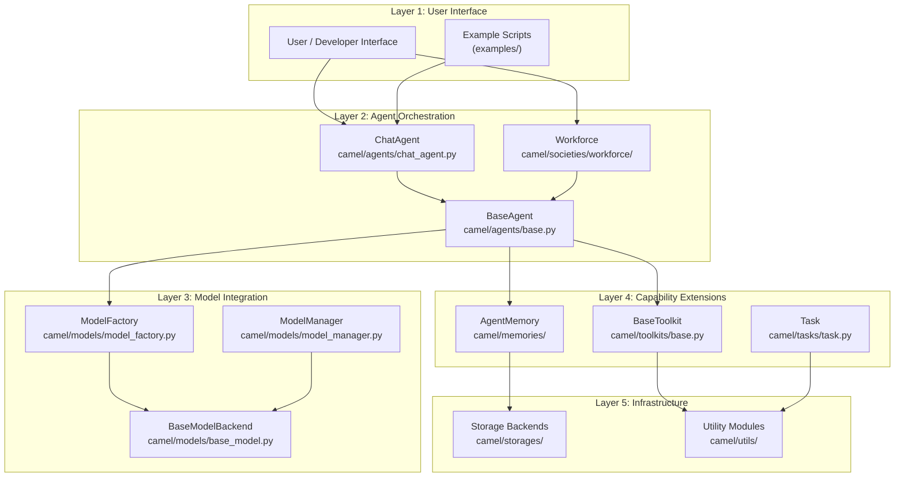
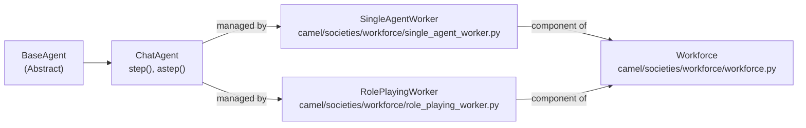
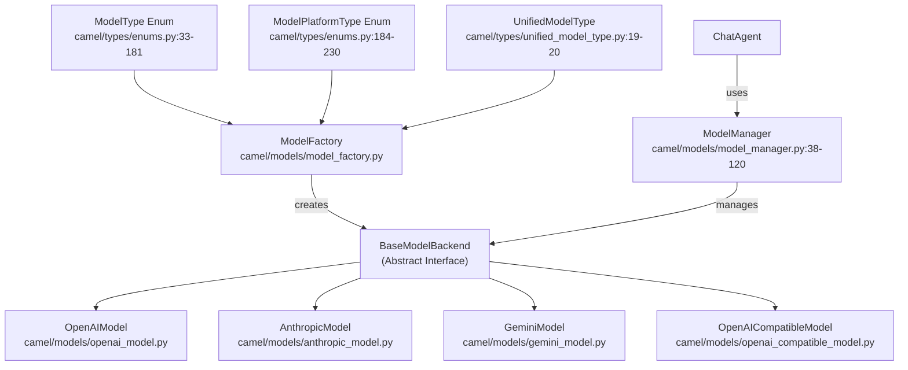
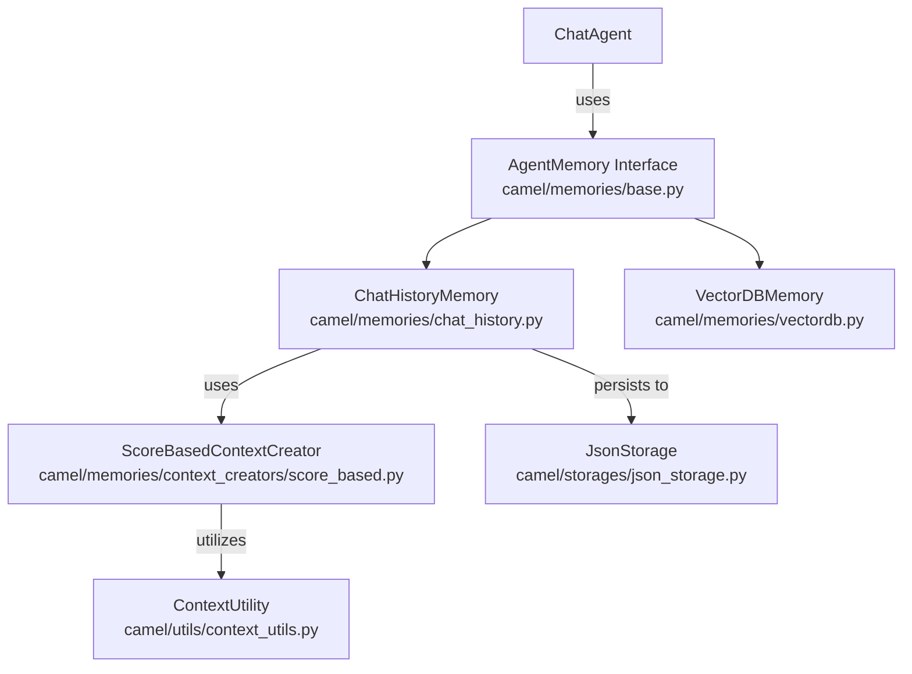
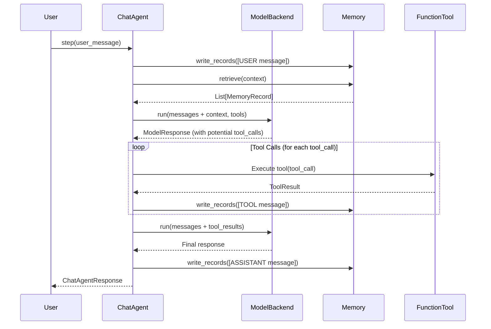
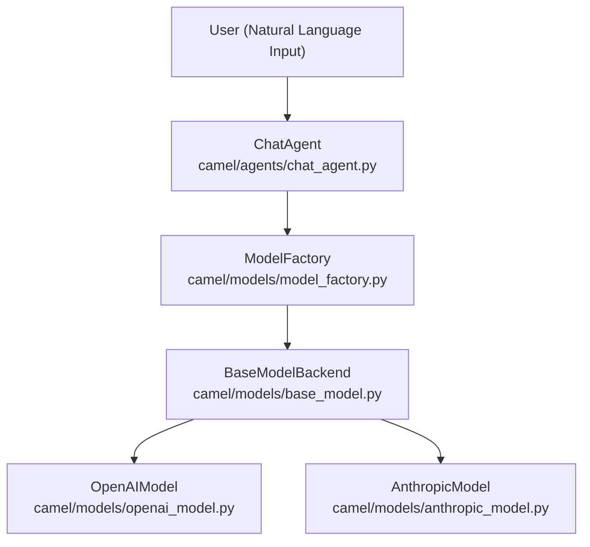
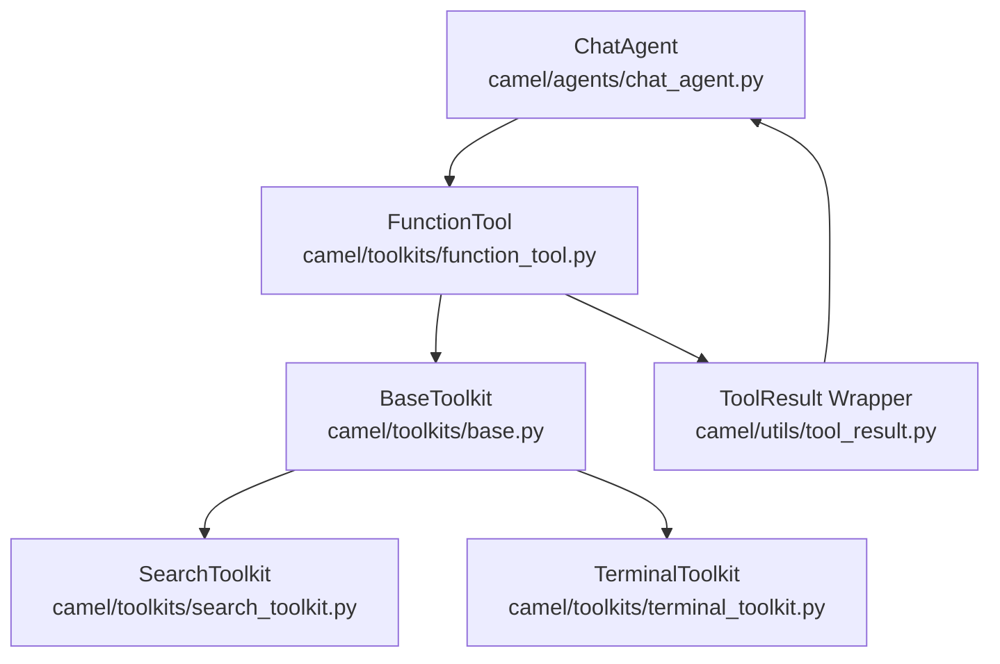

<!-- source: DeepWiki mcp.deepwiki.com · repo camel-ai/camel · page 1.2 Core Architecture Overview · fetched 2026-10-29 -->

# Core Architecture Overview

<details>
<summary>Relevant source files</summary>

The following files were used as context for generating this wiki page:

- [.github/ISSUE_TEMPLATE/bug_report.yml](.github/ISSUE_TEMPLATE/bug_report.yml)
- [README.md](README.md)
- [camel/__init__.py](camel/__init__.py)
- [camel/agents/chat_agent.py](camel/agents/chat_agent.py)
- [camel/toolkits/__init__.py](camel/toolkits/__init__.py)
- [docs/conf.py](docs/conf.py)
- [docs/get_started/installation.md](docs/get_started/installation.md)
- [docs/get_started/setup.md](docs/get_started/setup.md)
- [docs/key_modules/agents.md](docs/key_modules/agents.md)
- [docs/key_modules/datagen.md](docs/key_modules/datagen.md)
- [docs/key_modules/embeddings.md](docs/key_modules/embeddings.md)
- [docs/key_modules/interpreters.md](docs/key_modules/interpreters.md)
- [docs/key_modules/loaders.md](docs/key_modules/loaders.md)
- [docs/key_modules/memory.md](docs/key_modules/memory.md)
- [docs/key_modules/messages.md](docs/key_modules/messages.md)
- [docs/key_modules/prompts.md](docs/key_modules/prompts.md)
- [docs/key_modules/retrievers.md](docs/key_modules/retrievers.md)
- [docs/key_modules/runtimes.md](docs/key_modules/runtimes.md)
- [docs/key_modules/society.md](docs/key_modules/society.md)
- [docs/key_modules/storages.md](docs/key_modules/storages.md)
- [docs/key_modules/tasks.md](docs/key_modules/tasks.md)
- [docs/key_modules/tools.md](docs/key_modules/tools.md)
- [docs/key_modules/workforce.md](docs/key_modules/workforce.md)
- [docs/mintlify/docs.json](docs/mintlify/docs.json)
- [docs/mintlify/reference/camel.agents._utils.mdx](docs/mintlify/reference/camel.agents._utils.mdx)
- [docs/mintlify/reference/camel.agents.chat_agent.mdx](docs/mintlify/reference/camel.agents.chat_agent.mdx)
- [docs/mintlify/reference/camel.configs.avian_config.mdx](docs/mintlify/reference/camel.configs.avian_config.mdx)
- [docs/mintlify/reference/camel.configs.cerebras_config.mdx](docs/mintlify/reference/camel.configs.cerebras_config.mdx)
- [docs/mintlify/reference/camel.configs.orcarouter_config.mdx](docs/mintlify/reference/camel.configs.orcarouter_config.mdx)
- [docs/mintlify/reference/camel.memories.agent_memories.mdx](docs/mintlify/reference/camel.memories.agent_memories.mdx)
- [docs/mintlify/reference/camel.memories.base.mdx](docs/mintlify/reference/camel.memories.base.mdx)
- [docs/mintlify/reference/camel.memories.blocks.chat_history_block.mdx](docs/mintlify/reference/camel.memories.blocks.chat_history_block.mdx)
- [docs/mintlify/reference/camel.memories.context_creators.score_based.mdx](docs/mintlify/reference/camel.memories.context_creators.score_based.mdx)
- [docs/mintlify/reference/camel.models.avian_model.mdx](docs/mintlify/reference/camel.models.avian_model.mdx)
- [docs/mintlify/reference/camel.models.cerebras_model.mdx](docs/mintlify/reference/camel.models.cerebras_model.mdx)
- [docs/mintlify/reference/camel.models.orcarouter_model.mdx](docs/mintlify/reference/camel.models.orcarouter_model.mdx)
- [docs/mintlify/reference/camel.types.enums.mdx](docs/mintlify/reference/camel.types.enums.mdx)
- [docs/mintlify/reference/camel.types.unified_model_type.mdx](docs/mintlify/reference/camel.types.unified_model_type.mdx)
- [pyproject.toml](pyproject.toml)
- [test/agents/test_chat_agent.py](test/agents/test_chat_agent.py)
- [uv.lock](uv.lock)

</details>


## Purpose and Scope

This document provides a detailed exposition of CAMEL-AI’s core layered architecture, detailing the primary components—agents, models, memory, tools—and how they interoperate to enable rich multi-agent communicative systems. It highlights key design abstractions and patterns, illustrating implementation relationships and data flow, serving as a technical foundation for contributors and developers extending the framework.

For in-depth implementation details, specific components can be referenced in the following files:

- Agent internals and lifecycle: [camel/agents/chat_agent.py:246-363]()
- Memory implementations and abstractions: [camel/memories/chat_history.py:34-75]()
- Multi-agent orchestration and workforce: [camel/societies/workforce/workforce.py:50-150]()
- Model backends and factory: [camel/models/base_model.py:28-112](), [camel/models/model_factory.py:78-143]()
- Toolkits and tools: [camel/toolkits/base.py:35-110](), [camel/toolkits/function_tool.py:30-100]()

---

## Architectural Layers

CAMEL-AI organizes its architecture in five distinct yet interlinked layers, enabling modular extensibility and clean separation of concerns:



**Notes:**

- **Layer 1** represents entry points like users or example scripts.
- **Layer 2** handles agent orchestration, including individual chat agents and multi-agent societies.
- **Layer 3** manages model backends supporting multiple LLM providers with flexible factory instantiation.
- **Layer 4** extends agent capabilities via memory, toolkits (function calls and external APIs), and task abstractions.
- **Layer 5** provides foundational infrastructure such as persistent storage and utility functions.

**Sources:** [camel/agents/chat_agent.py:1-465](), [camel/models/model_factory.py:1-143](), [camel/agents/base.py:1-29](), [camel/models/base_model.py:1-112]()

---

## Core Components

### Agent System

The **agent system** comprises both the abstraction of single agents and multi-agent orchestration components. Its core class is `ChatAgent`, derived from `BaseAgent`, managing dialogue context, invoking models, and orchestrating tool executions.

| Component | Implementation Path | Responsibility |
|-----------|---------------------|----------------|
| `BaseAgent` | [camel/agents/base.py:29]() | Defines the abstract agent interface and lifecycle methods such as `step()` and `reset()` |
| `ChatAgent` | [camel/agents/chat_agent.py:246-363]() | Implements conversational agent logic, including memory integration, tool calling, and streaming responses |
| `Workforce` | [camel/societies/workforce/workforce.py:50-150]() | Coordinates multiple agents and workers for complex task orchestration |



**Design Highlights:**

- `ChatAgent.step()` method sequences user input processing, memory updates, model calls, and tool invocations to produce an assistant response. This is the main conversational "turn" method.
- Streaming responses are supported via the `StreamContentAccumulator` class that aggregates partial content progressively.
- Tool call handling is integrated tightly, supporting multi-step interactions.

**Sources:** [camel/agents/chat_agent.py:1171-1450]() (main step pipeline), [camel/agents/base.py:29](), [camel/models/_utils.py:87-88]()

---

### Model Integration Layer

CAMEL-AI interfaces with over 40 different large language model (LLM) providers through an extensible factory and backend abstraction:



**Key Points:**

- The `ModelFactory.create()` method centralizes creation of suitable model backends based on platform and type enums or strings.
- Supports both synchronous `run()` and asynchronous `arun()` calls.
- Model backends implement a shared interface `BaseModelBackend` specifying key methods and properties such as token counting, streaming, and prompt preprocessing.
- Model configurations (hyperparameters, defaults) are managed separately per platform (e.g., `ChatGPTConfig`, `AnthropicConfig`, `GeminiConfig`).

**Sources:** [camel/models/model_factory.py:78-143](), [camel/models/base_model.py:28-112](), [camel/types/enums.py:33-230](), [camel/types/unified_model_type.py:19-20]()

---

### Memory System

The memory subsystem allows agents to maintain conversational and task context persistently with pluggable storage mechanisms and intelligent context retrieval:



**Operational Flow:**

1. **Memory Writing:** When new messages arrive or tool calls complete, they are encapsulated as `MemoryRecord` and written to the memory backend, e.g., file-backed JSON or vector databases.
2. **Context Retrieval:** On each turn, the `ChatAgent` invokes memory retrieval to obtain relevant conversation history using `ScoreBasedContextCreator`, which scores and filters based on relevance and token constraints.
3. **Token Management:** Token counting utilities, such as `BaseTokenCounter` implementations, ensure memory context does not exceed model limits.
4. **Context Utilities:** `ContextUtility` provides supporting methods for context assembly and summarization.

**Sources:** [camel/agents/chat_agent.py:70-75](), [camel/memories/chat_history.py:34-150](), [camel/memories/context_creators/score_based.py:120-150](), [camel/utils/context_utils.py:107-108]()

---

### Tool Ecosystem

Tools enrich agents by enabling external actions, functionalities, and API calls via a unified interface and schema-based invocation system:

```mermaid
graph TB
    BaseToolkit["BaseToolkit Class<br/>camel/toolkits/base.py"]
    
    BaseToolkit --> SearchToolkit["SearchToolkit<br/>camel/toolkits/search_toolkit.py"]
    BaseToolkit --> TerminalToolkit["TerminalToolkit<br/>camel/toolkits/terminal_toolkit.py"]
    
    FunctionTool["FunctionTool Wrapper<br/>camel/toolkits/function_tool.py"]
    
    BaseToolkit --> |"methods wrapped as"| FunctionTool
    
    Decorators["Validation & Dependency Decorators"]
    Decorators --> dependencies_required["@dependencies_required<br/>camel/utils/commons.py"]
    
    ChatAgent --> |"calls"| FunctionTool
    FunctionTool --> |"executes"| BaseToolkit implementations
```

**Tool Development Workflow:**

- Developers implement toolkits by subclassing `BaseToolkit`.
- Each actionable method is decorated to enforce dependencies, timeouts, or API key presence via `@dependencies_required` and other decorators.
- `ChatAgent` integrates tools by converting methods to `FunctionTool` objects, supplying function schemas compatible with LLM tool-calling standards.
- Executed tool results are wrapped within `ToolResult` to standardize response handling.

**Sources:** [camel/toolkits/base.py:35-110](), [camel/toolkits/function_tool.py:30-100](), [camel/utils/commons.py:106-107](), [camel/utils/tool_result.py:44]()

---

## Design Patterns

### Factory Pattern (Model Creation)

- The CAMEL-AI uses a Factory Pattern via `ModelFactory.create()` to instantiate appropriate model backends from platform and model type enums or strings.
- This pattern encapsulates platform-specific differences and supports quick extension for new LLM providers, ensuring loose coupling.

**Sources:** [camel/models/model_factory.py:78-143]()

---

### Strategy Pattern (Memory Management)

- Memory implementations adhere to the `AgentMemory` interface, allowing seamless swapping between in-memory, file-based, or vector-database storages.
- This enables flexible context retention strategies without modifying agent code.

**Sources:** [camel/agents/chat_agent.py:70-75](), [camel/memories/chat_history.py:73-74]()

---

## Data Flow: Single Agent Execution Pipeline

The following sequence diagram details the processing steps when a `ChatAgent` handles a user message:



**Explanation of Key Steps:**

- The user input is recorded in memory.
- Relevant context is retrieved to compose the model input prompt.
- The language model runs, optionally requesting tool calls.
- The agent executes the tools, adding their outputs to memory.
- The model is called again with tool results to produce the final response.
- The assistant’s response is stored.
- The agent returns the response to the user.

**Additional notes:**

- If streaming is enabled, partial content aggregation is managed by `StreamContentAccumulator`.
- Specialized reasoning or "thinking" extraction is handled by utilities like `extract_thinking_from_content()` for models that output intermediate thoughts.
- Tool call and result tracking uses the `ToolCallingRecord` abstraction.

**Sources:** [camel/agents/chat_agent.py:1171-1450](), [camel/agents/chat_agent.py:176-228](), [camel/models/_utils.py:87-88](), [camel/types/agents.py:100-101]()

---

## Key Abstractions Summary

| Abstraction          | File Path                                  | Key Methods                  | Purpose                                      |
|----------------------|--------------------------------------------|-----------------------------|----------------------------------------------|
| `BaseAgent`          | [camel/agents/base.py:29]()             | `step()`, `reset()`          | Defines the agent lifecycle interface         |
| `ChatAgent`          | [camel/agents/chat_agent.py:246-363]()     | `step()`, streaming support  | Implements single chat agent with tool and memory integration |
| `BaseModelBackend`   | [camel/models/base_model.py:28-112]()      | `run()`, `arun()`            | Unified interface for language model backends |
| `AgentMemory`        | [camel/memories/chat_history.py:34-75]()  | `write_records()`, `retrieve()` | Abstraction for stateful storage and retrieval of conversational context |
| `BaseToolkit`        | [camel/toolkits/base.py:35-110]()          | `get_tools()`                | Toolkit interface for defining pluggable tools |
| `FunctionTool`       | [camel/toolkits/function_tool.py:30-100]()| Call wrappers and schema     | Wraps Python functions as tools accessible to agents |
| `ModelFactory`       | [camel/models/model_factory.py:78-143]()  | `create()`                  | Factory pattern to instantiate model backends |
| `ScoreBasedContextCreator` | [camel/memories/context_creators/score_based.py:120-150]() | Context filtering/scoring     | Implements token-aware retrieval strategy for memory |

---

## Bridging Natural Language Concepts to Code Entities

### Diagram: Agent and Model Bridging



- The user's natural language passes to `ChatAgent.step()` which calls `ModelFactory.create()` to get a backend.
- The backend handles communication with the LLM provider (OpenAI, Anthropic, etc.)
- Model responses encapsulate tokens and tool call metadata usable by agent layers.

**Sources:** [camel/agents/chat_agent.py:246-363](), [camel/models/model_factory.py:78-143](), [camel/models/openai_model.py](), [camel/models/anthropic_model.py]()

---

### Diagram: Tool Invocation Bridging



- Agent uses `FunctionTool` wrappers to invoke specific toolkit methods.
- Toolkit classes implement concrete external integrations (e.g., web search, terminal commands).
- Results are wrapped and fed back to the agent's memory and reasoning streams.

**Sources:** [camel/toolkits/function_tool.py:30-100](), [camel/toolkits/base.py:35-110](), [camel/agents/chat_agent.py:246-363]()

---

# Summary

The CAMEL-AI core architecture leverages modular abstractions across agents, models, memory, and capabilities (tools, tasks) connected through well-defined interfaces and design patterns. The layered system enables integration of diverse LLM backends, persistent stateful memory, and extensible tool ecosystems, orchestrated by agent instances to engage in sophisticated multi-turn dialogues and multi-agent workflows. Understanding these components and their interactions is essential for effectively developing, debugging, or extending the CAMEL framework.

---

**Sources:**

- [camel/agents/chat_agent.py:1-465]()
- [camel/agents/chat_agent.py:1171-1450]()
- [camel/models/model_factory.py:78-143]()
- [camel/models/base_model.py:28-112]()
- [camel/agents/base.py:29]()
- [camel/memories/chat_history.py:34-150]()
- [camel/memories/context_creators/score_based.py:120-150]()
- [camel/utils/context_utils.py:107-108]()
- [camel/toolkits/base.py:35-110]()
- [camel/toolkits/function_tool.py:30-100]()
- [camel/utils/commons.py:106-107]()
- [camel/utils/tool_result.py:44]()
- [camel/models/_utils.py:87-88]()
- [camel/types/agents.py:100-101]()

---

