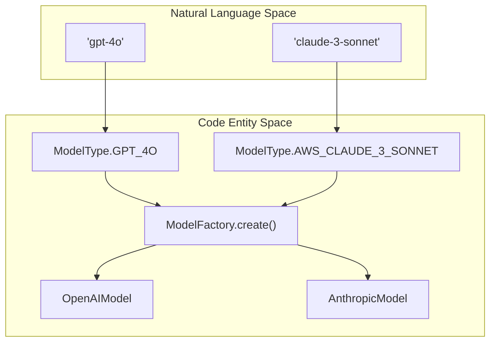
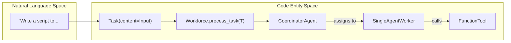

<!-- source: DeepWiki mcp.deepwiki.com · repo camel-ai/camel · page 10 Glossary · fetched 2026-10-29 -->

# Glossary

Relevant source files

The following files were used as context for generating this wiki page:

- [.github/workflows/build_package.yml](.github/workflows/build_package.yml)
- [.github/workflows/pytest_package.yml](.github/workflows/pytest_package.yml)
- [camel/configs/__init__.py](camel/configs/__init__.py)
- [camel/interpreters/__init__.py](camel/interpreters/__init__.py)
- [camel/memories/__init__.py](camel/memories/__init__.py)
- [camel/memories/agent_memories.py](camel/memories/agent_memories.py)
- [camel/memories/base.py](camel/memories/base.py)
- [camel/memories/blocks/chat_history_block.py](camel/memories/blocks/chat_history_block.py)
- [camel/memories/blocks/vectordb_block.py](camel/memories/blocks/vectordb_block.py)
- [camel/memories/context_creators/__init__.py](camel/memories/context_creators/__init__.py)
- [camel/memories/context_creators/score_based.py](camel/memories/context_creators/score_based.py)
- [camel/memories/records.py](camel/memories/records.py)
- [camel/models/__init__.py](camel/models/__init__.py)
- [camel/models/model_factory.py](camel/models/model_factory.py)
- [camel/societies/workforce/__init__.py](camel/societies/workforce/__init__.py)
- [camel/societies/workforce/prompts.py](camel/societies/workforce/prompts.py)
- [camel/societies/workforce/role_playing_worker.py](camel/societies/workforce/role_playing_worker.py)
- [camel/societies/workforce/single_agent_worker.py](camel/societies/workforce/single_agent_worker.py)
- [camel/societies/workforce/utils.py](camel/societies/workforce/utils.py)
- [camel/societies/workforce/worker.py](camel/societies/workforce/worker.py)
- [camel/societies/workforce/workforce.py](camel/societies/workforce/workforce.py)
- [camel/storages/key_value_storages/json.py](camel/storages/key_value_storages/json.py)
- [camel/storages/vectordb_storages/base.py](camel/storages/vectordb_storages/base.py)
- [camel/tasks/task.py](camel/tasks/task.py)
- [camel/toolkits/function_tool.py](camel/toolkits/function_tool.py)
- [camel/toolkits/google_maps_toolkit.py](camel/toolkits/google_maps_toolkit.py)
- [camel/toolkits/whatsapp_toolkit.py](camel/toolkits/whatsapp_toolkit.py)
- [camel/types/enums.py](camel/types/enums.py)
- [camel/types/unified_model_type.py](camel/types/unified_model_type.py)
- [camel/utils/__init__.py](camel/utils/__init__.py)
- [camel/utils/commons.py](camel/utils/commons.py)
- [camel/utils/token_counting.py](camel/utils/token_counting.py)
- [docs/key_modules/models.md](docs/key_modules/models.md)
- [docs/mintlify/key_modules/models.mdx](docs/mintlify/key_modules/models.mdx)
- [examples/interpreters/microsandbox_interpreter_example.py](examples/interpreters/microsandbox_interpreter_example.py)
- [examples/toolkits/generate_openai_tool_schema.py](examples/toolkits/generate_openai_tool_schema.py)
- [examples/toolkits/synthesize_function_execution.py](examples/toolkits/synthesize_function_execution.py)
- [examples/workforce/eigent.py](examples/workforce/eigent.py)
- [examples/workforce/pipeline_workflow_example.py](examples/workforce/pipeline_workflow_example.py)
- [test/interpreters/test_microsandbox_interpreter.py](test/interpreters/test_microsandbox_interpreter.py)
- [test/memories/context_creators/test_score_based.py](test/memories/context_creators/test_score_based.py)
- [test/memories/test_agent_memories.py](test/memories/test_agent_memories.py)
- [test/memories/test_blocks.py](test/memories/test_blocks.py)
- [test/memories/test_chat_history_memory.py](test/memories/test_chat_history_memory.py)
- [test/memories/test_vector_db_memory.py](test/memories/test_vector_db_memory.py)
- [test/runtimes/test_daytona_runtime.py](test/runtimes/test_daytona_runtime.py)
- [test/toolkits/test_generate_openai_tool_schema.py](test/toolkits/test_generate_openai_tool_schema.py)
- [test/toolkits/test_google_maps_function.py](test/toolkits/test_google_maps_function.py)
- [test/toolkits/test_openai_function.py](test/toolkits/test_openai_function.py)
- [test/toolkits/test_synthesize_output.py](test/toolkits/test_synthesize_output.py)
- [test/toolkits/test_whatsapp_function.py](test/toolkits/test_whatsapp_function.py)
- [test/utils/test_commons.py](test/utils/test_commons.py)

This page provides definitions and technical context for the core abstractions, jargon, and domain-specific terms used within the CAMEL-AI codebase. It is intended to help onboarding engineers navigate the system architecture and understand the relationships between different code entities.

## Core Agent System

### ChatAgent
The primary unit of intelligence in CAMEL. A `ChatAgent` manages the lifecycle of a conversation with a model backend, including message history, tool calling, and response parsing [camel/agents/chat_agent.py:176-180]().
- **Key Method**: `step()` - The main execution loop that sends messages to the model and processes the response [camel/agents/chat_agent.py:680-685]().
- **Implementation**: It utilizes an `AgentMemory` for context and a `BaseModelBackend` for LLM interactions [camel/agents/chat_agent.py:71-87]().

### RolePlaying
A collaborative paradigm where two agents (typically an `Assistant` and a `User`) interact to solve a task through multi-turn dialogue. The roles are defined by the `RoleType` enum [camel/types/enums.py:24-31]().

### AgentPool
A management structure for maintaining and retrieving a collection of agents. It is frequently used in `Workforce` environments to provide specific workers for tasks based on their descriptions or capabilities.

### AgentMemory
The interface for managing an agent's context. 
- **ChatHistoryMemory**: Stores the linear sequence of messages [camel/agents/chat_agent.py:73]().
- **ScoreBasedContextCreator**: A utility used to select the most relevant messages from memory when the context window is nearly full, based on importance scores [camel/memories/context_creators/score_based.py:35-40]().

**Sources**: [camel/agents/chat_agent.py:71-180](), [camel/types/enums.py:24-31](), [camel/memories/context_creators/score_based.py:35-40]()

## Model Integration Layer

### BaseModelBackend
The abstract base class for all model implementations (e.g., `OpenAIModel`, `AnthropicModel`). It defines the interface for sending requests to various LLM providers [camel/models/base_model.py:27-30]().

### ModelFactory
A factory class used to instantiate the correct `BaseModelBackend` based on a `ModelType` and `ModelPlatformType` [camel/models/model_factory.py:71-76](). It maintains a mapping of platforms to their respective implementation classes [camel/models/model_factory.py:78-128]().

### UnifiedModelType
A base class for model enums that provides a standardized way to refer to models across different platforms using string-based identifiers [camel/types/unified_model_type.py:19]().

### Model Mapping to Code Entities
The following diagram illustrates how natural language model requests are mapped to specific code implementations.

**Natural Language to Code Entity Space: Models**

**Sources**: [camel/types/enums.py:33-75](), [camel/models/model_factory.py:71-143](), [camel/models/base_model.py:27-30]()

## Workforce and Task Orchestration

### Workforce
A high-level orchestration system where multiple `Worker` nodes cooperate to solve complex tasks [camel/societies/workforce/workforce.py:176-180]().
- **Coordinator Agent**: Internal agent that assigns tasks to workers based on capabilities [camel/societies/workforce/workforce.py:183-184]().
- **Task Planner Agent**: Internal agent that decomposes complex tasks and composes results [camel/societies/workforce/workforce.py:184-185]().

### WorkforceMode
Defines the strategy for task execution [camel/societies/workforce/workforce.py:142-147]():
- `AUTO_DECOMPOSE`: Automatic task decomposition mode.
- `PIPELINE`: Predefined sequence of steps (pipeline mode).

### TaskState
Represents the lifecycle of a task within the system [camel/tasks/task.py:85]():
- `OPEN`, `RUNNING`, `DONE`, `FAILED`.

### TaskChannel
A communication abstraction used within a `Workforce` to facilitate message passing and dependency management between different task execution nodes [camel/societies/workforce/task_channel.py:20-25]().

### RecoveryStrategy
Strategies used by the `Workforce` to handle task failures [camel/societies/workforce/utils.py:75-80]():
- `RETRY`: Re-run the task.
- `DECOMPOSE`: Break the failed task into smaller sub-tasks.
- `CREATE_NEW_WORKER`: Instantiate a new agent with specific tools to solve the failure.

### WorkflowMemoryManager
A component responsible for persisting and retrieving the state of a `Workforce` execution, allowing for session recovery and long-running task management.

### StructuredOutputHandler
A utility used to enforce that model responses adhere to a specific Pydantic schema or JSON format, particularly for workforce prompts like `FAILURE_ANALYSIS_RESPONSE_FORMAT` [camel/societies/workforce/workforce.py:68-70]().

### Task Execution Data Flow
This diagram shows how a task moves from a high-level definition into code execution.

**Natural Language to Code Entity Space: Task Execution**

**Sources**: [camel/societies/workforce/workforce.py:142-210](), [camel/tasks/task.py:83-88](), [camel/societies/workforce/utils.py:75-80]()

## Tooling and Utilities

### BaseToolkit & FunctionTool
- **BaseToolkit**: A collection of related tools (e.g., `SearchToolkit`, `TerminalToolkit`) [camel/toolkits/base.py:20-25]().
- **FunctionTool**: A wrapper that converts a standard Python function into a format (OpenAI JSON Schema) that LLMs can understand and call [camel/toolkits/function_tool.py:15-21]().

### MCPToolkit
A toolkit implementation that integrates with the **Model Context Protocol (MCP)**, allowing CAMEL agents to use tools provided by external MCP servers [camel/toolkits/__init__.py:67]().

### ContextUtility
A utility class for managing and summarizing workflow context, ensuring that agents stay within token limits while retaining critical information [camel/utils/context_utils.py:20-30]().

### StreamContentAccumulator
Utility to gather chunks of a streaming LLM response before processing the final content [camel/agents/chat_agent.py:177-180]().

## Technical Jargon Summary

| Term | Definition | Code Reference |
| :--- | :--- | :--- |
| **Code-as-Prompt** | Philosophy where code structure and comments serve as instructions for agents. | [README.md:122-125]() |
| **UnifiedModelType** | A standardized model identifier across all supported platforms. | [camel/types/unified_model_type.py:19]() |
| **TaskChannel** | Async mechanism for workers to receive and report task status. | [camel/societies/workforce/task_channel.py:20]() |
| **RecoveryStrategy** | Enumerated strategies for handling worker or task failures. | [camel/societies/workforce/utils.py:75]() |
| **WorkerConf** | Configuration object for instantiating workers in a workforce. | [camel/societies/workforce/utils.py:79]() |

**Sources**: [camel/agents/chat_agent.py:1-230](), [camel/societies/workforce/workforce.py:1-176](), [camel/types/enums.py:1-110](), [camel/toolkits/function_tool.py:15-21]()