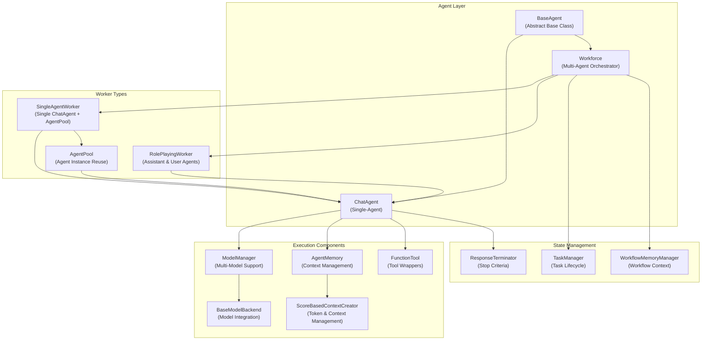
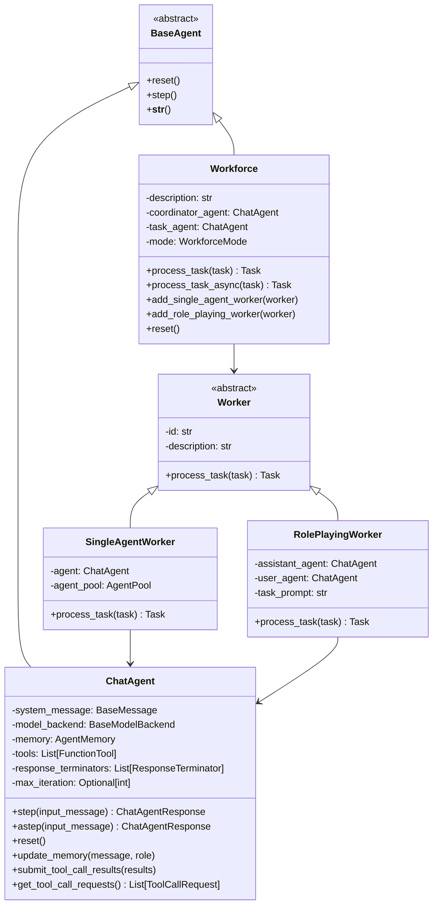
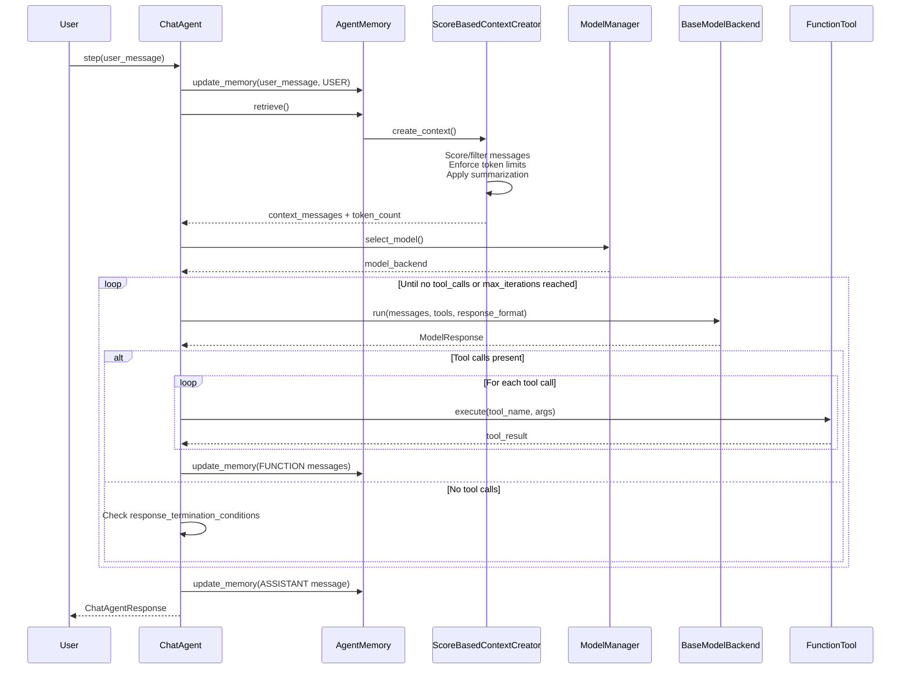
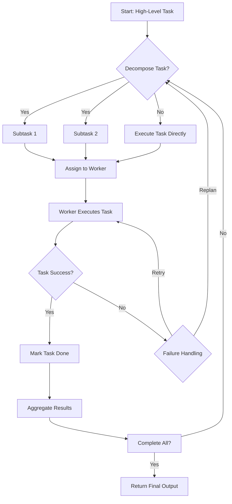

<!-- source: DeepWiki mcp.deepwiki.com · repo camel-ai/camel · page 2 Core Agent System · fetched 2026-10-29 -->

# Core Agent System

Relevant source files

The following files were used as context for generating this wiki page:

- [camel/toolkits/__init__.py](camel/toolkits/__init__.py)
- [docs/key_modules/agents.md](docs/key_modules/agents.md)
- [docs/key_modules/datagen.md](docs/key_modules/datagen.md)
- [docs/key_modules/embeddings.md](docs/key_modules/embeddings.md)
- [docs/key_modules/interpreters.md](docs/key_modules/interpreters.md)
- [docs/key_modules/memory.md](docs/key_modules/memory.md)
- [docs/key_modules/messages.md](docs/key_modules/messages.md)
- [docs/key_modules/prompts.md](docs/key_modules/prompts.md)
- [docs/key_modules/retrievers.md](docs/key_modules/retrievers.md)
- [docs/key_modules/runtimes.md](docs/key_modules/runtimes.md)
- [docs/key_modules/society.md](docs/key_modules/society.md)
- [docs/key_modules/storages.md](docs/key_modules/storages.md)
- [docs/key_modules/tasks.md](docs/key_modules/tasks.md)
- [docs/key_modules/tools.md](docs/key_modules/tools.md)
- [docs/key_modules/workforce.md](docs/key_modules/workforce.md)
- [docs/mintlify/docs.json](docs/mintlify/docs.json)
- [docs/mintlify/reference/camel.agents._utils.mdx](docs/mintlify/reference/camel.agents._utils.mdx)
- [docs/mintlify/reference/camel.agents.chat_agent.mdx](docs/mintlify/reference/camel.agents.chat_agent.mdx)
- [docs/mintlify/reference/camel.configs.avian_config.mdx](docs/mintlify/reference/camel.configs.avian_config.mdx)
- [docs/mintlify/reference/camel.configs.cerebras_config.mdx](docs/mintlify/reference/camel.configs.cerebras_config.mdx)
- [docs/mintlify/reference/camel.configs.orcarouter_config.mdx](docs/mintlify/reference/camel.configs.orcarouter_config.mdx)
- [docs/mintlify/reference/camel.memories.agent_memories.mdx](docs/mintlify/reference/camel.memories.agent_memories.mdx)
- [docs/mintlify/reference/camel.memories.base.mdx](docs/mintlify/reference/camel.memories.base.mdx)
- [docs/mintlify/reference/camel.memories.blocks.chat_history_block.mdx](docs/mintlify/reference/camel.memories.blocks.chat_history_block.mdx)
- [docs/mintlify/reference/camel.memories.context_creators.score_based.mdx](docs/mintlify/reference/camel.memories.context_creators.score_based.mdx)
- [docs/mintlify/reference/camel.models.avian_model.mdx](docs/mintlify/reference/camel.models.avian_model.mdx)
- [docs/mintlify/reference/camel.models.cerebras_model.mdx](docs/mintlify/reference/camel.models.cerebras_model.mdx)
- [docs/mintlify/reference/camel.models.orcarouter_model.mdx](docs/mintlify/reference/camel.models.orcarouter_model.mdx)
- [docs/mintlify/reference/camel.types.enums.mdx](docs/mintlify/reference/camel.types.enums.mdx)
- [docs/mintlify/reference/camel.types.unified_model_type.mdx](docs/mintlify/reference/camel.types.unified_model_type.mdx)

## Purpose and Scope

This document provides a high-level overview of CAMEL’s core agent architecture, focusing on the single-agent abstraction, multi-agent orchestration, and the agent lifecycle. It introduces the foundational concepts and relationships among key components such as agents, models, memory, tools, and workforce management.

For detailed technical information on each aspect, please refer to the dedicated child pages:
- ChatAgent internals → see [ChatAgent](#2.1)
- Memory management and strategies → see [Agent Memory System](#2.2)
- Multi-turn role-playing dialogues → see [Role Playing System](#2.3)
- Task lifecycle and management → see [Task Management](#2.4)
- Multi-agent workforce orchestration → see [Workforce Orchestration](#2.5)

---

## Agent Architecture Overview

At the core, CAMEL’s agent system is designed with modular layers that interoperate to enable autonomous and collaborative AI behavior. The central abstraction is the `BaseAgent`, from which specific implementations extend, most notably the `ChatAgent` for single-agent conversational tasks and the `Workforce` for managing multiple agents working together.

The system integrates these main components:
- **Model Integration**: Abstracted by `BaseModelBackend` and managed via `ModelManager` for selecting and using language models.
- **Memory Management**: Agents use the `AgentMemory` interface to store and retrieve conversation or task context, with support from context creators like `ScoreBasedContextCreator`.
- **Tool Execution**: Tools are wrapped as `FunctionTool` objects, exposing external functions or APIs accessible by agents.
- **Multi-Agent Orchestration**: The `Workforce` class coordinates multiple worker agents, assigning tasks dynamically or via pipelines.

### High-Level Agent System Architecture

This architecture enables flexible configurations ranging from simple single-agent conversations to complex multi-agent collaborations with shared memory and streaming support.

Sources: [camel/agents/chat_agent.py:69-112](), [camel/agents/base.py:1-29](), [camel/societies/workforce/workforce.py:15-40]().

---

## Agent Class Hierarchy

The core agent interface, `BaseAgent`, defines fundamental agent lifecycle methods like `reset()` and `step()`. Two main classes extend this base:

- **ChatAgent**: Implements conversational AI with features such as system message setup, model backend management, tool function integration, memory handling, response termination detection, and multi-model scheduling.
- **Workforce**: Orchestrates multiple worker agents, coordinating task assignment, failure recovery, and complex workflows.

Specialized worker classes extend functionality further:
- `SingleAgentWorker` manages a single `ChatAgent` with an `AgentPool` for efficient reuse.
- `RolePlayingWorker` sets up a multi-turn role-playing session between two `ChatAgent` instances simulating assistant-user dialogues.

### Agent Class Diagram

This hierarchy supports code reuse and specialization, enabling versatile agent behaviors.

Sources: [camel/agents/base.py:27-29](), [camel/agents/chat_agent.py:364-465](), [camel/societies/workforce/workforce.py:15-70]().

---

## ChatAgent: Single Agent Execution

The `ChatAgent` is the primary class for single-agent conversational workflows. It manages dialogue state, executes tool calls, interacts with language model backends, and maintains conversation memory.

### Core Execution Flow

The key method `step()` encapsulates a single interaction cycle with the agent. This includes updating memory with user messages, retrieving context, invoking the language model, handling tool calls if any, managing response termination conditions, and committing assistant responses to memory.

### ChatAgent Step Execution Flow Diagram

This iterative cycle allows the agent to seamlessly chain reasoning steps with external tool invocations.

Sources: [camel/agents/chat_agent.py:844-1200](), [camel/memories/agent_memory.py:27-50](), [camel/memories/context_creators/score_based_context_creator.py:35-70]().

### ChatAgent Initialization Parameters Overview

The `ChatAgent` constructor provides rich configuration parameters for customized behavior:

| Category | Key Parameters | Description |
|---------|----------------|-------------|
| System Config | `system_message`, `agent_id` | Specify the agent's system prompt and unique identifier. |
| Model Backend | `model`, `model_config` | Select model backend(s) via `BaseModelBackend` or model specifications (strings, enums). |
| Memory | `memory`, `message_window_size` | Agent memory instance and maximum messages in context. |
| Tools | `tools` | List of external `FunctionTool` callables for tool usage. |
| Execution Controls | `max_iteration`, `response_terminators` | Limits on iteration count and handlers to decide conversation termination. |

These parameters balance flexibility and ease of use for diverse agent tasks.

Sources: [camel/agents/chat_agent.py:366-464]().

---

## Multi-Agent Orchestration with Workforce

The `Workforce` provides a multi-agent framework that enables complex task orchestration through collaboration of specialized agents.

### Core Concepts

- **Coordinator Agent** assigns and tracks tasks.
- **Task Agent** decomposes high-level tasks into subtasks.
- **Workers** execute subtasks, which may be single agents (`SingleAgentWorker`) or role-playing pairs (`RolePlayingWorker`).
- **Shared Memory and Task Management** help maintain context and coordinate execution.

### Execution Modes

Workforce supports:

- **AUTO_DECOMPOSE** (default): Fully automated task breakdown and assignment with failure handling.
- **PIPELINE**: Fixed sequence of tasks with defined order.

### Workforce Task Lifecycle (Simplified Sequence)

For an in-depth walkthrough of Workforce capabilities, worker types, and failure strategies, see [Workforce Orchestration](#2.5).

Sources: [camel/societies/workforce/workforce.py:10-190]().

---

## Agent Memory and Context Management

CAMEL’s memory system provides agents with persistent and flexible context management for conversations and tasks.

### Key Concepts

- **AgentMemory**: Abstract base managing reading and writing dialogue or task data.
- **ChatHistoryMemory**: Stores sequential chat messages.
- **VectorDBMemory**: Supports embedding-based retrieval.
- **LongtermAgentMemory**: Combines multiple blocks with context summarization.
- **ScoreBasedContextCreator**: Strategy for selecting relevant context based on message scores and token limits.

Memory enables agents to maintain coherent, context-rich dialogues beyond a single interaction.

For comprehensive details visit [Agent Memory System](#2.2).

Sources: [camel/memories/agent_memory.py:27-45](), [camel/memories/context_creators/score_based_context_creator.py:35-50]().

---

## Advanced Features

### Streaming Responses

`ChatAgent` supports streaming outputs, delivering partial responses as they are generated. This is managed by classes like:

- **StreamContentAccumulator**: Aggregates streaming chunks to provide coherent full content and reasoning traces.
- **StreamingChatAgentResponse** and **AsyncStreamingChatAgentResponse**: Wrappers allowing seamless integration with existing interfaces.

Streaming allows real-time interaction and enhances UX in conversational applications.

Sources: [camel/agents/chat_agent.py:11-105](), [camel/agents/chat_agent.py:110-185]().

### Structured Output Support

Agents can output structured data (e.g., JSON) conforming to Pydantic models via the `response_format` parameter in the `step()` method. This is facilitated internally by:

- `StructuredOutputHandler`

It enforces schema, enabling predictable and machine-readable agent responses.

Sources: [camel/agents/chat_agent.py:844-900](), [test/agents/test_chat_agent.py:180-212]().

---

# Summary

The Core Agent System is the foundation of CAMEL’s autonomous and collaborative AI capabilities. It supports flexible single-agent conversations via `ChatAgent`, rich memory and context management to sustain dialogue coherence, and powerful multi-agent orchestration with `Workforce` for complex workflows.

By leveraging well-defined abstractions across model backends, memory structures, toolkits, and agent lifecycles, CAMEL enables scalable, extensible AI agent designs adaptable to a wide range of applications.

---

# References to Related Child Pages

- [ChatAgent](#2.1) — Deep dive into ChatAgent’s internals and execution.
- [Agent Memory System](#2.2) — Details on memory strategies and implementations.
- [Role Playing System](#2.3) — Multi-agent dialogue structures via role-playing.
- [Task Management](#2.4) — Task lifecycle, decomposition, and validation.
- [Workforce Orchestration](#2.5) — Comprehensive multi-agent and workflow orchestration.

---

# End of Core Agent System Page

---

