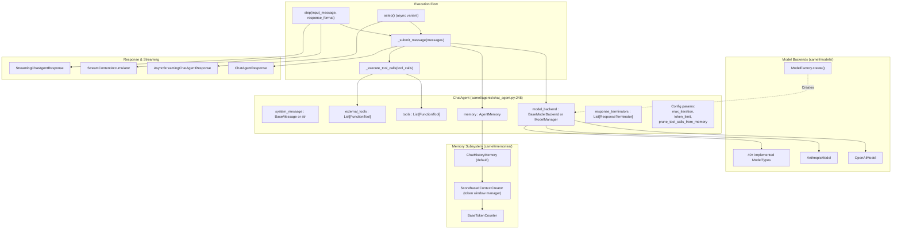
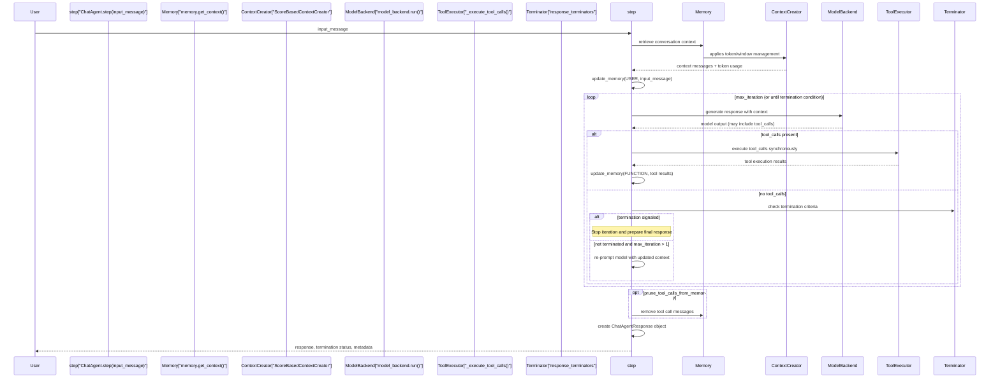
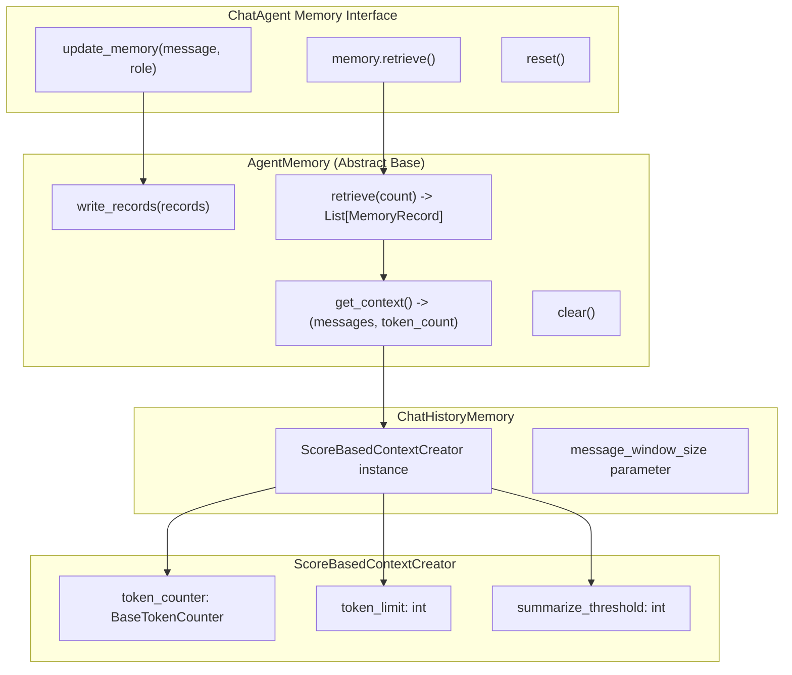
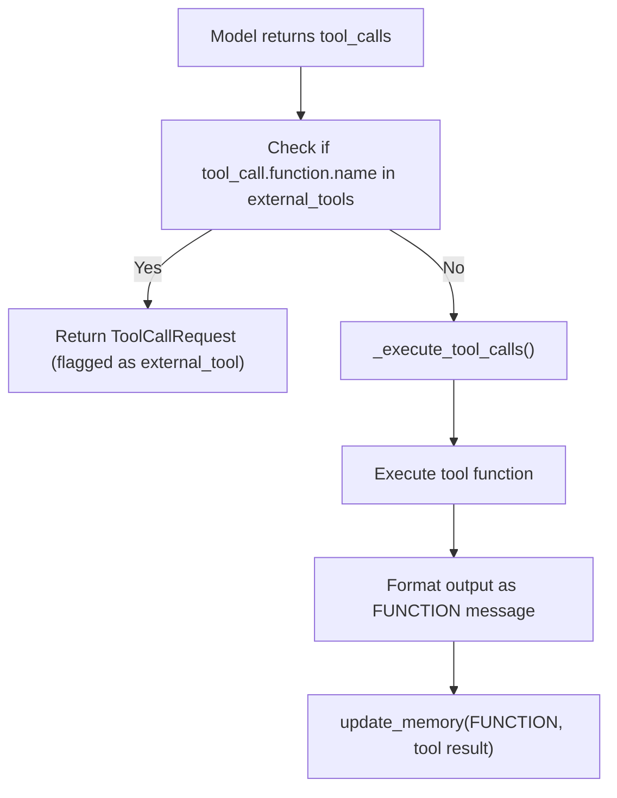
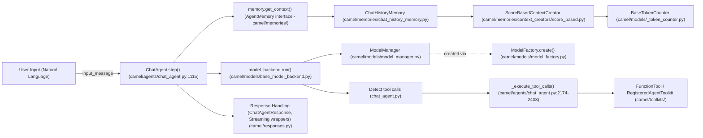
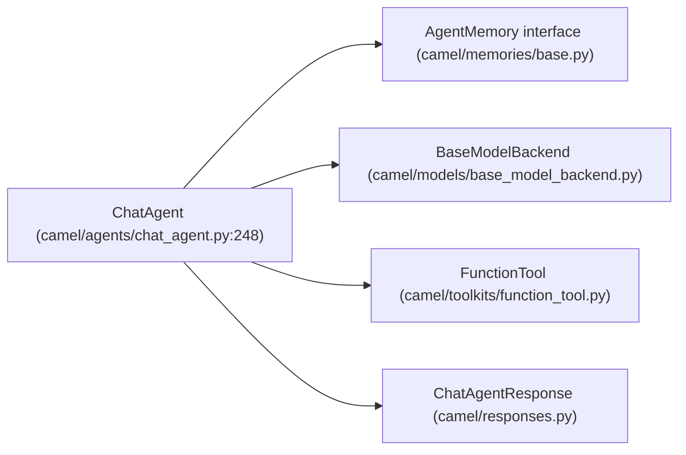

<!-- source: DeepWiki mcp.deepwiki.com · repo camel-ai/camel · page 2.1 ChatAgent · fetched 2026-10-29 -->

# ChatAgent

<details>
<summary>Relevant source files</summary>

The following files were used as context for generating this wiki page:

- [.github/ISSUE_TEMPLATE/bug_report.yml](.github/ISSUE_TEMPLATE/bug_report.yml)
- [README.md](README.md)
- [camel/__init__.py](camel/__init__.py)
- [camel/agents/chat_agent.py](camel/agents/chat_agent.py)
- [docs/conf.py](docs/conf.py)
- [docs/get_started/installation.md](docs/get_started/installation.md)
- [docs/get_started/setup.md](docs/get_started/setup.md)
- [docs/key_modules/loaders.md](docs/key_modules/loaders.md)
- [docs/mintlify/docs.json](docs/mintlify/docs.json)
- [docs/mintlify/reference/camel.agents._utils.mdx](docs/mintlify/reference/camel.agents._utils.mdx)
- [docs/mintlify/reference/camel.agents.chat_agent.mdx](docs/mintlify/reference/camel.agents.chat_agent.mdx)
- [docs/mintlify/reference/camel.configs.avian_config.mdx](docs/mintlify/reference/camel.configs.avian_config.mdx)
- [docs/mintlify/reference/camel.configs.cerebras_config.mdx](docs/mintlify/reference/camel.configs.cerebras_config.mdx)
- [docs/mintlify/reference/camel.configs.orcarouter_config.mdx](docs/mintlify/reference/camel.configs.orcarouter_config.mdx)
- [docs/mintlify/reference/camel.memories.agent_memories.mdx](docs/mintlify/reference/camel.memories.agent_memories.mdx)
- [docs/mintlify/reference/camel.memories.base.mdx](docs/mintlify/reference/camel.memories.base.mdx)
- [docs/mintlify/reference/camel.memories.blocks.chat_history_block.mdx](docs/mintlify/reference/camel.memories.blocks.chat_history_block.mdx)
- [docs/mintlify/reference/camel.memories.context_creators.score_based.mdx](docs/mintlify/reference/camel.memories.context_creators.score_based.mdx)
- [docs/mintlify/reference/camel.models.avian_model.mdx](docs/mintlify/reference/camel.models.avian_model.mdx)
- [docs/mintlify/reference/camel.models.cerebras_model.mdx](docs/mintlify/reference/camel.models.cerebras_model.mdx)
- [docs/mintlify/reference/camel.models.orcarouter_model.mdx](docs/mintlify/reference/camel.models.orcarouter_model.mdx)
- [docs/mintlify/reference/camel.types.enums.mdx](docs/mintlify/reference/camel.types.enums.mdx)
- [docs/mintlify/reference/camel.types.unified_model_type.mdx](docs/mintlify/reference/camel.types.unified_model_type.mdx)
- [docs/reference/camel.agents.chat_agent.md](docs/reference/camel.agents.chat_agent.md)
- [docs/reference/camel.memories.context_creators.score_based.md](docs/reference/camel.memories.context_creators.score_based.md)
- [docs/reference/camel.messages.func_message.md](docs/reference/camel.messages.func_message.md)
- [docs/reference/camel.models.azure_openai_model.md](docs/reference/camel.models.azure_openai_model.md)
- [docs/reference/camel.models.base_model.md](docs/reference/camel.models.base_model.md)
- [docs/reference/camel.models.model_manager.md](docs/reference/camel.models.model_manager.md)
- [docs/reference/camel.models.openai_compatible_model.md](docs/reference/camel.models.openai_compatible_model.md)
- [docs/reference/camel.models.openai_model.md](docs/reference/camel.models.openai_model.md)
- [docs/reference/camel.utils.message_summarizer.md](docs/reference/camel.utils.message_summarizer.md)
- [pyproject.toml](pyproject.toml)
- [test/agents/test_chat_agent.py](test/agents/test_chat_agent.py)
- [uv.lock](uv.lock)

</details>


ChatAgent is the primary single-agent class in CAMEL responsible for managing autonomous conversations powered by Large Language Models (LLMs). It provides a comprehensive interface for processing input messages, maintaining conversation memory, invoking model backends, executing tools, handling multi-turn dialogues, and streaming responses. ChatAgent serves as a fundamental building block for autonomous agents, used both in standalone scenarios and as part of multi-agent orchestration systems such as Workforce.

**Scope:** This page provides an in-depth technical explanation of ChatAgent’s design and implementation, including initialization parameters, the core `step()` method, message and memory handling, tool execution strategies, and streaming response management. It includes data flow diagrams bridging natural language concepts to concrete code entities.

---

## Core Architecture

At a high level, ChatAgent integrates five major subsystems, each distinctly implemented but tightly orchestrated:

- **Model Backend Management**: Interface with one or more LLM backends via `BaseModelBackend` or managed by `ModelManager`, leveraging the `ModelFactory` for instantiation.
- **Memory Storage and Retrieval**: Uses an `AgentMemory` implementation (by default `ChatHistoryMemory`) to store and retrieve conversational context with token-awareness and summarization policies driven by `ScoreBasedContextCreator`.
- **Tool Integration and Execution**: Supports internal and external tools via `FunctionTool` instances or toolkits. The agent can automatically execute internal tools or defer execution by signaling external tools.
- **Message Processing**: Handles various message types (`BaseMessage`, `OpenAIMessage`, `FunctionCallingMessage`) and deals with dynamic prompt and response formatting.
- **Response Handling and Streaming**: Produces `ChatAgentResponse` objects for synchronous calls and specialized streaming wrappers (`StreamingChatAgentResponse` and `AsyncStreamingChatAgentResponse`) to deliver streaming tokens gracefully.

---

### System Architecture Diagram



**Sources:** [camel/agents/chat_agent.py:248-362](), [camel/agents/chat_agent.py:177-227](), [camel/agents/chat_agent.py:230-304](), [camel/agents/chat_agent.py:1115-1257]()

---

## Initialization and Configuration

When creating a `ChatAgent` instance, the constructor accepts a rich set of parameters for precise control over behavior. It defaults to a helpful assistant role with a sensible message memory and a default model unless customized.

### Usage Example

```python
from camel.agents import ChatAgent
from camel.models import ModelFactory
from camel.types import ModelPlatformType, ModelType

# Minimal default agent
agent_default = ChatAgent()

# Agent with explicit system message and OpenAI GPT-4O backend
system_msg = "You are a helpful assistant specialized in data analysis."
model = ModelFactory.create(
    model_platform=ModelPlatformType.OPENAI,
    model_type=ModelType.GPT_4O,
)
agent_custom = ChatAgent(system_message=system_msg, model=model)
```

### Key Parameters

| Parameter                     | Type                                                              | Description                                      | Default            |
|-------------------------------|-------------------------------------------------------------------|-------------------------------------------------|--------------------|
| `system_message`              | `BaseMessage` or `str`                                            | System prompt defining agent behavior            | `None` (generic)   |
| `model`                      | `BaseModelBackend` or `ModelManager` or model specifiers          | Model backend(s) used for generation             | Default LLM        |
| `memory`                     | `AgentMemory`                                                     | Memory storage for chat history and context      | `ChatHistoryMemory`|
| `tools`                      | List of `FunctionTool` or callable                               | Internal tools automatically executed            | `None`             |
| `external_tools`             | List of `FunctionTool` or callable                               | Tools returned as requests, not executed internally | `None`           |
| `max_iteration`              | `int`                                                            | Max model calls per single `step()` invocation   | Unlimited          |
| `token_limit`                | `int`                                                            | Maximum tokens allowed in context window override| Defaults to model default |
| `message_window_size`        | `int`                                                            | Max number of messages kept in context (windowing) | `None`          |
| `prune_tool_calls_from_memory` | `bool`                                                        | Whether to remove tool-related messages after step | `False`          |
| `response_terminators`       | List of `ResponseTerminator`                                    | Criteria to end iterative generation             | None               |
| `stream_accumulate`          | `bool`                                                          | Whether to accumulate streaming output cumulatively | `False`          |

These parameters allow tuning of resource usage, robustness, and the degree of interactivity and tool integration.

**Sources:** [camel/agents/chat_agent.py:257-362](), [camel/agents/chat_agent.py:466-534]()

---

## The `step()` Method – Core Execution Loop

The `step()` method is the primary function to feed an input message and receive a response. It encapsulates the internal loop of prompt preparation, model invocation, tool detection and execution, memory updates, and termination checking.

### Execution Flow Sequence Diagram



### Details

- **Context Retrieval**: Gets relevant messages from memory, filtered by token and message window constraints.
- **User Input Memory Update**: Inserts the new user input into the memory system.
- **Iterative Model Calls**: Runs model queries up to `max_iteration` times or when termination criteria met.
- **Tool Calls Detection & Execution**: Automatically executes internal tools if model requests, updating memory with results.
- **Termination Check**: Uses configured `response_terminators` (e.g., keywords, token limits) to conclude the conversation step.
- **Memory Pruning**: Optionally removes intermediary tool messages to keep memory clean.

---

### Response Dataclass

The method outputs a `ChatAgentResponse` dataclass that contains:

```python
@dataclass
class ChatAgentResponse:
    msgs: List[BaseMessage]    # List of generated or executed messages
    terminated: bool           # Whether termination conditions were met
    info: Dict[str, Any]       # Additional metadata (e.g., ids, usage, reasons)
```

**Sources:** [camel/agents/chat_agent.py:1115-1257](), [camel/responses.py:27-38]()

---

## Memory Management Integration

Memory is central to ChatAgent’s ability to maintain coherent multi-turn conversations. The default memory implementation is `ChatHistoryMemory` augmented by `ScoreBasedContextCreator` which handles context windowing intelligently based on token budgets.

### Memory Architecture Diagram



### Token Management and Summarization

The `ScoreBasedContextCreator` monitors token usage and triggers summarization recursively if usage crosses a configured threshold of the token limit.

Process highlights:

1. Calls `build_default_summary_prompt()` to generate summarization instructions blending code summarization context [camel/agents/_utils.py:61-93]().
2. Spawns a recursive `ChatAgent` with summarization roles to generate concise summaries of older conversation blocks.
3. Inserts system-level summary messages back into the memory at the start to condense state.
4. Returns a trimmed context, ensuring that token limit compliance and conversational coherence are maintained.

**Sources:** [camel/agents/chat_agent.py:466-534](), [camel/memories/context_creators/score_based.py:34-150](), [camel/agents/_utils.py:61-93]()

---

## Tool Integration and Execution

ChatAgent handles tools via internal and external patterns to support synchronous execution and deferred external interactions.

### Tool Execution Flow Diagram



### Differences

- **Internal Tools**: Are invoked automatically within the agent's execution loop and their results are fed back into the memory context seamlessly. This enables multi-step reasoning augmented with dynamic tool calls [camel/agents/chat_agent.py:2174-2403]().
- **External Tools**: Are detected and returned as a `ToolCallRequest` to users/calling code to execute externally. The agent does not execute these but flags them for external handling [camel/agents/chat_agent.py:2405-2525]().

This supports flexible integration with external APIs, toolkit orchestrators, or user-informed tool execution in workflows.

**Sources:** [camel/agents/chat_agent.py:2174-2403](), [camel/agents/chat_agent.py:2405-2525](), [camel/toolkits/function_tool.py:1-124]()

---

## Streaming Responses Support

ChatAgent supports streaming generation from models to provide partial outputs in real-time. Streaming is managed with careful accumulation and state maintenance to ensure coherence and usability.

### Streaming Components

- **StreamContentAccumulator**: Collects streamed content fragments, reasoning segments, and tool status messages to build a cumulative response [camel/agents/chat_agent.py:177-227]().
- **StreamingChatAgentResponse**: Wraps a synchronous generator of response chunks to emulate a streaming experience while exposing the same API as `ChatAgentResponse` [camel/agents/chat_agent.py:230-304]().
- **AsyncStreamingChatAgentResponse**: Wraps an asynchronous generator to provide awaitable streaming compatible with async code [camel/agents/chat_agent.py:306-361]().

### Example Usage

```python
# Synchronous streaming
response = agent.step("Write a detailed essay")
for chunk in response:
    print(chunk.msgs[0].content, end="", flush=True)
```

The streaming wrappers abstract away the complexity of partial updates while maintaining consistent message semantics for downstream consumers.

---

## Summary

`ChatAgent` is the core single-agent conversational engine in CAMEL, responsible for:

- Managing LLM-based dialogues with a unified `step()` API.
- Maintaining token and message window-aware memory via `AgentMemory` and `ScoreBasedContextCreator`.
- Supporting advanced tool execution including internal synchronous and external asynchronous tools.
- Handling complex multi-turn interactions with built-in response termination criteria.
- Providing full streaming support for incremental response delivery.
- Allowing structured output parsing through Pydantic schema integration.

This design enables rich, extensible agent workflows robust to scaling, external tool interactions, and complex memory constraints.

---

# Bridging Natural Language Concepts to Code Entities: Key Mappings





---

**Sources:**  
- [camel/agents/chat_agent.py:1-1300]()  
- [camel/memories/context_creators/score_based.py:34-150]()  
- [camel/memories/chat_history_memory.py]()  
- [camel/models/base_model_backend.py]()  
- [camel/models/model_factory.py]()  
- [camel/models/model_manager.py]()  
- [camel/toolkits/function_tool.py]()  
- [camel/responses.py]()  
- [camel/agents/_utils.py:60-100]()

---

