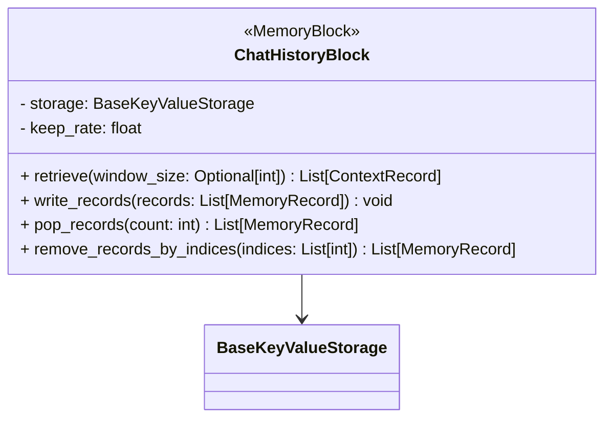
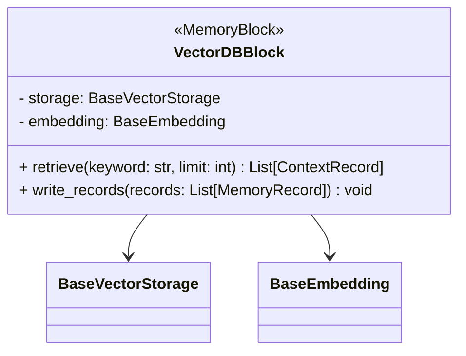
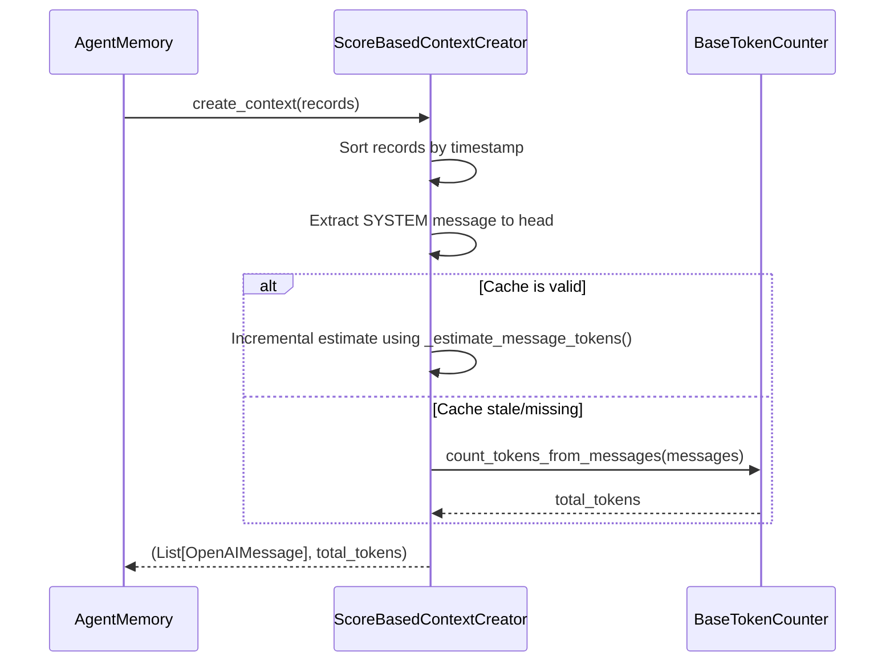
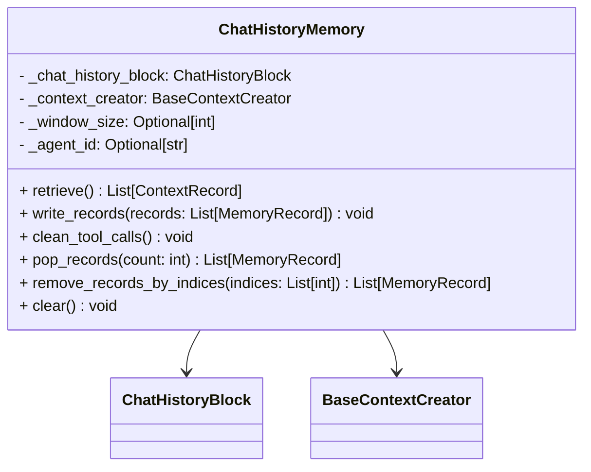
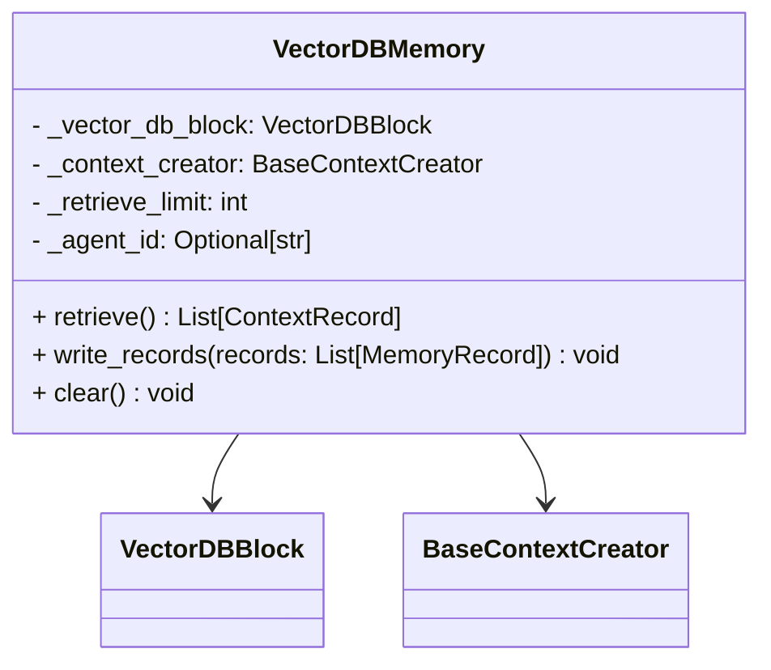
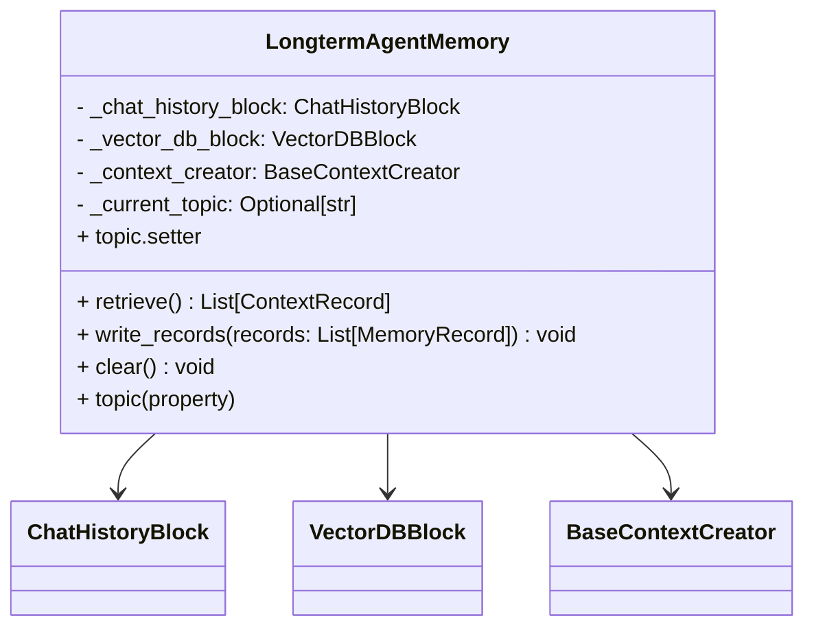

<!-- source: DeepWiki mcp.deepwiki.com · repo camel-ai/camel · page 2.2 Agent Memory System · fetched 2026-10-29 -->

# Agent Memory System

<details>
<summary>Relevant source files</summary>

The following files were used as context for generating this wiki page:

- [camel/memories/__init__.py](camel/memories/__init__.py)
- [camel/memories/agent_memories.py](camel/memories/agent_memories.py)
- [camel/memories/base.py](camel/memories/base.py)
- [camel/memories/blocks/chat_history_block.py](camel/memories/blocks/chat_history_block.py)
- [camel/memories/blocks/vectordb_block.py](camel/memories/blocks/vectordb_block.py)
- [camel/memories/context_creators/__init__.py](camel/memories/context_creators/__init__.py)
- [camel/memories/context_creators/score_based.py](camel/memories/context_creators/score_based.py)
- [camel/memories/records.py](camel/memories/records.py)
- [camel/storages/key_value_storages/json.py](camel/storages/key_value_storages/json.py)
- [camel/storages/vectordb_storages/base.py](camel/storages/vectordb_storages/base.py)
- [camel/toolkits/__init__.py](camel/toolkits/__init__.py)
- [docs/key_modules/agents.md](docs/key_modules/agents.md)
- [docs/key_modules/datagen.md](docs/key_modules/datagen.md)
- [docs/key_modules/embeddings.md](docs/key_modules/embeddings.md)
- [docs/key_modules/interpreters.md](docs/key_modules/interpreters.md)
- [docs/key_modules/memory.md](docs/key_modules/memory.md)
- [docs/key_modules/messages.md](docs/key_modules/messages.md)
- [docs/key_modules/prompts.md](docs/key_modules/prompts.md)
- [docs/key_modules/retrievers.md](docs/key_modules/retrievers.md)
- [docs/key_modules/runtimes.md](docs/key_modules/runtimes.md)
- [docs/key_modules/society.md](docs/key_modules/society.md)
- [docs/key_modules/storages.md](docs/key_modules/storages.md)
- [docs/key_modules/tasks.md](docs/key_modules/tasks.md)
- [docs/key_modules/tools.md](docs/key_modules/tools.md)
- [docs/key_modules/workforce.md](docs/key_modules/workforce.md)
- [docs/mintlify/docs.json](docs/mintlify/docs.json)
- [docs/mintlify/reference/camel.agents._utils.mdx](docs/mintlify/reference/camel.agents._utils.mdx)
- [docs/mintlify/reference/camel.agents.chat_agent.mdx](docs/mintlify/reference/camel.agents.chat_agent.mdx)
- [docs/mintlify/reference/camel.configs.avian_config.mdx](docs/mintlify/reference/camel.configs.avian_config.mdx)
- [docs/mintlify/reference/camel.configs.cerebras_config.mdx](docs/mintlify/reference/camel.configs.cerebras_config.mdx)
- [docs/mintlify/reference/camel.configs.orcarouter_config.mdx](docs/mintlify/reference/camel.configs.orcarouter_config.mdx)
- [docs/mintlify/reference/camel.memories.agent_memories.mdx](docs/mintlify/reference/camel.memories.agent_memories.mdx)
- [docs/mintlify/reference/camel.memories.base.mdx](docs/mintlify/reference/camel.memories.base.mdx)
- [docs/mintlify/reference/camel.memories.blocks.chat_history_block.mdx](docs/mintlify/reference/camel.memories.blocks.chat_history_block.mdx)
- [docs/mintlify/reference/camel.memories.context_creators.score_based.mdx](docs/mintlify/reference/camel.memories.context_creators.score_based.mdx)
- [docs/mintlify/reference/camel.models.avian_model.mdx](docs/mintlify/reference/camel.models.avian_model.mdx)
- [docs/mintlify/reference/camel.models.cerebras_model.mdx](docs/mintlify/reference/camel.models.cerebras_model.mdx)
- [docs/mintlify/reference/camel.models.orcarouter_model.mdx](docs/mintlify/reference/camel.models.orcarouter_model.mdx)
- [docs/mintlify/reference/camel.types.enums.mdx](docs/mintlify/reference/camel.types.enums.mdx)
- [docs/mintlify/reference/camel.types.unified_model_type.mdx](docs/mintlify/reference/camel.types.unified_model_type.mdx)
- [test/memories/context_creators/test_score_based.py](test/memories/context_creators/test_score_based.py)
- [test/memories/test_agent_memories.py](test/memories/test_agent_memories.py)
- [test/memories/test_blocks.py](test/memories/test_blocks.py)
- [test/memories/test_chat_history_memory.py](test/memories/test_chat_history_memory.py)
- [test/memories/test_vector_db_memory.py](test/memories/test_vector_db_memory.py)

</details>


This page documents CAMEL's memory and context management system, which enables agents to maintain conversation history, manage token limits, and share context across multi-agent workflows. The system provides flexible memory storage backends, context creation strategies, and integration with agent execution loops.

## Overview

CAMEL's agent memory system is designed to facilitate persistent and context-aware conversational AI by providing several layers of abstraction:

- **AgentMemory Interface**: The abstract base that defines the contract for memory implementations, enabling retrieval, storage, and context creation.
- **Memory Blocks**: Underlying storage components that manage raw data (messages and metadata), such as `ChatHistoryBlock` for sequential chat logs and `VectorDBBlock` for semantic vector-based storage.
- **Context Creators**: Strategies, such as `ScoreBasedContextCreator`, to assemble memory records into a context window considering token limits and message importance.
- **Concrete Memory Implementations**:
  - `ChatHistoryMemory` for time-sequenced chat history with windowing support.
  - `VectorDBMemory` for semantic retrieval using vector databases.
  - `LongtermAgentMemory` combining both chat history and vector search for a hybrid approach supporting both short-term and long-term memory.
  
Together, these components enable agents to retrieve informative conversation context for effective reasoning and response generation while respecting model token limits.

---

## Memory System Architecture

### Bridging Natural Language Concepts to Code Entities

```mermaid
graph TD
    subgraph "Agent Memory Interface Layer"
        AM[AgentMemory (abstract/interface)]
        CHM[ChatHistoryMemory]
        VDM[VectorDBMemory]
        LAM[LongtermAgentMemory]
    end

    subgraph "Memory Block Layer"
        CHB[ChatHistoryBlock<br/>write_records(), retrieve()]
        VDB[VectorDBBlock<br/>write_records(), retrieve()]
    end

    subgraph "Context Creation Layer"
        SBC[ScoreBasedContextCreator<br/>create_context(), _estimate_message_tokens()]
    end

    subgraph "Storage Backend Layer"
        IMKV[InMemoryKeyValueStorage]
        VDBS[BaseVectorStorage (QdrantStorage, etc.)]
    end

    AM --> CHM
    AM --> VDM
    AM --> LAM

    CHM --> CHB
    CHM --> SBC

    VDM --> VDB
    LAM --> CHB
    LAM --> VDB

    CHB --> IMKV
    VDB --> VDBS

    ChatAgent["ChatAgent<br/>step(), update_memory()"] -- "uses" --> AM
```

This diagram relates the natural language idea of "Memory" to the main classes and interfaces in CAMEL.

Sources: [camel/memories/base.py:23-196](), [camel/memories/agent_memories.py:26-304](), [camel/memories/blocks/chat_history_block.py:23-156](), [camel/memories/blocks/vectordb_block.py:28-81](), [camel/memories/context_creators/score_based.py:24-169]()

---

## AgentMemory Interface

At the core lies the `AgentMemory` class defining the interface for all agent memory types. It provides methods for:

- `retrieve()`: Fetch a list of `ContextRecord` instances representing historical interactions relevant for context.
- `write_records(records)`: Store new memory entries.
- `get_context_creator()`: Return the associated `BaseContextCreator` strategy.
- `get_context()`: Produce a properly sized list of messages for the model's input considering token limits.
- `clear()`: Remove stored memory.
  
This abstraction allows different implementations of memory to adhere to a common API and be interchangeable in agents.

Sources: [camel/memories/base.py:134-196]()

---

## Memory Blocks

Memory Blocks implement the lower-level storage functionality, focusing on efficient data access and persistence.

### ChatHistoryBlock

- Stores chat messages sequentially using a key-value storage backend.
- Supports sliding window retrieval of recent messages, while always preserving the initial `SYSTEM` or `DEVELOPER` message at index 0.
- Uses a scoring decay `keep_rate` (default 0.9) to assign importance scores to recent messages, falling exponentially for older messages.
- Methods:
  - `retrieve(window_size)`: Returns the recent messages up to the window size plus preserved system message.
  - `write_records(records)`: Saves new chat records to the backend.
  - `pop_records(count)`: Removes the last N records.
  - `remove_records_by_indices(indices)`: Deletes messages at specified indices, with protection over the initial system message.



### VectorDBBlock

- Wraps a vector storage backend for semantic search of memory records.
- Converts messages using embedding models for indexing and similarity queries.
- Methods:
  - `retrieve(keyword: str, limit: int)`: Queries semantically related messages based on text keywords.



Sources: [camel/memories/blocks/chat_history_block.py:23-156](), [camel/memories/blocks/vectordb_block.py:28-111]()

---

## Context Creator: ScoreBasedContextCreator

The `ScoreBasedContextCreator` is a token management strategy to construct an agent's input context with efficient token counting:

- It orders retrieved records chronologically by timestamp.
- Identifies and places the `SYSTEM` role message first in the context.
- Maintains a cached token count from previous LLM API responses to limit full recounting.
- Estimates token usage for new messages with a heuristic (~2 characters per token), fast enough to be practical.
- Integrates a `BaseTokenCounter` for precise token counting when cache is invalid or stale.
- Returns a tuple of the context messages list and the estimated total token count.

Sequence Diagram of Token Counting and Context Construction:



Sources: [camel/memories/context_creators/score_based.py:24-169](), [camel/memories/base.py:80-131]()

---

## AgentMemory Implementations

### ChatHistoryMemory

- Wraps `ChatHistoryBlock` and uses a `BaseContextCreator` for preparing context.
- Supports windowed retrieval to limit the number of chat messages included.
- Provides `clean_tool_calls()` to remove tool-call related messages (e.g., with role `FUNCTION`, `TOOL`, and assistant tool call messages) to reduce token consumption.
- Supports assigning an `agent_id` to messages for multi-agent identification.
  


### VectorDBMemory

- Wraps `VectorDBBlock`.
- Provides semantic retrieval with embedding similarity.
- Returns cached semantic results but does not include the very latest messages unless they have been embedded and stored.
- Supports a retrieval `limit` to constrain the number of results added to context.



### LongtermAgentMemory

- Hybrid memory combining `ChatHistoryBlock` and `VectorDBBlock`.
- Ideal for agents requiring both short-term chat context and long-term semantic search capabilities.
- Maintains an internal `_current_topic` inferred from the latest user or assistant message for semantic queries.
- Retrieval logic:
  - Retrieves recent chat history records.
  - Queries vector DB with the current topic to retrieve semantically related records.
  - Combines both sets and passes to context creator.
- Provides write methods to store messages into both blocks when applicable.



| Memory Class          | Storage Block(s)           | Retrieval Style            | Use Case                        |
|----------------------|----------------------------|----------------------------|--------------------------------|
| `ChatHistoryMemory`  | `ChatHistoryBlock`          | Recent messages windowed   | Short-term dialogue context     |
| `VectorDBMemory`     | `VectorDBBlock`             | Semantic similarity search | Long-term knowledge and facts  |
| `LongtermAgentMemory`| Both blocks combined        | Hybrid                     | Persistent, context-rich memory |

Sources: [camel/memories/agent_memories.py:26-304]()

---

## Memory Operations and Data Flow

### Writing Memory Records

When `write_records` is called on any `AgentMemory` instance:

- Each `MemoryRecord` is inspected.
- If it lacks an `agent_id` but the memory has an `agent_id`, the record is assigned this ID.
- The record is stored in one or both underlying memory blocks, depending on the implementation (e.g., `LongtermAgentMemory` writes to both chat and vector blocks).
  
This ensures consistent attribution of messages to agents in scenario with multiple agents.

### Managing Records

- `pop_records(count)`: Removes the most recent `count` records from the chat history storage.
- `remove_records_by_indices(indices)`: Deletes records at specified indices, while preventing removal of the crucial first system message (index 0).
- `clean_tool_calls()`: Specifically in `ChatHistoryMemory`, removes messages related to tool/function calls to optimize token usage during context generation.

Data flow for retrieval context generation:

```mermaid
flowchart TD
    Records[(Memory Records)]
    AgentMemory --> Retrieve[retrieve()]
    Retrieve --> MemoryBlocks
    MemoryBlocks --> Records
    AgentMemory --> ContextCreator
    ContextCreator --> ComposeContext
    ComposeContext --> ContextMessages[(Context Messages for Agent)]
```

Sources: [camel/memories/base.py:23-77](), [camel/memories/blocks/chat_history_block.py:173-234](), [camel/memories/agent_memories.py:80-85]()

---

# Summary

The Agent Memory System in CAMEL provides a rich abstraction hierarchy to manage conversational context and token limit challenges effectively. The core interface `AgentMemory` is implemented through specialized memory classes that wrap lower-level storage blocks and use context creators like `ScoreBasedContextCreator` for token-efficient context formation.

- `ChatHistoryMemory` manages sequential message storage with windowing and tool call filtering.
- `VectorDBMemory` facilitates semantic retrieval via vector embeddings.
- `LongtermAgentMemory` integrates both chat history and vector search for persistent multi-timescale memory.

This layered approach ensures that CAMEL agents maintain coherent, context-aware interactions and handle token constraints intelligently.

Sources:  
[camel/memories/base.py:23-196](),  
[camel/memories/agent_memories.py:26-304](),  
[camel/memories/blocks/chat_history_block.py:23-156](),  
[camel/memories/blocks/vectordb_block.py:28-111](),  
[camel/memories/context_creators/score_based.py:24-169]()

---

