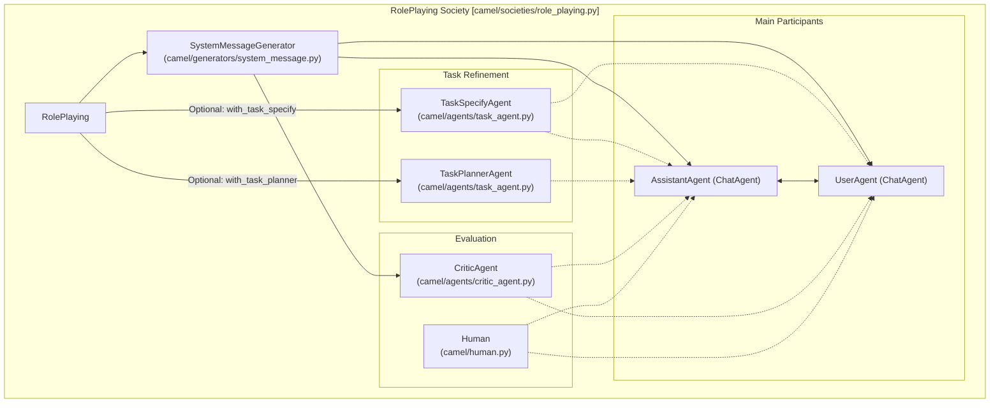
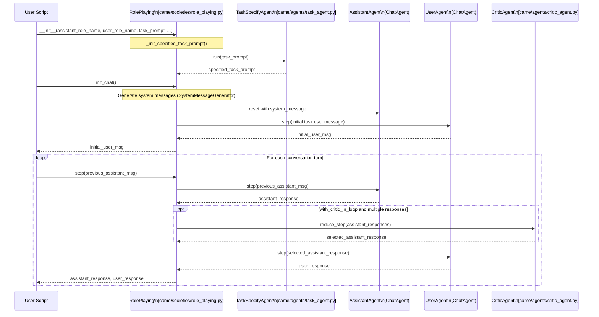

<!-- source: DeepWiki mcp.deepwiki.com · repo camel-ai/camel · page 2.3 Role Playing System · fetched 2026-10-29 -->

# Role Playing System

<details>
<summary>Relevant source files</summary>

The following files were used as context for generating this wiki page:

- [camel/agents/__init__.py](camel/agents/__init__.py)
- [camel/agents/critic_agent.py](camel/agents/critic_agent.py)
- [camel/agents/task_agent.py](camel/agents/task_agent.py)
- [camel/human.py](camel/human.py)
- [camel/prompts/ai_society.py](camel/prompts/ai_society.py)
- [camel/prompts/code.py](camel/prompts/code.py)
- [camel/prompts/role_description_prompt_template.py](camel/prompts/role_description_prompt_template.py)
- [camel/societies/role_playing.py](camel/societies/role_playing.py)
- [examples/ai_society/role_playing.py](examples/ai_society/role_playing.py)
- [examples/ai_society/role_playing_multi_lingual.py](examples/ai_society/role_playing_multi_lingual.py)
- [examples/ai_society/role_playing_multiprocess.py](examples/ai_society/role_playing_multiprocess.py)
- [examples/ai_society/role_playing_with_critic.py](examples/ai_society/role_playing_with_critic.py)
- [examples/ai_society/role_playing_with_human.py](examples/ai_society/role_playing_with_human.py)
- [examples/code/role_playing.py](examples/code/role_playing.py)
- [examples/code/role_playing_multiprocess.py](examples/code/role_playing_multiprocess.py)
- [examples/misalignment/role_playing_multiprocess.py](examples/misalignment/role_playing_multiprocess.py)
- [examples/misalignment/role_playing_with_human.py](examples/misalignment/role_playing_with_human.py)
- [examples/role_description/role_generation.py](examples/role_description/role_generation.py)
- [examples/role_description/role_playing_with_role_description.py](examples/role_description/role_playing_with_role_description.py)
- [examples/test/test_ai_society_example.py](examples/test/test_ai_society_example.py)
- [examples/test/test_code_example.py](examples/test/test_code_example.py)
- [examples/test/test_role_description_example.py](examples/test/test_role_description_example.py)
- [examples/test/test_single_agent.py](examples/test/test_single_agent.py)
- [test/agents/test_critic_agent.py](test/agents/test_critic_agent.py)
- [test/agents/test_role_assignment_agent.py](test/agents/test_role_assignment_agent.py)
- [test/agents/test_role_playing.py](test/agents/test_role_playing.py)
- [test/agents/test_task_agent.py](test/agents/test_task_agent.py)
- [test/prompts/test_role_description_prompt_template.py](test/prompts/test_role_description_prompt_template.py)

</details>


The Role Playing System enables multi-turn, task-oriented dialogues between two agents—a user agent and an assistant agent—facilitating problem-solving via autonomous conversation. It supports task refinement and decomposition with optional evaluation by a critic or a human in the loop. This system forms the core of simulated interactive communication where agents role-play specified personas to collaboratively accomplish complex tasks.

**Scope**: This page documents the `RolePlaying` society class for bi-directional agent communication, covering initialization, task refinement, interaction flow, and evaluation. For multi-agent workforce task orchestration, see [Workforce Orchestration (2.5)](2.5). For single agent internals, see [ChatAgent (2.1)](2.1) and task/critic agents [Task Management (2.4)](2.4).

---

## Core Concept

The system facilitates dialogue-driven collaboration between two primary agents:

- **Assistant Agent**: Acts as the expert or solution provider.
- **User Agent**: Acts as the task requester or stakeholder.

Additional components include:

- **Task Specify Agent** (optional): Refines vague tasks into detailed specifications.
- **Task Planner Agent** (optional): Decomposes tasks into subtasks.
- **Critic Agent or Human** (optional): Evaluates and selects the best assistant response when multiple candidates are available.

This system architecture enables staged task processing, iterative refinement, and quality control through conversation loops.

Sources: [camel/societies/role_playing.py:36-90]()

---

## Architecture Overview

The following diagram connects conceptual elements of the Role Playing System to the concrete classes and files implementing them in the CAMEL codebase.

### Role Playing System Entity Mapping



Sources: [camel/societies/role_playing.py:36-178](), [camel/agents/task_agent.py:35-198](), [camel/agents/critic_agent.py:40-185]()

---

## Key Components

### RolePlaying Class

The `RolePlaying` class manages a session where two agents role-play distinct roles and interact via turns of message exchanges. Its responsibilities include:

- Task refinement via TaskSpecifyAgent (optional).
- Task planning with TaskPlannerAgent (optional).
- Initialization of assistant and user agents with system prompts.
- Iterative dialogue through the `step()` method.
- Optional incorporation of a CriticAgent or human for response evaluation.

#### Initialization Highlights

| Parameter                  | Type                  | Description                                              | Reference                          |
|----------------------------|-----------------------|----------------------------------------------------------|----------------------------------|
| `assistant_role_name`       | `str`                 | Name for the assistant's role.                           | [role_playing.py:93-117]()       |
| `user_role_name`            | `str`                 | Name for the user's role.                                | [role_playing.py:93-117]()       |
| `critic_role_name`          | `str`                 | Role of the critic agent; `"human"` uses `Human` agent. | [role_playing.py:43-45]()         |
| `task_prompt`               | `str`                 | Initial task description prompt.                         | [role_playing.py:47]()           |
| `with_task_specify`         | `bool`                | Whether to use task specification agent (default `True`). | [role_playing.py:49]()          |
| `with_task_planner`         | `bool`                | Whether to use task planner agent (default `False`).    | [role_playing.py:51]()           |
| `with_critic_in_the_loop`   | `bool`                | Whether to run a critic during dialogues (default `False`). | [role_playing.py:53]()          |
| `model`                    | `BaseModelBackend`     | Optional global model backend for all agents.            | [role_playing.py:57-60]()        |
| `task_type`                | `TaskType`             | Categorization of task: AI_SOCIETY, CODE, MISALIGNMENT.  | [role_playing.py:61-62]()        |

Other parameters support passing additional kwargs to agents and system message customization.

#### Important Methods

- **`init_chat()`**: Prepares and initializes the chat conversation:
  - Runs task specification if enabled to produce a detailed prompt.
  - Runs task planning if enabled to decompose the task.
  - Creates system messages for assistant and user agents.
  - Resets agents and starts the initial conversation round.
  
- **`step(assistant_msg: BaseMessage)`**: Advances a conversation step given a message from the assistant.
  - Invokes the assistant agent’s `step()` method.
  - If `with_critic_in_the_loop` is enabled and multiple assistant messages exist, uses CriticAgent to select the best response.
  - Passes the selected assistant message to the user agent’s `step()`.
  - Returns the responses from both assistant and user agents encapsulated as `ChatAgentResponse` objects.

Sources: [camel/societies/role_playing.py:92-117](), [camel/societies/role_playing.py:361-438](), [camel/societies/role_playing.py:473-548]()

---

### TaskSpecifyAgent

- Specializes vague task prompts into more detailed descriptions to enhance clarity.
- Uses a prompt template generator to define the specification prompt based on task type.
- The `run()` method takes an initial prompt and metadata dict, returning a refined `TextPrompt`.
- Defaults to a 50-word limit specification guideline.

Sources: [camel/agents/task_agent.py:35-128]()

---

### TaskPlannerAgent

- Divides a task prompt into subtasks to enable modular task execution.
- Uses a concise prompt: "Divide this task into subtasks: {task}. Be concise."
- The `run()` method outputs a prompt describing subtasks.

Sources: [camel/agents/task_agent.py:129-189]()

---

## Data Flow and Interaction

This sequence diagram demonstrates the typical lifecycle and message flow during a RolePlaying session from initiation to multi-turn dialogue, connecting system entities to their code implementations.

### RolePlaying Interaction Sequence



Sources: [camel/societies/role_playing.py:361-438](), [camel/societies/role_playing.py:473-548](), [camel/agents/task_agent.py:93-128]()

---

## Evaluation and Quality Control

### Critic System

The system optionally incorporates a critic to evaluate multiple candidate responses from the assistant agent to select the best for the user agent. This is especially used when the model is configured to generate multiple outputs (e.g., temperature/n-shots > 1).

#### CriticAgent

- Provides methods to present multiple assistant message options and request a ranking choice.
- Key methods:
  - `flatten_options(messages)`: Converts multiple assistant messages into a single critique prompt [camel/agents/critic_agent.py:101-123]().
  - `get_option(input_message)`: Repeatedly calls the critic model to obtain a valid option choice or falls back to a random choice after retries [camel/agents/critic_agent.py:125-170]().
  - `parse_critic()`: Parses the critic's numeric choice from the response [camel/agents/critic_agent.py:171-185]().

#### Human Evaluator

- By setting `critic_role_name="human"` in `RolePlaying`, the system switches to the `Human` class which waits for terminal input to select among options. 
- This allows for human-in-the-loop evaluation during simulation runs [camel/societies/role_playing.py:44-45]().

Sources: [camel/agents/critic_agent.py:41-185](), [camel/human.py:19-95](), [camel/societies/role_playing.py:36-90]()

---

## Initialization and Configuration

### Task Typing and Prompts

- The nature of the task shapes the interaction:
  - **AI_SOCIETY**: General AI collaboration tasks.
  - **CODE**: Software development-focused tasks, often with language and domain metadata to specialize prompt generation.
  - **MISALIGNMENT**: Tasks focused on AI safety and alignment issues.

- System messages guiding the agents are generated using `SystemMessageGenerator` based on task specifics and roles [camel/societies/role_playing.py:119-135]().

---

## Usage Example: Multiprocess Dataset Generation

The RolePlaying system is often utilized to generate multi-turn dialogue data by running many sessions concurrently.

```python
from camel.models import ModelFactory
from camel.societies import RolePlaying
from camel.types import TaskType, ModelPlatformType, ModelType

# Create model instance
model = ModelFactory.create(
    model_platform=ModelPlatformType.DEFAULT,
    model_type=ModelType.DEFAULT,
)

# Initialize RolePlaying
role_play_session = RolePlaying(
    assistant_role_name="Assistant Role",
    user_role_name="User Role",
    task_prompt="Your task prompt here.",
    with_task_specify=True,
    task_type=TaskType.AI_SOCIETY,
    assistant_agent_kwargs=dict(model=model),
    user_agent_kwargs=dict(model=model),
)

# Initialize chat
input_msg = role_play_session.init_chat()

# Step through conversation loop
assistant_resp, user_resp = role_play_session.step(input_msg)
```

This pattern is shown in numerous example scripts such as `examples/ai_society/role_playing_multiprocess.py` and `examples/code/role_playing_multiprocess.py` which automate multi-turn conversations and dataset harvesting.

Sources: [examples/ai_society/role_playing_multiprocess.py:48-57](), [examples/code/role_playing_multiprocess.py:66-72]()

---

## Key Characteristics & Constraints

- **Two-Agent Interaction**: The system is designed for one assistant and one user agent communicating in a turn-based manner.
- **Termination Conditions**: A session terminates when either agent flags termination or detects end tokens (e.g., `<CAMEL_TASK_DONE>` in message content) [examples/ai_society/role_playing.py:81]().

- **Agent Model Priority**: If a global model is provided in `RolePlaying`, it is used for all agents except when overwritten by explicit agent kwargs.

---

# Summary

The Role Playing System in CAMEL-AI offers an extensible framework for simulating interactive dialogues between AI agents with roles, task refinement, planning, and evaluation features. It leverages modular agents wrapped by the `RolePlaying` class to manage conversation state, task prompts, and iterative message exchanges. The flexible critic and human evaluation enable quality control over generated dialogues, making it suitable for synthetic data generation, AI research, and experimentation.

---

# References

- [camel/societies/role_playing.py:1-178, 361-548]()
- [camel/agents/task_agent.py:1-198]()
- [camel/agents/critic_agent.py:1-185]()
- [camel/human.py:1-95]()
- [examples/ai_society/role_playing_multiprocess.py:1-80]()
- [examples/code/role_playing_multiprocess.py:1-100]()
- [examples/ai_society/role_playing.py:1-88]()
- [examples/misalignment/role_playing_multiprocess.py:1-90]()

---

