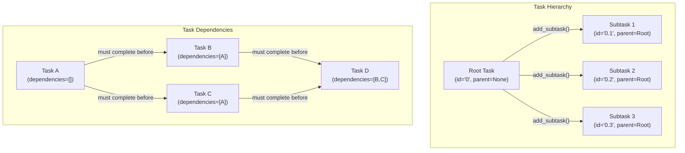
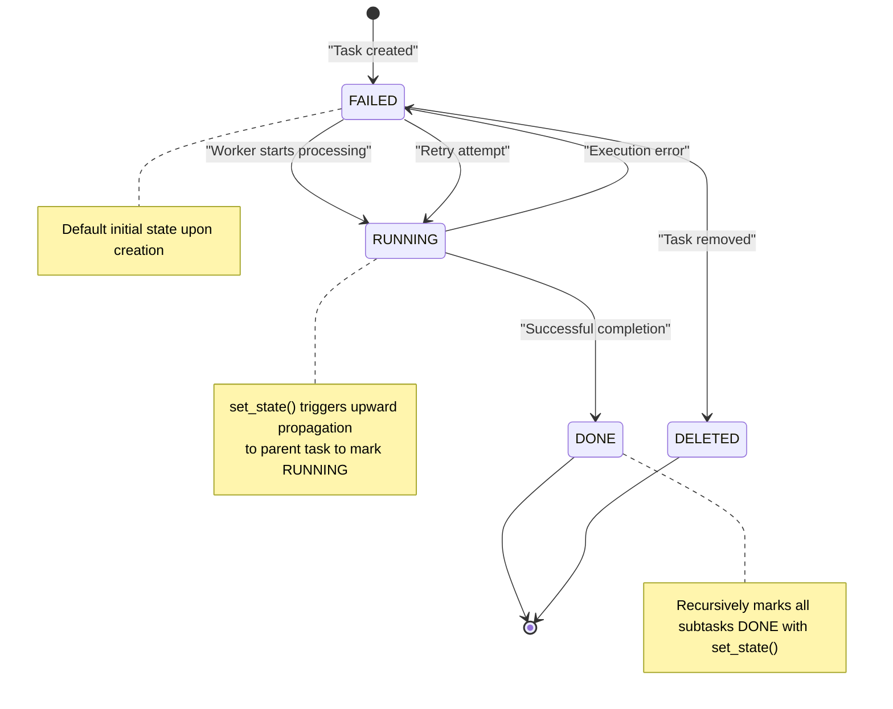
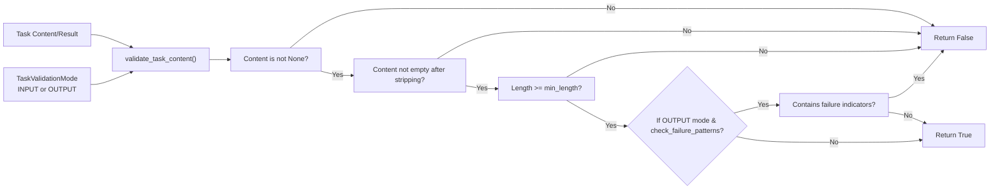
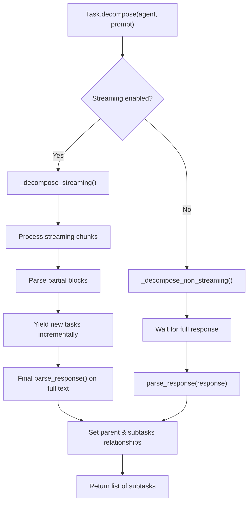
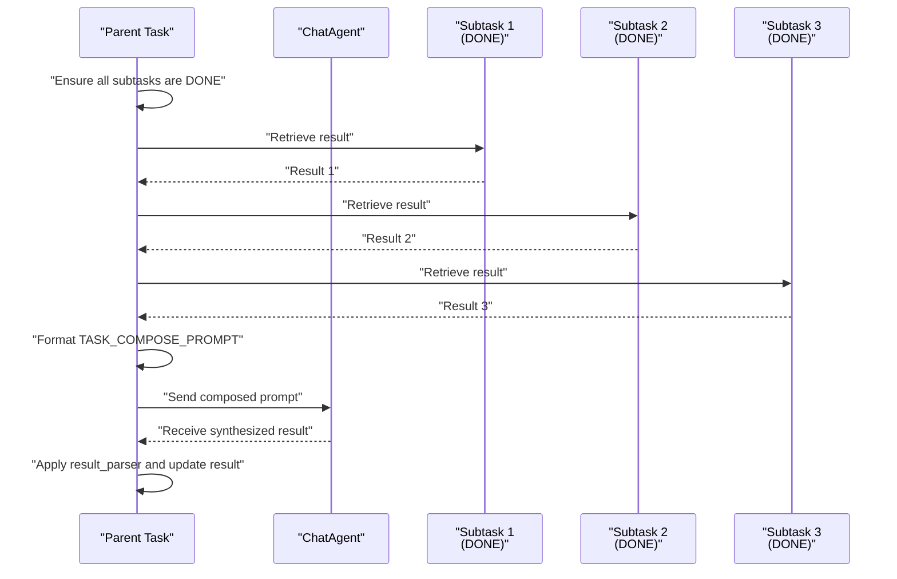
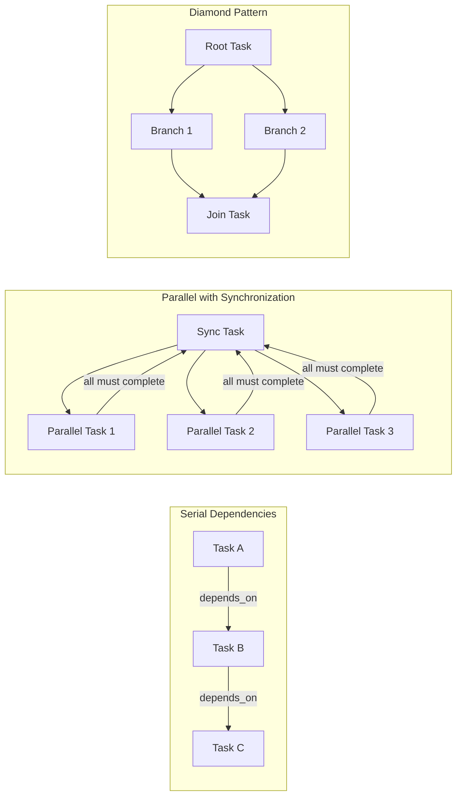
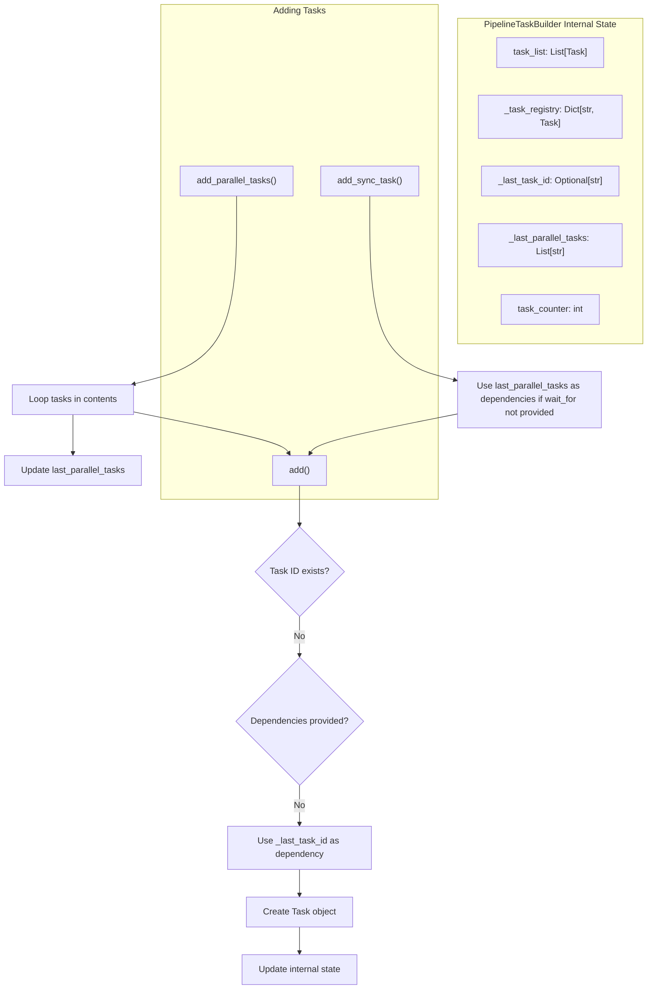
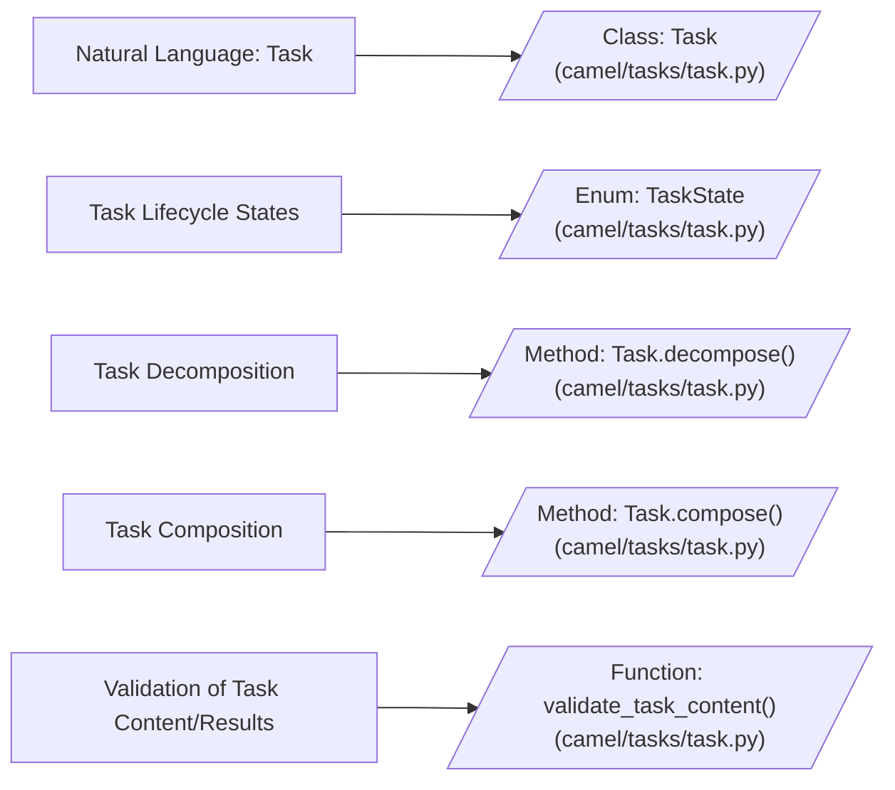
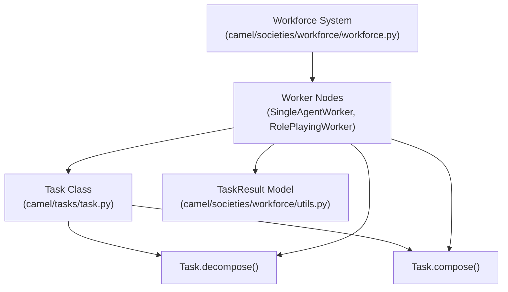

<!-- source: DeepWiki mcp.deepwiki.com · repo camel-ai/camel · page 2.4 Task Management · fetched 2026-10-29 -->

# Task Management

<details>
<summary>Relevant source files</summary>

The following files were used as context for generating this wiki page:

- [camel/societies/workforce/__init__.py](camel/societies/workforce/__init__.py)
- [camel/societies/workforce/prompts.py](camel/societies/workforce/prompts.py)
- [camel/societies/workforce/role_playing_worker.py](camel/societies/workforce/role_playing_worker.py)
- [camel/societies/workforce/single_agent_worker.py](camel/societies/workforce/single_agent_worker.py)
- [camel/societies/workforce/utils.py](camel/societies/workforce/utils.py)
- [camel/societies/workforce/worker.py](camel/societies/workforce/worker.py)
- [camel/societies/workforce/workforce.py](camel/societies/workforce/workforce.py)
- [camel/tasks/task.py](camel/tasks/task.py)
- [camel/toolkits/__init__.py](camel/toolkits/__init__.py)
- [docs/key_modules/agents.md](docs/key_modules/agents.md)
- [docs/key_modules/datagen.md](docs/key_modules/datagen.md)
- [docs/key_modules/embeddings.md](docs/key_modules/embeddings.md)
- [docs/key_modules/interpreters.md](docs/key_modules/interpreters.md)
- [docs/key_modules/memory.md](docs/key_modules/memory.md)
- [docs/key_modules/messages.md](docs/key_modules/messages.md)
- [docs/key_modules/prompts.md](docs/key_modules/prompts.md)
- [docs/key_modules/retrievers.md](docs/key_modules/retrievers.md)
- [docs/key_modules/runtimes.md](docs/key_modules/runtimes.md)
- [docs/key_modules/society.md](docs/key_modules/society.md)
- [docs/key_modules/storages.md](docs/key_modules/storages.md)
- [docs/key_modules/tasks.md](docs/key_modules/tasks.md)
- [docs/key_modules/tools.md](docs/key_modules/tools.md)
- [docs/key_modules/workforce.md](docs/key_modules/workforce.md)
- [docs/mintlify/reference/camel.messages.base.mdx](docs/mintlify/reference/camel.messages.base.mdx)
- [docs/mintlify/reference/camel.models.modelscope_model.mdx](docs/mintlify/reference/camel.models.modelscope_model.mdx)
- [docs/mintlify/reference/camel.models.qwen_model.mdx](docs/mintlify/reference/camel.models.qwen_model.mdx)
- [docs/mintlify/reference/camel.societies.workforce.role_playing_worker.mdx](docs/mintlify/reference/camel.societies.workforce.role_playing_worker.mdx)
- [docs/mintlify/reference/camel.societies.workforce.single_agent_worker.mdx](docs/mintlify/reference/camel.societies.workforce.single_agent_worker.mdx)
- [docs/mintlify/reference/camel.societies.workforce.structured_output_handler.mdx](docs/mintlify/reference/camel.societies.workforce.structured_output_handler.mdx)
- [docs/mintlify/reference/camel.societies.workforce.utils.mdx](docs/mintlify/reference/camel.societies.workforce.utils.mdx)
- [docs/mintlify/reference/camel.societies.workforce.workflow_memory_manager.mdx](docs/mintlify/reference/camel.societies.workforce.workflow_memory_manager.mdx)
- [docs/mintlify/reference/camel.societies.workforce.workforce.mdx](docs/mintlify/reference/camel.societies.workforce.workforce.mdx)
- [docs/mintlify/reference/camel.societies.workforce.workforce_callback.mdx](docs/mintlify/reference/camel.societies.workforce.workforce_callback.mdx)
- [docs/mintlify/reference/camel.societies.workforce.workforce_logger.mdx](docs/mintlify/reference/camel.societies.workforce.workforce_logger.mdx)
- [docs/mintlify/reference/camel.societies.workforce.workforce_metrics.mdx](docs/mintlify/reference/camel.societies.workforce.workforce_metrics.mdx)
- [docs/mintlify/reference/camel.tasks.task.mdx](docs/mintlify/reference/camel.tasks.task.mdx)
- [docs/mintlify/reference/camel.toolkits.context_summarizer_toolkit.mdx](docs/mintlify/reference/camel.toolkits.context_summarizer_toolkit.mdx)
- [docs/mintlify/reference/camel.toolkits.task_planning_toolkit.mdx](docs/mintlify/reference/camel.toolkits.task_planning_toolkit.mdx)
- [docs/mintlify/reference/camel.utils.context_utils.mdx](docs/mintlify/reference/camel.utils.context_utils.mdx)
- [examples/workforce/eigent.py](examples/workforce/eigent.py)
- [examples/workforce/pipeline_workflow_example.py](examples/workforce/pipeline_workflow_example.py)

</details>


## Purpose and Scope

This document covers the `Task` class and related infrastructure for defining, validating, decomposing, composing, and managing units of work in CAMEL-AI. It details the `TaskState` lifecycle, task composition, decomposition techniques, validation utilities, and how these integrate with the broader multi-agent Workforce system.

Tasks serve as the fundamental units of assignment for agents, supporting hierarchical subtasks, dependency management, and multimodal content. Understanding task management is crucial for leveraging CAMEL’s task orchestration and worker coordination capabilities.

For execution and interaction details, see [Workforce Orchestration](#2.5) and [Worker Types](#2.5.1).

---

## Task Class and Structure

The `Task` class models a discrete unit of work. It is designed to be flexible for varied workflows ranging from simple tasks to complex hierarchies with dependencies and multimodal data.

### Core Attributes

| Attribute           | Type                             | Description                                                |
|---------------------|---------------------------------|------------------------------------------------------------|
| `content`           | `str`                           | The description or instruction for the task                 |
| `id`                | `str`                           | Unique identifier, auto-generated UUID by default           |
| `state`             | `TaskState`                     | Lifecycle state: OPEN, RUNNING, DONE, FAILED, DELETED       |
| `result`            | `Optional[str]`                 | The output or answer produced after task execution           |
| `parent`            | `Optional[Task]`                | Parent task if this is a subtask, else None                  |
| `subtasks`          | `List[Task]`                    | List of child subtasks created by decomposition             |
| `dependencies`      | `List[Task]`                    | Other tasks that must complete before this task starts      |
| `assigned_worker_id`| `Optional[str]`                 | ID of worker node currently assigned to process this task   |
| `failure_count`     | `int`                          | Number of times this task has failed                         |
| `additional_info`   | `Optional[Dict[str, Any]]`     | Arbitrary metadata or contextual info                        |

### Multimodal Support

| Attribute      | Type                                 | Description                                        |
|----------------|-------------------------------------|----------------------------------------------------|
| `image_list`    | Optional[List[Union[Image.Image,str]]] | List of PIL images or image URLs related to task    |
| `image_detail`  | `Literal["auto", "low", "high"]`    | Detail level of images                               |
| `video_bytes`   | Optional[bytes]                     | Optional video data bytes                            |
| `video_detail`  | `Literal["auto", "low", "high"]`    | Detail level of video                                |

Sources: [camel/tasks/task.py:216-284]()

### Task Relationships Diagram



---

## Task Lifecycle and States

### TaskState Enum

The lifecycle of a `Task` is defined by the `TaskState` enumeration:

```python
class TaskState(str, Enum):
    OPEN = "OPEN"        # Task created but not started yet
    RUNNING = "RUNNING"  # Task is currently being processed
    DONE = "DONE"        # Task completed successfully
    FAILED = "FAILED"    # Task execution failed
    DELETED = "DELETED"  # Task marked for removal
```

Sources: [camel/tasks/task.py:204-214]()

### State Transition Flow Diagram



### Key State Methods

- `set_state(state: TaskState)`  
  Recursively updates the state of the task and its subtasks. When moving to `RUNNING`, the parent task is also set to `RUNNING` to reflect active processing. When setting `DONE`, all subtasks (except those marked `DELETED`) are recursively marked done.  
  (See [camel/tasks/task.py:337-349]())

- `update_result(result: str)`  
  Assigns the result string and marks the task as `DONE`. (See [camel/tasks/task.py:313-322]())

- `reset()`  
  Resets the task to the initial `FAILED` state and clears the result, preparing it for retry. (See [camel/tasks/task.py:303-311]())

---

## Task Validation

CAMEL-AI performs rigorous validation of task content and results to prevent silent failures, empty results, or failure indicators being overlooked.

### TaskValidationMode Enum

Two validation modes are supported:

| Mode           | Purpose                              | Failure Pattern Check          |
|----------------|------------------------------------|-------------------------------|
| `INPUT`        | Validate task content before agent processing | Disabled                      |
| `OUTPUT`       | Validate task result after execution           | Enabled (detect failure phrases) |

Sources: [camel/tasks/task.py:52-57]()

### Validation Logic Flow



Sources: [camel/tasks/task.py:59-145]()

### Failure Indicators Checked in OUTPUT Mode

- Phrases like:  
  - "i cannot complete", "i cannot do", "task failed"  
  - "unable to complete", "cannot be completed", "failed to complete"  
  - "i cannot", "not possible", "impossible to", "cannot perform"
- Results starting with error/refusal words: "error", "failed", "cannot", "unable"

Sources: [camel/tasks/task.py:108-139]()

### Convenience Function to Check Insufficient Results

```python
def is_task_result_insufficient(task: Task) -> bool:
    """Check if a task's result is insufficient and should be treated as failure."""
    if not hasattr(task, 'result') or task.result is None:
        return True
    return not validate_task_content(
        content=task.result,
        task_id=task.id,
        mode=TaskValidationMode.OUTPUT,
        check_failure_patterns=True,
    )
```

This function is used internally to determine if a task should be flagged as `FAILED`.  
Sources: [camel/tasks/task.py:148-169](), [camel/societies/workforce/single_agent_worker.py:44]()

---

## Task Decomposition

Decomposition is the process of breaking a complex task into manageable subtasks. This enables parallelization and orchestration in multi-agent workflows.

### Decompose Method Overview

The `Task.decompose()` method supports both streaming and non-streaming agents for flexible task extraction.

Signature:

```python
def decompose(
    self,
    agent: ChatAgent,
    prompt: Optional[str] = None,
    task_parser: Callable[[str, str], List[Task]] = parse_response,
    stream_callback: Optional[Callable[[ChatAgentResponse], None]] = None,
) -> Union[List[Task], Generator[List[Task], None, None]]
```

- `agent`: the ChatAgent to use for decomposition
- `prompt`: optional custom prompt; defaults to `TASK_DECOMPOSE_PROMPT`
- `task_parser`: function to parse agent responses into tasks (`parse_response` default)
- `stream_callback`: optional callback for streaming partial responses

### Streaming vs Non-Streaming Decomposition Flow



Sources: [camel/tasks/task.py:409-542]()

### Parsing Tasks from Responses

The default parser extracts tasks from XML-like tags `<task>...</task>` using regex:

```python
def parse_response(response: str, task_id: Optional[str] = None) -> List[Task]:
    pattern = "<task>(.*?)</task>"
    tasks_content = re.findall(pattern, response, re.DOTALL)
    
    tasks = []
    if task_id is None:
        task_id = "0"
    for i, content in enumerate(tasks_content, 1):
        stripped_content = content.strip()
        if validate_task_content(stripped_content, f"{task_id}.{i}"):
            tasks.append(Task(content=stripped_content, id=f"{task_id}.{i}"))
    return tasks
```

Invalid or empty subtasks are skipped with warnings.  
Sources: [camel/tasks/task.py:171-201]()

---

## Task Composition

Composition aggregates results from subtasks into a final consolidated output for the parent task.

### compose Method

```python
def compose(
    self,
    agent: ChatAgent,
    template: TextPrompt = TASK_COMPOSE_PROMPT,
    result_parser: Optional[Callable[[str], str]] = None
) -> str
```

- Formats a prompt combining subtask results using a `TextPrompt` template (default `TASK_COMPOSE_PROMPT`)  
- Sends the prompt to the `agent` for synthesis  
- Optionally parses the agent response with `result_parser`  
- Updates the task's `result` with the composed output

### Composition Sequence Diagram



Sources: [camel/tasks/task.py:543-567]()

---

## Task Dependencies and Ordering

Tasks can specify prerequisite dependencies that must complete before execution, enabling complex workflows.

### Dependency Attribute

```python
dependencies: List[Task] = []
```

These dependencies ensure correct execution order and data flow.

Sources: [camel/tasks/task.py:273]()

### Dependency Patterns

Common dependency structures found in workflows:



Sources: [camel/societies/workforce/utils.py:176-181](), [camel/societies/workforce/utils.py:270-331]()

---

## PipelineTaskBuilder: Fluent Task Pipeline Construction

`PipelineTaskBuilder` offers a high-level API to construct complex workflows with dependency management:

### Builder Methods Summary

| Method              | Description                         | Auto Dependencies                   |
|---------------------|-----------------------------------|-----------------------------------|
| `add()`             | Add a single task                  | Yes, depends on previous task by default |
| `add_parallel_tasks()` | Add tasks to run in parallel     | Yes, added tasks depend on last task |
| `add_sync_task()`    | Add task that waits for parallel tasks | Yes, waits on last parallel tasks |
| `fork()`            | Alias for `add_parallel_tasks()` | Yes                               |
| `join()`            | Alias for `add_sync_task()`       | Yes                               |
| `build()`           | Validate and obtain final task list | N/A                               |

### Internal State and Flow



Sources: [camel/societies/workforce/utils.py:237-331]()

---

## TaskResult: Structured Task Outcome

`TaskResult` is a Pydantic model used for workers to deliver consistent task results.

```python
class TaskResult(BaseModel):
    content: str = Field(description="The result of the task.")
    failed: bool = Field(
        default=False,
        description="Flag indicating if the task processing was unsuccessful."
    )
```

Workers, such as `SingleAgentWorker`, use `TaskResult` to parse and validate output from LLMs either through native structured output or prompt-guided parsing with `StructuredOutputHandler`.  
Sources: [camel/societies/workforce/utils.py:129-137](), [camel/societies/workforce/single_agent_worker.py:39](#camel/societies/workforce/single_agent_worker.py:39-80)(), [camel/societies/workforce/role_playing_worker.py:75-83]()

---

## Bridging Natural Language to Code Entities

### Diagram 1: Natural Language "Task" to Code Entity Mapping



### Diagram 2: From Workforce System to Task Handling Entities



---

## Summary of Key Classes and Functions

| Component               | File Path                                   | Purpose                                              |
|-------------------------|---------------------------------------------|------------------------------------------------------|
| `Task`                  | [camel/tasks/task.py:216-407]()             | Core class representing an individual task with state, relations, decomposition, and composition   |
| `TaskState`             | [camel/tasks/task.py:204-214]()             | Enum specifying task lifecycle states                |
| `validate_task_content()`| [camel/tasks/task.py:59-145]()               | Validation method for task content and results       |
| `is_task_result_insufficient()`| [camel/tasks/task.py:148-169]()          | Checks if the task's result is insufficient           |
| `parse_response()`       | [camel/tasks/task.py:171-201]()              | Regex-based parser extracting tasks from agent output |
| `PipelineTaskBuilder`    | [camel/societies/workforce/utils.py:237-331]() | Fluent builder for task pipelines with dependency management |
| `TaskResult`             | [camel/societies/workforce/utils.py:129-137]() | Structured model for worker task execution results   |

Sources: [camel/tasks/task.py:1-542](), [camel/societies/workforce/utils.py:1-331](), [camel/societies/workforce/single_agent_worker.py:1-187]()

---

This detailed technical overview of task management in CAMEL-AI provides engineers with a deep understanding of task definition, lifecycle states, validation protocols, and decomposition/composition methods, enabling effective multi-agent task orchestration and development.

---

