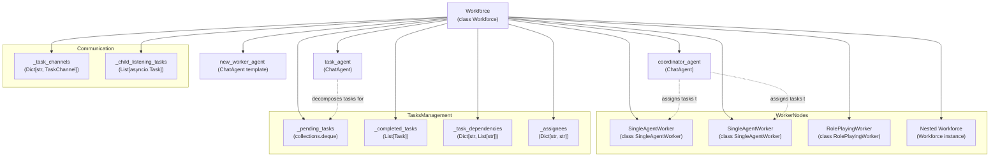
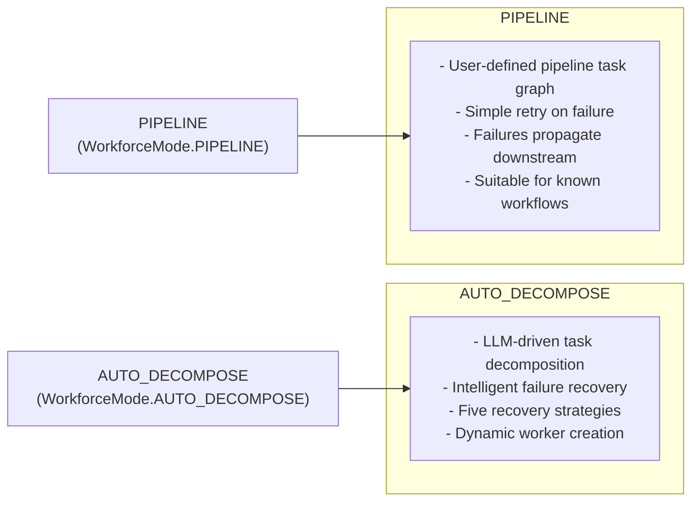
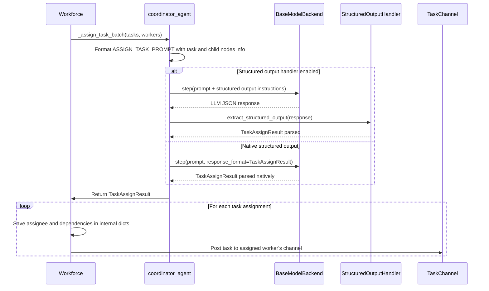
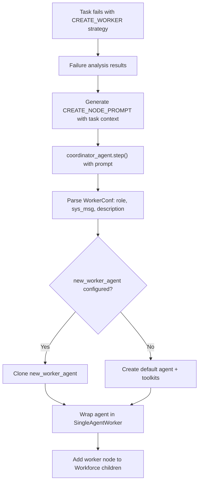
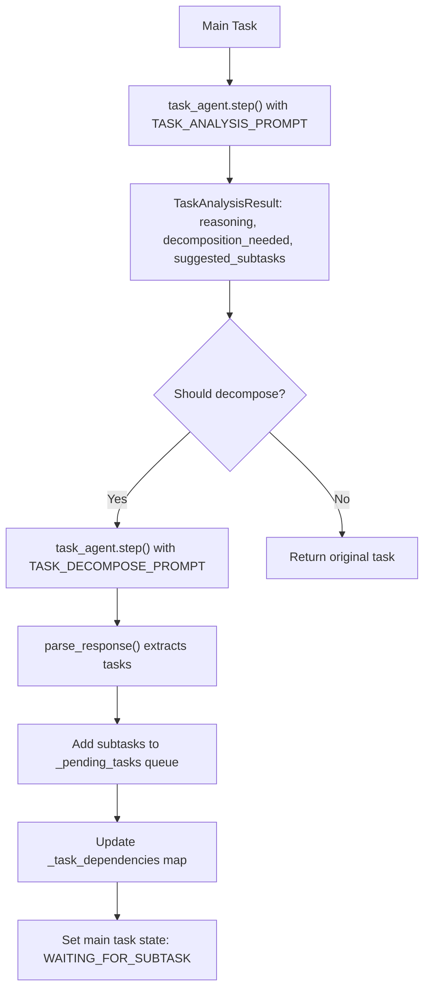
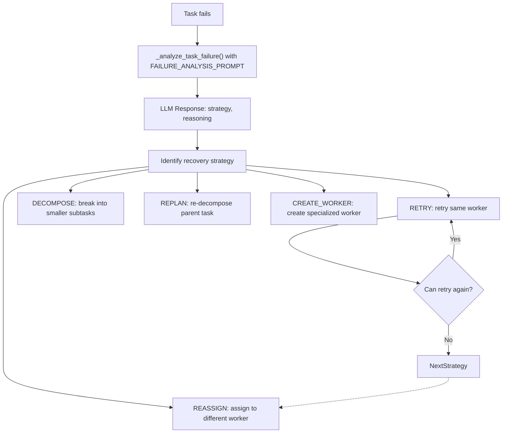
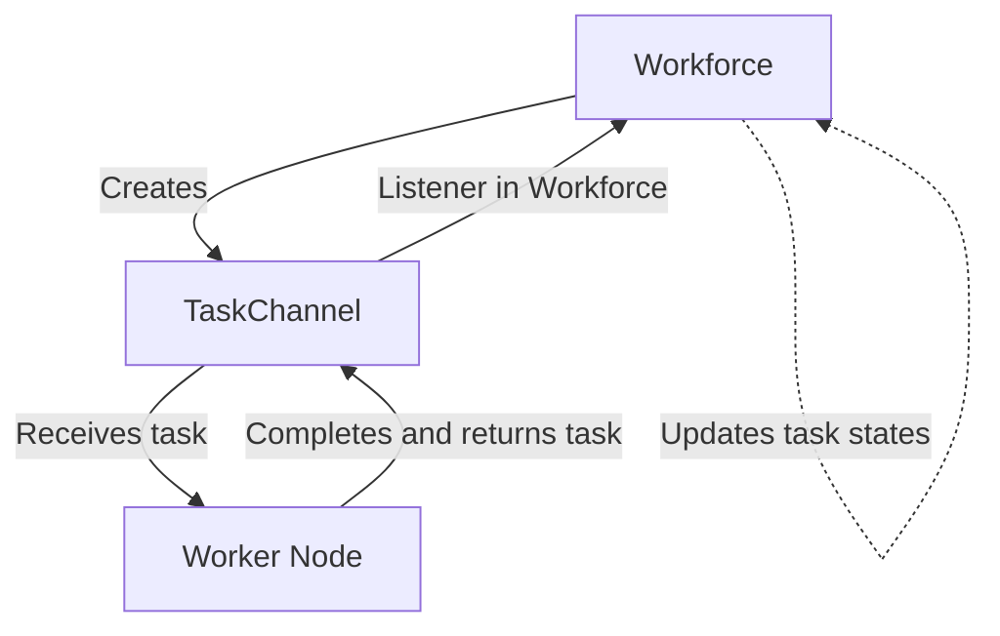
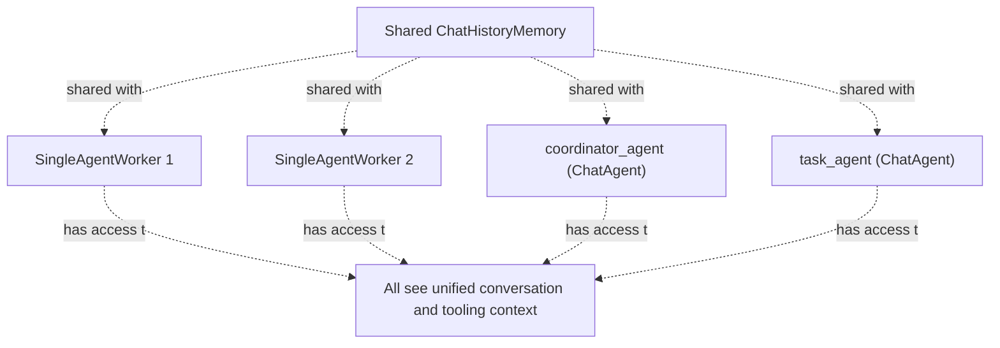

<!-- source: DeepWiki mcp.deepwiki.com · repo camel-ai/camel · page 2.5 Workforce Orchestration · fetched 2026-10-29 -->

# Workforce Orchestration

Relevant source files

The following files were used as context for generating this wiki page:

- [camel/societies/workforce/__init__.py](camel/societies/workforce/__init__.py)
- [camel/societies/workforce/prompts.py](camel/societies/workforce/prompts.py)
- [camel/societies/workforce/role_playing_worker.py](camel/societies/workforce/role_playing_worker.py)
- [camel/societies/workforce/single_agent_worker.py](camel/societies/workforce/single_agent_worker.py)
- [camel/societies/workforce/task_channel.py](camel/societies/workforce/task_channel.py)
- [camel/societies/workforce/utils.py](camel/societies/workforce/utils.py)
- [camel/societies/workforce/worker.py](camel/societies/workforce/worker.py)
- [camel/societies/workforce/workforce.py](camel/societies/workforce/workforce.py)
- [camel/tasks/task.py](camel/tasks/task.py)
- [docs/mintlify/reference/camel.messages.base.mdx](docs/mintlify/reference/camel.messages.base.mdx)
- [docs/mintlify/reference/camel.models.modelscope_model.mdx](docs/mintlify/reference/camel.models.modelscope_model.mdx)
- [docs/mintlify/reference/camel.models.qwen_model.mdx](docs/mintlify/reference/camel.models.qwen_model.mdx)
- [docs/mintlify/reference/camel.societies.workforce.role_playing_worker.mdx](docs/mintlify/reference/camel.societies.workforce.role_playing_worker.mdx)
- [docs/mintlify/reference/camel.societies.workforce.single_agent_worker.mdx](docs/mintlify/reference/camel.societies.workforce.single_agent_worker.mdx)
- [docs/mintlify/reference/camel.societies.workforce.structured_output_handler.mdx](docs/mintlify/reference/camel.societies.workforce.structured_output_handler.mdx)
- [docs/mintlify/reference/camel.societies.workforce.utils.mdx](docs/mintlify/reference/camel.societies.workforce.utils.mdx)
- [docs/mintlify/reference/camel.societies.workforce.workflow_memory_manager.mdx](docs/mintlify/reference/camel.societies.workforce.workflow_memory_manager.mdx)
- [docs/mintlify/reference/camel.societies.workforce.workforce.mdx](docs/mintlify/reference/camel.societies.workforce.workforce.mdx)
- [docs/mintlify/reference/camel.societies.workforce.workforce_callback.mdx](docs/mintlify/reference/camel.societies.workforce.workforce_callback.mdx)
- [docs/mintlify/reference/camel.societies.workforce.workforce_logger.mdx](docs/mintlify/reference/camel.societies.workforce.workforce_logger.mdx)
- [docs/mintlify/reference/camel.societies.workforce.workforce_metrics.mdx](docs/mintlify/reference/camel.societies.workforce.workforce_metrics.mdx)
- [docs/mintlify/reference/camel.tasks.task.mdx](docs/mintlify/reference/camel.tasks.task.mdx)
- [docs/mintlify/reference/camel.toolkits.context_summarizer_toolkit.mdx](docs/mintlify/reference/camel.toolkits.context_summarizer_toolkit.mdx)
- [docs/mintlify/reference/camel.toolkits.task_planning_toolkit.mdx](docs/mintlify/reference/camel.toolkits.task_planning_toolkit.mdx)
- [docs/mintlify/reference/camel.utils.context_utils.mdx](docs/mintlify/reference/camel.utils.context_utils.mdx)
- [examples/benchmarks/browsecomp_workforce.py](examples/benchmarks/browsecomp_workforce.py)
- [examples/toolkits/async_browser_toolkit.py](examples/toolkits/async_browser_toolkit.py)
- [examples/workforce/eigent.py](examples/workforce/eigent.py)
- [examples/workforce/human_in_the_loop/simple_hotkey_demo.py](examples/workforce/human_in_the_loop/simple_hotkey_demo.py)
- [examples/workforce/pipeline_workflow_example.py](examples/workforce/pipeline_workflow_example.py)
- [examples/workforce/workforce_multitask_with_skip.py](examples/workforce/workforce_multitask_with_skip.py)
- [examples/workforce/workforce_shared_memory_validation.py](examples/workforce/workforce_shared_memory_validation.py)
- [test/workforce/test_workforce.py](test/workforce/test_workforce.py)

## Purpose and Scope

The Workforce system provides a coordinator-driven multi-agent orchestration framework within CAMEL-AI, enabling multiple worker nodes (agents) to collaboratively solve complex tasks. It combines intelligent task decomposition, task assignment, failure recovery strategies, and task result composition. This page offers a high-level overview of the core Workforce design, its two main execution modes, failure handling mechanisms, and the logging framework. 

More granular details on different worker node types are in [Worker Types](#2.5.1). Workflow memory management and workflow session persistence mechanisms are covered in [Workflow Memory](#2.5.2).

Sources: [camel/societies/workforce/workforce.py:1-310]()

---

## Architecture Overview

The central class is `Workforce`, which extends `BaseNode` and acts as a root orchestrator managing a set of child worker nodes (which can be either single-agent workers, role-playing workers, or even nested Workforce instances). 

Internally, the Workforce employs three specialized `ChatAgent` instances that cooperate to form a robust task coordination system:

- **Coordinator Agent**: Assigns tasks to workers based on their capabilities, manages dynamic worker creation, and monitors workforce status.
- **Task Planner Agent**: Responsible for decomposing complex tasks into subtasks and composing results for final outputs.
- **Dynamic Worker Agent Template**: Used to create new worker nodes dynamically at runtime when current workers cannot handle certain failure cases.

The Workforce maintains key data structures:

- Task queues: `_pending_tasks` (deque), `_completed_tasks` (list).
- Task dependencies: `_task_dependencies` (dict mapping from task IDs to their prerequisite task IDs).
- Task assignments: `_assignees` (mapping task IDs to assigned worker IDs).
- Communication channels: `_task_channels` (mapping from worker IDs to `TaskChannel` instances).
- Child workers: `_children` list (the active worker nodes).

### Diagram: Workforce Architecture and Code Entities

Sources: [camel/societies/workforce/workforce.py:176-310](), [camel/societies/workforce/prompts.py:17-82]()

---

## Execution Modes

The Workforce supports two primary execution modes, defined by the `WorkforceMode` enumeration:

- **AUTO_DECOMPOSE**: The default mode where task decomposition and failure recovery are managed dynamically by the LLM agents based on recovery strategies. This includes decomposing tasks, replanning, retrying, reassigning, or creating new dynamic workers as needed.
- **PIPELINE**: A mode where tasks follow a predefined pipeline with explicit dependency graphs. Task failure is handled with simple retry logic, and failed tasks can propagate errors downstream without auto decomposition.

### Diagram: WorkforceMode Overview

| Mode            | Description                                               | Failure Handling                                       | Typical Use Case                 |
|-----------------|-----------------------------------------------------------|-------------------------------------------------------|---------------------------------|
| AUTO_DECOMPOSE  | Dynamic, LLM-driven decomposition and recovery            | 5 strategies: RETRY, REASSIGN, DECOMPOSE, REPLAN, CREATE_WORKER | Complex and evolving workflows  |
| PIPELINE        | User pre-defines pipeline and dependencies explicitly     | Simple retry, failures continue with error propagation | Stable workflows, batch pipelines |

The mode can be configured during Workforce initialization or modified later via `set_mode()`.

Sources: [camel/societies/workforce/workforce.py:142-147](), [camel/societies/workforce/workforce.py:235-256](), [camel/societies/workforce/utils.py:236-245]()

---

## Coordinator Agent System

### Task Assignment Logic

The coordinator agent is responsible for assigning tasks to worker nodes by matching task requirements with worker capabilities. The assignment process involves:

- Formatting the assignment prompt (`ASSIGN_TASK_PROMPT`) including tasks info and worker node info.
- Executing LLM calls with structured output instructions or native structured output parsing to obtain precise JSON assignments (`TaskAssignResult`).
- Storing the assignment results in internal mappings and posting tasks to workers via their `TaskChannel`s.

### Diagram: Task Assignment Flow (Simplified Sequence)

`TaskAssignResult` contains a list of `TaskAssignment` entries with task IDs, assignee IDs, and dependencies.

Sources: [camel/societies/workforce/workforce.py:1087-1205](), [camel/societies/workforce/prompts.py:52-85](), [camel/societies/workforce/utils.py:169-206]()

### Dynamic Worker Creation

If failure recovery requires a specialized worker not currently available, the coordinator creates a new worker node dynamically using insights from failure analysis:

- Uses `CREATE_NODE_PROMPT` to query the LLM for role name, system message, and description of a new worker adapted to the failing task type.
- If a `new_worker_agent` template agent is provided, clones it; otherwise creates a default ChatAgent with toolkits like SearchToolkit, CodeExecutionToolkit, and ThinkingToolkit.
- Wraps the agent in a `SingleAgentWorker` and adds it to the workforce's children list.

### Diagram: Dynamic Worker Creation Process

Sources: [camel/societies/workforce/workforce.py:895-978](), [camel/societies/workforce/prompts.py:17-50]()

---

## Task Planner Agent System

### Task Decomposition

The task planner agent analyzes whether a complex task requires decomposition by generating a `TaskAnalysisResult`. If decomposition is needed:

- The agent decomposes the task into subtasks using the `TASK_DECOMPOSE_PROMPT`.
- Parses the subtasks from the LLM's markdown response.
- Newly created subtasks are enqueued in `_pending_tasks` and dependencies relations updated.
- Marks the main task as waiting for subtasks.

### Diagram: Task Decomposition Process

This process centralizes task management and enables hierarchical task execution.

Sources: [camel/societies/workforce/workforce.py:1444-1584](), [camel/societies/workforce/prompts.py:155-207](), [camel/societies/workforce/utils.py:195-208]()

---

## Failure Handling System

### Recovery Strategies

The Workforce handles task failures via a modular strategy system represented by the `RecoveryStrategy` enum, with five key strategies:

- **RETRY**: Retry the same task with the same worker.
- **REASSIGN**: Assign the task to a different capable worker.
- **DECOMPOSE**: Break the task into smaller subtasks.
- **REPLAN**: Re-decompose and replan the parent task.
- **CREATE_WORKER**: Create a new specialized worker to handle the task.

Upon failure, the Workforce:

- Uses the `FAILURE_ANALYSIS_PROMPT` to analyze the failure.
- Interprets the LLM output to select a recovery strategy with rationale.
- Executes the chosen strategy, either retrying, reassigning, decomposing, replanning, or worker creation.

### Diagram: Failure Recovery Strategy Flow

The framework respects maximum retry limits and can halt or continue based on configuration.

Sources: [camel/societies/workforce/utils.py:130-137](), [camel/societies/workforce/workforce.py:751-893](), [camel/societies/workforce/prompts.py:234-278]()

---

## Task Lifecycle and Communication

### Task State Machine

Tasks have a lifecycle defined by the `TaskState` enum:

| State   | Description                                 |
|---------|---------------------------------------------|
| OPEN    | Task is pending assignment or processing    |
| RUNNING | Task is currently being worked on            |
| DONE    | Task completed successfully with results    |
| FAILED  | Task failed processing                        |
| DELETED | Task removed from the workflow                |

This state machine governs transitions during execution and failure recovery.

Sources: [camel/tasks/task.py:204-210](), [camel/societies/workforce/workforce.py:1754-1852]()

### Task Channel Communication

Workers are connected with the Workforce via dedicated `TaskChannel` instances. Communication flow:

- On assignment, Workforce posts a task into the worker's `TaskChannel`.
- Worker asynchronously obtains tasks from its channel, processes them, and returns results.
- Workforce listens on channels for completed tasks, updating internal states and triggering dependent task processing.

### Diagram: Workforce TaskChannel Communication Schema

Sources: [camel/societies/workforce/task_channel.py:1-105](), [camel/societies/workforce/workforce.py:398-465](), [camel/societies/workforce/workforce.py:1854-1979]()

---

## Callbacks and Observability

### WorkforceCallback System

The Workforce supports extensible lifecycle event callbacks via the `WorkforceCallback` interface, allowing hooks into events like task creation, assignment, start, completion, failure, and worker node lifecycle events.

By default, a `WorkforceLogger` callback is attached if no other metrics-reporting callback is provided. This callback logs lifecycle events and collects metrics exposed by `WorkforceMetrics`.

Sources: [camel/societies/workforce/workforce_callback.py:1-115](), [camel/societies/workforce/workforce_logger.py:43-48](), [camel/societies/workforce/workforce_metrics.py:33](), [camel/societies/workforce/workforce.py:363-396]()

---

## Shared Memory Configuration

The Workforce supports enabling shared memory across all `SingleAgentWorker` instances as well as the coordinator and task agents by sharing their complete conversation histories and function call trajectories. This enriches context continuity for distributed task execution and handoffs.

### Diagram: Shared Memory Architecture Across SingleAgentWorkers

Note: Currently, only `SingleAgentWorker` types participate in shared memory. RolePlayingWorker and nested Workforce instances do not.

Sources: [camel/societies/workforce/workforce.py:540-564](), [camel/societies/workforce/single_agent_worker.py:228-239]()

---

This completes the high-level overview of workforce orchestration in CAMEL-AI. For concrete implementation, usage patterns, and detailed APIs, see the related child pages:

- [Worker Types](#2.5.1) — for deep details of `SingleAgentWorker`, `RolePlayingWorker`, and nested Workforce nodes.
- [Workflow Memory](#2.5.2) — for memory management, workflow summaries, and session management utilities.

---

# References

- `camel/societies/workforce/workforce.py:1-310`  
- `camel/societies/workforce/prompts.py:17-82`  
- `camel/societies/workforce/utils.py:130-245`  
- `camel/societies/workforce/workforce_callback.py:1-115`  
- `camel/societies/workforce/workforce_logger.py:43-48`  
- `camel/societies/workforce/workforce_metrics.py:36-70`  
- `camel/tasks/task.py:204-210`  
- `camel/societies/workforce/task_channel.py:1-105`  
- `camel/societies/workforce/single_agent_worker.py:228-239`

---

